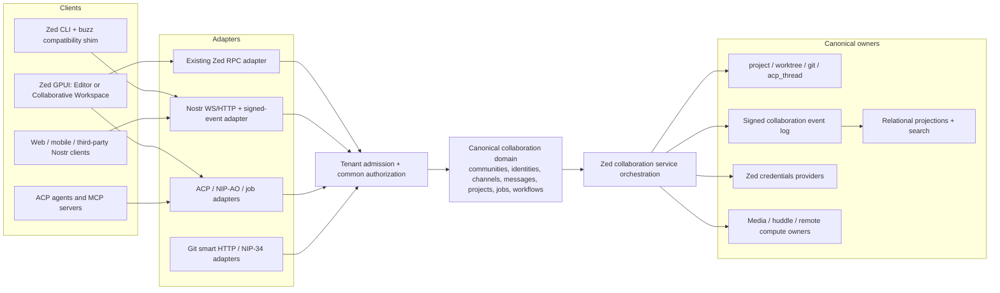
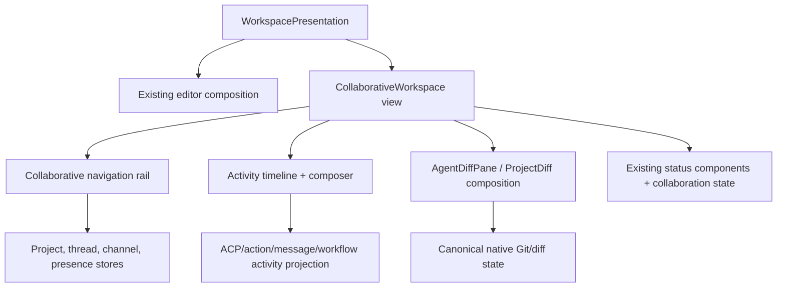
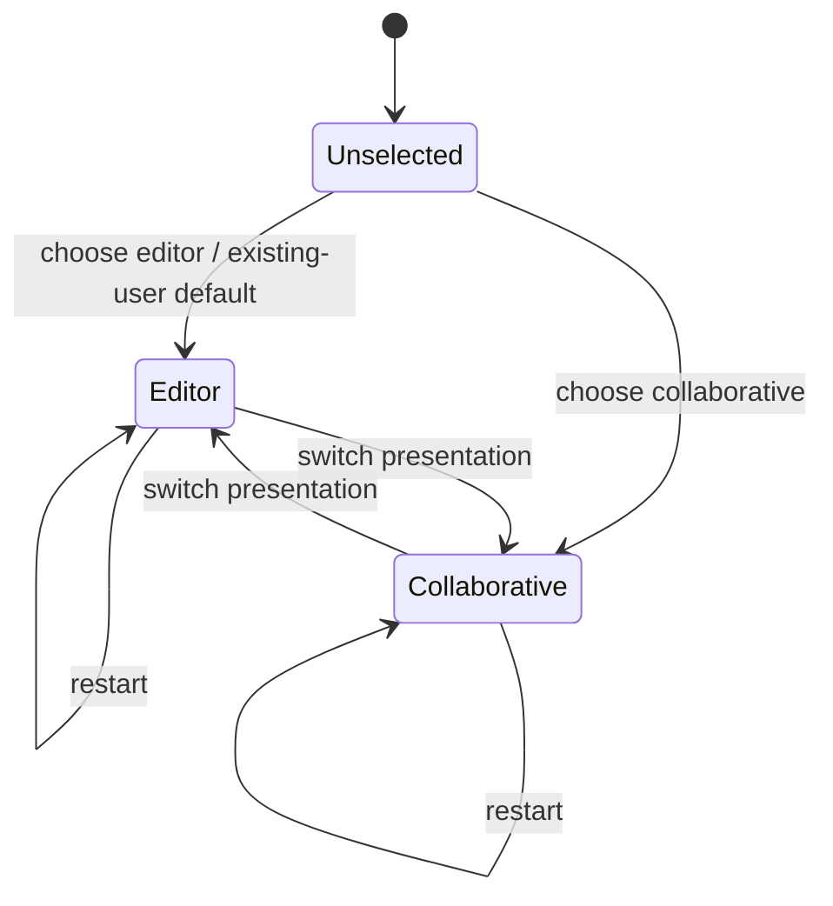

# Design: Collaborative Workspace and Buzz Consolidation

 ## Current New Thread navigation synchronization — Source147, acceptance pending

 `CW-NEW-THREAD-STALE-NAVIGATION-20261014` maps to tasks55.2/55.3/56.3/21.2. Source146 native Copper showed a New Thread title and composer while the sidebar retained an older completed-thread selection. That observed refresh mismatch remains separate from the inline terminal's bounded Source146 keyboard, restart, theme and selected-Stop evidence; those results do not validate Source147.

 The existing AgentPanel synchronizes its active conversation's canonical thread identity through `Workspace::navigate_collaborative_to`. A genuine focused conversation transition defers navigation until the panel update has finished, verifies that the active conversation still matches the captured entity, and rejects a stale, unregistered panel, mismatched project or non-Collaborative workspace. Initial composition repairs a current Thread or missing target, while preserving an explicit non-thread target such as a Channel. Repeated settled reconciliation uses the same canonical navigation owner and must leave history unchanged; a deliberate New Thread transition may leave a Channel for the actual new draft. No parallel selection, identity, history or persistence authority is introduced.
The same synchronization runs when entering Multiplayer through the existing Workspace presentation action: a feature-gated `Workspace::Event::PresentationChanged` is emitted after mode state, focus and serialization update, and the existing Zed subscriber calls the AgentPanel helper with explicit non-thread preservation. This closes the mode-entry edge where the Agent panel already existed before the presentation switch; it does not create a second mode or navigation authority. The existing production-composition/no-model owner regression now checks the current canonical draft identity after the real `SwitchToCollaborativeWorkspace` action. Standard builds receive no new event path.

 Acceptance requires the real New Thread entry point to agree across title, integrated input, sidebar selection and current canonical thread identity; idempotent history; stale-callback, panel and project fences; preservation of explicit Channel selection during background hydration; and the existing startup/new-draft persistence lifecycle. Mounted owner tests must exercise initial Thread/None reconciliation, actual focused New Thread navigation, repeated reconciliation and explicit Channel preservation. Matched real Delta/current repository-built Copper must verify New Thread followed by inline terminal entry, focus and history at the same state, including mode entry and normal restart. A fresh profile must prove no historical dock shell is restored; Source146's preserved profile with an older dock does not satisfy that check. The approved live-provider terminal submission/history journey also remains open. Existing inline PTY, Unicode, keyboard, Stop and persistence assertions remain required; Standard isolation and Buzz domain ownership remain intact.

 The four final production-owner changes are installed in Source147; the immutable current packet now has43 owners. Controller-recorded formatting across all four owners and diff checks passed0; Source147 runtime, normal application build and native acceptance remain unvalidated. Required affected owner tests, `./script/clippy`, full Standard/Multiplayer checks, current executable provenance and matched native workflows remain open. Source146 Copper captures21/22 for themes,13/14 for restart, keyboard and selected-Stop retain Source146 attribution. No task checkbox, product parity or delivery status is promoted; authenticated collaboration remains deferred. See the [durable checklist](remediation-checklist.json); earlier text below retains historical attribution.

 <!-- impl: crates/agent_ui/src/agent_panel.rs#AgentPanel::synchronize_collaborative_thread_navigation -->
 <!-- impl: crates/agent_ui/src/agent_panel.rs#AgentPanel::set_base_view -->
 <!-- impl: crates/zed/src/zed.rs#subscribe_to_collaborative_review_agent_panel -->
 <!-- impl: crates/workspace/src/workspace.rs#Event::PresentationChanged -->
 <!-- impl: crates/workspace/src/workspace_presentation_actions.rs#Workspace::switch_workspace_presentation -->

## Current inline keyboard registration and test capability — Source145, acceptance pending

The canonical Agent owner binds Ctrl-backtick only in an enabled Multiplayer conversation, with AI enabled and a default base keymap. The normal application keymap reload restores that scoped binding after built-in defaults and before user overrides; explicit user bindings remain authoritative. Standard keeps its Workspace terminal-dock shortcut. The integrated conversation still mounts the canonical Project/TerminalView PTY rather than a separate dock or output card.

The canonical Agent binding helper routes editing and navigation keys in `CollaborativeConversation > Terminal` to TerminalView's existing SendKeystroke action, preventing an embedded PTY from activating the surrounding draft Editor's bindings. User keymap overrides remain authoritative, and Standard bindings remain isolated. The canonical Terminal owner maps live keys to the PTY and retains output selection for read-only history. Application tests suppress automatic Agent panel creation while retaining explicitly mounted panels when AI is enabled; real disabled-AI settings still tear down those panels. Mounted owner acceptance checks require actual PTY Backspace and navigation input with the Unicode draft and insertion fingerprint unchanged. The Source144 test exposed draft mutation after actual inline entry and PTY typing; matched Delta/Copper native keyboard acceptance remains separately required.

TerminalView's existing `test-support` capability forwards the canonical Terminal test capability so consuming application tests can verify the actual PTY input recipient. This is test-only instrumentation; normal application builds retain their production feature graph. Source140's new mounted keyboard test exposed the missing propagation at compilation (`take_input_log` unavailable); zero tests ran. Source141 repairs the existing feature edge without changing assertions or test commands. Mounted regressions require actual keyboard input before/after production reload, Unicode/cursor preservation, one inline execution and no dock, user override precedence, selected Stop and independent child cleanup. Disabled Agent, AI, BaseKeymap::None and Standard isolation remain separately asserted.

Fresh Delta observation placed a focused live shell inline from Ctrl-backtick, retained it on Escape, and supported disclosure, per-terminal Scroll to Terminal and Stop Process. Source139 Copper's command entry, real PTY input, focus/Escape and disclosure/reentry worked, while its shortcut fell back to a dock. Source141 matched native comparison, runtime tests, affected `./script/clippy`, product profiles, normal Copper build and delivery remain required. Tasks21.2/55.3/56.3/59.6 stay partial; authenticated Buzz collaboration remains deferred. Current results belong in the [durable checklist](remediation-checklist.json), with [closed Source139 evidence](../../evidence-archives/collaborative-workspace/current139-focused52-clippy15-normal-mp-cleanup-closed-20261014/README.md) retained as predecessor proof.

<!-- impl: crates/agent_ui/src/agent_ui.rs#bind_keys -->
<!-- impl: crates/zed/src/zed.rs#reload_keymaps -->
<!-- impl: crates/terminal_view/Cargo.toml#[features] -->

> Evidence archive note (2026-09-23): Historical `test-results/collaborative-workspace/` paths in this specification are retained at the immutable [collaborative-workspace-evidence-2026-09-23 archive](https://github.com/simtropolis/made/blob/collaborative-workspace-evidence-2026-09-23/.agents/evidence-archives/collaborative-workspace/README.md). The [checksum manifest](https://github.com/simtropolis/made/blob/collaborative-workspace-evidence-2026-09-23/.agents/evidence-archives/collaborative-workspace/summary.json) maps every tracked evidence file; linked evidence below points into that snapshot. Local generated `test-results/` files are ignored on current branches.

## Current inline terminal focused-block lifecycle — source111, acceptance pending

The canonical Editor retains its existing weak focused-block record during recursive block-height measurement and resize retries. `Editor::focused_block` clones this record for measurement; it does not consume the seed needed to include a focused child whose block moves outside the measured viewport. `EditorElement` consumes the record only once the final block prepaint can publish the child focus path. Existing block/live-view and focus identity remain the authority; this uses no GPUI production change, parallel focusmanager or asynchronous refocus.

The source111 correction is owned by [Editor](../../../crates/editor/src/editor.rs), [EditorElement](../../../crates/editor/src/element.rs) and [the existing Editor tests](../../../crates/editor/src/editor_tests.rs). It preserves strict real child keyboard focus, measured-offscreen resize, explicit blur and removed-block handling, while keeping the existing File workflow assertions. Tasks21.2/55.3/56.3/59.6 and criteria4.1/4.4/9.3 retain their required clean-source owner/profile/lint/normalproduct/matchednative evidence. Installed source [manifest](/private/tmp/current111-focused-block-measurement-lifecycle-20261012/candidate/manifest.json) SHA256 `a8d596507e192b6905df2b1bdd0d35eac5b6967b2177646d78706ec597edfb01` /EApatch `72e577be5998b0a2602c86960df626af358b388b932bbd176279407a0c135e62`; owner retry closed by the original10GiB reserve during coldcompilation beforetests. Implementation remainsunvalidated; no behavioral acceptance, productionfailure or taskcompletion inferred. Earlier109/110 passive traces and failed focus witness are historical observations, not a duplicate-key/truncation cause proof.

## Current product direction — 2026-10-03

Delta owns UI structure and observed interaction patterns; Buzz owns collaboration
capabilities and domain semantics; Fractal owns typography, icons, colors, spacing
and controls. [The tracked Delta parity matrix](delta-parity-matrix.md) distinguishes
native observation from assumptions and unavailable flows, and maps each flow to
existing owners, tasks, acceptance criteria, gaps and required evidence. Onboarding
text and historical reports are reference material. Preserve the prior references;
compare the latest conversation reference for collapsed review and Image 2 for
expanded review, recording and reconciling any conflict explicitly.

The user selected keeping Multiplayer active and showing a selected native dock
alongside it. Do not switch to Editor to make a status-popover panel action work.
Reuse existing dock entities and persist requested visibility; do not show all
historically open Editor docks in the default Multiplayer composition. This
corrective implementation now routes canonical panel actions through the visible
workspace and mounts only explicitly requested native dock positions. The existing
layout KVP owner persists mount requests; native Dock persistence retains open
state, active panel and size. Closing returns focus to visible Multiplayer content.
Measured collaborative bounds are applied immediately; a deferred repaint after
prepaint prevents stale conversation geometry when a selected dock closes. Native
panel activation waits for the mounted dispatch tree before focusing its active
item.

Owner tests cover first toggle of a historically open but hidden Editor dock,
canonical panel action focus and persisted mount requests. Fresh native qualification
of the rebuilt product is pending. The separately mounted composer band is
also pending reconciliation with Delta's observed inline input.

The full goal stays active after scoped checkpoints. Authenticated Made/Buzz
collaboration is deferred. Native Delta observation is reference evidence, not
repository-built Made acceptance or authenticated Buzz workflow evidence.

### Restored execution outcomes

The canonical ACP thread records Unknown, Running, Completed, Cancelled, Failed
or Interrupted through its actual turn lifecycle. ThreadMetadataStore persists a
derived snapshot in its existing sidebar database, including status transitions;
no additional execution or participant authority is introduced. Local root-session
restoration matches the same thread/session identity and restores only into an
idle, unknown ACP outcome. Saved Running is restored as Interrupted, with no
running process implied. Legacy rows and cross-channel imports without this field
remain Unknown. Hosted collaboration continues to use its canonical service owner.
Unloaded navigation and task rows project recorded outcomes rather than defaulting
to Completed; current live status takes precedence. Cancel, error, success and
superseded-turn completion preserve distinct outcomes. An older completion cannot
emit current-turn error/refusal/stop events or truncate a newer prompt.

Owner and SQLite evidence must include a real native no-model failure, a flushed
database reload and newly loaded ACP session, legacy import without schema writes,
and current/stale completion and cancellation. This proves bounded persistence
behavior; native restart and same-state Delta comparison remain separate gates.
<!-- impl: crates/acp_thread/src/acp_thread.rs#ThreadExecutionOutcome -->
<!-- impl: crates/agent_ui/src/thread_metadata_store.rs#ThreadMetadata -->
<!-- impl: crates/agent_ui/src/conversation_view.rs#new_thread_view -->
<!-- impl: crates/sidebar/src/collaborative_tasks.rs#task_rows -->

## Full remediation resumed — 2026-09-19

The user resumed the full collaborative-workspace remediation. The September 12
UI-only stop/pause boundary below is historical and superseded. Continue every
independent implementation and validation task, with periodic coherent validated
commits and normal pushes to `origin/dev`, preserving unrelated work and safely
integrating remote changes. Do not force-push. Deployment, destructive migration,
source retirement and reference replacement remain unauthorized.

Computer Use is authorized; fresh native checks must use the current repository's
Made/Copper executable with recorded provenance. Authenticated collaboration
access remains deferred. Docker access supported the disposable SQL interruption,
rollback and resume smoke on September 19. Fresh September 20 probes return
`Docker Desktop is unable to start`; new SQL execution awaits engine recovery.
The historical September 20 Computer Use check reported the Mac locked. Current
October native access and responsive observations supersede that access state;
Docker SQL/physical-standby validation and owned-resource cleanup also now pass.
Maintain historical September evidence in
`test-results/collaborative-workspace/remediation-20260919/task-checklist.json`.
Full task completion, visual parity and functional parity are still unverified.

## Desktop message response admission — 2026-09-19

The Multiplayer channel adapter checks protocol versions, channel scope, binary
identity lengths, bounded pages and cursor consistency before applying responses.
Accepted receipts must identify the pending operation and message; malformed
responses retain the draft and retry state and surface an error. The adapter updates
its paging cursor and edit targets only after the timeline accepts the data.
A reconnected head replaces completed history through MessageTimeline's existing
transactional update, preserving newer observed entries and pending reconciliation.
The complete collab_ui owner suite passes (59 tests), including malformed-response
draft retention and completed-history reconnect regressions. Network-WebSocket and
authenticated native-service evidence remain open; see the September 19 audit.
<!-- impl: crates/collab_ui/src/channel_messaging.rs#apply_page -->
<!-- impl: crates/collab_ui/src/message_timeline.rs#replace_history_head -->

## Historical checkpoint authority — 2026-09-12

The latest user instruction narrows remediation to the UI batch already in progress.
It authorizes local validation, a scoped commit, safe integration of newer
`origin/dev` changes and a normal push, then stopping and pausing the standing goal.
Broader service, CLI, client and collaboration integration work is deferred by scope.
Deployment, destructive migration, source retirement and reference replacement
remain excluded. Historical permission text below is not current authority.
Computer Use is authorized; authenticated collaboration access remains deferred.
The goal API cannot pause and Computer Use denies Codex itself; the user must
operate the goal pause control. This is a checkpoint, not full remediation completion.

Image 2 governs layout and behavior while Fractal typography, icons and density
remain authoritative. Review provider selection moves to an accessible menu beside
Review Changes. A single native pane's existing file tabs share that header row;
split panes retain individual native tab bars. Pane retains item, selection, close,
drag and context-menu ownership. This resolves the historical selector conflict.
The UI batch is implemented and validated as a checkpoint; full visual/functional
parity remains partial, with exact native and density gaps in checkpoint.md.

Direct inspection of the expanded reference shows excerpt expansion arrows,
contrary to the September 11 audit's absence claim. Retain those controls. Compact
project review omits redundant per-file stage checkboxes, per-file totals and
colored Git gutter markers while retaining native hunk commands, context actions
and global totals. Editor presentation restores its usual controls without changing
settings. Compact multibuffer review also reduces unused right gutter padding,
preserving the left excerpt-control hit area and line-number width. Fresh captures
and action validation remain required.

Restoration reconciles a saved native-editor presentation after item deserialization.
An unavailable saved item kind reproduces the empty native pane through the actual
Workspace::load_workspace path; a valid TestItem verifies successful restoration
retains native presentation. The registered review provider remains the same entity.
This is deterministic GPUI/SQLite fixture evidence, not normal-app restart evidence.

<!-- impl: crates/workspace/src/workspace.rs#Workspace::load_workspace -->
<!-- impl: crates/workspace/src/collaborative_review.rs#CollaborativeEditorTabs -->
<!-- impl: crates/editor/src/config.rs#set_compact_diff_presentation -->

Native F6/Shift-F6 region navigation uses the currently visible Collaborative
navigation, timeline, composer, review and status regions, plus the title toolbar.
Hidden Editor docks and center panes are excluded. Exact focused handles and then
the most specific containing region resolve the nested composer/timeline case.
Editor presentation retains its existing region list and native editing keys.
Timeline and review landmarks use the theme's focused-border token when keyboard
focus lands on their containers; nested native editor focus retains its caret.
<!-- impl: crates/workspace/src/workspace.rs#Workspace::focusable_parts -->

## Local audit corrections — 2026-09-10 (verification in progress)

The current request authorizes local audit, implementation and verification only. The user confirmed on 2026-09-10 that Fractal typography, icons and density remain authoritative; Image 2 determines layout and behavior. The current Image 2 is the intended final composition; Image 1 is the empty-state reference. Historical reports, screenshot text, past Computer Use restrictions and past commit/push instructions are reference material, not current authorization. Verified commits and normal pushes to origin/dev are now authorized at coherent validated checkpoints; newer remote work must be integrated without force-pushing. Source retirement, production deployment and destructive migration remain outside this request. Canonical Cloud identity access and two-account authenticated verification were deferred by the user; other verification continues.

The Collaborative layout mounts the existing native `StatusBar` below the composer within the timeline column. The review column extends alongside that footer to the bottom of the workspace. Editor presentation keeps the same status-bar entity in its original outer position; `status_bar.experimental.show` controls either mount. Narrow or collapsed review layouts give the conversation and footer the released width. This is a composition change, not another status or project owner. The review heading, accessible provider menu and native opened-file tabs occupy a title segment above their pane, following the September 12 decision; the segment uses the same review geometry as the body and disappears when review is collapsed or the viewport is narrow. Review and Editor layout controls remain reachable in either layout. Hidden status bars are excluded from the collaborative focus handles. The September 10 checkpoint recorded 92 passing focused collaborative regressions and both eight-variant controlled rendering suites; that historical evidence establishes its local header/footer correction, not acceptance of later changes. Current evidence lives in the remediation ledger and full reference parity remains incomplete.

The Multiplayer composer's ACP configuration controls use a cached single-row presentation of the existing native selector entities. The presentation observes the configuration owner through a weak handle, so server metadata refreshes remain owned by `ConfigOptionsView`; the regular composer retains wrapping. Individual controls are capped to the viewport and remain horizontally scrollable. Native select and boolean triggers participate in tab navigation, and focus entering a selector schedules scrolling after the current draw effect cycle. The presentation introduces no second configuration store. Scoped GPUI validation covers long controls, active-window focus scrolling, wider density, provider refresh and native picker selection/cancellation. A stronger boolean visibility regression subsequently found its native switch beyond the clipped row despite successful keyboard activation. The boolean container now opts into native label truncation while reserving switch width and retaining the full accessible label and tooltip; the corrected scoped regression and20-seed sweep pass, while production-rendered focus navigation still requires a real active host window. Physical native acceptance remains open. <!-- impl: crates/agent_ui/src/config_options.rs#SingleRowConfigOptions --> <!-- impl: crates/agent_ui/src/conversation_view/thread_view.rs#render_collaborative_composer_footer -->

<!-- impl: crates/workspace/src/collaborative_layout.rs#render_timeline -->
<!-- impl: crates/workspace/src/workspace.rs#Workspace::render -->

The review host retains the preferred provider independently of the temporarily available provider. The existing workspace layout record also stores the canonical ProjectDiff `DiffBase`; restoring the view applies that value to the native DiffBufferList. No separate diff or transcript owner is introduced. Unavailable preferred providers may fall back visibly and recover their preference when registered again.
<!-- impl: crates/workspace/src/collaborative_review.rs#preferred_slot -->
<!-- impl: crates/workspace/src/collaborative_layout_persistence.rs#CollaborativeLayoutState -->
<!-- impl: crates/git_ui/src/collaborative_review.rs#register_in_workspace -->

Task child rows project the native ACP tool-call subagent session links, including nested sessions, into the collaborative rail. Navigation uses the retained ConversationView. Collapse state is stored with the parent in the existing ThreadMetadataStore task-organization record; absent fields default to expanded. Unavailable child sessions report an error and never open an unrelated root. Live membership and attribution still require authenticated service evidence.
<!-- impl: crates/sidebar/src/collaborative_tasks.rs#conversation_subtasks -->
<!-- impl: crates/agent_ui/src/thread_metadata_store.rs#TaskOrganization -->

The migration release manifest includes the existing 20260826000100 message-transport pair and the committed 20260930000100 room authorization generation pair, which depend on the separately owned native users/channels/rooms schema. Canonical runtime compatibility and chart schema ceilings target20260930000100; writes against the earlier transport-only schema must fail closed. The disposable migration smoke initializes its shared native schema from the existing canonical test schema; this is not production bootstrap or permission to migrate live data. Current23-pair static coverage is verified, while corrected compatibility owner tests and fresh disposable SQL/crash/cleanup acceptance remain pending.
<!-- impl: deploy/collaboration/migrations/manifest.json -->

The inventory checker includes the final coverage join: every CAP row must include all mapped leaves (including corrective work), their criteria and exact source rows. A `complete` row with unfinished tasks is rejected. Passing this structural checker does not establish semantic completion; catalog statuses remain partial or unverified until sufficient current evidence exists.
<!-- impl: .agents/specs/collaborative-workspace/scripts/check-inventory.py#_check_final_coverage -->

The native capture runner gives RealFs-backed settings a disposable profile rather than writing to the test user's missing home directory. Each variant writes the same appearance configuration to that profile and the settings store; capture-time checks verify the actual active theme and font sizes after application actions. The normal application is separately built without visual-test features. Its isolated database records are inspected before/after restart and a Standard-profile launch without injecting state. These checks do not replace authenticated two-client or host-window evidence.
<!-- impl: crates/zed/src/visual_test_runner.rs#run_collaborative_workspace_visual_tests -->

## Overview

The target is one Zed product with two native workspace presentations and one canonical owner per aggregate. Existing Zed workspace/project/Git/ACP components remain authoritative for local development. Buzz's signed-event collaboration semantics are ported into a UI-independent domain and service layer, while Nostr, existing Zed RPC, CLI, web, mobile and temporary legacy processes become adapters around that domain.

The transition is deliberately incremental. Milestone 1 ships a useful GPUI vertical slice without waiting for server consolidation. Later milestones add the canonical collaboration domain, protocol/service foundations and complete Buzz parity. A temporary Buzz-compatible service boundary is allowed only during migration; the final deployment owner is the Zed collaboration platform after ADR-001.

## Existing context

- `workspace`, `onboarding`, `sidebar` and `ui` already own GPUI windows, panes, docks, persistence, focus, themes and the first-run flow.
- `project`, `worktree`, `project_panel`, `git` and `git_ui` own local files, worktrees, repositories, index/working-tree state and native diff/review surfaces.
- `agent`, `acp_thread`, `action_log`, `agent_ui`, `agent_servers` and tool-permission stores own native agent execution, ACP sessions, transcripts, tool activity and cancellation. The approved ACP prompt-reentrancy spec remains binding.
- `channel`, `collab_ui`, `client`, `rpc`, `proto`, `session`, `livekit_client` and the `collab` service already implement accounts, channels, rooms, presence-like state, project sharing and production WebSocket/RPC/Postgres infrastructure.
- The existing `collab` binary uses Axum 0.6, SeaORM 1.1.10 and SQLx 0.8; Buzz currently uses Axum 0.8 and SQLx 0.9. Directly merging manifests before dependency alignment is unsafe, which motivates the bounded sidecar phase in `migration-plan.md`.
- Buzz's `buzz-core` is zero-I/O and contains the most complete audited signed-event/tenant rules. `buzz-relay` is the orchestration point around SQLx/Postgres, Redis, S3/Blossom, Git, workflows, audit, push and audio. Its desktop is React/Tauri and must not become a GPUI architecture template.
- Existing specs under `.agents/specs/goose-migration` and `.agents/specs/acp-thread-prompt-reentrancy` constrain agent infrastructure, tool permissions, prompt lifecycle and security. `telemetry-disabled-default` prevents Buzz-derived client code from re-enabling telemetry.

## Target architecture

The diagram shows logical ownership, not a requirement that all components run in one process. Adapters may be separate listeners or binaries; they cannot author independent domain state.

## Design decisions

### D1. Canonical domain by aggregate, not by legacy product

- **Responsibility:** Define commands, entities, stable IDs, state transitions, authorization inputs, projection events and versioning for communities, identities, channels/messages, shared projects/Git records, jobs, workflows, audit references, media/huddles and presence.
- **Integration:** The domain is UI-free and I/O-free. Existing Zed types remain canonical for local project/Git/ACP aggregates. Buzz-derived collaboration types are moved from `buzz-core` only where no suitable Zed type exists. Nostr encoding stays in a protocol adapter.
- **Rationale:** Neither current `proto` nor client-side `channel` is a suitable shared server/client domain owner, while copying `buzz-core` intact would preserve Buzz as a second product. A narrow collaboration-domain boundary is a justified new logical component.
- **Constraint:** Accepted ADR-001 fixes `collab` as the final service owner and permits only its documented bounded Nostr sidecar; implementation beyond the vertical slice must follow that dependency and removal boundary.

### D2. Provenance-aware authoritative records

Each aggregate declares one authoring source:

| Aggregate | Authority | Derived/compatibility state |
| --- | --- | --- |
| Local files/worktrees/index/diffs | Zed `project`/`worktree`/`git` | NIP-34 patches/status and timeline cards |
| Native ACP session/transcript/actions | `agent`/`acp_thread`/`action_log` | NIP-AO frames, channel messages and activity projections |
| Nostr-authored channel/message/social/workflow records | Verified signed event log | SQL search/timeline/member/read projections and GPUI stores |
| Service-issued membership, summaries and bounds | Authorized collaboration service | Relay-signed event representation and RPC payloads |
| Service account | Zed user/account service | Explicit Nostr-key bindings |
| Collaboration keys | Zed credentials provider | Pairing/backup/import formats |

Projection rows carry `source_kind`, `source_id`, `source_version`, `community_id` and `projected_at`. A projection cannot accept a direct write that bypasses its command/event authority. Drift checks rebuild or compare projections from authoritative records.

Projection checkpoints preserve the domain provenance vocabulary as bounded source system, record ID, optional source version, observation time and paired integrity reference; they add a projection-local version, reset generation, opaque 64-KiB resume cursor, projected time and closed drift state with optional authoritative/projection hashes. The community-leading source key is immutable and protected by forced RLS with the common restrictive tenant predicate. Every update must advance `projection_version` by exactly one or PostgreSQL raises a serialization failure, preventing a stale worker from overwriting a newer checkpoint even if it omitted a defensive version predicate. A reset may hold or increment its generation by one; an increment must atomically enter `reset_pending`, clear the cursor and record reset time, fencing pre-reset workers. Diverged state requires two distinct 32-byte hashes, clean state cannot retain an error, and all scan/source indexes lead with community. The rebuild orchestrator installs that tenant fence, loads bounded authoritative rows through an aggregate adapter, deterministically sorts and length-prefix-hashes source identity, source version, row count, row keys and payloads, replaces only the selected derived aggregate, reads it back and records equal clean hashes or unequal drift hashes plus a bounded content-free summary. Authority reads, projection replacement, comparison and checkpoint upsert share one transaction; adapter or storage failure rolls back the projection and checkpoint without an authority write. Re-running the same source therefore produces identical projection bytes and hashes while advancing only the optimistic checkpoint version. <!-- impl: crates/collab/migrations/20260820000300_collaboration_projections.up.sql --> <!-- impl: crates/collab/src/db/collaboration/rebuild.rs#ProjectionRebuilder --> <!-- impl: crates/collab/tests/collaboration_projection_rebuild.rs#collaboration_projection_rebuild_is_deterministic_and_does_not_mutate_authority -->

The UI-free `collaboration_domain` foundation represents canonical aggregate identity as an explicit community, aggregate type and UUID tuple; sharing a raw aggregate UUID across communities does not make the identities equal. Deterministic UUIDv5 import IDs preserve stable compatibility references without granting authority, while strictly positive ordered aggregate versions and bounded source provenance retain source system, record/version, observation and optional integrity metadata. These types perform no I/O, protocol decoding, authorization or GPUI work. <!-- impl: crates/collaboration_domain/src/identity_types.rs#ScopedAggregateId --> <!-- impl: crates/collaboration_domain/src/provenance.rs#Provenance -->

The lower-layer dependency contract is executable. `collaboration_domain` and `nostr_compat` declare their architectural layer, exact non-dev direct-dependency allowlist and the GPUI, storage and transport capability classes they forbid. The boundary checker includes normal and build dependencies, ignores dev-only fixture tooling, requires exact allowlist agreement and traverses locked Cargo metadata so an indirect forbidden package fails as decisively as a direct dependency. <!-- impl: script/check-collaboration-dependencies -->

### D3. Protocol adapters preserve exact wire behavior

- **Nostr:** The adapter owns event serialization, signing/verification, kind/tag validation, filter translation, NIP-01 frames, NIP-11/05, NIP-42/98, NIP-CW cursors/overlays and all Buzz NIPs. It calls domain commands only after admission/auth. It may return signed compatibility projections without changing domain ownership.
- **Zed RPC:** Existing clients continue through `client`/`rpc`/`proto`. New collaborative RPC messages carry domain IDs and versions rather than Nostr JSON where no compatibility is required.
- **ACP/MCP:** Zed's native ACP runtime remains authoritative. Channel mentions, NIP-AO frames and signed jobs translate into session/job commands. MCP tools remain subject to Zed permissions and sandbox policy.
- **Git:** Git smart HTTP and NIP-34 translate hosted-repository operations and signed review records. Local repository state is never reconstructed from a chat projection.

Unknown versions fail before writes. Compatibility adapters are independently tested against Buzz fixtures and old clients.

The Zed-owned command boundary carries one current contract version, stable operation ID, admitted tenant and principal, optimistic expected/predecessor versions, originating adapter and typed payload. Its receipt reports the authoritative version and an applied-or-duplicate disposition, allowing adapters to preserve idempotent protocol acknowledgements without an adapter-owned replay store. A `DomainCommandSink` is the only mutation-facing listener interface; its Postgres implementation owns the transaction around the injected canonical mutation, durable receipt and outbox operation. The Nostr ingress accepts only the current bounded adapter version, rejects invalid peer minimums before invoking the sink and consumes the existing admission token to construct the command. In-process and temporary-sidecar origins remain explicit for compatibility metrics, but both call the same sink contract; neither origin receives storage, migration or projection authority. <!-- impl: crates/collab/src/collaboration_command.rs#DomainCommand --> <!-- impl: crates/collab/src/collaboration_command.rs#DomainCommandReceipt --> <!-- impl: crates/collab/src/nostr/ingress.rs#VersionedNostrIngress --> <!-- impl: crates/collab/src/db/collaboration/outbox.rs#TransactionalCommandOutbox -->

NIP-42 connection authentication is a terminal state machine over one redacted 32-byte challenge and five-second response deadline. It verifies kind 22242 event ID, signature and ±60-second freshness through `nostr_compat`, requires exactly one matching challenge and normalized relay tag, optionally verifies one NIP-AA owner attestation, then atomically claims a community/event replay key before resolving a current authorized principal. The injected resolver owns active membership, binding and revocation reads; its output must remain in the row-zero tenant, match the event author and retain NIP-42 provenance. Success retains the actual key principal; timeout closes without a response, same-connection reauthentication and post-failure attempts preserve Buzz's closed reasons, and invalid, restricted or infrastructure outcomes map to bounded protocol dispositions without persisting or logging the AUTH event. The replay and resolver traits deliberately have no permissive default: Task 16.1 supplies shared expiring runtime storage and the membership repositories supply authoritative identity decisions. <!-- impl: crates/collab/src/nostr/auth.rs#NostrConnectionAuthenticator --> <!-- impl: crates/collab/src/nostr/auth.rs#NostrAuthReplayStore -->

The shared Redis authentication replay owner implements both NIP-42 and NIP-98 claims with one community/event key namespace and atomic expiring `SET NX EX`. It keeps the fence through the inclusive last freshness second, rejects expired or excessive lifetimes before I/O, and has no memory fallback. NIP-42 verification and asynchronous replay/resolution share the remaining original challenge deadline. The common connection owner decodes URL credentials, selects the configured database, accepts IPv6 literals and verifies platform trust plus hostname for `rediss`; unsupported options reject without plaintext fallback. Publish and subscription setup have bounded I/O, while active quiet subscriptions remain long-lived. The local ordinary-profile HTTP candidate composes this replay owner with canonical SQL identity and current direct-membership admission; other production routes and membership modes remain pending. <!-- impl: crates/collab/src/nostr/replay.rs#RedisAuthenticationReplayStore --> <!-- impl: crates/collab/src/pubsub/redis.rs#RedisClient -->

REQ, COUNT and CLOSE parsing is bounded before any query or resource allocation: frames are at most 512 KiB, identifiers at most 256 bytes, requests at most ten filters, filter fields retain `nostr_compat` bounds and query limits clamp to 1,000 results per filter. An authenticated subscription session fixes one tenant, principal and connection ID; injected query and resource interfaces must consume that scope rather than reconstruct it from client data. REQ activates or generation-replaces at most 1,024 subscriptions, emits bounded historical EVENT frames followed by EOSE, and removes the active resource before a query failure is surfaced as CLOSED. COUNT never registers a live subscription and sees only the session tenant. CLOSE, connection cancellation and replacement release their exact resource tokens; failed release remains observable. These interfaces deliberately have no store or pub/sub default because Task 15.2 owns the event repository and Task 16.1 owns shared realtime fanout. <!-- impl: crates/collab/src/nostr/subscriptions.rs#NostrSubscriptionSession --> <!-- impl: crates/collab/src/nostr/subscriptions.rs#NostrSubscriptionQuery -->

EVENT ingest bounds and structurally parses one NIP-01 envelope, normalizes its compatibility representation to signed fields, and performs ID/signature, 256-KiB content, 512-KiB canonical-event and ±15-minute timestamp verification on the blocking executor. Malformed and cryptographically invalid events receive Buzz-compatible negative OK frames before a write. Except for NIP-59 gift wraps, the signed author must be the authenticated direct/bound Nostr key or owner-attested agent key; AUTH events cannot re-enter through EVENT. An accepted event becomes one typed command through the versioned ingress, with an operation ID deterministically derived from the trusted community and event ID. Applied and duplicate receipts map to exact positive OK/empty and OK/`duplicate:` frames; policy rejection and infrastructure failure map to bounded restricted/error responses. No adapter replay cache or event store exists at this boundary. <!-- impl: crates/collab/src/nostr/event_ingest.rs#NostrEventIngress --> <!-- impl: crates/collab/src/nostr/event_ingest.rs#NostrEventCommand -->

The native Nostr HTTP boundary owns an Axum router for content-negotiated `/`, `/info` and `/.well-known/nostr.json` plus a reusable NIP-98 authenticator for protected HTTP handlers. The HTTP adapter requires exactly one Host header and rejects user-info, empty ports, nonnumeric ports and ports outside the u16 range before tenant lookup. Valid host names are case-normalized and explicit numeric ports remain part of the route. Only a canonical direct or explicitly trusted-forwarded Host may resolve a tenant; `X-Forwarded-Host`, request bodies and signed tags cannot select one. NIP-11 advertises the limits enforced by the WebSocket adapter and includes only bounded deployment metadata plus an optional same-tenant icon; unmapped hosts and directory outages receive the same generic document without tenant data. NIP-05 lowercases and bounds local names, performs one tenant-scoped directory read and returns the standard empty response for malformed, missing, foreign or unavailable records. NIP-98 decodes a bounded `Nostr` header, uses the shared signed-event parser and blocking verifier, requires kind 27235, ±60-second freshness, exact tenant-derived URL and method tags, and a matching body hash when present or required. It then atomically claims the tenant/event replay key for 120 seconds and resolves a current same-tenant NIP-98 principal. Host, signature, expiry, payload, replay, revocation and infrastructure failures all fail closed. Host/directory/replay/principal traits have no permissive defaults; the ordinary-profile candidate mounts only its supported subset through those canonical owners. The configured ordinary-profile source candidate now mounts NIP-11 `/info` and delegates the existing root Accept branch to the same renderer while preserving ordinary status output. It reads current canonical community icon/lifecycle/host/version through IdentityProfileRepository and the existing channel-admission serving-state transaction, rejecting foreign supplied tenant bindings and redacting tenant metadata on lookup failure. It advertises only mounted NIPs 5/11/98 and omits WebSocket-only subscription fields. The same production metadata router now mounts NIP-05 over the canonical identity repository: genuine admitted kind-0 heads update one same-transaction accepted-name projection, while typed tenant binding, current Active community state and retained signed-source/hash verification govern public lookup. Missing, malformed or off-host claims clear accepted names; contested names and valid claims beyond Buzz’s 255-character storage width retain the prior accepted name and exact signed source while the newest authored event remains. Existing stable identity IDs, registration, kind, owner, membership and grants remain separate authorities. Schema 20261010000400 adds forced-RLS-compatible retained event references, a community/name unique index and a provenance-preserving DOWN refusal; the coherent package contains 28 pairs. The approved canonical authored-profile validator retains the320-byte ASCII limit and bounds non-ASCII NIP-05 claims to320 Unicode scalar values/1280UTF-8bytes; canonical accepted-name storage retains Buzz’s255-character limit. Domain tests qualify those bounds separately from pending service/native evidence. Broader event/query/WebSocket composition and current mounted HTTP/PostgreSQL/Redis, ordinary listener, strict lint and full-profile runtime proof remain required. <!-- impl: crates/collab/src/identity/profile_repository.rs#current_accepted_nip05 --> <!-- impl: crates/collab/src/identity/profile_repository.rs#current_public_community_metadata --> <!-- impl: crates/collab/src/nostr/http.rs#metadata_http_root_response --> <!-- impl: crates/collab/src/main.rs#handle_root --> <!-- impl: crates/collab/src/nostr/http.rs#router --> <!-- impl: crates/collab/src/nostr/http.rs#Nip98Authenticator -->

Trusted deployment host admission is implemented by `NostrDeploymentHostResolver`: an explicit community/URL configuration binds exact canonical authorities, including default-port aliases and bracketed IPv6. Configuration is bounded to 256 routes, rejects conflicting authorities and ignored path/query/fragment options, and requires HTTPS/WSS except on loopback. Unmapped requests fail closed; there is no wildcard, payload-selected tenant or default community. The HTTP owner suite uses this production resolver. The local ordinary-profile candidate injects explicit deployment routes and current canonical principals; broader identity-directory, listener and membership flows remain required independently; the accepted-name NIP-05 source composition is described above and remains runtime-unqualified. <!-- impl: crates/collab/src/nostr/http.rs#NostrDeploymentHostResolver -->

The ordinary-profile HTTP source candidate mounts `POST /events` and `POST /query` in the existing collaboration server composition. Both routes require configured community/public URL bindings, PostgreSQL, shared Redis and an explicit API quota; absent configuration mounts nothing, partial or invalid configuration fails closed. The existing authenticator verifies the genuine NIP-98 signature, exact URL/method, freshness and any present body hash before atomic shared quota admission, replay and canonical exact-key registration. These newly mounted Buzz-compatible routes accept an omitted payload hash; existing consumers that require a payload hash keep that requirement. Quota accepts the configured u64 range, including zero as deny-all, and uses one tenant/key namespace with atomic counter/TTL repair across workers. No memory fallback or default tenant is introduced. <!-- impl: crates/collab/src/nostr/http.rs#configured_profile_http_router --> <!-- impl: crates/collab/src/nostr/replay.rs#RedisHttpAdmissionQuota -->

The supported subset is signed kind-0 authored metadata for an actual current direct community member. Canonical moderation, an exact Active community row held `FOR SHARE`, current subject, membership/version/scopes and archive checks fence read/write access; the event sink rechecks admission in the same transaction as canonical signed-event persistence and profile projection. Invalid optional owner evidence cannot grant owner authority, while independently valid authored metadata remains usable. Missing data and an explicit empty replacement remain distinct; Human classification and membership are never inferred, and retained verified owner provenance remains separate and immutable. Queries return retained signed current heads through the canonical event decoder and authored-metadata reader. Unsupported event kinds, broad filters and virtual/OpenRelay membership remain explicit gaps. <!-- impl: crates/collab/src/identity/profile_repository.rs#IdentityProfileRepository --> <!-- impl: crates/collab/src/messages/channel_admission.rs#current_community_serving_state_in_transaction -->

This source candidate is installed locally but is not yet runtime qualified. Actual full-package SQL/Redis/production-handler fixed and semantic-control evidence, affected owner/Clippy checks and desktop participant/profile consumer wiring remain required. Native display and authenticated service proof are separate from disposable Axum handler evidence; current status and exact source receipts are tracked in [the remediation checklist](remediation-checklist.json).

Reconnect compatibility is connection-scoped: a replacement connection completes a fresh NIP-42 challenge, refetches the authoritative head and older cursor window independently, and rearms each live subscription against its new connection identifier. A failed older-window query closes and releases only that subscription while a successful head reaches EOSE and remains live, preserving the last trustworthy scope instead of collapsing freshness into one global boolean. A publish whose outcome was uncertain may be replayed with the same signed event; its community-and-event operation ID and positive `duplicate:` acknowledgement let the client replace the optimistic item and any historical/live echo by event ID. This is the adapter contract only: Task 15.4 must enforce the operation receipt transactionally and Task 16.1 must suppress duplicate local fan-out across replicas before production mounting. <!-- impl: crates/collab/tests/nostr_reconnect.rs#nostr_reconnect_reauthenticates_refetches_windows_and_rearms_subscriptions --> <!-- impl: crates/collab/tests/nostr_reconnect.rs#nostr_reconnect_reconciles_an_optimistic_event_without_a_duplicate_echo -->

The canonical signed-event table is owned by `collab` and keyed by `(community_id, event_id)` across sixteen community-hash partitions, so one signed event may be admitted independently to different communities without a global deduplication leak. Forced row-level policy with the common restrictive tenant predicate is installed on the partitioned parent and every directly addressable partition; an absent or mismatched `app.community_id` yields no access. The record retains full-range unsigned Nostr time as `numeric(20,0)`, bounded parsed fields, the exact canonical signature-input bytes, 64-byte signature and live-or-historical verification provenance. Accepted rows are update-immutable, while explicit deletion remains available to the later retention/deletion authority. Ephemeral classification is not a storable state. Community-leading chronological, kind, author-kind and addressable indexes preserve greatest-time then lowest-event-ID head selection without a second head store. The reversible SQLx migration pair is checksum-covered and does not run a production migration by itself. <!-- impl: crates/collab/migrations/20260820000100_collaboration_events.up.sql --> <!-- impl: crates/collab/tests/collaboration_event_migration.rs#collaboration_event_schema_preserves_bytes_and_head_order -->

The event repository accepts only a typed record whose event ID and Schnorr signature have passed `nostr_compat` verification under a state-matched policy: historical provenance requires the historical policy and live provenance requires an explicit bounded timestamp policy. Every transaction sets the admitted community as PostgreSQL's local row-zero tenant before reading or writing. Its write method additionally requires an opaque kind-bound persistence decision from the common policy boundary, so callers cannot substitute a public decision for private content. Ephemeral events return a non-persisted disposition before opening a transaction. Regular events insert once by community and event ID. Replaceable events first advance a durable coordinate watermark using greatest timestamp then lowest ID; an older candidate or exact deleted head is stale and never inserted, while an exact live candidate reaches the normal duplicate path. Visible filter queries return regular rows plus only each watermark's live addressable row, apply at most ten validated OR filters and 1,000 results in SQL, and preserve deterministic time/ID order; exact lookup remains available for retained authority and audit. Deletion clears a matching live pointer before physically removing immutable bytes, leaving the head order as a tombstone floor so older signed values cannot reappear. Returned rows are re-bound to the requested community and canonical bytes/ID before use. <!-- impl: crates/collab/src/db/collaboration/event_repository.rs#EventRepository --> <!-- impl: crates/collab/src/db/collaboration/event_repository.rs#query_statement -->

The event persistence policy resolves only cataloged relay kinds, retaining the deliberately defined-but-unused standard kind while excluding the internal media-upload application kind. Ephemeral kinds are always transient and search-excluded regardless of later delivery authorization. Durable private kinds require explicit adapter-supplied evidence for every catalog gate: author-only, recipient, result-reader and author-or-explicitly-shared compose without one gate satisfying another. Accepted private material can enter only an authorization-scoped index; it is never eligible for community search. Public kinds may enter the community index. The resulting decision carries its event kind in private state and exposes no payload, author, recipient or search text; policy errors are content- and kind-neutral. The repository revalidates the exact kind before any transaction, while the authorization layer remains responsible for deriving—not trusting—admission evidence from current principal and event semantics. <!-- impl: crates/collab/src/db/collaboration/persistence_policy.rs#EventPersistencePolicy --> <!-- impl: crates/collab/tests/collaboration_persistence_policy.rs#collaboration_persistence_policy_keeps_ephemeral_events_out_of_sql_and_search -->

The initial `nostr_compat` event boundary encodes the NIP-01 signature preimage as the exact compact UTF-8 JSON array `[0,pubkey,created_at,kind,tags,content]` and hashes those bytes with SHA-256. Public keys and event IDs admit only exact-length lowercase hexadecimal representations, timestamps remain unsigned 64-bit values and kinds remain unsigned 16-bit values. The adapter exposes canonical bytes and IDs without signing, key custody, verification, authorization, persistence or domain mutation; those remain separate downstream boundaries. <!-- impl: crates/nostr_compat/src/event.rs#CanonicalEvent::canonical_bytes --> <!-- impl: crates/nostr_compat/src/event.rs#CanonicalEvent::event_id -->

Signed-event verification remains a pure CPU boundary: it rejects content above 256 KiB and canonical preimages above 512 KiB before cryptography, applies an explicit historical-or-bounded timestamp policy, recomputes and compares the event ID, parses an x-only secp256k1 public key and verifies the BIP-340 Schnorr signature over the 32-byte ID. Historical import deliberately has no freshness window, while live admission supplies its policy; neither path can access signing keys or authorize/persist an event. <!-- impl: crates/nostr_compat/src/verification.rs#verify_signed_event -->

Filter evaluation validates at most ten OR-ed filters before matching; fields within a filter are AND-ed, event-ID prefixes are canonical lowercase hex, authors are exact keys, time bounds are inclusive and generic tag values are bounded. Buzz's stored-channel `#h` fallback applies only when the event carries no explicit `h` tag, so derived channel scope cannot override signed scope. Persistence classification separates regular, NIP-16 replaceable, ephemeral and NIP-33 parameterized-replaceable ranges. Replacement coordinates require exactly one `d` tag for NIP-33 events, reject mixed-coordinate selection and deterministically choose greatest `created_at` then lowest event ID. The same owned order key survives deletion as a tombstone/watermark floor, preventing an older signed value from being resurrected while permitting a genuinely newer value. <!-- impl: crates/nostr_compat/src/filter.rs#filters_match --> <!-- impl: crates/nostr_compat/src/head.rs#select_head --> <!-- impl: crates/nostr_compat/src/head.rs#HeadOrder -->

The frozen protocol catalog generates the native event-kind registry rather than allowing a second handwritten number table. Each of the 133 event kinds carries typed persistence, replacement, privacy and registration metadata; overlapping Buzz privacy controls remain combinable flags, and the internal media-upload application event remains distinguishable from relay events. Generation compares every scalar source constant and all four range boundaries against the catalog, rejects additions without a catalog classification, preserves the catalog's one deliberate `defined-unused` kind and formats deterministic Rust for drift checks. <!-- impl: crates/nostr_compat/src/generated_kinds.rs#EVENT_KINDS --> <!-- impl: .agents/specs/collaborative-workspace/scripts/generate-kind-registry.py#validate_inputs -->

Identity compatibility uses typed NIP-OA attestations, NIP-AA authentication presentations and NIP-IA requests, relay deltas and snapshots. OA conditions preserve their exact signed byte string while exposing parsed canonical clauses; full event provenance evaluates every clause, AA admission deliberately ignores `kind=` while evaluating timestamp clauses, request-borne IA owner proof evaluates timestamp clauses against the request, and latest-profile IA proof can pass no timestamp so it acts as the standing ownership declaration defined by NIP-IA. IA codecs enforce one protected marker and target, action-specific replacement rules, consent actor constraints, distinct request/proof references and bounded reason/content fields; snapshot parsing ignores invalid member entries as required while retaining valid relay-scoped identities. These codecs verify cryptographic ownership evidence but do not grant membership, mutate archive state or trust a relay signer; those remain authorization and reducer responsibilities. <!-- impl: crates/nostr_compat/src/buzz_nips/identity.rs#OwnerAttestation --> <!-- impl: crates/nostr_compat/src/buzz_nips/identity.rs#AgentAuthentication --> <!-- impl: crates/nostr_compat/src/buzz_nips/identity.rs#IdentityArchiveRequest --> <!-- impl: crates/nostr_compat/src/buzz_nips/identity.rs#IdentityArchiveDelta -->

Agent-configuration compatibility separates public NIP-AP projections from the private NIP-PMA aggregate. Persona projections enforce the plaintext slug grammar, content cap, explicit secret-field prohibition and exact absent-or-`shared=true` privacy gate; team catalogs use their distinct bounded coordinate grammar and recursively reject known private/local-only fields. Kind 30177 accepts both slim definition-linked content and legacy fat content without choosing field authority at the wire boundary. PMA validates a signed owner-authored outer envelope before ciphertext use, with exact tag grammar, positive safe generation, predecessor-at-generation-two CAS shape and active/deleted state. Strict decrypted-v1 parsing rejects duplicate/unknown core fields, validates RFC3339 bookkeeping, nsec checksum/key derivation, unconditional owner attestation, portable-field bounds, tombstone shape, signed 30175/30177 recovery IDs/signatures/coordinates and exact content hashes. Relay ingest is a compile-time false capability until the later privacy and transactional gates land; this module neither encrypts/decrypts NIP-44 bytes nor owns keys, persistence or aggregate submission. <!-- impl: crates/nostr_compat/src/buzz_nips/agent_config.rs#PersonaProjection --> <!-- impl: crates/nostr_compat/src/buzz_nips/agent_config.rs#PrivateManagedAgentEnvelope --> <!-- impl: crates/nostr_compat/src/buzz_nips/agent_config.rs#PrivateManagedAgentPayload -->

Agent activity compatibility keeps all NIP-44 content opaque at the wire boundary. NIP-AE derives the symmetric v2 conversation key from raw ECDH x-coordinate plus the `nip44-v2` HKDF-extract salt, blinds valid `core`/`mem/...` slugs with the versioned HMAC domain and validates a signed agent-authored envelope before accepting decrypted strict JSON or matching the body back to its coordinate. NIP-AM accepts only signed agent-authored, channel-free, owner-result-gated envelopes; decrypted metrics preserve absent-versus-zero counters, reject explicit-null cache/pricing fields, require cumulative correlation, constrain costs and billing identities and map future stop reasons to unknown. NIP-AO accepts signed ephemeral telemetry/control envelopes, enforces direction shape, exposes recipient-only visibility, treats future frame/control types as ignored and redacts kind-specific payload values from debug output. Key custody, durable memory services and network publication remain outside these pure codecs. <!-- impl: crates/nostr_compat/src/buzz_nips/agent_activity.rs#nip44_conversation_key --> <!-- impl: crates/nostr_compat/src/buzz_nips/agent_activity.rs#EngramEnvelope --> <!-- impl: crates/nostr_compat/src/buzz_nips/agent_activity.rs#AgentTurnMetricEnvelope --> <!-- impl: crates/nostr_compat/src/buzz_nips/agent_activity.rs#ObserverEnvelope -->

The NIP-AE memory codec composes that validated body/envelope boundary with standard NIP-44 v2 encryption without taking custody of a persistent key. Only an agent secret can construct a new encrypted record; decryption first derives the supplied reader identity and admits only the declared agent or owner before authenticating ciphertext and re-deriving the blinded slug coordinate. Coordinates are exact canonical `30174:<agent>:<d>` values plus an explicit owner scope, ciphertext diagnostics are redacted and malformed or cross-owner input fails closed. Relay scope is a bounded, transport-free value: usable agent-advertised NIP-65 write relays take precedence over fallback relays, WebSocket URLs use canonical equality while retaining their advertised connection form, and rotation exposes the prior/new union that must receive current heads before a departing relay is decommissioned. Storage, relay queries, publication, signing and migration execution remain with later owners. <!-- impl: crates/nostr_compat/src/agent_memory.rs#encrypt_engram_for_owner --> <!-- impl: crates/nostr_compat/src/agent_memory.rs#EngramRelayScope -->

Canonical encrypted memory persistence is an `agent`-owned multiplayer domain on the shared application SQLite database. It stores only the exact owner/agent/blinded-slug coordinate, immutable signed-event identity and creation time, canonical NIP-44 ciphertext, its SHA-256 integrity reference and a positive versioned retention state; no storage API accepts plaintext or secret material. Reads require the authenticated owner to match the coordinate before I/O, hide records at their exact expiry boundary and reparse both event and ciphertext while verifying the saved digest before returning recovery evidence. Addressable writes follow greatest-creation-time then lowest-event-ID replacement order; identical retries do not overwrite saved bytes. Retention expiry uses an exact generation compare-and-swap and can only shorten visibility. Owner-key rotation accepts an already re-encrypted replacement for the same agent under a distinct owner, then atomically expires the old coordinate and inserts the replacement; exact retries are idempotent, while stale generations and conflicting replacement events leave both states unchanged. Publication, encryption, decryption, keys and later cross-store retention workers remain outside this repository. <!-- impl: crates/agent/src/memory.rs#AgentMemoryRepository -->

Managed-agent lifecycle snapshots are likewise an `agent`-owned, multiplayer-gated shared-SQLite domain. Each immutable owner/agent snapshot stores bounded canonical persona and optional team JSON plus the exact validated private managed-agent runtime record, with closed source-version/predecessor provenance and separate SHA-256 component and aggregate integrity. Stable snapshot IDs make exact retries idempotent, comparisons disclose only which component changed and diagnostics redact all documents and runtime state. Restore never rewrites authority directly: it requires the caller's current private runtime record and exact expected version, then returns a verified historical bundle for the existing managed-agent compare-and-swap owner to apply as a new version. Compaction requires the exact current snapshot head, verifies every source row first, writes and reads back an owner-scoped journal containing the removed IDs and chain digest, and only then deletes older rows in the same savepoint while always retaining the head and requested recent history. Corrupt or stale state leaves the original rows intact. This private local lifecycle exposes no portable exporter; later migration/export adapters must apply their own explicit disclosure policy and revalidate imported persona/team documents. <!-- impl: crates/agent/src/snapshot.rs#ManagedAgentSnapshotRepository -->

Private per-turn usage accounting is a separate `agent`-owned, multiplayer-gated shared-SQLite domain, not client telemetry. An agent secret encrypts a validated, observed-usage NIP-AM payload directly to its distinct owner with NIP-44 v2 while plaintext buffers are zeroized; the resulting canonical kind-44200 event contains only the exact `p` and `agent` tags and can be signed by the existing event owner. Local rows retain owner/agent/event identity, the strict payload needed for private accounting, ciphertext, independent SHA-256 integrity references and generation-fenced expiry. Append-only event IDs make exact retries idempotent and conflicting retries closed. Aggregation prefers deltas recomputed from ordered session cumulative values, uses a reliable reported turn only when no prior cumulative baseline exists, preserves unknown counters rather than treating them as zero and rejects duplicate sequence positions or overflow. Owner exports expose ciphertext and coarse envelope/retention metadata only; debug output redacts both local payload and wire ciphertext. The module has no telemetry emitter or client integration, so disabling Zed telemetry leaves local accounting available without creating outbound telemetry. Relay publication, signing, provider-billing reconciliation and cross-store import remain with their existing or later owners. <!-- impl: crates/agent/src/usage.rs#AgentUsageRepository -->

Buzz agent-state materialization is an owner-profile-scoped, multiplayer-gated migration boundary over the staged desktop plan and the canonical encrypted-memory, managed-snapshot and private-usage repositories. The adapter recomputes the complete staging plan before I/O, requires one explicit retained-source marker per record and accepts only caller-supplied canonical records that already carry the exact owner, agent, event, ciphertext, retention and private-runtime evidence needed by their owning repositories. This is deliberate: Task 17.9 retains sanitized JSON and hash-only archive evidence, not decryption keys or missing plaintext, so the migration never guesses or fabricates canonical state. It admits one exact usage record only for its matching archived kind-44200 event, retains kind-24200 evidence without inventing a durable observer store and allows snapshot writes only from staged snapshot shapes. Each canonical write is read back before a per-record receipt commits source content/privacy hashes and a redacted target manifest; verified record receipts short-circuit retries before canonical mutation, while the final batch receipt binds the original source/staged/privacy checkpoint to the aggregate target hash. Partial batches therefore resume from the first unverified record. Rollback evidence keeps execution, automatic start and credential use disabled and requires the untouched original source to remain recovery authority; the adapter performs no source deletion, decryption, key custody, relay publication or activation. <!-- impl: crates/zed/src/migration/buzz/agent_state.rs#BuzzAgentStateImporter -->

Agent-observer ingress adds policy around that pure NIP-AO codec without executing ACP or taking custody of keys. It admits only signed kind-24200 frames with exact closed tags and canonical opaque NIP-44 v2 ciphertext, derives telemetry versus control from the sender/agent/recipient route, authenticates the exact recipient, requires an adapter-supplied current owner relationship and freshness-gates controls. Live subscriptions are recipient-exact and cannot request history. After a caller decrypts the content, the adapter validates bounded typed telemetry or `cancel_turn`, maps channel identifiers to UUIDs and safely ignores future frame and telemetry kinds. NIP-44 encryption/decryption, key zeroization, ACP execution, buffering and persistence remain owned by later adapters and services. <!-- impl: crates/nostr_compat/src/agent_observer.rs#AgentObserverFrame --> <!-- impl: crates/nostr_compat/src/agent_observer.rs#authorize_agent_observer_filters -->

Native ACP observer publication is a bounded in-memory projection from one channel-scoped native session into NIP-AO telemetry values. Monotonic per-session sequence numbers and stable turn/action identifiers let consumers detect drops and update one action item from pending through terminal state; a bounded 800-entry source window suppresses transport retries and identical action-state retries, while resolved turns and terminal actions reject later mutation. Protocol reads and writes publish only method and structural presence metadata, never IDs, parameters, results, errors, prompt text or credentials, so the adapter cannot become a second transcript. Native stop reasons, including cancellation, become one terminal `session_resolved` frame. The adapter validates identifiers and the NIP-AO plaintext ceiling but does not sign, encrypt, publish, persist or own ACP execution. <!-- impl: crates/acp_thread/src/collaboration_observer.rs#CollaborationObserverAdapter --> <!-- impl: crates/acp_thread/src/collaboration_observer.rs#NativeCollaborationObserverEvent -->

Collaboration session coordination maps one community-scoped channel, thread or job identity onto Zed's native ACP session identifier without owning an agent transcript or execution engine. Resolution reserves a generation-fenced lease before asynchronous session creation, returns that same reservation to idempotent retries and returns the existing native session for resume only to the current executor. A reverse binding prevents one native session from representing two collaboration identities, while a competing executor cannot create or resume the claimed identity. Failed creation can release only its current reservation; cancellation requires a capability derived from the same active executor generation and removes the binding only after the native cancellation path reports completion. Native `AgentConnection`, `AcpThread` and `ThreadStore` remain the execution, process-lifecycle and transcript owners. <!-- impl: crates/agent/src/collaboration_session.rs#CollaborationSessionRegistry --> <!-- impl: crates/agent/src/collaboration_session.rs#CollaborationCancellationAuthorization -->

Accepted-job execution composes that native session registry with a mandatory tenant-bound execution-authority capability rather than importing the server-side PostgreSQL repository into the desktop agent. The coordinator acquires an exact job-version/executor lease, creates or resumes the single job-scoped ACP session and publishes one deterministic lease-derived progress command before dispatching the bounded prompt to the native runtime. Completion, failure and cancellation are checked against both the recovery deadline and current lease generation before any terminal side effect; cancellation additionally uses the existing native-session cancellation capability. A crash leaves the lease and in-progress command intact, rejects takeover before `recovery_after`, then permits a new generation to resume the same native session. Terminal commands use stable lease-derived operation IDs, repository idempotency suppresses uncertain retries and terminal reloads clean up any surviving owned lease without re-running the prompt. The authority and runtime traits own no implementation state: service/RPC composition supplies canonical job/lease operations, while `AgentConnection`, ACP threads and their task lifecycle remain the only execution owner. <!-- impl: crates/agent/src/jobs.rs#JobExecutionCoordinator --> <!-- impl: crates/agent/src/jobs.rs#JobExecutionAuthority --> <!-- impl: crates/agent/src/jobs.rs#NativeJobRuntime -->

Delegated child-job orchestration extends that authority boundary without adding a recursive executor or a desktop job store. A child request must already have passed the canonical job-transition and delegation policy, including exact parent/child binding, resource narrowing and bounded acyclic ancestry; the orchestrator then verifies a nonterminal parent, delegates atomic creation to canonical authority and reloads the exact initial history plus ancestry before exposing success. An exact retry resolves to the existing child, so only the canonical Task 31.5 lease path can execute it. Direct-child aggregation validates unique same-tenant edges, waits while any child is nonterminal, completes the parent only when every child completes and fails it when any child fails or is cancelled. Parent cancellation propagates deterministic per-job cancellation commands to nonterminal direct children before cancelling the parent, and terminal reloads make retries idempotent. Buzz's Harbor orchestra remains compatibility evidence for message-level one-step assignment, reporting and verification; it supplies no durable job graph, retry, cancellation or ancestry authority. <!-- impl: crates/agent/src/job_delegation.rs#DelegatedJobOrchestrator --> <!-- impl: crates/agent/src/job_delegation.rs#AuthorizedChildJobRequest --> <!-- impl: crates/agent/src/job_delegation.rs#JobDelegationAuthority -->

Collaboration mention routing consumes a canonical message, a current common-policy authorization request, a resolved direct or bounded team target and the current collaboration-session lease. It validates exact conversation/write scope, tenant and channel membership through the shared authorization policy, rechecks human/scoped-token/owner-attested-agent authorship shape and exposes no routing state before authorization succeeds. Addressed visible content becomes one native ACP `PromptRequest` for the lease-bound session; an active dispatch makes the session busy, the same source event is suppressed in flight and in a bounded completion window, abort permits retry and generation fencing prevents stale completion from clearing newer work. The router does not call an ACP process, append a second transcript, resolve teams or invent membership evidence; those remain the native execution and canonical domain owners. <!-- impl: crates/agent/src/collaboration_mention.rs#CollaborationMentionRouter --> <!-- impl: crates/agent/src/collaboration_mention.rs#ResolvedCollaborationMentionTarget -->

Buzz development-tool compatibility is a pure, fail-closed translation into Zed's existing native tool schemas rather than a second executor. Shell, text/image reads, unique edits, grep and one-level directory listings retain the native registry's availability, permission, sandbox and cancellation owners; Buzz todo replacements become bounded ACP plan state rather than a parallel todo store. Paths are strict project-relative paths, requests and outputs are bounded and mapped arguments or plan contents are redacted from diagnostics. Legacy-only `replace_all`, recursive tree rendering and remote/data-URL image acquisition reject instead of silently weakening native edit or path/SSRF policy; the Task 28.6 differential gate confirms that these cases remain on the temporary Buzz boundary until explicit parity or retirement approval. <!-- impl: crates/agent/src/buzz_tool_compat.rs#BuzzToolCompatibilityMapper -->

ACP/MCP lifecycle conformance is independent of both production implementations: a test-owned frozen reference harness captures the retained Buzz agent busy-prompt, crash invalidation, retry, tool-owner and observer contracts, then compares the same observable transitions against the native session, mention, tool and observer adapters. A reentrant prompt reports busy without consuming its source event; crash handling aborts the dispatch, emits one cancelled terminal frame, releases both session directions and permits the same event under a fresh executor generation. Tool denial and cancellation happen before native dispatch, observer retries consume no sequence and terminal turns cannot reopen. This evidence does not import or execute Buzz reducers, create a compatibility queue or claim parity for the explicitly rejected legacy-only tool cases. <!-- impl: crates/agent/tests/buzz_acp_conformance.rs#buzz_acp_conformance_reentrant_prompt_crash_and_queue_retry -->

Communication-state compatibility keeps relay computation, durable scheduling and encrypted-content custody outside the wire codec. NIP-CW parses the opt-in filter only when `top_level` is exactly true, preserves the composite timestamp/event-id cursor, clamps row budgets and binds cryptographically verified relay overlays to the exact request cursor and channel. NIP-DV accepts only relay-authored snapshots whose `d` and `p` viewer agree with the authenticated reader, then exposes hidden channels as a set without changing membership. NIP-ER validates signed author-only addressable envelopes, canonical schedule/expiration tags and strict decrypted reminder bodies while leaving due delivery and NIP-44 to their later owners. NIP-RS validates one stable installation coordinate, preserves last-value duplicate-context compatibility, escape/unescape semantics, complete-or-tombstone override groups, componentwise-max convergence, primary-coordinate confinement, clear-wins canonical publication and checked counter exhaustion. It deliberately does not claim the full-state enumeration barrier, persistence, notifications or encryption responsibilities planned in later milestones. <!-- impl: crates/nostr_compat/src/buzz_nips/communication.rs#ChannelWindowRequest --> <!-- impl: crates/nostr_compat/src/buzz_nips/communication.rs#DmVisibilitySnapshot --> <!-- impl: crates/nostr_compat/src/buzz_nips/communication.rs#ReminderEnvelope --> <!-- impl: crates/nostr_compat/src/buzz_nips/communication.rs#ReadStateEnvelope --> <!-- impl: crates/nostr_compat/src/buzz_nips/communication.rs#OverrideRegister -->

The canonical read-state aggregate consumes only adapter-validated replicas decrypted for their owning principal and binds them to one community-and-owner scope; foreign owners and communities cannot merge or inspect state, and diagnostics expose counts rather than context identifiers. Frontiers and manual-unread registers join by componentwise maximum, parent frontiers participate only in effective-state evaluation, and clear wins counter ties. A potentially incomplete NIP-RS load may be merged for conservative reads but cannot advance, override or publish state; reconnect can only restore mutation authority by replacing it with a newly complete aggregate. Canonical publication co-locates every override with its frontier, emits live triples or permanent counter-floor tombstones, and refuses counter wrap. NIP-44 encryption, relay enumeration/fencing, persistence and key custody remain adapter/service responsibilities. <!-- impl: crates/collaboration_domain/src/read_state.rs#ReadState --> <!-- impl: crates/collaboration_domain/src/read_state.rs#OwnerReadStateReplica -->

Local collaborative message drafts are persisted only in Zed's native SQLite key-value store and never enter an event, outbox, relay or server-owned aggregate. Each store instance is fixed to one canonical principal, with independent namespaces for the canonical community and channel and exact keys for either the channel composer or a canonical thread-root event. Loads are synchronous for composer restoration, writes and deletion are asynchronous and error-reporting, whitespace-only content clears the exact draft, and channel deletion clears that channel's namespace without touching another channel, community or account. The stored document is strictly versioned, unsent content is redacted from diagnostics, and constructing a new store over the same database restores offline drafts without granting any server authority. <!-- impl: crates/collab_ui/src/draft_store.rs#DraftStore --> <!-- impl: crates/collab_ui/src/draft_store.rs#DraftLocation -->

The canonical reminder aggregate consumes only NIP-ER replicas already signature-checked, decrypted and bound to their owning principal by an adapter, then scopes them to one community and owner. Heads converge by NIP-01 replacement ordering, including the lowest-event-id tie break, while local create/update/dismiss operations preserve pending schedule shape and the 30–90 day terminal cleanup window used by Buzz. Due polling enforces `not_before` against the local clock even after an early relay signal, persists the handled head so restart and duplicate delivery cannot notify it twice, retries temporarily unavailable targets and permanently suppresses reminders whose target or own retention window has expired. Target visibility/expiry is an explicit input from the canonical authorization and retention owner and cannot grant access. Records and diagnostics redact the private identifier, target, note, schedule and handled event. Encryption, relay enumeration, persistence, timers, native notification policy and terminal-event publication remain adapter/service responsibilities. <!-- impl: crates/collaboration_domain/src/reminder.rs#Reminder --> <!-- impl: crates/collaboration_domain/src/reminder.rs#OwnerReminderReplica -->

The canonical inbox is a pure rebuildable projection, never a second message or reminder store. It binds one community/viewer to the canonical read aggregate, consumes borrowed canonical messages plus adapter-resolved stable conversation/read contexts and mention/reply relationships, and consumes only reminders readable by that same owner. Inputs are bounded and conflicting message/source/reminder duplicates fail closed; exact duplicates are idempotent. Deleted and self-authored messages do not become rows, external records group by stable conversation, and the oldest unread record is the representative while aggregate categories preserve activity, mention and reply reasons. Pending reminders enrich a represented target conversation or become stable standalone rows without retaining private target, note or message content. Potentially incomplete read state stays visible on the projection and evaluates conservatively; persistence, protocol parsing, authorization, scheduling, notification delivery and GPUI rendering remain with their approved owners. <!-- impl: crates/collaboration_domain/src/inbox.rs#InboxProjection -->

The native inbox and pulse surface consumes complete canonical `InboxProjection` and activity-projection snapshots for exactly one inbox scope. Revision numbers must advance, inbox scope and every pulse community must match, pulse inputs are bounded and duplicate stable activity identities must be byte-equivalent; invalid snapshots fail without replacing the last trustworthy rows. Inbox activity, unread, mention, reply and reminder filters and pulse person, agent and system filters are local presentation choices. Paging is bounded and resets when the selected mode or filter changes, while GPUI's virtual list owns only the currently visible page. Loading and empty states are distinct, and reconnect failure marks the retained projection stale or retrying instead of clearing it or inventing new authority. The view stores no message content beyond the canonical inbox rows, persists nothing and does not perform authorization, refetch, notification or activity reduction. <!-- impl: crates/collab_ui/src/inbox_pulse.rs#InboxPulseView -->

The canonical forum is a visibility-gated borrowed projection over one canonical forum `Channel` and its canonical `Message` records; it never copies message content into a forum store. Original message event IDs remain the stable post, comment, parent and root links across edits, while the existing thread graph retains deleted ancestors structurally and omits deleted comments from summaries and pages. Post pages sort by descending creation time then ascending event ID, and continuation resumes strictly after that pair so same-second rows and concurrently arriving newer posts cannot skip or repeat older rows; comment pages reuse the thread graph's ascending timestamp/event-ID cursor. Buzz forum votes remain ordinary immutable signed observations rather than a new replaceable protocol kind. Each vote is admitted through the canonical current write policy for its target post or comment, and the projection selects one observation per voter/target by greatest timestamp then lowest event ID before deriving counts, score and the viewer's direction. Archived forums remain readable but cannot accept votes; deleted or expired forums are unavailable. Protocol parsing/signature checks, event persistence, membership authority and GPUI rendering remain with their existing owners. <!-- impl: crates/collaboration_domain/src/forum.rs#ForumProjection --> <!-- impl: crates/collaboration_domain/src/forum.rs#ForumVote::cast -->

The native forum view snapshots only bounded presentation rows from that borrowed projection, retaining the exact community, channel, viewer and continuation cursors needed to reject a foreign or differently archived refresh. Adapter-resolved author presentations prevent raw principal identifiers from becoming labels, while post detail reuses the canonical native message timeline for comments and reply ancestry. The local composer validates `MessageContent` and emits typed create-post or create-comment requests; vote controls likewise emit the target event and direction without optimistically changing canonical counts. Adapter-projected permissions and archived state gate every write, and paging/open requests are surfaced as view events so the GPUI entity never stores a borrowed projection, fetches records, performs authorization or persists a second forum model. <!-- impl: crates/collab_ui/src/forum.rs#ForumView --> <!-- impl: crates/collab_ui/src/forum.rs#ForumAction -->

Canonical custom emoji remain member-authored NIP-30 replaceable set records, not mutable message fields or a relay-owned palette. Each record is scoped to one community and resolved owner, contains a bounded unique set of normalized lowercase shortcodes and validated HTTP(S) asset references, and replaces only that owner's prior head by signed timestamp and event-ID ordering. The rebuildable community palette unions current owner heads, collapses shortcode collisions by newest set then lexicographically smallest asset URL and lets an omitted entry remove only its owner's contribution. Custom reactions keep independent historical authority: their canonical `ReactionValue` remains in the existing reaction aggregate, while a matching embedded reaction-event asset tag supplies rendering even after palette removal. Resolution validates tags against active reaction event IDs, deterministically selects the earliest active embedded asset and requires an embedded asset for Buzz's 66-character wrapped values; a current palette entry is only a presentation fallback for shorter custom values. Upload MIME inspection, signature/tag parsing, membership mapping, event persistence, media fetching and UI image decoding remain adapter responsibilities. <!-- impl: crates/collaboration_domain/src/custom_emoji.rs#CustomEmojiPalette --> <!-- impl: crates/collaboration_domain/src/custom_emoji.rs#CustomEmojiPalette::resolve_reaction_group -->

Canonical product feedback is a private, channel-less community aggregate rather than an ordinary message, timeline event or public projection. Submission requires the exact feedback-write scope and current community membership, retains the signed source, resolved submitter and bounded private body, and redacts private submission context from diagnostics. A closed submitted/reviewing/resolved/declined workflow uses optimistic versions, monotonic operator sources and idempotent operation IDs; only current community owners or administrators with the exact feedback-management scope may read its status or mutate it, and read-shaped authority cannot perform a mutation. The operator-safe projection exposes only category, workflow state and reason, signed event identity, version and update time—never body, submitter or private attachment/diagnostic context. Protocol kind/tag and attachment validation, encrypted or sidecar persistence, deployment-admin routing, media custody and operator UI remain adapter/service responsibilities. <!-- impl: crates/collaboration_domain/src/feedback.rs#Feedback --> <!-- impl: crates/collaboration_domain/src/feedback.rs#FeedbackStatusView -->

Social-surface reconnect recovery always rebuilds from canonical domain records rather than replaying presentation state as authority. Inbox and pulse retain their last accepted bounded snapshot while offline or retrying and replace it only with a strictly newer scope-matching snapshot; forum reconnect creates a new owned presentation snapshot from a fresh borrowed projection; custom emoji and feedback rehydrate deterministically from their canonical records. Foreign scope, invalid activity, missing forum presentation, foreign emoji and unauthorized feedback status inputs fail before replacing the last trusted presentation. <!-- impl: crates/collab_ui/tests/social_surfaces.rs#social_surfaces_rebuild_after_offline_reconnect --> <!-- impl: crates/collab_ui/tests/social_surfaces.rs#social_surfaces_fail_closed_without_replacing_trusted_state -->

Direct-message compatibility admits only a cryptographically verified NIP-59 kind-1059 outer envelope with exactly one canonical `p` recipient and a canonical bounded NIP-44 v2 ciphertext. The wire codec intentionally has no plaintext or key-custody input: ciphertext can be exposed only through an explicit wire accessor, while debug output is redacted and indexing is unconditionally excluded. Filter admission treats kindless filters as capable of matching gift wraps and therefore requires one exact self-`#p`; result admission independently requires the authenticated reader to equal the signed outer recipient. This preserves Buzz's supported opaque gift-wrap boundary without claiming NIP-44 encryption, decryption, DM membership or persistence authority. <!-- impl: crates/nostr_compat/src/dm.rs#GiftWrapEnvelope --> <!-- impl: crates/nostr_compat/src/dm.rs#authorize_gift_wrap_filters -->

Project and workflow compatibility separates signed representation from authority and execution. NIP-GS accepts only the exact three-line LF armor and canonical compact v1 JSON, bounds base64, decoded envelope and Git payload bytes, binds timestamp plus optional NIP-OA bytes into the domain-separated hash and verifies the commit signature independently from the reported owner-attestation status. NIP-MP validates signed project coordinates against the shared Buzz ingest fixtures, preserves colon-bearing repository discriminators and opaque relay hints, treats unknown visibility as listed, and never converts grouping into repository ownership or push authority. NIP-WP validates the signed image-only mutation value and clear shape but leaves admin/owner admission, community persistence and public NIP-11 projection with their canonical service owners. Git CLI invocation, secret-key loading/zeroization, project folding, exhaustive enumeration, workflow execution and workspace-profile authorization therefore remain outside this pure codec boundary. <!-- impl: crates/nostr_compat/src/buzz_nips/project_workflow.rs#GitSignatureEnvelope --> <!-- impl: crates/nostr_compat/src/buzz_nips/project_workflow.rs#compute_git_signing_hash --> <!-- impl: crates/nostr_compat/src/buzz_nips/project_workflow.rs#ProjectEnvelope --> <!-- impl: crates/nostr_compat/src/buzz_nips/project_workflow.rs#WorkspaceProfileCommand -->

NIP-34 repository compatibility is likewise a pure signed-event representation boundary. Kind 30617 codecs preserve bounded multi-value web, clone, relay and maintainer tags, the earliest-unique-commit marker, subordinate-fork metadata, hashtags and bounded future tags while enforcing the migrated Buzz repository identifier grammar and exact kind-30617 coordinates. Kind 30618 codecs admit only safe full `refs/heads/*` and `refs/tags/*` names, SHA-1 or SHA-256 object IDs and a symbolic branch `HEAD`; kinds 1630–1633 preserve root/revision, repository, recipient, patch and merged/applied commit references with status-specific validation. Encoding or parsing these signals never reads, moves or establishes a local or hosted ref, selects a provider, grants repository permission or substitutes for ADR-003's authoritative manifest/provider result. <!-- impl: crates/nostr_compat/src/nip34_repository.rs#RepositoryAnnouncement --> <!-- impl: crates/nostr_compat/src/nip34_repository.rs#RepositoryState --> <!-- impl: crates/nostr_compat/src/nip34_repository.rs#RepositoryStatusEvent -->

Immutable NIP-34 forge collaboration uses the same boundary. Kind 1617 patch codecs preserve bounded format-patch content, root/revision linkage, repository/recipient references and optional stable-commit metadata while requiring paired commit/`r` references. Kinds 1618/1619 encode PR tips and updates with fetch locations, exact NIP-22 root references, optional channel/branch/merge-base metadata and repository-owner notification; kind 1621 preserves issue subject/labels. Git-scoped kind-1111 comments require a NIP-34 patch, PR or issue root, distinguish top-level equality from nested comment parents and cross-check root/parent authors, while a status-target validator binds the status root, author recipient and optional repository coordinate to one typed forge thread. These codecs do not apply patches, verify object reachability, mutate hosted review state, infer status authorization or replace the selected hosted authority. <!-- impl: crates/nostr_compat/src/nip34_collaboration.rs#GitPatch --> <!-- impl: crates/nostr_compat/src/nip34_collaboration.rs#GitPullRequest --> <!-- impl: crates/nostr_compat/src/nip34_collaboration.rs#GitIssue --> <!-- impl: crates/nostr_compat/src/nip34_collaboration.rs#GitComment -->

Canonical project-group metadata consumes only an adapter-verified signed NIP-MP head and preserves its signer plus signed source as container provenance. Its address is the signer-and-slug pair; bounded display metadata, optional opaque channel reference and listed/unlisted state belong only to that container. Member repository coordinates retain each NIP-34 owner and verbatim discriminator, including colon-bearing discriminators and unresolved cross-owner references, and normalize into deterministic coordinate order without interpreting opaque relay hints. Duplicate coordinates fail even when their hints differ, unknown visibility remains listed and zero-member groups remain valid. The model contains no local path, worktree, remote, repository permission, Git operation or filesystem capability; project signing, grouping and channel metadata grant no member-repository authority. Signed-event parsing remains in `nostr_compat`, Zed `Project` remains the local project/worktree owner, and community persistence/navigation binding are later adapter tasks. <!-- impl: crates/collaboration_domain/src/project_group.rs#ProjectGroup --> <!-- impl: crates/collaboration_domain/src/project_group.rs#RepositoryCoordinate -->

Local collaboration repository bindings resolve a current Zed `RepositoryId` through the canonical `Project`/`GitStore`, then discard that transient handle in favor of Zed's existing disk identity derived from the common Git directory. Normal and linked worktrees therefore converge on the same repository identity across project reopen, while submodules retain their independent work-directory identity. A binding pairs only that opaque local identity with the validated hosted NIP-34 coordinate; remote URLs, worktrees, Git mutation and filesystem access remain in their existing Zed owners, and a missing live repository fails explicitly instead of reviving stale state. Persistence and tenant-scoped project-group membership remain later adapter responsibilities. <!-- impl: crates/project/src/collaboration_repository.rs#CollaborationRepositoryIdentity --> <!-- impl: crates/project/src/collaboration_repository.rs#CollaborationRepositoryBinding -->

Tenant-local project-group persistence is a versioned projection of the canonical signed NIP-MP head, identified by source event ID and created-at version so it can be rebuilt and compared with the observed head for drift. Immutable group versions retain the signer-and-slug identity, while independently versioned current repository and channel bindings preserve history and represent removal with explicit tombstones. Repository coordinates store their own NIP-34 owner separately from the project signer, so cross-owner grouping conveys no repository authority. The projection contains no local path, worktree, remote URL or filesystem state; those remain exclusively in Zed's local project and Git stores. Every project, repository and channel row is community-fenced through forced row-level security, and exact group-version foreign keys keep bindings attributable to the signed head that produced them. <!-- impl: crates/collab/migrations/20260822000300_collaboration_projects.up.sql -->

Hosted Git persistence assigns one stable repository ID to each tenant-local kind-30617 owner/discriminator coordinate and stores exactly one optimistic authority version selecting either Zed-hosted NIP-34 or a complete external provider instance/owner/repository tuple. Only Zed-hosted records can acquire one opaque storage handle; the schema contains no bucket, credential, local path or remote URL and leaves manifest/ref state to the object-store adapter and selected authority. Explicit `read`, `write` and `admin` grants are unique per repository and current community principal, record their granting principal and require an explicit revocation transition; repository ownership, project signing and channel membership create no grant rows. Repository, handle and grant lifecycle timestamps are closed and auditable, every table uses forced restrictive community RLS, and rollback removes only these dependent tables in foreign-key order without cascading into membership or community authority. <!-- impl: crates/collab/migrations/20260822000400_collaboration_git.up.sql -->

The hosted repository registry composes the canonical authorization policy with repository grants rather than becoming another membership or scope oracle. Every request first proves the exact trusted tenant, repository resource, Git scope/action, current membership and scoped-token subject; the same tenant-bound transaction then locks or reads the active repository and requires an explicit grant, with `admin` satisfying write/read and `write` satisfying read. Repository creation by a canonical community owner/admin atomically installs only that actor's initial admin grant, later grants require an active same-community principal, rename preserves the stable repository ID behind an optimistic authority version, and archive atomically revokes active grants and closes any Zed-hosted storage handle before closing the repository. External-provider records coexist without storage handles or provider credentials, and authorization failure does not reveal whether the repository, authority or grant exists. <!-- impl: crates/collab/src/git/repository_registry.rs#HostedRepositoryRegistry -->

Sim-hosted Git storage is a bounded adapter over the authorized active repository record and its opaque storage handle. All pointer, manifest and packed-object keys are generated from fixed versioned segments plus typed community, repository and storage-handle IDs; no remote coordinate, ref name, credential or caller path enters an object-store key. Packed objects and canonical manifests are repository-local, create-only SHA-256 objects and are re-read with streaming byte limits and digest verification, including idempotent create collisions. A single bounded pointer names the current manifest and is updated only by `If-None-Match: *` or exact opaque-ETag `If-Match`; a stale or foreign snapshot returns a typed concurrent-update result, SDK retries are disabled for conditional writes, and success is returned only after the backend accepts the pointer write. Manifests use closed versioned JSON with bounded refs and object sets, validated Git ref/object grammar, an exact parent digest and verified existence/integrity of every named packed object before publication. Missing, malformed, oversized or cross-tenant state fails closed without exposing storage paths, and archived or external-provider repositories cannot instantiate this adapter. Smart-HTTP hydration, Git reachability/push policy and client responses remain downstream owners. <!-- impl: crates/collab/src/git/object_store.rs#GitObjectStore -->

Git smart-HTTP reads authorize the exact repository read through the hosted registry before validating or decoding a request, reading object storage or starting Git, so denied/private repositories and missing ref pointers expose the same generic absence while corrupt state below an accepted pointer remains a service failure. Each authorized discovery or fetch hydrates one ephemeral bare repository from its immutable snapshot: verified packs are written and indexed before validated refs, non-empty graphs pass Git connectivity checking before upload-pack can observe them, and temporary state is removed with the request. Only stateless `git upload-pack` is available; strict media type and bounded Git-protocol inputs, compressed and decoded request caps, repository/advertisement/result limits, a fail-fast subprocess semaphore, scrubbed Git configuration, timeouts with child termination and bounded output collection that still drains the pipe prevent unbounded work and deadlock. This adapter returns typed transport-independent responses for later route wiring and owns no receive-pack, ref mutation or push policy. <!-- impl: crates/collab/src/git/smart_http_read.rs#GitSmartHttpReadService -->

Git smart-HTTP writes independently require the exact repository write grant before request validation, decoding, storage or Git work; denied repositories therefore share the read path's generic absence and perform no backend operation. Stateless receive-pack runs only in a parent-snapshot ephemeral repository under bounded compressed/decoded input, response, repository, process and timeout limits, with fast-forward-only or explicitly force-enabled policy applied by Git itself. A changed workspace must expose bounded validated refs, pass connectivity verification and yield a complete reachable pack before the adapter writes its immutable object; the sole commit point is then an exact CAS from the snapshot receive-pack observed to a manifest naming that pack. Rejected and no-op pushes publish nothing, a concurrent winner returns conflict without a success response, and orphaned immutable packs are left only for the later object-lifecycle owner. Every push request requires a non-nil canonical operation ID, and its typed receipt binds that audit attribution to the observed parent and committed manifest (or to a rejected attempt) for the later tamper-evident audit repository; this adapter does not create an alternate audit chain. Global HTTP routing, provider-hosted writes, branch-protection workflows and audit persistence remain their separately planned owners. <!-- impl: crates/collab/src/git/smart_http_write.rs#GitSmartHttpWriteService -->

The NIP-98 Git credential helper is a bounded, read-only bridge from Git's out-of-process credential protocol to the canonical protected signing record. It ignores non-`get` actions and non-Nostr challenges, requires the caller's `authtype` capability, reconstructs only an HTTP(S) repository-root URL and refuses to touch the keyring unless the exact request authority is explicitly listed in repository configuration. One canonical `zed-nostr://credential/v1/...` identifier selects the record through platform readers that match Zed's existing macOS, Linux and Windows credential layouts; no environment secret, plaintext keyfile, source migration or credential mutation path exists. The stored secret must be exactly 32 bytes and derive the public-key username stored with it before kind 27235 is signed, while an optional validated NIP-OA tag is included inside that signature. Success emits only Git's ephemeral Nostr credential fields; missing, locked, denied, malformed and signing failures have stable distinct exit classes and fixed secret-free diagnostics. Credential lifecycle and selection remain canonical in Zed: the helper neither chooses nor rotates the configured identifier, and it exposes no lifecycle mutation path. <!-- impl: tools/git_credential_nostr/src/git_credential_nostr.rs#run_with -->

The NIP-GS Git signing helper shares that read-only protected-record adapter and accepts only Git's bounded x509 signing and verification invocation shapes. Signing requires the configured canonical credential to contain one raw 32-byte secret whose derived public key matches both its stored username and Git's requested hex or npub key ID; optional owner attestation is parsed and verified through the canonical NIP-OA codec before its bytes enter the signature. The canonical NIP-GS codec alone owns the versioned hash, compact envelope, exact three-line armor and cryptographic verification, while the helper owns bounded stdin/signature-file I/O and Git's GnuPG-compatible status lines. Verification never opens protected storage, altered objects produce `BADSIG`, structural signatures produce `ERRSIG`, and `TRUST_FULLY` remains an explicitly advisory match to repository `user.signingkey`. Fixed exit classes and secret-free diagnostics distinguish invocation/I/O, locked storage, missing credentials, invalid signing material and failed verification; no environment key, plaintext keyfile, lifecycle mutation, trust-root or repository authorization path exists. <!-- impl: tools/git_sign_nostr/src/git_sign_nostr.rs#run_with -->

Git-hosting conformance is measured at observable protocol boundaries rather than by sharing an implementation fixture. A real Git client performs repeated pushes and a fresh clone against both an independent `git http-backend` reference server and the consolidated smart-HTTP services over equivalent repository state, then compares the resulting ref and worktree bytes. The same suite round-trips canonical NIP-34 patches and exercises the retained NIP-98 and NIP-GS helper entry points, including the rule that verification performs no protected-storage read. Negative fixtures prove read/write denial and external-provider rejection occur before hosted object access. This test harness owns no production routing, storage, authorization, credential or provider behavior. <!-- impl: crates/collab/tests/git_conformance.rs#git_conformance_legacy_and_consolidated_servers_clone_and_push --> <!-- impl: crates/collab/tests/git_conformance.rs#git_conformance_patch_authentication_and_signing_round_trip --> <!-- impl: crates/collab/tests/git_conformance.rs#git_conformance_permissions_and_external_provider_fail_before_storage -->

Branch collaboration identity is the tenant-scoped repository ID, one validated full `refs/heads/*` name and a positive recreation generation; its commit link is an exact lowercase SHA-1 or SHA-256 object ID. The generation advances only by deriving a new active record from an archived one, so deleting or merging a branch and later reusing its Git name cannot revive the old channel identity or overwrite its history. Active head updates preserve the accepted previous/current pair and the caller-supplied fast-forward or force classification; merge metadata preserves source head, target branch and resulting commit through archival. Every mutation is fenced by both aggregate version and expected head, and stale commands are atomic. This pure state machine consumes facts only after the selected hosted authority accepts them: it does not inspect Git graphs, move refs, decide push/merge permission, create channels or emit timeline events. <!-- impl: crates/collaboration_domain/src/branch_activity.rs#BranchCollaboration --> <!-- impl: crates/collaboration_domain/src/branch_activity.rs#BranchCollaborationIdentity -->

Branch-channel creation reuses the canonical channel aggregate and `collaboration_channels` table. Only an active branch plus a community-manage authorization can reach storage; the adapter proposes a private stream and derives its channel UUID from the complete tenant, repository, branch-ref and recreation-generation identity. The PostgreSQL primary key linearizes concurrent insert-or-read attempts, while a stored full SHA-256 identity fingerprint detects a theoretical UUID collision or unrelated pre-existing row. The transaction establishes the RLS tenant before insert and reread, and an archived or conflicting channel fails closed instead of being replaced. Retries and reconnects may observe an existing channel's current presentation fields and original creator but cannot create a second row, change membership or transfer repository authority. <!-- impl: crates/collab/src/git/branch_channel.rs#BranchChannelService --> <!-- impl: crates/collab/src/git/branch_channel.rs#branch_channel_id -->

Immutable branch activity is projected only from a successful receive-pack receipt whose manifest CAS was applied and produced a published-manifest digest. A creation must be the active first branch version; an update must be one consecutive active version whose stored prior/current commits exactly match the before/after snapshots and whose fast-forward or force classification was already supplied by the accepted Git owner. The projector revalidates that the push context names the same tenant and repository, resolves or recovers the generation-scoped channel, then emits a deterministic operation-and-branch-scoped event containing actor, channel, branch version, commit links and both manifest digests. An idempotent sink may return the identical event on retry but must reject a conflicting payload. No-op/rejected pushes, stale snapshots and missing published manifests stop before channel or sink work, and these derived events never establish a ref or Git success. <!-- impl: crates/collab/src/git/branch_activity.rs#BranchActivityProjector --> <!-- impl: crates/collab/src/git/branch_activity.rs#BranchActivityEvent -->

Accepted merge and delete transitions archive the exact generation-scoped branch channel in place through canonical channel management authorization, tenant RLS, a row lock and optimistic channel-version fencing. The update changes only channel lifecycle, version and timestamp, retaining its stable ID, binding fingerprint, creator, memberships and all immutable conversation or review references. The later merged-to-archived branch transition is an idempotent channel no-op; stale or nonconsecutive branch/channel state fails closed. Reusing an archived Git branch name verifies the old generation is still archived before Task 26.2 binds the next active generation to a distinct channel, so reopening never restores or overwrites historical state. <!-- impl: crates/collab/src/git/branch_lifecycle.rs#BranchLifecycleService -->

Branch recovery treats immutable activity append and interactive channel binding as distinct lifecycle intents. A delayed accepted ref event may resolve the exact archived generation channel after the same canonical create authorization, tenant RLS and complete binding-fingerprint validation used during creation; it may neither reactivate that channel nor accept deleted, expired or mismatched rows. Duplicate and reordered activity therefore converge through stable event IDs even when lifecycle delivery wins first, while stale lifecycle commands remain fenced and ref reuse creates a separate generation channel. Reconnect reconstructs adapters from canonical channel rows and an idempotent activity sink, then safely replays the same facts without changing event cardinality or channel state. <!-- impl: crates/collab/src/git/branch_channel.rs#BranchChannelService::resolve_for_activity --> <!-- impl: crates/collab/tests/branch_channel_recovery.rs#branch_channel_recovery_converges_reordered_duplicate_delayed_and_reconnect_traces -->

Canonical review state is scoped to one generation-specific branch identity, repository and review ID. Each immutable patch revision binds a sequential revision number to exact base/head commits and its author; comments bind one revision and the corresponding base or head commit to a validated relative file path, content-derived hunk ID, diff side and nonempty line range. Review decisions retain the exact revision, head commit and approver, while a later decision by that approver replaces only their decision on that revision and any new revision supersedes every earlier approval. Merge readiness is a deterministic projection over the latest per-approver decisions for the current revision: it exposes the exact approval IDs the merge may reference, remains blocked by current change requests or an insufficient distinct approval count and rejects stale revision or commit queries. Revision, comment and decision mutation is version-fenced, bounded and idempotent by stable record ID; this state machine does not inspect diffs, authorize reviewers, verify signed events, persist projections or perform a merge. <!-- impl: crates/collaboration_domain/src/review.rs#Review --> <!-- impl: crates/collaboration_domain/src/review.rs#Review::merge_readiness -->

Canonical CI status is a versioned check suite bound to one exact review revision and head commit. Its workflow definition/run link, check-run IDs and artifact references remain explicit records; links accept only bounded HTTPS presentation targets and confer no fetch, redirect or execution authority. Each run moves from pending to running or directly to one terminal success, failure or cancellation state, may never reopen, and retains bounded output plus unique bounded artifact links. Suite status remains nonterminal while any run is pending/running, then resolves conservatively to failure, cancellation or success. Every mutation is suite/run-version fenced, terminal writes reject a stale commit before state changes and exact record retries converge. Provider labels and output are treated as untrusted text: allocation and inspection are capped, non-display control bytes are removed, UTF-8 is truncated only on character boundaries and the record exposes whether sanitization or truncation occurred. This boundary neither launches workflows, fetches links/artifacts, interprets markup, verifies provider signatures nor owns retention, secrets or process cleanup. <!-- impl: crates/collaboration_domain/src/ci_status.rs#CiCheckSuite --> <!-- impl: crates/collaboration_domain/src/ci_status.rs#CiOutputText::from_untrusted -->

Tenant-local review persistence stores the bounded canonical review aggregate as one current projection and its CI suites as generation-scoped derived rows. Replacement is fenced by review aggregate version: a newer revision atomically replaces the current projection while retaining every revision, comment and decision carried by the aggregate; an older version is rejected, and the same version cannot change review state. Exact projection replay increments the generation and rebuilds missing or stale CI rows from the supplied provenance-bearing snapshot. Canonically ordered SHA-256 hashes cover the JSONB review and suite payloads so database key reordering cannot create false corruption, while loaded row metadata is cross-checked against repository, revision, commit and aggregate identities. Every table is community-keyed behind forced row-level security, and provenance records source system, record, version, observation time and optional integrity reference. These projections contain no patch bytes, diff, index, worktree, ref or other Git working state; those remain with the native Git owners. <!-- impl: crates/collab/src/git/review_repository.rs#ReviewProjectionRepository --> <!-- impl: crates/collab/migrations/20260823000100_collaboration_git_review.up.sql -->

Code collaboration activity is a pure Multiplayer presentation projection over canonical branch, patch, review and CI records. Every known event derives its community, repository, branch, review, revision, commit, actor or workflow identity from the domain record and emits one stable `ActivityItem` with leading verb, object and outcome plus typed entity and Git-change links. Branch create, fast-forward, force-update, merge and delete; patch submission; inline comment; approval and change request; and pending, running, successful, failed and cancelled CI states have explicit semantics. Unknown Git, workflow or CI kinds remain visible through a bounded generic item with an unknown outcome and raw-detail handle rather than disappearing or inventing behavior. CI suites retain one stable item and advance from pending/running to a terminal outcome by aggregate version; immutable approval decisions remain successful historical facts and are not rewritten when later work supersedes them. The optional domain dependency and module exist only under `multiplayer-tools`, and the projector owns no event ingestion, persistence, Git state, review state or workflow execution. <!-- impl: crates/agent_ui/src/activity_git.rs#project_code_activity --> <!-- impl: crates/agent_ui/src/activity_git.rs#CollaborationCodeActivity -->

Project-group navigation resolution is a read-only adapter over the current signed group, its current persisted bindings and the live native `Project`. It emits the exact existing `ProjectGroupKey`, repository work-directory and `WorktreeId` values consumed by workspace navigation, so restart history continues to be authored only by `workspace::collaborative_navigation`. Repository membership resolves through stable common-Git-directory identity: every open linked checkout becomes a native target, while a missing clone remains an explicit unavailable member rather than a fabricated path or dropped coordinate. Channel projection requires an exact signed-reference match and emits a canonical community/channel pair only while the channel is active; absent or inactive channels degrade to no link. Archived project groups fail before any target can be recorded, and stale, foreign or duplicate bindings fail closed. The adapter does not mutate projects, repositories, worktrees, channels, Git state or navigation history. <!-- impl: crates/project/src/collaboration_navigation.rs#Project::resolve_collaboration_navigation -->

Push-lease compatibility treats NIP-PL as an expiring, author-private authorization document rather than a notification payload. The signed outer codec closes public tags to `d`, `expiration`, `exec` and optional `alt`, binds the authenticated author, enforces descriptor content/lifetime limits and never uses encrypted origin data for tenant selection. Strict decrypted v1 parsing rejects duplicate or unknown fields at every depth, separates complete active leases from minimal inactive tombstones, requires positive safe generations and byte-equal server-resolved origins, and validates app-profile transport binding plus bounded subscription/filter grammar. Positive filters must be narrowed by self-`#p`, exact authors or descriptor-grammar channels, use only eligible kinds and registered urgency, while ignore filters may only subtract. This boundary neither decrypts NIP-44 nor owns replacement watermarks, persistence, matching, outbox, fixed wake bodies, gateways, platform tokens, notification policy or provider delivery. <!-- impl: crates/nostr_compat/src/buzz_nips/push_lease.rs#PushLeaseEnvelope --> <!-- impl: crates/nostr_compat/src/buzz_nips/push_lease.rs#PushLeasePlaintext --> <!-- impl: crates/nostr_compat/src/buzz_nips/push_lease.rs#LeaseFilter --> <!-- impl: crates/nostr_compat/src/buzz_nips/push_lease.rs#PushLeasePolicy -->

### D4. One tenant context and authorization policy

Every ingress constructs an immutable `TenantContext` from trusted host/listener/deployment routing. Authentication yields a typed principal: Zed account, Nostr key, owner-attested agent, scoped token or service. A common policy evaluates community membership, role, channel membership, resource ownership, scopes and delegation conditions. Storage, search, cache, pub/sub, object and Git keys require the typed community value rather than accepting a raw client identifier.

`TenantContext` has private fields and no default or deserialization path. It can be established only from a bounded `TrustedTenantRoute` branded as a direct host, trusted forwarded host, listener or deployment route; transport admission owns the corresponding catalog/proxy validation before creating that record. Channel mappings, token stamps, signed URLs, event tags and body fields are modeled separately as untrusted claims. They may corroborate the row-zero community but an absent trusted route or any conflict returns the same closed error text and produces no context. The context retains route class and a bounded canonical reference for later audit without exposing a payload constructor or tenant fallback. <!-- impl: crates/collaboration_domain/src/tenant.rs#TenantContext --> <!-- impl: crates/collaboration_domain/src/tenant.rs#TrustedTenantRoute -->

Successful authentication normalizes into one non-deserializable `AuthenticatedPrincipal` containing the row-zero community, a stable principal ID, one explicit kind and an explicit bounded scope set. Zed service accounts, direct or account-bound Nostr identities, owner-attested agents, scoped tokens and internal services remain distinct kinds. A direct Nostr proof does not imply a Zed account; account/profile metadata is attached only by hydrating an active verified binding from the same community. An agent principal requires a validated agent profile with matching owner-attestation provenance, and retains the actual agent author plus proof rather than substituting the owner. Token and service scopes preserve known and bounded forward-compatible values exactly, deduplicate them deterministically and never synthesize unrestricted access. <!-- impl: crates/collaboration_domain/src/principal.rs#AuthenticatedPrincipal --> <!-- impl: crates/collaboration_domain/src/principal.rs#PrincipalScopes -->

The common policy is a pure domain decision over the tenant, authenticated principal, required scope, typed resource, current versioned membership facts and optional exact delegation. It rejects tenant disagreement and missing scope first; scoped tokens act only as their recorded subject. Community and channel membership must be active and match separately supplied current versions, so stale cached roles fail closed. Channel-shaped resources cannot omit their channel coordinate, community owners do not bypass channel membership, bots have no implicit role hierarchy, and resource ownership never bypasses community membership, scope, or community/administration role gates. A non-revoked, unexpired delegation may grant exactly one action on one resource to one delegate at the current membership version; later admission-evidence work owns how that grant is verified and loaded. <!-- impl: crates/collaboration_domain/src/authorization.rs#authorize -->

Admission evidence narrows verified credential state into common-policy inputs without taking ownership of cryptography or durable concurrency. A scoped-token admission rejects expiry, revocation, scope widening, cross-tenant/token replay evidence, stale challenge versions and consumed challenges; success returns the scoped principal plus a next-version consumed challenge that the adapter must commit atomically before use. Bounded invite evidence rejects stale, revoked, expired and exhausted claims, increments only a new member's use count and leaves an existing member retry idempotent; the canonical repository must serialize and atomically persist the returned evidence and membership. NIP-AA derives a connection-lifetime membership snapshot only from an owner-attested agent and a current active owner membership. The snapshot identifies the agent, grants only relay-level member semantics, retains owner identity for quota/termination and never persists a membership row or inherits owner channel/admin privileges. Signature verification, bearer hashing, challenge issuance and repository compare-and-swap remain in their protocol and persistence adapters. <!-- impl: crates/collaboration_domain/src/admission_evidence.rs#ScopedTokenEvidence --> <!-- impl: crates/collaboration_domain/src/admission_evidence.rs#InviteAdmissionEvidence --> <!-- impl: crates/collaboration_domain/src/admission_evidence.rs#VirtualAgentMembershipEvidence -->

Tenant-scoped Zed RPC handlers enter through `collab::tenant_admission`: row-zero route binding maps every missing/payload-selected/conflicting tenant failure to one denial, then policy authorization must produce an owned `AuthorizedRpcRequest` before a database or handler closure can run. The token carries only the admitted tenant and principal and executes the supplied operation exactly once. Existing editor-only RPC remains on its current service-account session until an explicit community mapping exists; it is not assigned a fabricated default tenant. New Collaborative Workspace RPC surfaces cannot use that legacy path. <!-- impl: crates/collab/src/tenant_admission.rs#AuthorizedRpcRequest -->

The independent conformance checker remains unable to depend on production tenant or authorization reducers. Its trace format is extended at adapter seams only.

### D5. Persistence convergence

The transition starts with Buzz SQLx migrations and Zed SeaORM tables intact but fenced within one tenant model. Target storage uses one Postgres deployment and one migration authority; exact table consolidation is aggregate-specific:

- Preserve the signed `events` log and replacement/visibility indexes required by Nostr interoperability.
- Preserve Zed project/worktree/editor/ACP databases for their canonical local aggregates.
- Consolidate overlapping channel/member/room/user projection tables only after backfill and differential-read evidence.
- Keep Redis state derived and expiring; it is never migration authority.
- Preserve S3/Blossom objects and content hashes; rewrite metadata pointers only after verification.

All schema changes have forward/backward compatibility windows and checksums. Dual writes use an outbox with stable operation IDs, not two unrelated transactions. See `migration-plan.md`.

The Buzz signed-event importer is a bounded, migration-only writer into the canonical event log rather than a runtime event repository. It reconstructs the exact NIP-01 signature-input bytes from Buzz's stored fields, verifies the event ID and Schnorr signature under historical timestamp policy, rejects ephemeral source rows and binds every batch to one typed community before database I/O. Within one tenant-fenced transaction it inserts immutable historical rows idempotently, compares every conflict against the stored ID, canonical bytes and signature, and rebuilds addressable watermarks by greatest timestamp then lowest event ID. A deleted winning source row leaves a null live pointer while retaining the order floor. Source and read-back target hashes cover the ordered source sequence, ID, canonical bytes and signature; overlapping retry windows therefore prove equality instead of advancing a second authority. Checkpoint persistence remains owned by the migration checkpoint repository, so a crash between the event commit and checkpoint update safely replays as verified duplicates. <!-- impl: crates/collab/src/migration/buzz/events.rs#BuzzEventImporter --> <!-- impl: crates/collab/tests/buzz_event_import.rs#buzz_event_import_preserves_signed_bytes_heads_and_interruption_idempotency -->

Canonical community projections use community-leading keys for communities, community memberships, join-policy acceptances, channels, invites and channel memberships; the trusted routing host remains deliberately unique across the deployment. Memberships bind canonical principal UUIDs rather than treating Buzz public keys as a second identity authority; the migration adapter retains the exact Buzz row key and version in source provenance. Channels preserve Buzz's stream/forum/DM/workflow types while reserving the approved native ephemeral/huddle types, and every role, lifecycle, visibility, TTL, use limit and version has a database bound. Community-composite foreign keys prevent cross-tenant creators, members, channels or invites even before policy evaluation. Every table carries bounded source system/record/version/observation/integrity fields and a tenant-leading provenance index. A named permissive candidate policy is paired with a restrictive `app.community_id` policy because PostgreSQL otherwise denies all rows when only restrictive policies exist; the restrictive policy remains the effective forced-RLS tenant fence for the non-bypass request role. The migration is reversible without cascade and does not copy into Zed's incompatible legacy integer channel tables. <!-- impl: crates/collab/migrations/20260820000700_collaboration_channels.up.sql --> <!-- impl: crates/collab/tests/collaboration_channel_migration.rs#collaboration_channel_schema_enforces_live_tenant_isolation_and_rolls_down -->

Community-state import consumes a frozen Buzz schema-v30 snapshot after the checksummed Buzz source migrations have normalized any older deployment; unsupported or future shapes fail before target I/O and the untouched source remains rollback authority. Each bounded, strictly sequenced batch is fixed to one typed community and carries already-resolved canonical principal IDs plus the original Buzz public-key identity in its integrity input. The adapter validates community/channel/member/invite enums, bounds, timestamps, use counts, TTL pairs, UUIDs and lowercase key/policy encodings before opening a transaction. It inserts community, membership, policy acceptance, channel, invite and channel-membership rows in source dependency order without updating existing authority. Every target row stores `buzz`, the exact table/key source identity, schema version `30`, observation time and SHA-256 of the complete normalized source record. A conflict is accepted only when that provenance hash matches; otherwise the batch rolls back as divergence. Batch source and read-back target hashes include source sequence plus each row hash, making an overlapping post-crash window idempotent while retaining exact aggregate and membership versions for the external checkpoint owner. <!-- impl: crates/collab/src/migration/buzz/community_state.rs#BuzzCommunityStateImporter --> <!-- impl: crates/collab/tests/buzz_community_state_import.rs#buzz_community_state_import_preserves_versions_and_resumes_idempotently -->

Every canonical collaboration table that uses a restrictive community policy also declares one explicit permissive candidate policy. PostgreSQL ORs permissive policies first and then ANDs restrictive policies; a restrictive-only policy set admits no candidate rows even when `app.community_id` matches. The permissive policy is intentionally content-free (`true`) and grants nothing on its own because normal SQL privileges still apply and the forced restrictive community predicate must also pass. A catalog regression test covers identity, event parent/partitions, addressable heads, projection checkpoints, receipts/outbox, search documents and migration run/checkpoint tables, and a NOBYPASSRLS role proves same-tenant writes succeed while foreign reads/writes remain closed. <!-- impl: crates/collab/tests/collaboration_rls_policies.rs#collaboration_rls_allows_one_tenant_and_hides_it_from_another_request_role -->

Identity bindings are persisted as append-only versions keyed by `(community_id, binding_id, version)`, with a unique current head and community-composite predecessor/successor links. Restrictive forced row-level security reads the trusted transaction-local `app.community_id`; all indexes that can select an identity begin with the same community key. The table stores only public signing identity and bounded verification-evidence references—credential material and raw challenges remain in the credentials provider. The reversible SQLx artifact is safe to resolve locally, while production application remains subject to the existing Cloud migration authority and rollout gates. <!-- impl: crates/collab/migrations/20260815000100_collaboration_identity_bindings.up.sql --> <!-- impl: crates/collab/tests/identity_binding_migration.rs#identity_binding_migration_has_safe_forward_and_down_paths -->

The identity-binding repository accepts typed community and binding identifiers, supports PostgreSQL only, and wraps every read or append in a transaction that installs the trusted community as transaction-local RLS state. Queries retain explicit community predicates as a second fence. Appends lock the current head, require the caller's expected version and an exact successor version, clear only that locked head, and insert the validated domain record before committing; constraint races are closed as version conflicts and every other failed mutation rolls back. Hydration reconstructs the domain aggregate rather than returning unchecked rows, rejects malformed records and rechecks the requested community even after RLS. <!-- impl: crates/collab/src/identity/binding_repository.rs#IdentityBindingRepository --> <!-- impl: crates/collab/tests/identity_binding_repository.rs#identity_binding_repository_rejects_cross_tenant_rows -->

Transactional command persistence first installs the admitted community as transaction-local RLS state, then reserves `(community_id, operation_id)` with the command contract, principal, adapter, kind, SHA-256 fingerprint and optional optimistic versions. A successful reservation invokes exactly one injected canonical mutation on the same database transaction, inserts exactly one provenance-bearing outbox operation and completes the receipt with its authoritative version before commit. A conflicting reservation can observe only a previously committed complete receipt; it returns duplicate only when the stored command identity and fingerprint match and the corresponding outbox row exists. Reusing an operation ID for different content is rejected, while a mutation, enqueue, receipt or commit failure rolls back the whole unit. The outbox identity sequence supplies durable order, payloads and source metadata are bounded, delivery indexes and all keys lead with community, and both tables use forced RLS with the common restrictive tenant predicate. This is a composition boundary for canonical aggregate repositories, not an alternate authority or adapter replay cache. <!-- impl: crates/collab/src/db/collaboration/outbox.rs#TransactionalCommandOutbox --> <!-- impl: crates/collab/migrations/20260820000400_collaboration_outbox.up.sql --> <!-- impl: crates/collab/tests/collaboration_outbox.rs#collaboration_outbox_retry_returns_one_receipt_without_reapplying -->

Redis fan-out carries a strict versioned envelope, never authoritative content. The envelope binds one community to an ordered durable outbox sequence, bounded topic, canonical source system/record/version/observation provenance and SHA-256 of the payload that consumers must fetch from authority. It rejects unknown fields, unsupported versions, missing source versions, malformed lowercase hashes, oversized frames and noncanonical topics. A tenant-fixed bounded local deduplicator rejects tenant disagreement before mutation and suppresses local/Redis echoes by source system, ID and version rather than by transport delivery, so a genuinely newer canonical version remains visible. Eviction affects only duplicate optimization: reconnect/replay authority remains the outbox and canonical stores. The subscription bus registers an initializing subscriber before its authoritative cursor read, buffers concurrent live envelopes, then merges replay and buffer by strictly increasing outbox sequence while suppressing identical source versions. Active queues, replay batches, subscriber counts and initialization buffers are bounded; a full/closed subscriber is removed without blocking peers. Local delivery precedes best-effort transport publication, but every retry republishes even when its local source is already deduplicated, allowing recovery from Redis failure. Incoming transport bytes pass strict decoding and tenant admission. Subscription drop/cancel removes its registration synchronously, and shutdown drains registrations and closes receivers. Concrete Redis clients and Postgres outbox readers implement injected interfaces; neither receives domain authority. The concrete Redis transport bounds response-line consumption before delimiter discovery, rejecting oversized unterminated replies without allowing an unbounded buffer. Production notification admission uses tenant context retained from authorized bus registration; hints cannot create tenant authority or allocate an unknown community bus. The receiver awaits an exact canonical PostgreSQL outbox-envelope match, including topic, sequence, provenance and payload hash, before changing local cursors or deduplication state. The concrete transport publishes only to the envelope community’s `zed.collaboration.message.v1:<community UUID>` channel. Its receiver subscribes only to community IDs projected from admitted, retained runtime buses; adding the first subscription registers that community and removing its last subscription removes it. Scope changes close and reopen the socket rather than cancel a partially consumed RESP frame and reuse its remainder. Empty scope waits without a Redis connection; excessive scope fails before I/O, and a channel/envelope community mismatch fails closed. PostgreSQL polling remains the recovery authority while reconnecting or during a rolling transition from global-topic hints. The October 3 checkpoint verifies strict routing and cancellation with 16 owner regressions, actual disposable Redis scope replacement/shutdown, five PostgreSQL-backed channel RPC tests and warning-denied repository lint. These are component/service-fixture results; complete two-pod, real WebSocket and authenticated fan-out acceptance remains open. <!-- impl: crates/collab/src/pubsub/envelope.rs#FanoutEnvelope --> <!-- impl: crates/collab/src/pubsub/envelope.rs#LocalFanoutDeduplicator --> <!-- impl: crates/collab/src/pubsub/subscription_bus.rs#SubscriptionBus -->

Replica freshness is a tenant-fixed operational projection, not an alternate source of collaboration data. It combines Buzz-compatible epoch-scoped monotonic heartbeat evidence with authoritative/projection cursors and pub/sub availability. Missing or stale heartbeats, pub/sub loss, token regression and epoch change fail closed as disconnected while retaining the last trustworthy cursor; bounded projection lag is reported independently. After a disconnect, two consecutive fully healthy observations are required to move through recovering to healthy, preventing a single transient sample from presenting restored service. Repeated heartbeat tokens cannot refresh their age, impossible projection-ahead-of-authority observations are rejected, and the cursor exposed to clients and operators never regresses. <!-- impl: crates/collab/src/freshness.rs#ReplicaFreshnessTracker -->

Collaboration full-text search keeps signed-event text in the immutable event authority: a stored generated vector on `collaboration_events` uses Buzz's positive kind allowlist, and every other signed kind produces `NULL` regardless of query or repository policy. Its partial GIN index admits only non-null vectors, so ciphertext, private, restricted and unclassified signed kinds have no index entry. A separate rebuildable `collaboration_search_documents` projection is limited to non-event canonical resources such as projects, repositories, tasks, agents and workflows; database-generated vectors admit only community-visible rows, while authorized-restricted and excluded rows remain null. Both paths retain tenant-first keys and forced RLS. The indexer resolves an exact sequence from the authoritative transactional outbox only after binding tenant RLS and accepts one strict versioned canonical-document topic. Its closed payload admits either a bounded community-visible upsert or a content-free exclusion reason for deletion, retention expiry, restricted visibility or direct messages; unrelated topics never reach the projection. The durable outbox sequence is both the document ordering fence and a big-endian checkpoint cursor. Conditional upserts therefore make duplicate or delayed replay a no-op, while excluded tombstones retain the ordering floor so stale public text cannot be resurrected. A successful document change and its clean `collaboration_search` checkpoint advance commit together. The repository applies the common community-read policy and `collaboration:search` scope before opening a transaction, then binds tenant RLS and unions only non-null event vectors and community-visible canonical vectors before ranking, stable ordering, limit or offset. Full-text and trailing-token prefix modes preserve Buzz normalization with bounded text/page sizes. Results carry only event or provenance references for canonical refetch, never indexed content, and report the worst `collaboration_search` projection checkpoint as current, lagging or unavailable. A typed query facade preserves that ordering and freshness while classifying community, channel, member, project, message and additional canonical resource hits for native consumers. Canonical identities intentionally exclude source version, replaceable signed member profiles use the author's public key and messages use the immutable event ID, so edits do not replace list identity. Channel names use the same strict canonical-document outbox contract; a reversible derived-schema extension admits the channel type without changing signed-event or channel authority. Native search consumes only already-authorized, canonically refetched presentation rows, groups them beside existing file and project rows, exposes scope and freshness state and preserves keyboard selection by stable identity; unauthorized state structurally supplies no collaboration rows or scope, and the view owns no query, authorization or content store. This avoids a second transcript or signed-event content store while preserving Buzz's storage-level privacy backstop. <!-- impl: crates/collab/migrations/20260820000500_collaboration_search.up.sql --> <!-- impl: crates/collab/migrations/20260822000100_collaboration_search_channels.up.sql --> <!-- impl: crates/collab/src/search/indexer.rs#CollaborationSearchIndexer --> <!-- impl: crates/collab/src/search/repository.rs#CollaborationSearchRepository --> <!-- impl: crates/collab/src/search/query.rs#CollaborationSearchQueries --> <!-- impl: crates/search/src/collaboration_search.rs#CollaborationSearchView -->

### D6. Native GPUI workspace composition

`workspace` owns a persisted `WorkspacePresentation` setting with `Editor` and `Collaborative`. It changes composition, not the active `Project` entity.

- The left rail groups pinned work, communities, projects/repositories/worktrees and active/history tasks. Items expose unread/running/waiting/failed/archived/completed states and presence.
- The top bar uses stable participant identities, share/invite actions, connection/sync/permission state and layout controls.
- The feed virtualizes semantic activity, supports anchored pagination, updates running rows in place and exposes raw data only on demand.
- The review pane composes existing `AgentDiffPane`, `ProjectDiff` and Git actions. Timeline links carry stable action/change IDs, not line-number-only references.
- The status surface composes community/project/worktree/branch/diff and agent/model/runtime/task/sync state from their canonical stores.

The former `collaborative_status` projection was removed during ownership cleanup. The native `StatusBar` remains the sole status container and renders ACP execution state from the canonical participant reader. The September 10 production-rendered capture and source audit found that project/branch controls were not actually restored in this container: their native implementation remains in `TitleBar::render_worktree_and_branch`, bypassed by Collaborative presentation. The current remediation mounts those native project controls through a weak TitleBar view adapter and canonical GitPanel totals through a weak GitPanel view adapter, only with multiplayer-tools enabled. The footer action selects and reveals the retained native project review rather than creating an editor diff behind the conversation. Popovers anchor above footer controls; constrained footers wrap. Both profile checks, normal Standard/Multiplayer startup persistence and native action suites pass; the two-row footer is not yet the compact reference composition. A subsequent correction extracts the normal status-item registration into workspace_status::initialize and invokes that same module from the normal application and collaborative renderer. Full native captures now include search, diagnostics, edit-prediction and editor status controls; their additional rows reinforce that compact footer parity is incomplete. The renderer can configure an explicitly supplied installed rust-analyzer through normal lsp binary-path settings, retaining real diagnostic and failure states. The historical removal claim alone did not prove project/Git footer parity.
<!-- impl: crates/workspace/src/status_bar.rs#StatusBar::render_left_tools -->
<!-- impl: crates/title_bar/src/title_bar.rs#TitleBar::render_worktree_and_branch -->

Collaborative focus is coordinated by the existing `Workspace` because it already owns the sidebar focus boundary, Collaborative surface and status bar. Its ordered landmarks are navigation → timeline → composer → review when geometrically visible → status. The timeline, composer, native review and status surfaces expose GPUI focus handles without creating alternate UI state; the existing sidebar handle represents navigation. Forward and reverse actions move between these native handles, Tab/Shift-Tab dispatch those actions throughout the Collaborative presentation, terminal traversal falls back to the window focus chain, and restoring the presentation returns to the last still-available collaborative landmark. Narrow-window or user-collapsed review state is removed from the order, and Editor presentation ignores the collaborative actions. <!-- impl: crates/workspace/src/collaborative_focus.rs#CollaborativeFocusOrder --> <!-- impl: crates/workspace/src/workspace.rs#Workspace::collaborative_focus_regions --> <!-- impl: crates/workspace/src/collaborative_workspace.rs#CollaborativeWorkspace::focus_region_handles --> <!-- impl: crates/workspace/src/status_bar.rs#StatusBar::collaborative_focus_handle -->

The same native surfaces publish a stable accessibility contract rather than a parallel accessibility tree. Workspace, top controls, navigation, timeline, composer, review and status use persistent GPUI element IDs, semantic AccessKit roles and concise names; participant labels include bounded names and presence; activity rows combine semantic summary, class, lifecycle and outcome and expose detail expansion state. Running, waiting and completed task changes use status semantics, while agent, participant-provider and shell failures use alert semantics. Shell loading/retry and failure labels include affected scope, project status names include canonical repository/branch/diff/task projections, and collapsed review is absent from both focus and accessibility composition. <!-- impl: crates/workspace/src/collaborative_accessibility.rs#COLLABORATIVE_ACCESSIBILITY_CONTRACTS --> <!-- impl: crates/agent_ui/src/collaborative_timeline.rs#activity_accessibility_label --> <!-- impl: crates/workspace/src/collaborative_shell_state.rs#CollaborativeShellStatus --> <!-- impl: crates/workspace/src/collaborative_status.rs#CollaborativeStatus -->

Collaborative selection and back/forward history are owned by `workspace::collaborative_navigation`, below the sidebar and agent UI. Its typed targets retain canonical Zed project-group identity as ordered paths plus remote identity, while community/channel/thread and Buzz message/NIP-MP/NIP-34 entity identifiers remain opaque routing values until their canonical stores resolve them. Navigation mutates only after an availability resolver confirms the target, persists a bounded versioned history per existing `WorkspaceId`, and rejects malformed, ambiguous or extended `buzz://message|repo|project|pr|issue` links rather than silently interpreting them. Sidebar row conversion and dispatch remain an upper adapter responsibility, so the navigation state does not copy source entities. Project, repository and worktree activation resolves the live canonical `MultiWorkspace` hierarchy before changing the active workspace; task and pinned-thread activation resolves canonical `ThreadMetadata`, loads the existing ACP thread surface and records the same workspace-owned target. Missing sources fail visibly without recording a false selection. <!-- impl: crates/workspace/src/collaborative_navigation.rs#CollaborativeNavigation --> <!-- impl: crates/workspace/src/workspace.rs#Workspace::navigate_collaborative_to --> <!-- impl: crates/sidebar/src/collaborative_projects.rs#activate_project_target --> <!-- impl: crates/sidebar/src/collaborative_tasks.rs#activate_thread_target -->

Native review surfaces register through `workspace::collaborative_review`, a dependency-safe host that names semantic agent-change and project-change slots without depending on `agent_ui` or `git_ui`. A workspace accepts at most one `AnyView` per slot and only when it is bound to the workspace's exact canonical `Project` entity; mismatches and occupied slots fail explicitly without exposing project keys or remote credentials. Selection falls back deterministically to an available registered slot, stale unregistration tokens cannot remove a replacement, and collapsing the review region suppresses its selected view without unregistering it or copying diff state. Upper composition in `zed` observes the workspace's existing `ProjectDiff` and active `AgentPanel` thread, constructs the concrete adapters after GPUI releases the originating workspace update lease, and replaces registrations through their scoped tokens. `workspace` projects only the selected `AnyView` into `CollaborativeLayout`, preserving the native view entity and canonical Git or ACP state across selection, resize, collapse and restore. <!-- impl: crates/workspace/src/collaborative_review.rs#CollaborativeReviewHost --> <!-- impl: crates/workspace/src/workspace.rs#Workspace::register_collaborative_review_provider --> <!-- impl: crates/workspace/src/workspace.rs#Workspace::synchronize_collaborative_review_view --> <!-- impl: crates/workspace/src/collaborative_layout.rs#CollaborativeLayout::set_review_view --> <!-- impl: crates/zed/src/zed.rs#reconcile_collaborative_project_review --> <!-- impl: crates/zed/src/zed.rs#reconcile_collaborative_agent_review -->

The collaborative composer uses the same dependency-safe registration pattern. `workspace` owns a project-bound host and bottom-surface mount but no prompt, transcript or ACP session state. The `agent_ui` adapter supplies the active thread's existing native `MessageEditor`, validates that its `Project` is the workspace's exact canonical entity and routes submit and cancel through the editor's existing send and cancellation events. Upper composition in `zed` reconciles registration after active-thread changes; an absent thread renders the explicit unavailable surface, and project mismatch, occupied-provider and provider failures remain visible errors. Generation-bearing registration tokens prevent a stale unregistration from removing a replacement even when the same editor entity is reused. <!-- impl: crates/workspace/src/collaborative_composer.rs#CollaborativeComposerHost --> <!-- impl: crates/workspace/src/collaborative_composer.rs#CollaborativeComposerSurface --> <!-- impl: crates/agent_ui/src/collaborative_composer.rs#CollaborativeComposerAdapter --> <!-- impl: crates/zed/src/zed.rs#reconcile_collaborative_composer -->

Participant and execution chrome consume a workspace-owned display projection rather than ACP UI types. Human identities retain the canonical Zed user ID; agent identities use an opaque stable agent ID; display names, avatars and bounded presence are non-authoritative presentation fields. Execution view data carries phase plus optional model/runtime labels and a typed local, remote or unknown location, with explicit safe unknown labels. A workspace accepts one exact-project participant provider and represents provider absence, user-safe failure and ready data distinctly. Registration generations reject stale update/removal and provider replacement never creates identity, presence or session persistence. The collaborative top bar renders bounded native avatars and ready, failed or unavailable participant state; the existing status bar renders execution phase, model, runtime and location only while the Collaborative presentation is active. Workspace orchestration copies the provider's display projection into those surfaces after register, update, unregister and presentation transitions, while the provider host remains the sole workspace authority and Editor chrome remains unchanged. <!-- impl: crates/workspace/src/collaborative_participants.rs#CollaborativeParticipantViewData --> <!-- impl: crates/workspace/src/collaborative_participants.rs#CollaborativeParticipantHost --> <!-- impl: crates/workspace/src/workspace.rs#Workspace::register_collaborative_participant_provider --> <!-- impl: crates/workspace/src/workspace.rs#Workspace::synchronize_collaborative_participant_surfaces --> <!-- impl: crates/workspace/src/collaborative_top_bar.rs#CollaborativeTopBar --> <!-- impl: crates/workspace/src/status_bar.rs#CollaborativeParticipantStatus -->

The `agent_ui` participant adapter binds the active `ThreadView` to the workspace's exact `Project`, retains the thread entity ID as the ephemeral provider source and reads identity/display/icon metadata from the existing agent stores. It projects the current model selection, native Zed versus ACP runtime, ACP thread running/waiting/error/idle phase and the existing thread metadata's local or named remote connection. Missing metadata yields unknown location, missing threads remain unavailable and non-HTTP icon paths are not elevated into remote avatar URIs. The adapter returns workspace view data plus a provider value only; it does not observe, store or mutate the ACP thread, metadata database or remote connection. <!-- impl: crates/agent_ui/src/collaborative_participants.rs#CollaborativeParticipantAdapter -->

The upper Zed composition observes the active canonical `ThreadView`, converts it through the `agent_ui` adapter and owns one scoped workspace provider registration. Changes to model, runtime, execution phase or location update that registration in place; changing the active thread unregisters the prior generation before registering the replacement; losing the thread removes the provider and restores unavailable state. Equality checks suppress redundant surface updates, an observation subscription is replaced with the active thread, and stale registrations cannot remove a successor. This composition state retains only entity IDs, cloned display data and registration tokens; it adds no participant, presence, transcript or session persistence. <!-- impl: crates/zed/src/zed.rs#reconcile_collaborative_participants --> <!-- impl: crates/zed/src/zed.rs#apply_collaborative_participant_projection --> <!-- impl: crates/zed/src/zed.rs#observe_collaborative_participant_thread -->

The `agent_ui` review adapter constructs the existing native `AgentDiffPane` for the active canonical `AcpThread`, retains that thread's existing `ActionLog` identity, and registers the pane only against the same `Project` entity. A missing active thread is reported as unavailable, and project or action-log drift fails as stale instead of creating a fallback thread, diff, or action log. The upper Zed composition remains responsible for choosing the active thread and invoking registration. <!-- impl: crates/agent_ui/src/collaborative_review.rs#CollaborativeAgentReviewAdapter -->

The `git_ui` review adapter reuses an already-open native `ProjectDiff` when available. Upper composition may lazily create that same native view over the workspace's exact `Project` and current `GitStore`; this creates presentation, not another repository model or diff authority. Registration retains and validates those identities in the project-change slot, while cross-project reuse or Git-store replacement fails as stale. The adapter never constructs a fallback project or Git store. <!-- impl: crates/git_ui/src/collaborative_review.rs#CollaborativeProjectReviewAdapter -->

Collaborative review directly registers the native `ProjectDiff` and
`AgentDiffPane` entities after checking the exact `Project`, Git store, active
thread and action-log identities. File lists, hunks, paths, comments, stage
state, conflict state and diff lifecycle remain inside those native entities;
the former parallel review-anchor/diff index was removed because it had no
production consumer and duplicated native diff state. <!-- impl: crates/git_ui/src/collaborative_review.rs#CollaborativeProjectReviewAdapter --> <!-- impl: crates/agent_ui/src/collaborative_review.rs#CollaborativeAgentReviewAdapter -->

Collaborative Git activity cards consume the canonical `ActivityItem` projection and an optional native review-diff resolution without retaining Git, workflow or review state. Git, review, workflow and CI records render explicit pending, running, terminal, conflict, stale and deleted states; immutable approvals remain terminal activity rather than becoming mutable CI state. Progressive details disclose canonical workflow, change and resolved native hunk context on demand. Stage and review actions appear only for exact or moved native targets with a matching project-change action context, carry the exact source revision token and pass through the existing workspace authorization boundary; conflicting, stale and deleted outcomes remain visibly blocked. <!-- impl: crates/collab_ui/src/git_activity.rs#GitActivityCard --> <!-- impl: crates/collab_ui/src/git_activity.rs#GitActivityCard::route_native_action -->

The patch-to-merge conformance path composes the existing owners without adding an orchestration authority: an agent-authored canonical patch and anchored review comment project into timeline cards, the native project-change token routes the exact review action, CI advances through its canonical pending/running/success states and a current human approval yields ready review state before the canonical branch transition records the merge. A replacement revision fails the old readiness query, while stale and conflicting native resolutions expose their terminal card states and reject every native action request; the untouched branch remains active in both blocked variants. <!-- impl: crates/collab_ui/tests/patch_review_merge.rs#patch_review_merge_converges_and_blocks_unsafe_variants -->

Timeline-to-review links are resolved by an ephemeral `agent_ui` index bound to the exact active `ActionLog` and `ProjectDiff` entity identities. Bindings use stable action or repository/change IDs plus opaque file and hunk IDs; the current index supplies the native `ProjectPath` and hunk range. Resolution follows a file move only when the stable file and hunk identities still match, and otherwise fails explicitly for replaced sources, stale changes/files or missing hunks. The index is a navigation projection, not a second diff or action-log authority. <!-- impl: crates/agent_ui/src/activity_diff_link.rs#ActivityDiffLinkResolver --> <!-- impl: crates/agent_ui/src/activity_diff_link.rs#ActivityDiffIndex -->

Generic activity actions retain only a native provider/revision token so stale
callbacks fail closed. The workspace no longer stores a review file summary or
diff totals. `ProjectDiff` owns file navigation and diff state, while the native
status bar owns repository, branch and Git status. <!-- impl: crates/workspace/src/collaborative_review_summary.rs#CollaborativeReviewSummarySource -->

The complete type-level disposition is maintained in
`reuse-ownership-matrix.md`. Workspace-level provider/host types exist to avoid
dependency cycles: they carry `Entity`, `WeakEntity`, `AnyView`, action callbacks
and generation tokens only. Participant routing carries a live state reader over
the active `ThreadView`, `ThreadMetadataStore` and call room instead of copying
provider snapshots into Zed, Workspace, the top bar and status bar. Source-level
architecture tests reject new Collaborative storage-owner declarations and pin
the native thread, composer and diff entity paths. <!-- impl: crates/workspace/tests/collaborative_ownership_invariants.rs#collaborative_modules_do_not_declare_authoritative_storage_owners -->

Review mutations pass through the workspace-owned `route_collaborative_review_action` authorization boundary. It accepts the exact selected provider token and revision, the current native state and the actions exposed by that provider; agent changes admit keep/reject while project changes admit stage/review. Only after provider, revision, state, slot and capability checks succeed does the router invoke a caller-supplied native action. Conflicts, rejected or stale state, replaced providers, unavailable or invalid actions and native failures surface explicitly, and the workspace never reimplements the underlying `AgentDiffPane` or `ProjectDiff` mutation. <!-- impl: crates/workspace/src/collaborative_review_actions.rs#route_collaborative_review_action -->

`screenshots/screenshot-1.png` and `screenshots/screenshot-2.png` are the canonical acceptance references at 1930×1262 and 1928×1298 respectively. Their source hashes are recorded in `source-inventory.md`. Layout tokens use Zed theme/spacing; reference geometry is expressed as constraints and resizable minima rather than hardcoded colors or a single fixed split.

The checked-in native visual contract records those approved reference paths, hashes, viewport dimensions, required regions and review visibility. Its GPUI fixture is stored with the workspace specification target but executes inside the existing `sidebar` visual-test module, where the real `Sidebar` and `MultiWorkspace` can be composed without reversing the production `sidebar -> workspace` dependency or copying the rail into `workspace`. At each exact viewport it renders the native Collaborative presentation and asserts the rail, top bar, timeline, composer, status and optional review geometry; the collapsed case requires the review region to be absent and the timeline to occupy the full content layout. The user-provided reference artifacts are the explicit baseline approval. Their light-theme pixels are not copied into the contract: Zed theme tokens remain authoritative, and Task 10.7 supplies dark, high-contrast, zoom and narrow-window regressions. <!-- impl: crates/workspace/tests/fixtures/collaborative_workspace/visual-contract.json --> <!-- impl: crates/workspace/tests/visual/collaborative_workspace.rs#collaborative_workspace_visual_fixtures -->

### D7. Workspace presentation state machine

Switching captures navigation/pane presentation state and reuses the same workspace/project entities. If Collaborative initialization fails, Zed shows a recoverable error and permits Editor presentation without rewriting the saved choice unless the user changes it.

### D8. Communication and activity projections

Channel timelines and ACP transcripts remain distinct authoritative aggregates but render through one `ActivityItem` projection. Each item has stable source ID, class, actor, verb, object, lifecycle state, outcome, timestamp, community/project/thread association, visibility, detail handle and optional Git/action link. The projection is deterministic and idempotent:

- ACP/tool events map to message, thought, plan, file edit, shell, permission, error or generic classes.
- Nostr messages and system events map to human/agent message or platform-operation classes.
- Git/workflow/CI/moderation events map to consequence-weighted cards.
- Streaming fragments and lifecycle changes update one item by source ID.
- Unknown events render a truthful generic row plus raw details.

NIP-AO activity projection begins only after the signed envelope, owner relationship, recipient, NIP-44 decryption and decrypted schema have passed the `nostr_compat` ingress boundary. The Multiplayer-only projector accepts that typed ingress plus a canonical agent actor and outer event ID; it never accepts ciphertext and does not copy arbitrary decrypted payload values. `turn_started` and `session_resolved` share one agent/session/turn identity and advance by the observer sequence, with only a closed stop-reason vocabulary affecting terminal semantics. `acp_read` and `acp_write` become truthful generic protocol activity with no method, parameters, prompt or result content, avoiding a duplicate transcript. The canonical channel and session become typed links/context, while control frames and future NIP-AO kinds retain the protocol's required ignore behavior instead of contradicting it with a fabricated generic record. The projection owns no decryption, buffering, transcript, execution, persistence or raw protocol rendering. <!-- impl: crates/agent_ui/src/activity_observer.rs#project_agent_observer_activity --> <!-- impl: crates/agent_ui/src/activity_observer.rs#ObserverActivityProjectionContext -->

Canonical collaboration activity uses the immutable original Nostr event ID for a message row, the community/principal pair for a presence row and the community/job pair for a delegated-work row. Message edits and deletion retain that original identity while the detail handle advances to the current signed event; a reply remains a typed link on the same row rather than becoming a second transcript record. Fused presence snapshots advance through a caller-supplied authoritative projection version so online, away, disconnected and waiting-for-user states can replace one row and later resume. Canonical job versions similarly advance one delegated-work row from request and acceptance through running or a completed, cancelled or failed outcome. Actor display data, reply ancestry and the presence sequence/wait signal are resolved presentation inputs because the message, presence and job aggregates intentionally do not own those UI concerns; every supplied principal is checked against the canonical aggregate before projection. The adapter owns no message timeline, presence store, job executor, reconciliation authority or persistence. <!-- impl: crates/agent_ui/src/activity_collaboration.rs#project_message_activity --> <!-- impl: crates/agent_ui/src/activity_collaboration.rs#project_presence_activity --> <!-- impl: crates/agent_ui/src/activity_collaboration.rs#project_job_activity -->

The Multiplayer platform catalog delegates canonical Git, review and CI records to the existing code-activity projector and accepts a bounded versioned presentation envelope for workflow, moderation and system outcomes whose authoritative aggregates land in later milestones. Its closed version-one registry covers pending/running/approval/completed/failed/cancelled workflows, opened/resolved/dismissed reports, applied/lifted restrictions and connected/disconnected/timed-out/failed system states. Approval and moderation-review waits rise to permission cards; connectivity and execution failures rise to error cards; routine progress remains platform/lifecycle activity. Workflow and moderation records require canonical community scope, registered source families must match and run/report/restriction identities become typed links. A future kind or nonzero future schema version retains stable source identity and only a raw-source handle behind a truthful generic row, never inferred semantics or payload. This adapter owns no workflow or moderation state, raw event bytes, executor, policy, audit or persistence. <!-- impl: crates/agent_ui/src/activity_platform.rs#project_platform_activity --> <!-- impl: crates/agent_ui/src/activity_platform.rs#RegisteredPlatformEventKind -->

Cross-source reconciliation is explicit rather than heuristic: the caller supplies one validated correlation ID and canonical row ID for streaming, compatibility and authoritative projections of the same action. Every source first passes the canonical single-source reducer, and immutable source-to-correlation, canonical-to-correlation, actor and context fences prevent unrelated actions from collapsing. Visibility can only narrow as provenance is added. An authoritative terminal record outranks inferred timeout or disconnect records; otherwise terminal state, occurrence/projection time, intervention urgency and provenance provide a deterministic winner. Late authoritative completion may therefore replace a compatibility timeout, while a later authoritative running record can make a disconnected row visibly resume. The reconciler exposes all contributing source identities, advances one presentation version only when the canonical row changes and owns no correlation discovery, source aggregate, transport, persistence or rendering. <!-- impl: crates/agent_ui/src/activity_reconciliation.rs#ActivityReconciler -->

The Multiplayer activity timeline renders every canonical projection through one native semantic-card presentation. Message, operation, search, file-edit, command, test, thought, plan, permission, error, lifecycle, raw and suppressed records receive explicit labels and lifecycle-aware tones; waiting-for-user remains visible as an attention state rather than looking idle. Details are progressively disclosed, with typed native handles summarized separately from a raw-protocol provenance rail that lists every reconciled contributing source without exposing payload bytes. Permission review, error inspection and waiting-state resume controls emit typed intervention requests to the timeline owner; the card never approves, retries, navigates or assumes authority itself. Unknown and future records remain truthful raw cards, while virtualized row identity and expansion state stay owned by the existing timeline. <!-- impl: crates/agent_ui/src/collaborative_activity_cards.rs#CollaborativeActivityCard --> <!-- impl: crates/agent_ui/src/collaborative_timeline.rs#CollaborativeTimelineEvent -->

Activity-catalog conformance is checked above the individual projector tests through one Multiplayer integration inventory. It constructs every maintained ACP, NIP-AO, accepted protocol-message, Git/review/CI, delegated-job and registered platform fixture through the real public projection boundaries, then requires an exact closed family count, unique fixture and canonical source identities, nonblank actor/verb/object/outcome semantics, one reducer insertion and duplicate replay suppression. The message cases are bound directly to the accepted legacy and v2 event names and bytes in the versioned protocol fixtures, so compatibility drift cannot silently produce an empty or duplicate feed row. <!-- impl: crates/agent_ui/tests/activity_catalog.rs#activity_catalog_maps_every_fixture_exactly_once_without_blanks -->

The channel window remains immutable cursor-chained history; live items overlay page zero and are reconciled after reconnect. PostgreSQL channel and recursive-thread reads authenticate before database work, set the tenant inside one transaction, and bind every continuation to the head request's microsecond snapshot. Composite timestamp/event-ID cursors make tied seconds lossless, deletion and edit history is reconstructed as of that snapshot, and the client-side stable window keeps live IDs separate until an authoritative reconnect head or chained continuation absorbs them. <!-- impl: crates/collab/src/messages/window_repository.rs#MessageWindowRepository --> <!-- impl: crates/collab/src/messages/window_repository.rs#StableChannelWindow -->

Optimistic message delivery is a client-side state machine keyed by the caller's stable operation ID and caller-owned authoritative event IDs. A retry advances one checked attempt counter without inserting another optimistic row; rejection remains visible until authority proves acceptance; and an accepted receipt or reconnect window replaces the optimistic row with one authoritative event. Historical and live echoes are suppressed through retained event-to-operation aliases, including both the original accepted event and a later server replacement, while explicit cleanup removes the operation and all of its aliases. The generic reconciler is compiled only for Multiplayer Zed and owns no transport, persistence, tenant admission or message rendering. <!-- impl: crates/collab_ui/src/message_reconciliation.rs#MessageReconciler -->

Production Zed channel messaging deliberately leaves the retired numeric channel-chat wire fields frozen and introduces a version-one collaborative-message contract carrying canonical UUID identities, stable operation IDs, aggregate and reaction versions, signed-event fields, snapshot/keyset cursors, ordered outbox cursors and closed error outcomes. Open and history RPC requests reject page sizes outside 1–200 before database bootstrap or admission; they do not silently clamp malformed wire requests. Unsupported contract versions retain their distinct closed outcome. The Collab adapter admits the authenticated Zed session through the trusted deployment tenant route and current legacy membership binding before any window, mutation or subscription work. Message transitions run through the canonical message/reaction aggregates; signed event, message projection, operation receipt and transactional outbox commit together. Redis carries only bounded content-free fanout envelopes, while reconnect and notification loss always reload ordered payloads from PostgreSQL. <!-- impl: crates/proto/proto/channel.proto --> <!-- impl: crates/collab/src/messages/channel_admission.rs#AuthorizedChannel --> <!-- impl: crates/collab/src/messages/channel_mutation.rs#CanonicalMessageMutation --> <!-- impl: crates/collab/src/pubsub/postgres.rs#PostgresFanoutReplayStore --> <!-- impl: crates/collab/src/pubsub/redis.rs#RedisFanoutTransport -->

The Multiplayer desktop adapter owns no authoritative rows. It opens one authorized channel window, stores only cursor/operation reconciliation state, signs through the protected credentials provider, submits versioned operations through the shared client, and feeds server records into `MessageTimeline`. Connection recovery reopens from the last authoritative outbox cursor; workspace navigation or workspace release closes the server subscription and drops pending channel scope. The active channel composer exposes native send/cancel/retry/page/edit/delete/reaction/reply controls and typed denied/offline/retrying/stale/unavailable state. Server thread windows are implemented, but rail selection of a canonical message thread and a production GPUI test against the local Collab service remain open qualification work rather than claimed parity. <!-- impl: crates/zed_credentials_provider/src/channel_signing.rs#ChannelSigningIdentity --> <!-- impl: crates/collab_ui/src/channel_messaging.rs#ChannelMessagingTransport --> <!-- impl: crates/collab_ui/src/message_timeline.rs#MessageTimeline --> <!-- impl: crates/collab_ui/src/collab_panel.rs -->

The native message timeline adapts repository-ordered immutable pages, live overlay records and optimistic operations into the same `ActivityItem` renderer used by ACP activity. Cursor chains reject gaps and non-advancing continuations; authoritative event versions replace edits or deletion state without duplicating rows; reply links, edit state and deterministic reaction groups remain semantic message detail; and human versus agent authorship remains explicit. Failed optimistic messages stay visible with their scoped reason until an accepted receipt or authoritative window replaces them. The adapter rebuilds one chronological projection transactionally, so a rejected page or reconciliation conflict cannot partially mutate the visible timeline, and is compiled only through `collab_ui/multiplayer-tools`. <!-- impl: crates/collab_ui/src/message_timeline.rs#MessageTimeline -->

Canonical message commands are UI-free collaboration-domain aggregates over one active canonical channel. Message create, edit and delete reuse the common conversation/channel policy, retain immutable signed-event sources and contiguous versions, hide deleted content without erasing audit history, and require matching owner-attestation provenance when an agent authors the message. Reactions are a separate per-message aggregate that calls the same message authorization boundary: one actor/value tuple can be active at a time, add/remove/reactivation history retains exact signed source references, 64-character NIP-25 payloads and 66-character wrapped NIP-30 shortcodes remain compatible, and a deleted target suppresses active groups while preserving history for reconciliation. Pins and private bookmarks share one immutable marker history without sharing visibility: pin/unpin commands require channel management authority, bookmark commands are keyed to their authenticated actor, and the read projection returns bookmark state only for that authenticated viewer. Deleted targets suppress both marker classes without erasing their independent removal history. Scheduled messages are author-owned aggregates with bounded clock skew and scheduling horizon, versioned one-shot execution claims, finite lease recovery and exact claim/result idempotency. Hydration derives the expected version from immutable author mutations and execution attempts before another executor can reclaim a due message after restart. <!-- impl: crates/collaboration_domain/src/message.rs#Message --> <!-- impl: crates/collaboration_domain/src/reaction.rs#ReactionSet --> <!-- impl: crates/collaboration_domain/src/message_marker.rs#MessageMarkers --> <!-- impl: crates/collaboration_domain/src/scheduled_message.rs#ScheduledMessage -->

Canonical DM membership is a UI-free, community-scoped aggregate with two to nine participants at open and a bounded immutable mutation history. Opening passes the common community write policy and requires the authenticated subject in the initial set; add, remove and leave pass the common channel policy and additionally require the subject to be an active participant, so community administration alone cannot mutate a DM. Removing oneself is forbidden in favor of an explicit leave, a voluntarily departed participant may reopen through current community authorization and historical participation, and a participant removed by another cannot self-rejoin. Fewer than two active participants closes the conversation, restoring the second reopens it, every applied transition advances exactly one version and hydration replays the complete history before accepting persisted state. Buzz's immutable participant-set channels remain compatibility representations for the later adapter rather than mutable source rows, while per-viewer hide/reopen presentation remains a separate NIP-DV projection. <!-- impl: crates/collaboration_domain/src/dm.rs#DirectMessage -->

Per-viewer DM visibility is persisted only as `hidden_at` on the authenticated viewer's canonical channel-membership row; it never mutates message projections, deletion tombstones or another participant's state. Hide and reopen authorize the exact active DM membership before opening a database transaction, reject delegated access to this private preference and advance the membership version with the state change. The relay-signed NIP-DV snapshot is derived as one complete, deterministically ordered set from active DM memberships for that same authenticated viewer. Removed participants, inactive channels and non-DM channels are filtered before rows are returned, and the count is computed only from the already-authorized result rather than by a separately observable count query. <!-- impl: crates/collab/src/messages/dm_visibility.rs#DmVisibilityRepository -->

The native DM view derives its navigation row and complete participant presentation from one canonical `DirectMessage`, and it is constructible only for an active participant. Hiding removes only the viewer's navigation row while preserving participant and timeline state. The view delegates message ordering, optimistic reconciliation and reconnect-page validation to the shared native `MessageTimeline`; reconnect builds a replacement timeline off to the side and swaps it only after every authoritative page validates. Encrypted-message failures expose only a closed reason category plus event, sender and time metadata, never ciphertext or plaintext. If an authoritative reconnect shows that the viewer was removed, the view atomically clears its navigation, participants, failures and timeline before denying further operations. <!-- impl: crates/collab_ui/src/dm_view.rs#DmView -->

NIP-CW thread structure is a UI-free collaboration-domain graph keyed by immutable Nostr event IDs. Reply ancestry validates same-channel parents, optional root markers, cycles and Buzz's depth-100 ceiling before producing nodes; deleted events remain structural ancestors but do not contribute to reply pages or summaries. Thread pages use strict `(created_at ASC, event_id ASC)` composite continuation with a bounded row budget, summaries retain active direct/descendant counts and the ten most recent distinct participants, and auxiliary closure returns a stable unique maximum of 1,000 caller-scoped reaction/edit/delete events per each of its two protocol-defined hops. Channel-window storage queries, access scoping and relay overlay encoding remain with their later repository and compatibility owners. <!-- impl: crates/collaboration_domain/src/thread.rs#ThreadGraph -->

### D9. Identity and agent integration

Zed account IDs and Nostr keys are not interchangeable. A binding record includes account, community, pubkey, verification method, created/revoked timestamps and recovery policy. Signing occurs only through the credentials provider. Owner-attested agent keys remain separate principals.

The binding aggregate represents the existing Zed service account as an opaque numeric reference rather than importing `client::User`, and represents the Nostr author independently as verified 32-byte identity data. Community and profile are mandatory scope; verification evidence is bounded and referenced rather than stored as a challenge or secret; policy, actor, audit and optimistic versions remain explicit. Validated hydration closes state/timestamp/link combinations, migration-only evidence cannot authorize a live signer, only `active` can sign, and active-set validation enforces the ADR-002 tuple and community-local human-owner uniqueness rules without correlating authority across communities. <!-- impl: crates/collaboration_domain/src/account_binding.rs#AccountBinding --> <!-- impl: crates/collaboration_domain/src/account_binding.rs#validate_active_bindings -->

Canonical binding persistence is the `collab` PostgreSQL repository, not the credentials provider or a Buzz store. It preserves every lifecycle version and revocation as an append-only domain record, uses optimistic head replacement within the tenant-scoped transaction and exposes closed tenant, conflict, malformed-record and availability failures without leaking database details into user-facing text. Signing-key operations continue to resolve authority through the lifecycle abstraction; the repository owns public binding truth only and never reads or writes protected key material. <!-- impl: crates/collab/src/identity/binding_repository.rs#IdentityBindingRepository::append_version -->

Human and agent profiles retain one immutable Nostr author inside mandatory community/profile scope. Agent ownership is optional provenance, but any claimed owner requires matching bounded owner-to-agent attestation evidence and never substitutes the owner as author. Metadata, status and typed social-list projections retain their signed source author; profile updates cannot change author or human/agent kind. NIP-IA visibility is a current state per relay signer and target, so archiving hides forward-looking discovery only on that relay and leaves profile/event authorship intact. <!-- impl: crates/collaboration_domain/src/profile.rs#IdentityProfile --> <!-- impl: crates/collaboration_domain/src/profile.rs#validate_profile_update -->

Buzz signing-key import is a read-only compatibility source feeding Zed's canonical credentials provider. Its production entry point derives current time locally, binds a short-lived domain-separated challenge to community, service account, profile, expected x-only public key, source identifier and destination handle, then verifies both source possession and protected-store read-back. NSEC, hexadecimal and canonical raw inputs normalize to a 32-byte protected value; owned buffers are zeroized, logs and errors carry no secret, an existing conflicting destination is never overwritten, and a failed new read-back is removed or reported as an explicit cleanup failure. The compatibility source has no deletion operation, so activation and later migration confirmation—not import—own retirement of the Buzz copy. <!-- impl: crates/zed_credentials_provider/src/nostr_import.rs#import_buzz_signing_key -->

Signing-key lifecycle coordinates protected credential writes with optimistic identity mutations without making either store subordinate to the other. Generation and rotation probe the protected provider before requesting fallible OS entropy, persist and challenge-verify a new secret, then commit validated binding/profile records. A definite commit rejection removes the uncommitted credential; an unknown commit outcome retains it and exposes only its credential identifier for reconciliation. Because profile authorship is immutable, rotation versions the old binding to `rotated`, preserves the old profile and signed projections, and creates a distinct empty successor profile plus active successor binding; agent ownership must be freshly attested for the new author. Revocation and archive version only canonical binding authority and retain protected material for historical Nostr decryption. Every signing lookup re-reads the current community-scoped binding from the repository before resolving its credential, so stale `Active` objects cannot sign after a transition. <!-- impl: crates/zed_credentials_provider/src/nostr_lifecycle.rs#create_signing_identity --> <!-- impl: crates/zed_credentials_provider/src/nostr_lifecycle.rs#rotate_signing_identity --> <!-- impl: crates/zed_credentials_provider/src/nostr_lifecycle.rs#resolve_active_signing_credential -->

Signing-key backup compatibility uses Buzz's exact bounded NIP-49 `ncryptsec` representation without retaining Buzz's file or secret-store ownership. Export first resolves the current binding through the lifecycle repository, verifies the protected credential against that public identity and performs the scrypt operation on the background executor. Restore bounds input and KDF cost before password work, verifies the decrypted public key against explicit community/account/profile scope, refuses conflicting destinations and uses the canonical protected-store write/read-back/cleanup kernel. Passwords and recovered key bytes are zeroized where owned, and closed error classes never include passwords, ciphertext or secret material. <!-- impl: crates/zed_credentials_provider/src/nostr_backup.rs#create_nostr_backup --> <!-- impl: crates/zed_credentials_provider/src/nostr_backup.rs#restore_nostr_backup -->

Zed's ACP execution owns local sessions, cancellation, permissions and tools. Ported persona/team/PMA/engram/job records configure or refer to that runtime but cannot bypass it. Remote provider launches use the same session/job identifiers and permission envelopes. Provider output is hostile, secrets are separated from persisted configuration, and presence remains a bounded status signal rather than a management channel.

Remote-agent provider discovery is filesystem-only and never loads or executes provider code. It scans the current executable directory, `PATH` entries and the user's local binary directory in that order for executable `buzz-backend-<id>` candidates, with provider IDs restricted to `[a-z0-9][a-z0-9_-]*`. The first candidate for an ID is selected while later duplicates and malformed or unusable candidates remain observable for diagnostics. Only an executable whose canonical target remains inside the bundled executable directory is trusted automatically; environment and user-local candidates remain explicitly untrusted. Callers resolve an operation against the current discovery report and cached executable references must still match its canonical path, closing stale-path substitution. Protocol version one must be declared explicitly, but staging, invocation, bounded output parsing and provider configuration remain owned by the hostile-output boundary in the next leaf. <!-- impl: crates/remote/src/agent_provider_discovery.rs#AgentProviderDiscoveryReport::discover -->

Provider invocation is one GPUI-background-executor-tracked process group or Windows job per operation, with a one-MiB request/stdout ceiling, 64-KiB stderr ceiling, ten-second info deadline, ten-minute deploy deadline and two-second post-exit pipe-drain bound. Each cap or deadline terminates the complete process tree and cancels the bounded readers. A nonzero exit rejects all stdout before parsing; a successful exit must contain exactly one strict operation-specific JSON object with no unknown fields, explicit protocol version one and bounded nonempty display strings. Provider failures are typed but remain untrusted. Every returned string and diagnostic is recursively scrubbed of request environment values of at least four bytes and recognizable `nsec1` or `sprt_tok_` tokens before it can cross the boundary. Staging exact provider bytes and mapping accepted deploy responses into lifecycle state remain with the next leaf. <!-- impl: crates/remote/src/agent_provider_protocol.rs#invoke_agent_provider -->

The remote-agent provider lifecycle resolves the approved executable against the current discovery set, copies and SHA-256 hashes it into a private non-writable staging directory, holds a replacement-denying execution guard and runs info negotiation before the secret-bearing deploy against those same bytes. One identity-scoped lifecycle admits one numbered deployment generation; a repeated deploy while deployed returns the existing record without invoking the provider, while a cancelled, timed-out or otherwise failed deploy-stage operation becomes explicitly `DeploymentUncertain` until another identity-derived reconciliation deploy resolves it. Inspection exposes canonical lifecycle state only and reports that presence and provider inspection/termination are unsupported rather than inventing substrate status. Buzz v1 termination sends one injected owner-authorized shutdown request and remains `TerminationRequested` until the later job/session/presence owner confirms the exact provider agent ID; there is no undocumented provider kill operation. <!-- impl: crates/remote/src/agent_provider_lifecycle.rs#RemoteAgentProviderLifecycle -->

Remote-provider deploy preparation retains only typed scalar project configuration and redacted protected-credential or process-environment references. Configuration is capped at twenty fields and 64 KiB, has no null/nested value representation and rejects secret-like field words; an optional numeric field is therefore omitted or a JSON number, never an empty string silently reinterpreted downstream. Immediately before deployment, the agent owner resolves only the named credentials, zeroizes owned source buffers, converts the canonical 32-byte signing key to NSEC and proves its x-only public key matches the selected lowercase agent identity. Missing, empty, malformed, mismatched or unavailable credentials fail before provider execution with reference- and value-free diagnostics. At most 256 explicitly referenced environment entries, 64 KiB each and 512 KiB total, enter both legacy and resolved launch maps; the provider protocol redactor derives exact identity, authorization and environment values from the ephemeral request before hostile output can cross back. The durable template has no literal secret fields or serialization surface, and the provider configuration cannot carry a credential. <!-- impl: crates/agent/src/remote_provider_config.rs#RemoteProviderDeployTemplate -->

Provider-backed execution is an adapter around the canonical job coordinator, not another executor owner. A remote binding fixes the community/job, assigned executor and derived job-scoped ACP session identity; construction additionally requires the canonical presence principal and Nostr key to match that executor and both the provider lifecycle and reference-only deploy-template identity. The job coordinator acquires its fenced executor lease and claims or resumes the ACP session before the runtime resolves current credential references and invokes deployment, so a terminal replay cannot read credentials, launch or publish again and a disconnect retains the lease/session for canonical recovery. Cancellation first stops the owned session, then sends the lifecycle's owner-authorized shutdown request; only an exact provider-agent disconnect confirmation finalizes termination. Inspection combines canonical lifecycle state, execution phase, session/deployment identity, explicit provider capability gaps and the bounded signed-presence snapshot. Presence freshness advances through never-observed, fresh, stale or offline display states, but no presence value launches, cancels, transfers, confirms or releases execution authority. <!-- impl: crates/agent/src/remote_execution.rs#RemoteExecutionCoordinator --> <!-- impl: crates/agent/src/remote_execution.rs#RemoteExecutionRuntime -->

Provider conformance is pinned by a hermetic executable fixture carrying the canonical Kubernetes v1 info schema and full launch shape through the real discovery, bounded protocol and staged lifecycle path. It proves two pre-secret info exchanges before the only deploy, secret-free configuration discovery, digest-pinned bounded-lifetime launch data with owner and presence enabled, and strict replay without another process. Separate hostile fixtures prove an absent protocol version cannot reach deploy and request-derived secret echoes remain redacted. Cancellation must remove the staged executable directory and stop both the provider and its descendant process; an uncertain deployment remains explicit for reconciliation. The Agent-owned job/result/cancellation/disconnect binding remains covered at its owning layer rather than creating a reverse Remote-to-Agent dependency. <!-- impl: crates/remote/tests/agent_provider_conformance.rs#agent_provider_conformance_l1_l3_launch_and_exactly_once_deployment --> <!-- impl: crates/remote/tests/agent_provider_conformance.rs#agent_provider_conformance_cancellation_cleans_process_tree_and_staging -->

Workflow definitions are an I/O-free, versioned domain input and cannot activate work or resolve credentials. The v1 parser retains Buzz's message, reaction, diff, schedule and webhook triggers plus all seven action shapes, but rejects unknown versions, triggers, actions, fields, extra action fields, YAML tags, anchors and aliases before producing a definition. Encoded bytes, YAML depth/nodes, step count, strings, conditions, templates, headers, durations and timeouts all have hard ceilings; cron syntax uses the same normalized five-to-seven-field interpretation as Buzz. Definitions contain only named opaque credential references, sensitive outbound headers require typed references, secret-like body assignments cannot carry literals and conditions or destination fields cannot inspect secrets. Missing retry configuration means never retry; enabled exponential retry requires finite attempts and elapsed time, positive ordered backoff, full jitter and a closed transient-failure taxonomy that excludes permission and approval outcomes. Later services own activation, credential resolution, trigger admission, evaluation, authorization, durable attempts and side effects. <!-- impl: crates/collaboration_workflow/src/definition.rs#WorkflowDefinition --> <!-- impl: crates/collaboration_workflow/src/definition.rs#RetryPolicy -->

Durable workflow storage separates one stable tenant-scoped definition identity, immutable content-addressed definition versions and one optimistic current-version head. A definition is either community scoped or bound to one exact canonical project-group version; creators and version authors are canonical community members, and every imported version retains bounded source provenance. Each run pins the exact immutable definition version admitted by one unique trigger operation, while normalized step rows preserve definition order, stable step identity, an idempotent operation ID, bounded outcome data and the attempt count. Retry rows start at attempt two, admit only the parser's closed transient-failure classes, retain one operation ID per scheduled attempt and encode scheduled, claimed and terminal timestamps without deleting history. Community-leading composite keys, cross-record foreign keys and forced restrictive row-level security prevent tenant or definition-version drift before the repository layer. Approval requests, trigger evaluation, action effects and transition authorization remain with their later owners. <!-- impl: crates/collab/migrations/20260824000100_collaboration_workflows.up.sql -->

The workflow repository installs its typed community as transaction-local RLS state before every query or mutation. Definition publication serializes one validated canonical JSON shape, hashes its exact bytes, stores an immutable sequential version and advances the current head through an expected revision; reconstruction revalidates the canonical form and checksum rather than trusting database JSON. Trigger admission returns the existing definition-pinned run only for an exact replay and otherwise creates the run plus all ordered step operation identities in one transaction. Run reconstruction loads steps and retry history as one bounded checkpoint, preserving waiting-approval and repair states across restart. Every step mutation validates a closed state/attempt transition, checks an active non-expired run-lease generation, then compare-and-swaps both step and run version in one transaction; stale workers cannot commit after recovery. Run leases retain monotonically increasing generations and bounded heartbeat, expiry and recovery timestamps, with one active generation per run behind the same tenant fence. Retry writes use exact operation/provenance equality and a closed transient class. Approval records and decisions, trigger evaluation and action side effects remain with Tasks 34.6, 34.3–34.4 and 34.5 respectively. <!-- impl: crates/collab/src/workflows/repository.rs#WorkflowRepository --> <!-- impl: crates/collab/migrations/20260824000200_collaboration_workflow_run_leases.up.sql -->

The durable workflow scheduler is an admission facade over those canonical runs and fenced leases, not another run store or executor. A reversible database backstop serializes queue membership and lease creation across service replicas: tenant-visible run state enforces at most 1,000 queued runs per community, an opaque deployment-only queue index enforces 10,000 without exposing cross-community identifiers, and active non-recoverable leases enforce 16 executions per community and four per workflow definition. Exact trigger and lease retries converge before capacity is consumed twice; leaving queued state removes the opaque entry in the same transaction, and expired leases cease consuming execution capacity without accepting a stale generation. The Rust facade returns only queued, duplicate or typed community/deployment/definition capacity-unavailable outcomes and exposes content-free community/deployment depth plus oldest-age observations for the existing private OL-EXE-04 metrics. All workflow state transitions, side effects, retries and approval decisions remain with their existing owners. <!-- impl: crates/collab/src/workflows/scheduler.rs#WorkflowScheduler --> <!-- impl: crates/collab/migrations/20260825000100_collaboration_workflow_scheduler_admission.up.sql -->

Workflow event admission accepts only a bounded verified-event projection whose tenant, author and channel match an allowed common-policy `messages:write` decision, then independently rechecks the immutable workflow creator's current `workflows:run` authority. Message and diff conditions run through a fail-fast blocking pool capped at twice available CPU between two and thirty-two workers, with a 4 KiB context and 100 ms wall deadline; false is a typed filter while parse, type, saturation and timeout failures cannot become false or create a run. Schedule evaluation uses database time as authority, reports worker skew without consulting it for a fire decision and derives exact cron or epoch-aligned interval instants after a durable evaluation cursor. A missing cursor initializes without retroactive execution; later scans cover at most twenty-four hours, retain the sixteen newest fires and expose skipped or pre-window backlog. Event IDs and scheduled instants derive tenant/workflow-stable trigger, run and step operation IDs, so replicas converge on one repository claim, and the repository rejects a definition version once its head has advanced. <!-- impl: crates/collab/src/workflows/triggers.rs#WorkflowTriggerAdmission --> <!-- impl: crates/collab/src/workflows/triggers.rs#evaluate_schedule -->

Inbound workflow webhooks use a header-only HMAC-SHA-256 contract over an explicit protocol domain, trusted community, immutable workflow identity, timestamp, bounded idempotency key and declared body digest. The referenced credential is late-bound, redacted and zeroed after use; signature and current-owner authorization complete before the body stream is polled. A five-minute freshness window, ten-second pre-claim deadline and streaming 1 MiB ceiling precede digest verification and a closed top-level scalar-field schema whose hostile names cannot collide with server trigger fields. Only then does the signed idempotency key derive the same tenant/workflow-stable repository claim used by other triggers, so an exact replay returns the durable run while changed bytes cannot reuse its operation. Outbound webhook transport remains a distinct boundary: one shared policy requires HTTPS on port 443, rejects credentials and fragments, times out DNS, rejects the whole answer set when any IPv4/IPv6 address is private or special-use, pins one validated address for the request, preserves TLS hostname verification and builds a no-proxy/no-redirect client. <!-- impl: crates/collab/src/workflows/webhook.rs#WorkflowWebhookAdmission --> <!-- impl: crates/collab/src/workflows/webhook.rs#WebhookNetworkPolicy -->

Workflow action execution accepts only the exact active immutable definition version, running durable run/step and lease fence supplied by the repository worker. Templates resolve scalar trigger and prior-step namespaces once under a 64 KiB rendered-field ceiling; missing, structural, recursive and oversized values fail before permission admission. Immediately before every local side effect, an injected canonical authority rechecks the current workflow creator, tenant, lease and exact action target, then the action-specific canonical command owner receives the creator actor plus the durable step operation ID. Command receipts must return that same ID, duplicate receipts remain truthful duplicates and bounded outputs contain no raw credentials. Message, DM, topic and reaction never use relay HTTP or environment credentials. Outbound webhook actions reuse the HTTPS-only DNS-pinned no-proxy/no-redirect policy, reserve the idempotency header for the service, cap request/response bytes and record only status, digest, size, content type and credential reference versions; credentials resolve after authorization and destination validation and are zeroed after request construction. Permission and permanent failures cannot retry, closed transient classes map to the versioned retry taxonomy and an ambiguous delivery requires repair. Approval is returned as a typed suspension input for the approval owner and bounded delays are cancellable by dropping their task. <!-- impl: crates/collab/src/workflows/actions.rs#WorkflowActionExecutor --> <!-- impl: crates/collab/src/workflows/actions.rs#CanonicalWorkflowCommandSink -->

The canonical approval repository turns a leased running approval step into one durable pending request, waiting step/run checkpoint, released lease and notification outbox intent in a single tenant-scoped transaction. Its public request ID is deterministic from the immutable workflow/run/step identity, while a separately generated 256-bit capability is stored only as SHA-256 and zeroed after caller use. Eligibility is a closed policy over any active non-bot member, owner, owner-or-administrator or one exact principal; unknown role/mention spellings fail closed. A grant or deny resolves the effective scoped-token subject, requires `workflows:approve`, locks and rechecks current membership, prohibits creator self-approval and compare-and-sets the exact pending approval plus matching waiting run/version/step before atomically completing/cancelling the step, queuing/cancelling the run and writing a durable resume/cancel intent. Expiry uses the same one-shot path without a human actor. Exact operation replays are duplicates, competing decisions conflict and the persistent outbox exposes pending intents after restart without detached work becoming authoritative. <!-- impl: crates/collab/src/workflows/approval.rs#WorkflowApprovalRepository --> <!-- impl: crates/collab/migrations/20260824000300_collaboration_workflow_approvals.up.sql -->

The workflow recovery conformance suite rebuilds trigger, executor, repository and approval owners across explicit process boundaries. Event admission first fails on an injected database outage and then converges on the same run identity; missed cron fires and signed webhook deliveries likewise become one claim under replay. Canonical action recovery models a dependency applying the durable step operation before losing its receipt, so a restarted executor reauthorizes the current owner and observes one duplicate effect, while ambiguous delivery remains repair-only and a cancelled checkpoint admits no later dispatch. Timeout retry records are exact duplicates after repository reconstruction, and a stale pre-recovery lease cannot checkpoint. Approval outbox failure rolls back the whole decision transaction; reconstructed grant and deny races each retain one terminal outcome plus one recoverable resume or cancel intent. Public action errors remain bounded and credential values remain redacted throughout failure recovery. <!-- impl: crates/collab/tests/workflow_recovery.rs -->

The native workflow task surface is a Multiplayer-only presentation adapter over caller-supplied canonical checkpoints; it owns no workflow definition, run, approval, retry, capability or authorization state and has no dependency on the deployment service. Its bounded envelope requires one exact definition version, positive head/run revisions, contiguous steps, in-range approval references and a pending approval only beside its matching waiting run and step. Definitions expose identity, version, lifecycle and scope; runs and steps retain exact state, attempt and retry information; historical grant and deny decisions stay terminal; and an eligible pending request emits grant/deny intents carrying the exact community, workflow, run, approval and expected run version for the service boundary to reauthorize. Raw service error messages are deliberately discarded before rendering; a bounded stable code selects a closed public summary, while affected scope and the last trustworthy checkpoint remain visible. Partial or unavailable projections retain that checkpoint and expose a projection-refresh request rather than inventing workflow execution authority. The module is compiled only through `tasks_ui/multiplayer-tools`, forwarded from the sole public `zed/multiplayer-tools` feature. <!-- impl: crates/tasks_ui/src/workflows.rs#WorkflowTaskSurface --> <!-- impl: crates/tasks_ui/src/workflows.rs#WorkflowTaskProjection -->

Canonical signed-job lifecycle is a pure collaboration-domain aggregate reconstructed from its complete ordered command history. A request fixes one non-nil community/job identity, requester and target executor at aggregate version one. Every later accept, progress, result, cancel or error must advance exactly one version without timestamp regression; an accepted executor must be the requested target and remains fixed for all progress and successful-result transitions. Exact operation replays at any historical version are unchanged, while reuse of an operation ID for different bytes, version collisions, gaps and stale commands fail closed. Cancel and error may terminalize any nonterminal job for later policy-controlled actors, while completion requires prior acceptance; every non-replay update after completed, cancelled or failed is rejected. The aggregate retains the complete command history needed for durable version reconstruction but no prompt, result or error content. Authentication, transition authorization, delegation ancestry, executor leases, payload custody, protocol signatures, persistence and native task/session execution remain with their planned owners. <!-- impl: crates/collaboration_domain/src/job.rs#Job -->

Durable job storage uses one tenant-scoped current head plus immutable command-version rows keyed by contiguous canonical version and uniquely attributed operation ID. A bounded ancestry closure records at most one ancestor at each depth for a child, rejects self-links, caps depth at eight and indexes both descendant-chain and direct-child traversal; cycle and authorization decisions remain in the later domain policy and repository transaction. Executor lease history is generation keyed and bound to the exact job version that admitted execution. A partial unique index permits at most one active executor lease per job, while acquired, heartbeat, expiry, recovery-after and release timestamps preserve the fences needed for transactional crash recovery without deleting prior generations. Every table is community-keyed behind forced restrictive row-level security, composite foreign keys prevent cross-tenant references and the reverse migration drops dependents in exact order without cascade. The schema carries principals and lifecycle metadata only; signed payload bytes, prompts, results and errors remain outside these tables. <!-- impl: crates/collab/migrations/20260823000200_collaboration_jobs.up.sql -->

The canonical job repository installs the admitted community as transaction-local RLS state before every query or mutation and reconstructs each aggregate from its complete immutable command history, checking the denormalized head before returning it. Request creation writes the head, first version and root-to-parent ancestry atomically; exact retries return a duplicate disposition only when both command and ancestry match. Later transitions lock the head, apply the domain state machine and compare-and-swap the previous head version, so concurrent accepts serialize and a lost optimistic update rolls the inserted version back. Executor leases require the exact accepted or in-progress job version and assigned executor, allocate monotonically increasing generations, preserve expired generations and fence heartbeat/release by community, job, version, generation, lease and executor. A replacement is allowed only after `recovery_after`; every read and lease path retains the same typed tenant boundary and no payload content enters persistence. <!-- impl: crates/collab/src/jobs/repository.rs#JobRepository -->

Job transition authorization is a pure fail-closed policy evaluated against the exact current aggregate and command before any lease or write. Tenant identity, `jobs:write`, effective scoped-token subject and command actor are mandatory for every path. Current active community membership admits owners and administrators broadly and limits members to their own requests/cancellations or their assigned execution; current team evidence admits only its explicit coordinator/executor transition set, while owner-attested agents require team or delegation evidence. Service authority is an expiring, revocable grant bound to one principal, job version and transition set. Delegation additionally binds the current membership version, exact parent/child and delegate, an expiring transition set and a resource subset; ancestry is same-tenant, unique, cycle-free and capped at eight, with request admission capped at 16 active children and 256 active community jobs without blocking terminal cleanup. Every resource set is canonical, duplicate-free and capped at 64 identifiers, and can only narrow from the caller envelope through the job to the delegation. Team settings and resource resolution remain with their owning layers; the lower domain consumes explicit current evidence rather than importing settings or payload custody. <!-- impl: crates/collaboration_domain/src/job_authorization.rs#authorize_job_transition -->

The signed-job compatibility adapter maps Buzz's retained regular kinds 43001–43006 onto the canonical request, accept, progress, result, cancel and error commands without becoming an authorization, storage or execution owner. It verifies the complete signed event under the caller's explicit timestamp policy before reading fields; requires one exact tenant `h`, job, positive version and request-only target `p` tag; rejects every unknown, duplicate or malformed tag; resolves signer and target public keys through injected canonical identity evidence; converts Nostr seconds to checked milliseconds; and derives the operation UUID deterministically from community plus event ID. Ordered parent tags become same-tenant canonical ancestry only when they are unique, non-self and no deeper than eight. The inverse encoder emits the same canonical tag order and requires lossless whole-second timestamps, while opaque prompt/progress/result/error content stays separately accessible and redacted from diagnostics rather than entering the job aggregate. This one-way protocol-to-domain dependency remains I/O-free and passes the enforced collaboration boundary. <!-- impl: crates/nostr_compat/src/jobs.rs#parse_signed_job_event --> <!-- impl: crates/nostr_compat/src/jobs.rs#canonical_job_event -->

Persona packs enter the canonical settings boundary through a pure, in-memory parser: callers supply the manifest and bounded pack-relative file contents, while filesystem discovery, runtime launch and UI state remain outside it. The manifest is authoritative for persona order; persona YAML is strict; missing values inherit pack defaults; explicit empty collections override them; trigger objects replace rather than deep-merge; and thread/broadcast reply behavior falls back to the Buzz-compatible built-ins. Duplicate identities or MCP server names, unsafe paths, malformed frontmatter and oversized content fail closed. Pack instructions remain separate from persona prompts, persona versions fall back to the pack version, and the public identity grammar is the canonical lowercase NIP-AP slug rather than Buzz's wider legacy spelling. Parsed MCP and hook declarations are inert configuration metadata and do not confer execution authority. <!-- impl: crates/agent_settings/src/persona.rs#parse_persona_pack -->

Agent-team settings are likewise pure records rather than an authorization or execution owner. A team member binds one active agent public key, its exact upstream-verified owner-attestation evidence, a local or published persona reference and a bounded role; duplicate or revoked identities and owner/agent mismatches fail closed. Changing team ownership is atomic only with exactly one replacement attestation for every member and no extras. Public catalog records use an explicit share-only schema: standalone persona projections and owner-authored team projections, with ordered embedded persona/member definitions for NIP-AP compatibility. They contain no filesystem source, environment, credential, runtime process or private managed-agent state. Public-key and proof identifiers retain canonical lowercase Nostr hex, while team coordinates retain NIP-AP's distinct non-empty, no-whitespace/control, 64-character grammar. Signature and revocation verification remain with the canonical identity owner; this settings boundary consumes its evidence and current status. <!-- impl: crates/agent_settings/src/team.rs#AgentTeamRecord --> <!-- impl: crates/agent_settings/src/team.rs#PublicAgentCatalogRecord -->

Private managed-agent settings contain bounded runtime, provider and model identifiers plus environment bindings that can only name an inherited process variable or a protected-credential reference; no constructor or enum variant accepts a literal environment or secret value. Diagnostics redact every environment source and credential identifier. The pure PMA record binds distinct owner and agent identities to one current event and positive JavaScript-safe generation, requires no predecessor exactly at generation one and an exact predecessor thereafter, and supports validated hydration for later persistence. Replacement and tombstone transitions compare both the caller's expected generation and event ID before atomically advancing one generation and retaining the former event as the predecessor. Stale updates leave the record unchanged, duplicate event IDs and generation exhaustion fail closed, and tombstones cannot be updated or resurrected through this boundary. Encryption, credential resolution, filesystem persistence, runtime launch and signed aggregate submission remain with their approved owners. <!-- impl: crates/agent_settings/src/managed_agent.rs#PrivateManagedAgentRecord --> <!-- impl: crates/agent_settings/src/managed_agent.rs#ManagedAgentConfiguration -->

Public agent sharing crosses a one-way, transport-neutral domain projection rather than importing the GPUI-backed settings crate into the lower layer. A private catalog source supplies explicit shareable persona/team fields alongside managed-agent versions, environment and credential references, backend/source references and response allowlists. The output schema can express only standalone persona projections, sanitized team metadata and embedded member persona definitions; embedded definitions omit local/publication slugs, and the catalog has no managed-agent or private-reference field. Owner, attestation, coordinate, role, text, member and catalog bounds are revalidated before any output is returned. A closed field classification rejects every private class explicitly, while compile-time exhaustive test destructuring makes additions to any private input record update the redaction proof. Protocol encoding, shared-tag policy, settings adaptation and persistence remain outside this pure projection. <!-- impl: crates/collaboration_domain/src/agent_config.rs#project_public_agent_catalog --> <!-- impl: crates/collaboration_domain/src/agent_config.rs#AgentProjectionField -->

Managed-agent persistence is an `agent`-owned domain on the shared application SQLite database. Private snapshots store exact owner/agent identity, generation and event provenance beside a versioned JSON document that can be hydrated only through the validated settings constructors; malformed, mismatched or unknown-version records fail closed and remain available for recovery. Updates compare both expected generation and event identity in one savepoint, advance by exactly one generation, and invalidate any derived public projection atomically. Public projections persist only the already-redacted JSON plus source generation/event, deterministic revision and projection time; owner mismatch, deleted sources, stale rebuilds and private-shaped keys are rejected. Missing projections are rebuildable from the current private record, while credential resolution, encryption, signed event publication and runtime launch remain with their approved owners. <!-- impl: crates/agent/src/managed_agents.rs#ManagedAgentRepository -->

Native agent management is a multiplayer-gated, focusable GPUI surface over the canonical settings, projection and persistence owners. It lists personas, teams and managed agents in a theme-token-based narrow-window scroll layout; native buttons emit explicit create/edit/share requests so the eventual form host remains the single modal owner. Validated drafts update persona and team records locally, while private managed-agent creation and editing use the shared repository and exact version compare-and-swap; a stale write reloads current state and remains visibly conflicted. Sharing invokes the one-way redaction projection and stores only its public result. Credential and process-environment references are never rendered—the UI exposes only their count and explicit privacy copy—and validation, revoked owner-attested agent identity, storage availability and share state receive distinct visible feedback. <!-- impl: crates/agent_ui/src/collaborative_agent_settings.rs#CollaborativeAgentSettings -->

Canonical presence is a UI- and I/O-free collaboration-domain projection fixed to one community, principal and bound Nostr public key. It accepts only adapter-verified events authored by that exact key and authenticated room observations for the same tenant/principal, orders each source independently and retains offline/disconnect tombstones so delayed updates cannot resurrect liveness. Online wins over away across live sources; clearing or expiry affects only its source, and every active signed or room observation expires within 180 seconds unless refreshed. Construction and updates require the current explicit community membership, while archive or terminal revocation clears all source state and forces offline; presence exposes no authorization decision and cannot manufacture membership, permissions or execution authority. Signature verification, account-binding resolution, room authentication, clocks, persistence, fan-out and UI freshness timers remain with their approved adapters and owners. <!-- impl: crates/collaboration_domain/src/presence.rs#PresenceProjection --> <!-- impl: crates/collaboration_domain/src/presence.rs#SignedPresenceObservation::from_verified_event -->

Typing is a separate collab-owned lossy derived-state store over verified kind-20002 events, not a field of durable presence or a Redis authority. Admission requires the event author to equal the authenticated Nostr/agent identity, exactly one canonical channel tag, a current direct channel read/write membership through the common policy and a current tenant/principal-bound connection generation; delegated resource authority cannot impersonate typing. Each connection/device is an independent source, while reads collapse its live sources by principal. Reconnect replaces only the prior generation of that connection, stale generations and event order cannot refresh state, and disconnect removes the exact source synchronously. The normative token bucket admits two publications per second with burst ten, active state expires after 60 seconds, replay floors disappear by 120 seconds, and fixed caps bound connections and retained entries. Kind metadata keeps every typing event transient and search-excluded, so reconnect requires a new live publication and neither the event repository nor Redis receives a durable row. Cross-replica transports may fan out an admitted live event but never replay it as authoritative state. <!-- impl: crates/collab/src/presence/typing.rs#TypingIndicatorStore --> <!-- impl: crates/collab/tests/collaboration_typing.rs#typing_events_produce_zero_durable_rows -->

Native navigation reads unread/favorite state from `ChannelStore`, task state
from `ThreadMetadataStore` and live ACP threads, project hierarchy from
`MultiWorkspace`/`Project`, and participant presence from the active call room.
The removed `CollaborativeAwarenessStore` had no production updater and would
have become a second presence/unread/reminder authority. Rail rows keep only
render-time badges, expansion, scroll and selection. <!-- impl: crates/sidebar/src/collaborative_projects.rs#CollaborativeProjects --> <!-- impl: crates/sidebar/src/collaborative_tasks.rs#CollaborativeTasks -->

Notification eligibility is a pure collaboration-domain decision over a stable community/source/recipient/surface delivery identity. Current community and, when applicable, channel membership must match that tenant, recipient and channel before private participation, self-author, read state, mute or device permission is considered. Missing or unavailable read authority fails closed; mentions may override a personal mute only after access checks. Native and push permissions are independent, and a caller-supplied canonical delivered lookup suppresses duplicates per surface so adapters record only successful delivery in their approved store. The policy carries no notification content, persistence or delivery operation, and source records remain redacted in diagnostics. <!-- impl: crates/collaboration_domain/src/notification_policy.rs#decide_notification -->

The native notification adapter is enabled only with `multiplayer-tools` and converts an eligible native decision into GPUI's existing system-notification primitive. Community-visible previews are nonempty and bounded, while private records have no content-bearing constructor and always render a fixed reconnect-and-open prompt. Notification tags are SHA-256 derivations of the stable delivery identity rather than raw source or recipient values. Activations resolve an existing typed `CollaborativeNavigationTarget` through an injected canonical availability owner; a bounded one-shot target map drops stale entries and a missing target performs no navigation. The adapter reports application posting, not an operating-system delivery receipt, and leaves canonical delivery recording to its caller. <!-- impl: crates/notifications/src/collaboration.rs#CollaborationNotificationDispatcher -->

### D10. Git, workflows, audit and moderation

- `project` maps local repositories to NIP-34 coordinates and NIP-MP projects. A grouping assertion never changes repository permissions.
- Git smart HTTP/server storage is an additional hosting adapter whose authority is fixed by ADR-003. Native diffs always read canonical working/index/commit state.
- Workflows are durable domain runs. Trigger ingestion and action execution are separate; approval writes atomically transition waiting runs. Existing workflow stubs must be completed.
- Audit entries reference canonical operation IDs and form a per-community chain under a single writer lock. Client telemetry policy does not govern required server audit, but audit content is minimized and redacted.
- The canonical audit preimage is a domain-separated, length-prefixed binary record binding community, sequence, operation, action, optional actor, outcome, millisecond timestamp, sorted typed fields and the exact predecessor. Free-form payload values are absent; bounded identifiers are redacted in diagnostics, sensitive field classes accept only closed structural redaction markers, and validated deserialization cannot bypass either normalization or redaction. Genesis, canonical predecessor and imported Buzz-head bridge are distinct encodings, so a repository can serialize one community writer and verify the chain without treating imported history as a native predecessor. The SHA-256 chain is tamper-evident rather than key-authenticated and does not claim protection against a database administrator rewriting the entire chain. <!-- impl: crates/collaboration_domain/src/audit.rs#AuditEntry --> <!-- impl: crates/collaboration_domain/src/audit.rs#AuditFields -->
- Audit persistence stores immutable entries under `(community_id, sequence)`, unique community-local operation and hash identities, and an exact self-foreign-key from every native predecessor to `sequence - 1`. A first native entry is sequence one; an imported first entry instead binds the supported source, positive source sequence and 32-byte source head. One forced-RLS head row per community references an existing entry and can update only to the next entry whose predecessor is its prior hash. Forced-RLS export cursors reference an exact entry and advance through optimistic versions without rewind or deletion. Entry mutation/deletion and head deletion are rejected by database triggers. The repository establishes transaction-local tenant state before any query, takes a transaction-scoped namespaced advisory lock for one community before locking its head, compares an exact expected head and commits entry plus head atomically. This also serializes competing genesis writers, where no head row yet exists to lock. Reads reconstruct bounded ordered segments through the canonical domain verifier; export starts strictly after a typed cursor, and cursor advancement uses exact version/sequence/hash CAS. Cross-community heads and cursors fail before database work. <!-- impl: crates/collab/migrations/20260824000400_collaboration_audit.up.sql --> <!-- impl: crates/collab/src/audit/repository.rs#AuditRepository -->
- Security and administrative producers enter that repository through one non-deserializable event boundary. Authentication, membership, moderation, workflow and migration variants require the producer's existing non-nil operation identity; successful authentication and every administrative variant additionally require an admitted same-community actor. Actions, actor kinds, authentication methods and failure classes are closed tokens, while target, workflow, moderation and migration references are typed identifiers or counters. No free-form detail, credential, request body or error string is representable. The recorder rechecks the event community against the current tenant before delegating the exact expected head and canonical record to the chain repository; it neither generates replacement operation IDs nor owns producer transactions. <!-- impl: crates/collab/src/audit/events.rs#AuditEventRecorder --> <!-- impl: crates/collab/src/audit/events.rs#SecurityAuditEvent -->
- Tenant usage accounting is a privacy-minimized projection in that same chain, not a replacement for the owner-local NIP-AM repository and not client telemetry. Agent-job, private agent-turn and workflow-run records retain the producer's stable operation ID and a community/kind-bound SHA-256 source digest. Private turn projection contains only that digest and outcome: owner/agent keys, event ID, ciphertext, model, session, token counts and cost remain with the encrypted `agent` owner. Job and workflow projections add only bounded attempt, duration and step counters. Exact retries use the audit table's tenant-local operation index, reconstruct and compare the canonical record, and recover a concurrent stale-head loser as a duplicate; conflicting operation reuse stays closed. Export scans the common chain in order, omits non-usage entries from its typed payload while advancing through their verified head, and aggregates only checked closed counters. The module exposes a disabled-by-design telemetry marker and no emitter. <!-- impl: crates/collab/src/audit/usage.rs#UsageAccounting --> <!-- impl: crates/collab/src/audit/repository.rs#AuditRepository::load_operation -->
- Moderation distinguishes personal mute, content action, identity archive, access revocation and community deletion.
- Community moderation is a pure, versioned domain contract over three separate aggregates. An active member with the exact report scope may file a private report with a closed reason and event, principal or blob target; optional reporter context is bounded and redacted from diagnostics. Only a current owner or administrator with the exact administration scope may resolve a report or change a restriction, and every accepted transition retains its non-nil operation, actor and occurrence time. Ban and timeout state remain independent, with permanent or expiring bans and strict timeout expiry evaluated without mutating history. Restriction commands recheck the target membership version, protect owners from every actor and protect administrators from peer administrators. A personal mute is instead owned and versioned by the muting member, cannot create a community restriction and cannot be changed by an administrator on the member's behalf. Exact retries are unchanged, conflicting operation reuse, stale aggregate/actor/target versions, cross-tenant shapes and malformed rehydration fail closed with content-free errors. Persistence, common-boundary enforcement, audit writes and notices remain later service responsibilities. <!-- impl: crates/collaboration_domain/src/moderation.rs#ModerationReport --> <!-- impl: crates/collaboration_domain/src/moderation.rs#ModerationRestriction --> <!-- impl: crates/collaboration_domain/src/moderation.rs#PersonalMute -->
- Canonical moderation persistence separates immutable reports, attributed actions and one-time resolutions from version-history tables for community restrictions, member-owned personal mutes, identity archives and community archives. Every table carries a bounded source system/record/version/observation tuple plus optional paired integrity evidence, so imported Buzz rows and native Zed commands retain a rebuildable canonical source rather than becoming an unversioned projection. Same-community foreign keys bind reporters, actors and targets to memberships; every administrative action additionally references its unique canonical audit-chain operation. Forced restrictive row-level policy is installed on all seven tables. Partial unique indexes admit one current restriction, mute or archive state while retaining every retired version; a generic trigger permits only an exact current-to-retired flag change and rejects all deletion or historical mutation. Reports, actions and resolutions are fully immutable, and one community-local resolution row closes a report at version two. The reversible migration owns no repository, enforcement policy, notification or automatic report action. <!-- impl: crates/collab/migrations/20260824000500_collaboration_moderation.up.sql --> <!-- impl: crates/collab/tests/collaboration_moderation_migration.rs#collaboration_moderation_schema_enforces_live_uniqueness_history_tenants_and_rollback -->
- Common moderation authorization composes after the existing tenant, scope, membership, role, resource and delegation policy and issues a new opaque decision only from explicit authoritative snapshots. A snapshot distinguishes a confirmed absence from a current row, an unavailable authority and contradictory current state, so a lookup failure or duplicate head cannot become unrestricted access. Restriction and archive rows must match the admitted community and effective principal, including a scoped token's subject. An active ban denies every operation, an active timeout denies mutations until its strict expiry, an archived identity has no active authority and an archived community is read-only. A historical read separately retains the exact attributed principal even when that author's current identity is archived; it never restores the archived author as the requester. Stable diagnostic codes expose only closed denial classes. Repositories and transport adapters remain responsible for obtaining the snapshots and must not fall back to the older moderation-free decision at a collaborative boundary. <!-- impl: crates/collaboration_domain/src/moderation_policy.rs#authorize_with_moderation --> <!-- impl: crates/collaboration_domain/src/moderation_policy.rs#ModerationSnapshot -->
- Operator moderation is a transport-neutral Collab service boundary over that common decision. It assigns an exact scope, action and resource kind to each list, report, resolve, ban, timeout and archive command; report filing remains available to scoped members, queue reads and moderation mutations require owner or administrator, and community archive remains owner-only. Report and restriction transitions delegate to the canonical domain aggregates, while identity and community archive commands require an exact current-version fence. Every admitted command carries its producer operation ID and actor into one canonical moderation audit event before a single injected backend receives the operation and audit attribution together. The backend owns authoritative persistence, identity-key binding and transactionality; the service validates tenant, operation and version receipts and maps conflicts, unavailable authority, malformed results and partial failures to stable content-free diagnostics. It does not introduce an HTTP surface or a second moderation store. <!-- impl: crates/collab/src/admin/moderation.rs#ModerationOperatorApi --> <!-- impl: crates/collab/src/admin/moderation.rs#ModerationOperatorBackend -->
- The native moderation queue is a multiplayer-gated GPUI projection over an already-authorized bounded report snapshot. Construction admits only owner or administrator roles, requires every report and presentation to match one community and keeps adapter-supplied target, reporter and private-evidence summaries bounded and redacted from diagnostics. Open rows expose only target-applicable dismiss, content-removal, ban, one-hour-timeout and escalation requests; every action captures the report's exact version, requires explicit confirmation and emits a transport-neutral request for the operator service adapter. Service completion must preserve every immutable report field, advance exactly one version and match the requested resolution, while refresh races, denied work, malformed responses and partial failures retain the queue and surface stable accessible feedback. Theme-token styling, wrapping controls, a scrollable narrow layout, semantic list/status/alert roles and standard buttons provide the accessibility contract. The view owns no authorization decision, persistence, operation ID or network task. <!-- impl: crates/collab_ui/src/moderation.rs#ModerationQueueView --> <!-- impl: crates/collab_ui/src/moderation.rs#ModerationQueueSnapshot -->
- The moderation CLI adapter is multiplayer-gated and wraps the exact canonical operator command rather than copying its authorization or version model. Report, list, resolve, ban, timeout and identity/community archive invocations retain their canonical operation attribution through an injected executor; successful writes emit one newline-delimited JSON receipt and authorized report lists expose stable typed identifiers, reason, target, state and version while replacing all private context with a structural redaction marker. Failures use the shared collaboration error/message/retry envelope and retained usage, service/transport, authorization, unexpected and conflict exit classes; only definitely unavailable work is retryable, while partial outcomes remain non-retryable because mutation completion is unknown. Debug and failure output contain only closed verbs and diagnostic codes. The adapter is registered at `collaboration::moderation`, while the former public module remains a compatibility re-export for the existing security suite; neither path adds a Standard CLI dependency. <!-- impl: crates/cli/src/collaboration/moderation.rs --> <!-- impl: crates/cli/src/collaboration_moderation.rs#execute_moderation_command -->
- Moderation security scenarios live beside the feature-gated CLI adapter so the test graph follows the existing CLI-to-Collab dependency direction. They compile the exact native moderation source module with direct test-only GPUI/UI dependencies, then bridge its version-fenced action request through the real CLI executor and operator API. The suite treats personal mute as member-owned state and proves role, tenant and archive denials occur before backend work; accepted administrative work retains one exact audit attribution and authoritative version transition while private evidence remains absent from CLI, operator and UI diagnostics. This test ownership adds no production dependency or alternate authorization, service or UI contract. <!-- impl: crates/cli/tests/moderation_administration.rs#native_queue_cli_and_operator_preserve_tenant_version_and_audit_attribution -->
- Canonical retention is a pure tenant-scoped domain decision over a registry-derived event-kind classification, one versioned community policy, the relevant legal-hold head and the common community-archive authority. Standard ephemeral kinds can only produce `DoNotPersist`; durable records resolve to live or archive-only retention, an exact policy/archive deadline or immediate deletion. An active hold always preserves a durable record without restoring archived visibility. Missing custom policy means permanent retention, whereas unavailable, ambiguous, foreign or unsupported-version authority fails before a destructive disposition. Decisions bind the exact selected kind rule and every authority version/content fence; an identical retry is unchanged, time may advance a scheduled deadline to due, and version regression or same-version content drift is rejected. The policy uses an authoritative retention-start timestamp rather than untrusted signed event time and owns no worker, storage, search, cache, push, media or whole-community deletion execution. <!-- impl: crates/collaboration_domain/src/retention.rs#resolve_retention -->
- The authoritative retention worker consumes stable, strictly ordered records from one tenant-bound backend and evaluates bounded batches through that canonical policy. Durable checkpoints bind a monotonic version, sweep generation, exact opaque source cursor and cumulative disposition counts; completing a sweep resets only its cursor so later deadlines are reconsidered. An unavailable or ambiguous authority halts at the first unsafe record after committing only the safe prefix. The backend must atomically apply every live/archive/delete action and advance the expected checkpoint, so interruption before commit changes neither side and an unobservable completed transaction resumes from the reloaded checkpoint without reapplying authority actions. Backend hydration validates checkpoint and tenant shape before work. Search, cache, push and media convergence remain later retention phases rather than side effects of this worker. <!-- impl: crates/collab/src/retention/worker.rs#RetentionWorker -->
- Retention search cleanup is a separate bounded tenant consumer over the worker's opaque ordered source positions and the authoritative outbox sequence that carries each content-free search tombstone. Its exact checkpoint advances one delivery at a time only after the search indexer transaction commits. A retention-specific indexer entry point decodes and verifies the `RetentionExpired` mutation before any projection write, then retains the existing outbox-sequence ordering fence and atomic search checkpoint. Interruption between projection commit and cleanup checkpoint deliberately replays the same outbox row: an already-applied or superseded sequence converges as `IgnoredReplay`, while delayed older work cannot overwrite a newer projection. Unknown cleanup-checkpoint outcomes resume from durable state, and foreign, regressing or malformed batches fail before search I/O. <!-- impl: crates/collab/src/retention/search_cleanup.rs#RetentionSearchCleanup --> <!-- impl: crates/collab/src/search/indexer.rs#CollaborationSearchIndexer::index_retention_expiry_outbox_sequence -->
- Retention cache/push cleanup is another bounded tenant consumer over those opaque ordered source positions. Each content-free item carries only its source identity, decision time and the final archive-only or deleted visibility; live visibility is not representable. The consumer first asks one injected Redis boundary to invalidate both derived cache and presence state, then removes every matching durable wake job through the canonical tenant-fenced push repository, and advances its exact compare-and-set checkpoint only after both derived targets converge. Redis or gateway unavailability therefore leaves the item replayable, and an unknown checkpoint outcome is recovered by reloading durable state; repeated invalidation and an already-empty push queue are successful idempotent outcomes. Push rows are physically deleted because their restrictive source-event foreign key would otherwise retain obsolete derived work and block authoritative event deletion. Cache, presence and push remain non-authoritative and cannot restore final visibility. <!-- impl: crates/collab/src/retention/cache_push_cleanup.rs#RetentionDerivedCleanup --> <!-- impl: crates/collab/src/push/outbox.rs#PushOutboxRepository::cancel_source_wakes_after_retention -->
- Retention media cleanup consumes only final deleted-record work in strict retention-source order, grouping at most 32 unique same-message attachment links under one stable operation. Its canonical backend atomically detaches every exact tenant reference and reserves generation-fenced deletion leases only for content identities that have no remaining reference in any tenant; that transaction is idempotent and blocks concurrent publication through the Task 38.4 authority. The object provider receives only each reserved hash and opaque generation. Deleted and already-missing bytes finalize the lease, changed generations are preserved for a later global sweep, and version artifacts halt. The cleanup checkpoint advances only after every lease for the item is finalized, so an object-store outage after reference commit replays the same durable plan without restoring metadata or double-deleting bytes. <!-- impl: crates/collab/src/retention/media_cleanup.rs#RetentionMediaCleanup -->
- Whole-community deletion is a tenant-scoped, event-backed domain aggregate whose immutable transition stream is its recovery and authority evidence. One archived-community authority snapshot, attributed principal, unique operation and observation time accompany every requested, inventory-verified, reversible-fence, irreversible-boundary, completion, failure and resume transition. Archive authority may advance but never regress, transition times and operations are strictly ordered, inventory/boundary/completion evidence uses nonzero opaque digests and the irreversible transition must retain the exact reversible fence generation. The only forward lifecycle is requested → verified → reversible → irreversible → deleted; rollback completes only from verified/reversible state (including failure at those stages), while failure records the exact active phase and only closed transient classes may resume it. Hydration replays the complete bounded stream, so cross-tenant fragments, skipped phases, partial histories, stale authority, reused operations and invalid rollback cannot become trusted state. This aggregate owns no leases, checkpoints, storage phases, deletion I/O or community-row mutation; those belong to the executor and persistence leaves. <!-- impl: crates/collaboration_domain/src/community_deletion.rs#CommunityDeletion -->
- The community deletion executor advances one durable step at a time. A reversible aggregate must atomically append its irreversible transition and create a version-one checkpoint bound to the exact tenant, deletion, aggregate boundary version, fence generation and boundary digest before any destructive phase is callable. Database, search, cache, push, object-storage and Git phases then execute in that fixed order. Each backend effect and receipt uses the exact deletion/fence/phase/checkpoint tuple as an idempotency key; an unknown cross-store outcome remains reloadable, and a receipt advances the checkpoint by exactly one version with new opaque absence evidence. Completion is allowed only after all six receipts and must append the canonical deleted transition with the final evidence digest. Missing boundary checkpoints, phase skips, stale receipts, foreign identities, lost fences and malformed completion fail closed. Concrete store adapters retain their existing authority and must satisfy the injected fenced/idempotent backend contract rather than being recomposed into a second cross-store transaction owner. <!-- impl: crates/collab/src/deletion/executor.rs#CommunityDeletionExecutor -->
- Community deletion recovery is an owner-only pre-boundary operation over the same canonical aggregate. It may restore verified, reversible and their failed states; the backend must atomically restore pre-quiesce serving/archive state, release any reversible fence and append the attributed rollback transition. The first recorded irreversible checkpoint permanently removes that action, including after any later phase receipt or failure. Owners and administrators may read operator status only after the common `communities:manage` authorization succeeds, while restore additionally requires the owner delete decision and exact aggregate version/actor evidence. The status projection contains only a closed current and last-trustworthy stage, completed/total phase counts, next phase, checkpoint version, closed halt class and `restore`/`resume`/`none` action. Tenant/deletion identity, principals, operation IDs, fences and evidence digests are structurally absent, and authorization precedes lookup. <!-- impl: crates/collab/src/deletion/recovery.rs#CommunityDeletionOperatorApi -->
- Retention/deletion fault conformance treats the frozen unscoped `global-v0` and scoped `relay-owner-scoped-v1` retention fixtures as sanitized source generations, then admits their records only through the canonical retention worker. Before-commit and outcome-unknown faults must converge to one archive-driven deletion and one TTL-driven deletion with one authority effect each. Pre-boundary rollback outcome uncertainty is independently reloaded through the operator status API and must expose one rolled-back terminal state. Irreversible database, search, cache, push, object-storage and Git outcome uncertainty is injected separately at each phase; every run must retain one effect per phase, no recovery effect and one canonical deleted completion. This suite composes public production state machines and injected owner boundaries; it does not execute or recreate a retired legacy worker. <!-- impl: crates/collab/tests/retention_deletion_faults.rs#frozen_retention_versions_converge_after_before_and_after_commit_faults -->

### D11. Media, huddles, push, pairing and mesh

- Canonical media metadata is a pure collaboration-domain record whose stable identity is the exact SHA-256 content digest inside one community, so identical bytes in two tenants never become the same authority. It binds that identity to a non-nil owner principal, canonical bounded MIME type, positive byte size and upload time. At most one bounded thumbnail and poster descriptor may name their own content identities, MIME types and sizes. Typed attachment links join the media identity to one canonical channel/message pair only through the admitted same-community tenant. A logical tenant path can resolve only the original or a declared variant and carries no bucket name, URL, signed request, access key or other object credential. Bytes, object-key construction, upload admission, validation and serving remain with later Collab storage owners; Blossom remains a compatibility adapter and Zed's existing `media` crate remains a platform playback binding. <!-- impl: crates/collaboration_domain/src/media.rs#MediaMetadata --> <!-- impl: crates/collaboration_domain/src/media.rs#MediaAttachmentLink -->
- Authenticated upload admission is a transport-neutral Collab boundary entered only after trusted tenant and principal establishment. It requires the exact `media:write` scope, canonical media write authorization and an operation-owned media resource before evaluating byte limits or touching durable state. Each bounded admission binds one tenant, effective principal, non-nil operation, expected content hash and positive size to a lifetime of at most one hour. The injected backend atomically reserves that identity: exact unexpired retries return the original admission, changed content under the same operation fails closed, and expired, future-dated, malformed or cross-tenant records cannot be processed. Admissions expose neither storage location nor credentials; streaming byte/type/hash validation and object-store authority remain subsequent media phases. <!-- impl: crates/collab/src/media/upload_admission.rs#MediaUploadAdmissionService -->
- Media validation consumes a still-current upload admission into an anonymous temporary file while independently enforcing its exact byte count, media-class ceiling and incremental SHA-256 digest. Publication receives a one-use validated reader only after declared and magic-byte MIME agree, the complete container has no trailing/polyglot or forbidden metadata channel, and a bounded decoder accepts the content. The closed inline set is JPEG, PNG, GIF, WebP and fast-start ISO MP4; images are capped at 25 million decoded pixels and 1,000 GIF frames, while MP4 permits one H.264 track, at most one AAC track, 600 seconds, 3840×2160, 1,024 top-level boxes, 100,000 total boxes and depth 32. Unsupported, malformed, alternate-track, active-content and metadata-bearing inputs fail before storage authority, and dropping any incomplete or failed session removes its anonymous spool. <!-- impl: crates/collab/src/media/validation.rs#MediaValidationSession -->
- Canonical media object storage accepts only Task 38.3's one-use validated reader and conditionally writes immutable content-addressed bytes before publishing a tenant binding. Existing bytes must reproduce the exact hash, size and MIME descriptor; publication uses the admission's stable operation and timestamp, so exact retries converge while a conflicting binding remains closed. Reads require exact `media:read`, current tenant/resource authorization and canonical binding resolution before range semantics or provider access; one checked inclusive range is capped at 8 MiB and its returned length must match exactly. The provider boundary receives only typed hashes, descriptors and opaque generations, never tenant credentials or client-visible keys. Orphan cleanup scans strict sorted provider pages through a durable versioned checkpoint, halts on unknown, incomplete or versioned state, waits beyond the maximum admission lifetime and obtains an atomic fresh all-tenant no-reference lease before generation-matched deletion. Referenced, young or concurrently changed shared bytes survive, and interrupted deletion resumes idempotently. Retention's removal of expired attachment references remains Task 37.9. <!-- impl: crates/collab/src/media/object_store.rs#MediaObjectStore -->
- Collaboration media rendering is a platform-neutral contract beneath GPUI because GPUI already depends on the `media` crate. The adapter and its collaboration-domain/codec dependencies are behind the non-default `media/collaboration` feature so Standard Zed's dependency closure remains unchanged. It verifies the tenant path and selects only canonical JPEG, PNG, WebP, GIF, MP4 or bounded legacy audio MIME values for native presentation; active and unsupported content remains an inert download. Images prefer a declared supported thumbnail and otherwise retain the original, videos expose an optional supported poster, animation requires user action, and audio/video never autoplay. Every presentation carries a bounded control-safe accessibility label. HTTPS link cards reject embedded credentials, show the normalized origin and cannot navigate automatically. Thumbnail generation rechecks exact size and SHA-256, limits encoded bytes, decoded pixels/allocation and output dimensions, applies orientation and re-encodes metadata-free JPEG bytes before returning an unpublished variant descriptor; any failure leaves canonical metadata unchanged. CoreMedia/CoreVideo status and pointer accessors are fallible so collaboration input cannot reach assertion or null-wrapper paths. <!-- impl: crates/media/src/collaboration.rs#plan_native_media_attachment --> <!-- impl: crates/media/src/collaboration.rs#generate_collaboration_thumbnail -->
- Blossom compatibility remains a pure protocol projection in `nostr_compat`, never an alternate storage or authorization owner. It accepts bounded standard or URL-safe `Nostr` authorization envelopes, verifies the exact signed kind-24242 event under a one-hour/five-second freshness window, requires nonempty human content plus verb/expiration tags, binds any server tag to the already trusted tenant host and requires the claimed `x` hash for uploads. Upload authorization yields a deterministic event-owned canonical operation; read tokens are explicitly blob- or server-scoped, after which current membership and `media:read`/`media:write` authorization remain Collab obligations. `/upload` and `/media/upload` normalize to the same intent, while bare-hash, canonical-extension and `.thumb.jpg` paths resolve only through same-tenant canonical metadata. Single absolute/open/suffix ranges are checked and capped by the canonical object-store range limit; multipart requests retain Buzz's full-response fallback. Descriptor URLs project only from a validated tenant public origin, include no object/provider credentials, expose a thumbnail alias only for a declared JPEG variant and retain private immutable caching, `nosniff`, restrictive CSP and attachment disposition for non-inline types. <!-- impl: crates/nostr_compat/src/blossom.rs#authorize_blossom_upload --> <!-- impl: crates/nostr_compat/src/blossom.rs#resolve_blossom_object -->
- Media compatibility is an independent projected-observation trace rather than a call into either path's reducer. Its Buzz oracle freezes upload aliases, SHA-256 identity, validated image metadata, original/bare/thumbnail resolution, inclusive range bytes, descriptor URLs, native thumbnail selection/accessibility behavior and the closed authorization/protocol error surface. The consolidated trace drives signed Blossom authorization, canonical admission, chunked validation, content-addressed publication, tenant-authorized range reads and native presentation through their public boundaries, then requires the exact same observation sequence. Coverage fails when upload, download, rendering, authorization-failure or protocol-failure seams disappear, and mutation checks prove a changed hash or missing observation cannot pass. The native `media/collaboration` dependency is test-only at Collab, preserving production direction and Standard Zed's feature boundary. <!-- impl: crates/collab/tests/media_conformance.rs#buzz_and_consolidated_media_paths_emit_the_same_observations --> <!-- impl: crates/collab/tests/media_conformance.rs#independent_checker_bites_missing_and_divergent_observations -->
- The canonical huddle aggregate is transport-neutral and binds one community, channel, huddle and nonzero generation to a replayable, monotonically versioned lifecycle. Start establishes the owner as the first participant; exact operation retries are idempotent, changed commands cannot reuse an operation, owner departure does not end a populated huddle, final departure atomically ends it empty and an authorized owner or moderator may end it explicitly. Participant presence, role and moderation state plus bounded reactions are canonical domain data, while codec peers, queues and device state remain adapter-owned. Transcript links name an exact generation, participant, canonical message and bounded time interval, including delayed linkage after termination only when the segment ended before the huddle. Existing Zed LiveKit is the sole native audio authority under ADR-004, while Buzz Opus remains a versioned compatibility adapter. <!-- impl: crates/collaboration_domain/src/huddle.rs#Huddle -->
- The native audio adapter derives one bounded LiveKit room name and one generation-bound participant identity from the canonical huddle scope, then returns an attempt-fenced connect request to the existing LiveKit caller. Every connected, reconnecting, reconnected and participant callback must reproduce the exact room and current nonzero attempt; stale generation, unknown participant and duplicate roster observations fail before replacing the last coherent remote roster. Native admission is capped at 25 participants, matching the compatibility ceiling, and reconnect grace is bounded to 90 seconds. The adapter owns a capped registry for room, capture, playback, track, subscription, timer and credential resources; cancellation, reconnect expiry, canonical end and drop close every entry in reverse registration order, continue after individual failures and return a visible cleanup report. `audio` exposes this boundary without importing `livekit_client`, preserving the existing LiveKit-client-to-audio dependency direction. <!-- impl: crates/audio/src/collaboration_huddle.rs#NativeHuddleTransportAdapter -->
- The Buzz audio gateway is generation-bound adapter state over the same canonical huddle and an injected native-room bridge; it cannot create or sustain an independent compatibility room. Missing versions negotiate as v1, supported v1/v2 rooms pin the first admitted version, and mismatches or versions outside 1–2 fail before canonical admission. V1 forwards bounded Opus payloads directly; v2 validates the fixed big-endian eight-byte header and nonempty payload, preserves flags and clamps invalid dBov values to -127. Compatibility peers have bounded reusable indices and monotonically revised rosters, while attach failure leaves the canonical participant present for an exact retry and detach/close failures remain visible. Migration admits new sessions, drain-only preserves existing media and exact retries, and retirement is allowed only after all compatibility peers drain. <!-- impl: crates/collab/src/huddle/buzz_audio.rs#BuzzAudioCompatibilityAdapter -->
- Huddle audio controls are a GPUI-owned confirmed-state projection bound to one exact native room and nonzero connection attempt. Microphone mute, speaker mute and push-to-talk transitions call an injected native transport before changing visible state; permission, device, connection or stale-attempt failure therefore retains the prior confirmed controls and canonical huddle identity while exposing the failed function and exact safe retry. Input and output selection use bounded opaque device identities, reject absent choices, commit only after the native switch succeeds and fall back explicitly to the system default when a selected device disappears. Push-to-talk gates capture only while held and restores the user's mute intent when disabled. <!-- impl: crates/collab_ui/src/huddle_controls.rs#HuddleControlsView -->
- Local collaboration TTS is a huddle-generation-bound audio service over Buzz's pinned April Pocket model and content-identified bundled/imported voices. Model admission requires the exact source revision, eight artifact names, hashes and byte sizes; imported voice admission requires the content-addressed key/file identity plus the 25 MiB, 2–30 second and 8–96 kHz envelope. Authorized present human/agent speakers enqueue at most eight exact ≤50-token chunks, and an injected local inference worker receives only the verified model/voice identities, bounded text, attribution and a reusable cancellation signal. Completions are request-fenced, 24 kHz mono PCM is capped at 30 seconds and finite full scale, cancellation invalidates queued/in-flight work, and model/voice/backend/output failures remain visible without mutating the huddle. Failed synthesis retains a safe request for retry under a new nonzero fence. <!-- impl: crates/audio/src/collaboration_tts.rs#NativeTtsService -->
- Huddle transcription projection accepts only a canonical huddle generation, known source participant, nonzero transcription generation, content-free source-track digest and bounded model provenance. Current consent/channel policy is resolved before storage and supplies a retention ceiling that later updates may tighten but never extend. Contiguous partial source revisions update one stable channel message; one final revision becomes terminal and is applied atomically with the exact `HuddleTranscriptReference`, preventing message/link divergence. The projection store compare-and-sets an independent nonzero version and exact operation identity, so pre-commit failure or unknown outcome can be retried without duplicating content. Text is capped at 16 KiB/4,096 characters and redacted from diagnostics; explicit redaction or exact-deadline retention expiry removes content while preserving bounded provenance and convergence state. <!-- impl: crates/collab/src/huddle/transcription.rs#TranscriptChannelProjector -->
- The native huddle workspace is a GPUI confirmed-state projection over one canonical huddle snapshot. It requires an exact bounded display row for every canonical participant, derives roles, presence, moderation and reactions from the aggregate, accepts partial transcript text before linkage and requires every final, redacted or expired row to reproduce its canonical transcript reference. The view composes the native audio controls and exposes lifecycle, network, voice-model and transcript failures independently; start, join, leave, end and scoped retries replace visible state only with a service-confirmed snapshot, so device or service failure retains the last coherent huddle. Transcript diagnostics expose metadata and byte counts rather than text. <!-- impl: crates/collab_ui/src/huddle.rs#HuddleWorkspaceView -->
- Native/Buzz huddle interoperability is verified by an independent ordered-observation trace over the actual native transport, Buzz compatibility gateway, shared GPUI controls and native workspace. Both paths must emit the exact same canonical start, participant-join, transcript-link, participant-leave and end events while transport readiness, device failure/retry, transcript display, network failure/retry, failed leave recovery and terminal cleanup remain present and ordered. The checker rejects a missing seam or canonical divergence; Buzz media stays a versioned bridge into the native room and never becomes alternate huddle authority. <!-- impl: crates/collab_ui/tests/huddle.rs#native_and_buzz_huddles_emit_equivalent_canonical_and_recovery_traces --> <!-- impl: crates/collab_ui/tests/huddle.rs#audit_trace -->
- Huddle security binds every start/join/callback/frame/transcript to one trusted community, canonical generation and participant identity. LiveKit grants are room/action/participant scoped and short lived; the Buzz v1/v2 gateway retains only bounded connection/codec state and cannot sustain a legacy-only room. Raw audio and device telemetry remain ephemeral, transcription requires visible current consent and provenance, and local TTS/STT models plus imported voices are hash/size/path/cancellation fenced. Terminal cleanup closes tracks, devices, bridge peers, workers, subscriptions and tokens, while stale generation work cannot reopen a room or publish text. <!-- impl: .agents/specs/collaborative-workspace/security/huddle.md#security-invariants --> <!-- impl: .agents/specs/collaborative-workspace/security/huddle.md#boundary-checklist -->
- NIP-PL leases authorize wake-only push. The gateway never forwards event content; clients reconnect and query authority.
- The provider-neutral `PushLease` aggregate scopes one redacted installation address to a community and owner, binds active authority to nonzero lease/endpoint generations and an opaque 32-byte capability reference, and accepts only strictly newer active replacements or revocation tombstones. Expired, revoked, stale-generation, stale-endpoint and wrong-capability wakes fail closed. Revocation retains the prior active expiry so the aggregate can calculate NIP-PL's replay-safe watermark window, while reactivation requires a still-higher generation. An authorized `PushWake` exposes only the fixed `Reconnect` payload state; NIP-PL parsing, signed-event replacement ordering, persistence, matching, raw grants, provider bodies and delivery remain with their approved adapters. <!-- impl: crates/collaboration_domain/src/push_lease.rs#PushLease -->
- Canonical push persistence keeps one effective lease at the community/owner/installation address, references its immutable signed kind-30350 event and stores only bounded encrypted capability/subscription envelopes plus a key identifier and opaque capability digest. Active and tombstone column shapes are mutually exclusive, nonzero safe lease/endpoint generations are explicit, the prior active expiry survives revocation and endpoint disablement is generation-local state. Wake jobs are community-led, address-bound and idempotent by both stable request ID and capability/source-event pair; their closed claim/terminal states contain no application payload, preview, URL, ciphertext or extensible content. Both tables use forced restrictive tenant RLS, and rollback drops the dependent wake jobs before leases without cascading into canonical events or membership. <!-- impl: crates/collab/migrations/20260822000200_collaboration_push.up.sql -->
- The canonical push repository rejects typed cross-community access before I/O, installs the exact tenant inside every transaction and maps persisted rows back through the provider-neutral lease aggregate. Lease writes preserve only strictly newer generations and require encrypted authority for active records while revocation atomically clears it. Wake admission selects through the current enabled lease and treats only an exact stored identity as an idempotent retry; queue claims join that same generation, endpoint and capability authority, recover only expired claims under `SKIP LOCKED`, increment attempts and fence terminal completion by the current unexpired claim. Claimed work exposes routing identity and the fixed reconnect authorization only, never application content or a provider payload. <!-- impl: crates/collab/src/push/outbox.rs#PushOutboxRepository -->
- The push executor claims at most 16 jobs for 30 seconds, obtains a fresh clock reading at each send boundary, rechecks caller-injected current read/community authority and then revalidates the exact durable lease, endpoint generation, capability and claim immediately before provider contact. The provider contract receives only a stable request ID, opaque capability reference, generations, expiration and the fixed reconnect signal. Accepted work completes under the same claim; only an exact matching permanent endpoint result may conditionally disable that generation. Transient, authorization-unavailable and configuration failures release a deterministic jittered retry within a one-hour ceiling, while attempt eight, expiry, lost authority and stale provider generations terminate in closed content-free outcomes. Any claim, disposition or endpoint bookkeeping failure is returned to the worker so bounded claim recovery remains visible. <!-- impl: services/push_gateway/src/executor.rs#PushGatewayExecutor -->
- The ADR-005 platform boundary advertises only the existing `buzz-ios-production` and `buzz-ios-sandbox` APNs profile identifiers; FCM, UnifiedPush, webhook and desktop transports are closed unsupported values. The endpoint authority resolves the executor's opaque SHA-256 capability reference through a Buzz-compatible sealed grant, rechecks its relay delegation generation, endpoint epoch and expiration, then opens the separately encrypted 32-byte APNs token with current-plus-predecessor keyrings whose material may not overlap. App Attest pins Apple's production root and configured application identifier, bounds attestation/assertion CBOR and UTF-8 transcripts, and commits a single-use challenge plus strictly increasing assertion counter through an injected atomic durable store boundary. The APNs adapter selects a separately configured production or sandbox URL/topic/credential, caches ES256 provider tokens for less than 50 minutes, sends only the byte-pinned reconnect body with fixed push type/priority, bounds provider error bodies, refreshes an expired credential once and reduces every response to the common sanitized outcome. Existing Buzz profile strings, grant/token AEAD domains, sealed-grant schema and endpoint hashes remain byte-compatible for staged migration. <!-- impl: services/push_gateway/src/platform.rs#ApprovedPushProfile --> <!-- impl: services/push_gateway/src/platform/grant.rs#SealedEndpointAuthority --> <!-- impl: services/push_gateway/src/platform/app_attest.rs#AppAttestAdapter --> <!-- impl: services/push_gateway/src/platform/apns.rs#ApnsProvider -->
- The push-gateway Helm contract is disabled by default and its checked-in production values remain intentionally unrenderable until a release system supplies an immutable image digest, HTTPS public origin and environment-owned authority references. An enabled release exposes only the public listener, keeps liveness/readiness/metrics on the pod-private listener, applies fixed body/concurrency/timeout/claim/attempt ceilings, bounded runtime/migration resources, a disruption budget and scoped network policy, and wires only the two approved APNs profiles. Runtime DML, migration DDL, App Attest root and per-profile APNs credentials remain Secret references rather than chart data; migration and runtime database identities cannot alias. Forward upgrades run one time-bounded pre-upgrade migration at the canonical collaboration schema floor. Rollback selects a previous digest only after declaring compatibility with that floor, never renders a migration or down-migrates, and therefore retains authoritative data for the prior binary. <!-- impl: deploy/collaboration/push-gateway/templates/deployment.yaml --> <!-- impl: deploy/collaboration/push-gateway/templates/migration-job.yaml --> <!-- impl: deploy/collaboration/push-gateway/tests/render.sh -->
- The mixed-version search and notification privacy conformance trace treats Buzz-compatible and consolidated-Zed provenance as an exact cross-product over repository, indexer, native presentation, notification and push-executor observations. Its checker-owned outcomes require authorization before storage/provider work, storage-level private exclusion before ranking/limit, reference-only authorized search, generic private previews, closed cross-community suppression and the byte-exact reconnect payload. It rejects private content and source identifiers from every rendered observation and fails incomplete client/surface coverage, so no tested adapter can substitute its own privacy oracle. <!-- impl: crates/collab/tests/search_push_privacy.rs#audit_privacy_trace --> <!-- impl: crates/collab/tests/search_push_privacy.rs#mixed_version_search_authorizes_and_excludes_private_content_before_limit --> <!-- impl: crates/collab/tests/search_push_privacy.rs#mixed_version_search_presentation_and_native_notification_are_sanitized --> <!-- impl: crates/collab/tests/search_push_privacy.rs#mixed_version_push_is_wake_only_and_rejects_foreign_claims_before_provider -->
- Push admission is split into a provider-neutral canonical lease/outbox boundary and a last-hop installation/provider boundary. Trusted community/origin, current read authorization, lease generation/expiry and endpoint authority are rechecked before send; durable work is community-scoped, idempotent and bounded. The relay supplies only an opaque capability, stable request ID and expiration, while the APNs adapter constructs the exact registered reconnect body and reduces provider responses to closed outcomes. App Attest challenges/assertion counters, encrypted endpoint custody, replay/quota reservations, revocation races, retry exhaustion and unsupported-provider failure are threat-modeled independently. <!-- impl: .agents/specs/collaborative-workspace/security/push.md#security-invariants --> <!-- impl: .agents/specs/collaborative-workspace/security/push.md#boundary-checklist -->
- NIP-AB pairing is a transport/storage-free compatibility state machine over caller-supplied ephemeral secrets, content-free frame IDs and trusted timestamps. Its bounded QR codec admits one valid x-only source key, one nonzero 32-byte session secret, up to four unique credential-free `ws`/`wss` relay URLs and only version 1. Source and target derive the Buzz-compatible HKDF session ID, secp256k1 ECDH six-digit SAS and transcript hash, then exchange only NIP-44 v2 encrypted offer, SAS confirmation, bounded payload, completion or abort frames. Exact 120-second expiry, recipient/peer/time/ciphertext fences, a 16-frame processed set and terminal state prevent replay or out-of-order import. Session, ECDH, QR and received payload material is zeroized; diagnostics expose no session secret, ciphertext or payload. Later relay and credential owners reconstruct bounded opaque frames through a validated transport constructor, while this codec owns no event signature, network, persistence, QR UI or credential import authority. <!-- impl: crates/nostr_compat/src/pairing.rs#PairingSession --> <!-- impl: crates/nostr_compat/src/pairing.rs#PairingQr -->
- The pairing relay is a loopback-default `/pair` WebSocket service exposing only Nostr `REQ`, kind-24134 `EVENT` and `CLOSE` compatibility. It verifies canonical event ID/signature/freshness, one exact recipient tag and a bounded NIP-44 v2 frame before routing to exactly one live recipient. At most 128 connections live for 120 seconds; each connection admits 32 messages and eight attempted events, recipient queues hold eight frames, recipient delivery is capped at twelve and the replay set holds 1,024 IDs. Successful queue admission atomically reserves replay/delivery budget, whereas absent/ambiguous recipients, full queues or invalid frames retain no event. Expiry, disconnect and socket termination remove subscriptions and ciphertext queues. The relay provides immediate EOSE and no history, database, identity key, decrypted payload, authorization decision or credential import. <!-- impl: services/pair_relay/src/main.rs#PairRelay --> <!-- impl: services/pair_relay/src/main.rs#validate_pairing_event -->
- Paired identity import is a Multiplayer-only adapter from a dual-confirmed NIP-AB payload into Zed's canonical credentials provider. It accepts only an exact bounded `nsec` payload, derives the actual x-only public key before selecting the community/account/profile/public-key credential identifier and uses the shared protected-store kernel for canonical raw-secret write plus cryptographic read-back. A matching destination is idempotent, while an unsupported payload, malformed identity, conflicting destination, locked store, interrupted write or failed read-back returns a redacted closed error. Failed writes reconcile only the unverified destination; prior credentials and the borrowed pairing source remain unchanged, and callers may acknowledge NIP-AB completion only after a verified result. The adapter owns neither pairing consent/session state nor active identity bindings. <!-- impl: crates/zed_credentials_provider/src/pairing.rs#import_paired_identity -->
- The agent-first pairing CLI is a Multiplayer-only command adapter over the canonical NIP-AB and credential owners. `pair create --relay ...` and `pair receive` (with a QR URI on standard input) use strict canonical relay/QR types and retain `source`/`target` as discoverable aliases; `pair cancel <session-id>` and `pair status <session-id>` address bounded opaque session handles. An injected executor owns entropy, relay I/O, SAS consent, session retention and verified credential import, so the CLI cannot create a second state machine or key store. Successful commands emit one deterministic newline-delimited JSON object; create is the sole command allowed to emit its explicitly user-requested sensitive QR URI, while receive exposes only the verified public key and credential reference. Command/execution diagnostics redact QR and output bodies, failures contain closed codes only, and invalid input, unavailable service, authorization, import uncertainty, unexpected responses and expired/conflicting sessions retain the common exit classes 1–5. <!-- impl: crates/cli/src/pairing.rs#execute_pairing_command --> <!-- impl: crates/cli/src/pairing.rs#parse_pairing_command -->
- The native pairing surface is a Multiplayer-only GPUI state machine over an injected pairing service. The service retains entropy, relay, protocol, trusted-clock and credential authority; the view accepts only bounded opaque session handles, canonical `PairingQr` input, six-digit SAS confirmations and verified public-key/credential receipts. Source QR URIs are encoded into standards-compliant error-corrected modules through a zeroizing temporary buffer, after which the view retains only the visual matrix and redacted session metadata. Scanner activation and submission are separate so platform camera adapters cannot bypass canonical QR parsing; corrupt codes fail before service access, and import requires an explicit matching-code action. GPUI-owned timers enforce the canonical 120-second maximum, cancellation is terminal after exact-session acknowledgement, and a locked keyring retains the same confirmation for retry without claiming success. Every state has a semantic region/status/alert label, high-contrast QR quiet zone and visible cancellation or recovery action, while diagnostics and accessibility text expose no QR URI, session secret or imported identity secret. <!-- impl: crates/collab_ui/src/pairing.rs#NativePairingView --> <!-- impl: crates/collab_ui/src/pairing.rs#PairingQrMatrix -->
- Pairing interoperability is checked independently of Collab reducers across the six directed cross-surface combinations of current Zed desktop and the frozen Buzz mobile/CLI versions. The driver connects both ephemeral peers to the exact production relay router and exchanges signed kind-24134 offer, transcript-bound SAS confirmation, nsec payload and verified completion frames; every path must derive the same six-digit SAS, preserve the imported public-key identity and end terminally. Relay replay is observed at the wire acknowledgement and must produce no second delivery, cancellation is encrypted and one-shot, and exact expiry plus corrupt or unsupported QR input fail before state advance. Canonical credential recovery is exercised separately through the real pairing importer: an interrupted post-commit write must remove the unverified destination, retain unrelated credentials and succeed with cryptographic read-back on exact retry. The relay exposes only an erased-state router factory for this composition; the same source remains the deployed binary and retains no durable or credential authority. <!-- impl: crates/collab/tests/pairing_interop.rs#desktop_mobile_and_cli_pairing_matrix_completes_verified_transfer --> <!-- impl: crates/collab/tests/pairing_interop.rs#interrupted_verified_import_cleans_up_and_recovers_exactly --> <!-- impl: services/pair_relay/src/main.rs#router -->
- Iroh mesh membership/compute ads feed Zed remote-agent scheduling. Mesh execution is independently default-off at deployment, community, user and device boundaries; a current same-community/self-hosted trust decision and bilateral consent are necessary before one canonical Zed job can acquire a fenced executor/resource lease. Attested boot identities, bounded versioned frames, tenant binding and canonical session/job generations reject foreign, replayed, stale and duplicate work, while gossip and capacity advertisements remain non-authoritative hints. Scheduling applies locally enforced model/resource ceilings and community-local weighted fairness; shared inference conveys only explicitly classified context and never implies tools, credentials or host access. No-capacity, denial, partition, unknown outcome and failure remain visible without silent provider fallback, and rollback drains/cancels without rerouting. <!-- impl: .agents/specs/collaborative-workspace/security/mesh.md#security-invariants --> <!-- impl: .agents/specs/collaborative-workspace/security/mesh.md#boundary-checklist -->
- The canonical mesh protocol binds its `zed/mesh/1` ALPN, one-byte version and every accepted frame to a trusted `TenantContext`, deployment identity and the Iroh-authenticated transport endpoint before decoding can route domain work. A deployment-root Ed25519 signature attests the exact owner, community, Iroh endpoint/address set, membership version, boot generation, record version and expiry; the protocol then rechecks current canonical membership and runtime generation for the sender on every frame and for every gossiped delta. Control streams require a bounded first `Hello`, enforce closed role separation and pre-decode the 1 MiB control ceiling; reliable session frames retain the 16 MiB ceiling and compare the exact canonical session owner/generation at hello and delivery. Nonzero expiring nonces share one bounded replay window across a peer's streams, while a separate bounded membership window and strictly newer gossip versions reject stale records. Revocation tombstones may remove routing hints but cannot authenticate a peer, and unavailable membership/session authority during a partition rejects admission without consuming the frame nonce, allowing an exact safe retry only after canonical authority recovers. Approved Iroh transports are explicit and bounded; custom or unlisted routes fail closed. <!-- impl: crates/remote/src/mesh/protocol.rs#MeshProtocol -->
- A compute advertisement is an endpoint-signed discovery hint bound to the protocol's unforgeable authenticated-peer receipt, exact deployment/community/owner/membership, boot endpoint generation, stable device, nonzero sharing generation and strictly newer record version. An available or draining hint names at most 16 bounded immutable model identifiers/digests and only an approved subset of typed capabilities, plus a complete finite nonzero CPU, memory, accelerator, cache, network, context, token, time, concurrency and queue claim capped by current local policy. Deployment, community, user and device sharing gates must all be true, and only deployment-managed or active-community-member trust classes are representable as approved initial policy; third-party capacity remains closed. The signed record expires within 60 seconds and the bounded registry deduplicates endpoints across devices, filters draining records, removes exact-expiry records and retains per-device sharing-generation revocation floors. A later scheduler receives only active hints and must independently recheck current policy, membership, model installation and locally enforced capacity before acquiring a canonical lease. <!-- impl: crates/remote/src/mesh/advertisement.rs#ComputeAdvertisementRegistry -->
- Mesh scheduling is a content-free, community-scoped weighted fair queue whose request fixes the canonical job/version/attempt and executor, requester, immutable model digest/capability, explicitly transferable context class, complete resource demand and bounded lease ID/nonce/expiry/cancellation grace before selection. Its versioned, audit-attributed policy bounds requester weights, per-requester/community queue depth, requester concurrency and owner-reserved slots, excludes third-party trust and applies bounded aging without consulting another community. Fresh advertisements are only the first filter: an injected canonical authority must recheck current consent, membership, delegation, trust, model installation, sandbox and locally enforced capacity, including device queue and owner reservation, immediately before one atomic job executor/resource lease CAS. The first eligible node is permanently bound to that attempt before acquisition; capacity races remain visibly queued against that same node, while revocation, policy loss, canonical job conflict and authority loss return typed outcomes without trying another provider. A returned lease must exactly match the tenant, job/version/attempt, node/owner/model, policy, resource, time and nonce request plus a nonzero canonical executor generation, and release is idempotently delegated to the same authority. <!-- impl: crates/remote/src/mesh/scheduler.rs#MeshScheduler -->
- Shared-compute presentation is a Multiplayer-only, read-only GPUI projection of scheduler outcomes and separately supplied bounded execution-location labels. It exposes eligible slot count, exact model and approved trust class for available capacity, then keeps queued/running attempts bound to the scheduler-selected provider. Stale, revoked, no-capacity, unapproved-provider, other policy-denial and provider-failure states are distinct semantic status or alert regions; their copy explicitly reports blocked execution, no fallback, no reroute or unknown-outcome no-retry behavior as applicable. Provider presentation must exactly match the scheduler's opaque selected identity, rejects invalid or control-bearing labels, and supplies no policy, trust, retry, reroute or capacity controls. The Standard build does not compile or link this projection or its optional mesh dependency. <!-- impl: crates/collab_ui/src/mesh_compute.rs#MeshComputeView -->
- Mesh conformance composes the public protocol, advertisement, scheduler and executor/resource-lease boundaries rather than substituting a separate load model. A partitioned canonical authority must reject gossip without consuming its replay nonce, accept that exact frame after recovery, reject its next replay and reject later work after membership revocation. Endpoint-signed resource claims remain hints: lower local ceilings deny oversized work, an atomic capacity race keeps the attempt bound for same-provider recovery, and revoking that bound provider cannot select another live provider. The deterministic load scenario fills the approved default 256-entry community queue with sixteen equal-weight requesters at the default sixteen entries each, admits at a fixed 100 ms cadence, requires p95 logical wait at most 30 seconds, maximum/minimum normalized service at most 1.25 and every prefix's service gap at most one, then releases every acquired lease and requires no retained authority resource. A separate 1,024-frame gossip load remains within the bounded replay window and must reject a duplicate. <!-- impl: crates/remote/tests/mesh_compute.rs#mesh_equal_weight_load_meets_fairness_wait_and_cleanup_budgets -->

### D12. Companion clients and operational ownership

The mobile and web clients continue speaking Nostr during migration. The CLI gains Zed-owned commands with a `buzz` compatibility shim. Admin resources move to the consolidated service. Deployment charts, migrations, health endpoints, metrics and release artifacts move under Zed conventions only after differential tests pass. The React/Tauri desktop is frozen except for compatibility/security fixes during the migration and then retired.

Collab owns one tenant-independent compatibility policy for every retained HTTP and Nostr client. A bounded HTTP preflight and the equivalent Nostr `OK`/terminal `CLOSED` projection evaluate an exact client version, protocol set and closed feature catalog against the running Collab binary and canonical schema window before tenant or resource lookup. Responses advertise policy, client/service/schema ranges and accepted protocols; only `supported` can mint a private write-admission value, while read-only features and every unknown or incompatible input fail closed without authority. Invalid identities are never reflected, incompatible HTTP responses carry the stable `upgrade_required` error with status 426, and incompatible Nostr reasons begin `upgrade-required:`. <!-- impl: crates/collab/src/compatibility.rs#CompatibilityPolicy --> <!-- impl: crates/collab/src/compatibility.rs#http_router --> <!-- impl: crates/collab/src/compatibility.rs#negotiate_nostr -->

The migrated Buzz web invite boundary preserves `/invite/$code` and the exact `buzz://join` handoff while replacing legacy `/api` calls with compatibility preflight, canonical invite resolution, community join-policy lookup and invite redemption endpoints. Every request uses bounded JSON and a trusted HTTPS or loopback origin. Redemption runs a write preflight before invoking NIP-07, signs the exact canonical URL/method/payload plus a nonce as NIP-98 kind 27235 and rejects signer mutation or denial before the redeem request. The client projects expired, exhausted, revoked and invalid states without exposing bearer values, and a 426 response carries the closed supported version range before signer, tenant or invite access. This client adapter owns no invite, membership, policy or authentication authority; server-side resolution, authorization, signature verification and atomic redemption remain Collab responsibilities. <!-- impl: clients/web/src/auth/invite_flow.ts#CollaborationWebAuthClient --> <!-- impl: clients/web/src/auth/nip98.ts#makeNip98Authorization -->

The migrated Buzz web repository boundary preserves `/repos`, `/repos/$route`, `/repos/$route/blob/$path` and the existing download query while resolving the public route discriminator to a canonical hosted-repository UUID. Every list, detail, tree, blob and download operation runs a read compatibility preflight against one trusted HTTPS or loopback service origin. Public reads carry no browser identity; private reads use a fresh NIP-98 kind 27235 authorization bound to the exact canonical GET URL and method. Repository metadata, refs, paths, tree entries, object IDs, JSON and byte bodies are bounded and revalidated, previews and downloads have separate ceilings, and partial downloads require an exact internally consistent `Content-Range`. Authorization denial and absence deliberately share non-enumerating repository/object errors. This browser adapter owns no route resolution, hosted objects, ref selection, authorization or storage authority; the canonical Git owner must expose the transport binding before the mocked endpoint contract becomes deployable. <!-- impl: clients/web/src/repositories/browser_client.ts#RepositoryBrowserClient --> <!-- impl: clients/web/src/repositories/contracts.ts#parseRepositoryRoute -->

Web compatibility conformance composes the frozen Buzz 0.1.0 route, consent, deep-link and NIP-98 expectations with the migrated invite and repository adapters against an injected canonical service boundary. The closed compatibility matrix contains exactly that one supported version. Its supported path must preflight every operation and complete invite policy acceptance, redemption, public repository listing and blob retrieval without changing the retained browser URLs. Upgrade-required writes and read-only writes must stop before NIP-07, tenant/resource access or mutation; incompatible repository reads likewise stop before object lookup. This harness exercises only client-visible requests and responses and does not stand in for the separately owned server handlers or release-environment browser run. <!-- impl: clients/web/tests/compatibility/web_compatibility.browser.test.ts#CompatibilityService -->

The migrated administration data boundary replaces Buzz's same-origin `/api/admin/v1` helper with canonical, tenant-explicit community, member, invite, moderation, archive, deletion-recovery and metrics resource contracts. Every operation independently runs the common Buzz admin compatibility preflight; lifecycle resources carry only `communities:manage`, while report queue and resolution carry only `moderation:manage`. Mutations retain an exact operation ID and optimistic version, conflicts become a stable stale-write result and incompatible versions fail before operator authorization or resource lookup. Responses are bounded and revalidated, and deletion status projects only stage, trustworthy progress, phase/checkpoint, halt reason and permitted recovery action—never authority evidence, tenant inventory or backend receipts. Authentication and browser failure presentation remain a separate binding, and the injected transport owns no credential, role, tenant, persistence, moderation, deletion or metrics authority. The canonical moderation and deletion operator APIs do not yet expose the complete HTTP resource set, so these paths remain a client contract until the service transport owner binds them. <!-- impl: admin-web/src/data/collaboration/client.ts#AdminCollaborationClient --> <!-- impl: admin-web/src/data/collaboration/contracts.ts#AdminCollaborationTransport -->

Administration authentication wraps that resource contract with an injected canonical operator-session owner. Compatibility requests remain public and execute before session lookup; every scoped resource request then requires one current, unexpired, canonical community/principal session whose owner/admin role and exact requested scope agree with the tenant-explicit path before the opaque credential reference reaches its resolving transport. This is client-side admission only—the service must still derive trusted tenant context, authenticate the credential reference and apply the common current-membership/role/scope policy. Browser failure projection never renders server-provided messages: denied roles, expiry, stale state, unknown outcomes, upgrade requirements and unavailable services map to fixed operator-safe copy and actions. A resource controller retains prior trustworthy data as an explicit partial state and retries only through the original compatibility and authorization path. Neither session metadata nor tenant/resource identifiers enter failure output. <!-- impl: admin-web/src/auth/collaboration/session_transport.ts#AdminSessionTransport --> <!-- impl: admin-web/src/auth/collaboration/failure_view.ts#AdminResourceController -->

Administration compatibility conformance composes the frozen Buzz admin 0.1.0 route and failure expectations with the migrated resource and operator-session boundaries against the one published Collab 0.44.0 service version. Its supported lifecycle provisions community/member state, creates/lists/revokes an invite, lists/resolves moderation reports, archives as an owner, restores a reversible deletion and reads bounded metrics while proving a matching compatibility preflight for every resource request. An admin role reaches server authority but cannot archive, a foreign tenant is rejected before the credentialed transport, deletion authority evidence is absent from projections and an unsupported service version stops before session lookup. The harness consumes the frozen client manifest and models only client-visible transport behavior; it does not replace the unbound HTTP handlers, service integration tests or release-environment browser validation. <!-- impl: admin-web/tests/compatibility/admin_compatibility_e2e.browser.test.ts#CanonicalAdminService -->

The migrated mobile data boundary replaces relay-origin/local-UUID storage identity with an explicit canonical account, community and profile tuple plus its verified Nostr public key, trusted service origin, retained relay URL and opaque device-credential reference. It never stores an `nsec` or treats a relay URL as community identity. Activation performs the common Buzz mobile compatibility preflight before authorizer or tenant access, authorizes the exact account/community bootstrap URL and commits the validated binding, active selection and bounded entity revision/digest index through one versioned local document. Switching changes only the active canonical tuple; records remain account/community/entity-keyed, exact retries deduplicate, newer revisions replace in place and same-revision conflicts fail closed. Frozen local records cannot be upgraded until a canonical owner resolves their missing account/community/profile identities, so the legacy import seam accepts only an already-resolved binding and cannot fabricate authority. The bootstrap route and authorization remain injected client contracts until their canonical service transport owner binds them. <!-- impl: clients/mobile/lib/data/collaboration/client.dart#MobileCollaborationClient --> <!-- impl: clients/mobile/lib/data/collaboration/storage.dart#MobileCollaborationStateStore -->

Mobile collaboration lifecycle retains Buzz's five-second background grace, immediate foreground/network reconnect and canonical refetch while serializing transitions through one injected connection owner. A background push accepts only the byte-equivalent fixed APNs reconnect alert used by ADR-005's `buzz-ios-production` and `buzz-ios-sandbox` profiles, consults the current non-revoked unexpired local lease view, fetches canonical state and disconnects again while backgrounded; it carries no message, URL, ciphertext or entity data, and server-side generation/capability admission remains authoritative. NIP-AB admission parses only bounded version-one offers with lowercase source/secret values, one to four approved WSS or loopback relays and the retained optional recovery mode. A compatibility write gate runs before the injected cryptographic/socket port, SAS is exactly six digits, receive-mode completion must match the offered identity and every transition is fenced by the canonical 120-second session deadline. Session cryptography, transcript verification, consent UI, relay delivery and protected credential import remain with their established owners. <!-- impl: clients/mobile/lib/platform/collaboration_lifecycle/lifecycle.dart#MobileCollaborationLifecycle --> <!-- impl: clients/mobile/lib/platform/collaboration_lifecycle/pairing.dart#MobilePairingCoordinator -->

Mobile compatibility conformance composes the migrated data and lifecycle boundaries with the frozen Buzz 0.0.0+1 contract. Its supported matrix activates canonical channel, message, direct-message, read-state, search-result and media projections, retains only bounded identity/revision/digest state for offline use and exercises both approved APNs profiles through background disconnect, foreground reconnect/refetch and wake-only refetch. The same version-one NIP-AB offer completes through the injected pairing port, while an unsupported version and an upgrade-required client fail before identity authorization, resource lookup, storage or pairing transport. The harness owns no content, ciphertext, query, media bytes, credential secret, device integration or server authority and does not replace release-environment device/simulator validation. <!-- impl: clients/mobile/test/compatibility/mobile_compatibility_e2e.dart#main -->

The Multiplayer-only collaboration CLI contract is the canonical compatibility vocabulary for the frozen Buzz 0.1.0 surface. Its manifest maps all 22 public command groups and 113 executable leaf paths, including nested repository-protection operations and explicitly named social commands, to the Zed-owned agent, channel, community, Git, media, message, moderation, review, social and workflow adapters. Four global options retain their environment, default, secret-display and relay-command requirements; JSON remains the normalized default while compact remains a reduced-field read format. Successful and help output use stdout, all structured errors use the fixed `error`/`message`/`retryable` stderr envelope, and usage/not-found, service/network, authorization/key, unexpected and conflict outcomes retain exit classes 1 through 5 with only eligible transport failures and relay statuses 429/502/503/504 retryable. The manifest owns no parser, transport, credential, authorization or domain operation, and the Standard CLI build does not compile its module or optional collaboration dependencies. <!-- impl: crates/cli/src/collaboration/contracts.rs#COMMAND_GROUPS --> <!-- impl: crates/cli/src/collaboration/contracts.rs#error_contract -->

The community CLI adapter carries profile, social-list, community, membership and invite requests as canonical domain identifiers, validated value types, operation IDs and optimistic versions through one injected executor. It never reconstructs authorization, persistence, signing, invite hashing/token generation or aggregate transitions. Profile reads retain Buzz-compatible full and reduced-field JSON while adding canonical community/profile identity and version; community, member and social reads serialize stable typed projections. Mutations return one canonical operation/resource/version receipt. Invite bearer tokens are absent from debug and failure surfaces and may appear only in the successful result of an explicit create command. Executor denial, absence, unavailable authority, unknown completion, malformed outcome and stale writes map through the shared structured envelope and retained exit/retry classes. The adapter and its domain dependencies remain outside the Standard CLI build. <!-- impl: crates/cli/src/collaboration/community.rs#execute_community_command --> <!-- impl: crates/cli/src/collaboration/community.rs#CommunityCliCommand -->

The message CLI adapter carries get, bounded list/search, thread, send/reply, edit/delete, reaction, pin/bookmark and scheduled-message requests through the same injected canonical executor. Requests retain tenant/channel/message identity, cursor, root/parent reference, validated content or reaction value, exact expected version and operation attribution; the adapter does not sign events, resolve mentions, reconstruct a thread graph, authorize a marker or execute a schedule. Read results are revalidated through the canonical message and schedule aggregates before serialization, deleted content remains absent, pages expose stable event/time cursors, thread rows retain root/parent/depth, and reactions and caller-specific marker views remain typed. Every mutation emits only its canonical resource/version receipt. Invalid canonical results fail as unexpected service output, while all other failures use the shared structured envelope and retained exit/retry classes. <!-- impl: crates/cli/src/collaboration/messages.rs#execute_messages_command --> <!-- impl: crates/cli/src/collaboration/messages.rs#MessagesCliCommand -->

The Git CLI adapter carries project get/list/create/update/delete, hosted-repository get/list/host/rename/archive, permission grant/revoke, ref discovery and clone-coordinate requests through one injected canonical executor. Project writes retain canonical community, slug, display, repository, channel, visibility, source-event and operation values; repository writes retain canonical coordinates, authority, principal, permission and optimistic versions. The adapter does not sign project events, authorize repository access, host objects, resolve refs or perform a clone. Returned project records are revalidated through the signed project-group aggregate before serialization, hosted and external authorities remain explicit, ref manifests and clone coordinates retain bounded stable shapes, and mutations return only canonical resource/version receipts. Invalid results fail closed as unexpected service output and all executor failures retain the shared error envelope, exit and retry classes. <!-- impl: crates/cli/src/collaboration/git.rs#execute_git_command --> <!-- impl: crates/cli/src/collaboration/git.rs#GitCliCommand -->

The agent CLI adapter carries draft/catalog lifecycle, identity archive, local persona-pack, encrypted-memory, lifecycle-snapshot and signed-job requests through one injected canonical owner boundary. It retains canonical community, identity, catalog-projection, archive, operation/version, memory-slug/hash and job command/ancestry values while leaving pack parsing, private configuration, encryption/decryption, archive verification, storage, authorization, scheduling, delegation and cancellation execution with their established owners. Command diagnostics redact every payload. Catalog output uses only the one-way public projection; persona inspection and snapshots expose metadata and integrity hashes rather than prompts, MCP environment, runtime documents or credential references. Memory plaintext appears only for an explicit get result, never in list, hash, mutation, debug or error output. Job reads serialize canonical state, executor continuity and version, while mutations return only one resource/version receipt. Mismatched results and invalid action/transition shapes fail closed through the common error envelope and retained exit/retry classes. <!-- impl: crates/cli/src/collaboration/agents.rs#execute_agents_command --> <!-- impl: crates/cli/src/collaboration/agents.rs#AgentsCliCommand -->

The workflow CLI adapter carries list/get/create/update/delete, bounded manual trigger, run history, approval grant/deny, retry and cancellation requests through one injected canonical workflow executor. YAML enters through the canonical definition parser, so literal secrets, unsupported actions and malformed retry/trigger policies fail before backend work; commands retain tenant/workflow/run/channel identity, exact operation attribution and optimistic definition/run versions. Read output preserves canonical definition hashes, lifecycle/scope, run/step/retry and approval state while omitting trigger context, action output, error detail, approval capability hashes and decision notes. Mutations return one resource/version receipt. Invalid limits, IDs, version fences and mismatched outcomes fail closed, and executor failures use the shared structured envelope and retained exit/retry classes. The workflow-domain dependency is optional and remains absent from Standard CLI builds. <!-- impl: crates/cli/src/collaboration/workflows.rs#execute_workflows_command --> <!-- impl: crates/cli/src/collaboration/workflows.rs#WorkflowsCliCommand -->

The media CLI adapter carries authenticated upload, download, metadata and attachment requests through one injected canonical media executor. Upload requests retain canonical operation/hash/size and validated content type while the redacted source path, byte streaming, admission, media validation, object publication and metadata transaction remain executor responsibilities. Downloads retain canonical tenant media identity, original/variant selection, optional bounded range and an explicit stdout or redacted file target. Only an explicit stdout download may return raw bytes; a file-target success returns no bytes because the executor owns the write. All other successes use normalized JSON with canonical descriptor, owner, timestamp, variants, attachment receipt and exact bounded transfer progress. Byte-count, target and outcome mismatches fail closed, and unsupported media, denial, absence, unavailable service, unknown completion, unexpected output and conflicts use the shared envelope and retained exit/retry classes. <!-- impl: crates/cli/src/collaboration/media.rs#execute_media_command --> <!-- impl: crates/cli/src/collaboration/media.rs#MediaCliCommand -->

The channel CLI adapter carries typed channel reads, create/update/archive/restore, versioned membership and channel-target invite mutations, template creation and topic/canvas metadata through one injected canonical executor. Commands preserve tenant/channel/principal identity, operation attribution, optimistic versions, bounded list limits, canonical channel type/visibility, role/status, template references and metadata text. Update requests distinguish omitted values from clearing description or TTL and reject empty mutations; invite bearer values and all command payloads are redacted from debug output. Read projections retain lifecycle/expiration, all canonical channel types and roles, membership provenance and metadata attribution. Invite creation alone returns its new bearer, while other writes return resource/version receipts; command/outcome mismatches and executor failures use the shared structured envelope and retained exit/retry classes. <!-- impl: crates/cli/src/collaboration/channels.rs#execute_channel_command --> <!-- impl: crates/cli/src/collaboration/channels.rs#ChannelCliCommand -->

The social CLI adapter carries DM conversation lifecycle and already-validated NIP-44 ciphertext delivery, owner-scoped read/unread and reminder operations, forum projections/votes, custom emoji sets and feedback through one injected privacy-aware executor. Commands preserve canonical tenant/resource identity, bounded limits, optimistic versions, replacement heads, forum cursors/votes, emoji values and feedback transitions while redacting every payload from debug output. Ciphertext is never returned, owner reminder content appears only on an explicit successful reminder read, feedback reads omit submission bodies, and privacy and authorization denials deliberately share one non-leaking error contract. DM lists expose participant lifecycle without message content; read status preserves completeness/frontiers/manual overrides; forum and emoji reads expose their intended public projection. Outcome mismatches fail closed and all failures retain the common exit/retry classes. <!-- impl: crates/cli/src/collaboration/social.rs#execute_social_command --> <!-- impl: crates/cli/src/collaboration/social.rs#SocialCliCommand -->

The review CLI adapter carries canonical NIP-34 patch, pull-request, issue and repository-status records together with versioned review revisions/comments/decisions, merge readiness and bounded CI suites through one injected executor. Record commands preserve repository coordinates, authors, event identity, commit lineage, labels and status attribution; review writes retain review/branch identity, optimistic aggregate and revision fences, exact head commits and operation attribution. CI reads preserve workflow/run identity, sanitized bounded labels/output, artifacts, timestamps and per-run versions. Command and outcome payloads are redacted from debug output, list/read outcomes are kind-checked, and mismatches fail closed. Stale revision/head/version state uses the conflict exit class, denied approvals share the authorization class, and all other failures use the common structured envelope. <!-- impl: crates/cli/src/collaboration/review.rs#execute_review_command --> <!-- impl: crates/cli/src/collaboration/review.rs#ReviewCliCommand -->

The standalone Buzz 0.1.0 compatibility shim recognizes the frozen 22 command groups and 113 executable leaf paths, resolves each legacy group to its canonical Zed collaboration owner and forwards the retained relay, output-format and command-tail syntax through a versioned protocol-one invocation. Private keys and authorization tags move only through child-process environment variables and are absent from arguments and diagnostics. Help, version, missing-auth and incompatible-protocol/minimum-version responses are resolved locally; all consolidated-command stdout, stderr, retry envelopes and exit codes otherwise pass through unchanged. The dependency-free shim is isolated from both the Standard and Multiplayer Zed dependency graphs and owns no credential storage, signing, authorization, transport, persistence or domain operation. <!-- impl: tools/buzz_compat/src/buzz_compat.rs#execute --> <!-- impl: tools/buzz_compat/src/main.rs#ProcessRunner -->

The canonical collaboration service configuration is one typed admission boundary over public service identity, replica count, a single Postgres writer and optional reader, optional Redis, mandatory object storage, local Git workspace, push gateway, NIP-AB pairing relay and relay mesh. Public and dependent service endpoints require HTTPS/WSS except explicit loopback development endpoints; database, Redis, object credentials, Git hook material, push credentials and mesh trust roots are opaque secret values whose debug output is always redacted. Multi-replica Git requires its hook secret, relay mesh requires at least two replicas plus Redis, unique bounded peers and a trust root, and disabled features reject leftover endpoint/secret settings instead of silently activating or retaining them. Stable errors expose only a diagnostic class and canonical environment field, never the rejected value. This boundary deliberately accepts no legacy `BUZZ_*` aliases and does not create a second migration, tenant or service authority; deployment composition binds it to Collab in the following leaves. <!-- impl: crates/collab/src/collaboration_config.rs#CollaborationServiceConfig -->

The single-node Compose topology binds that canonical configuration to one Collab image plus health-ordered Postgres, Redis and S3-compatible object storage, with separate named volumes for database, Redis, objects and Git state. Collab and the object store share a container network namespace so the development-only object endpoint is a true loopback URL rather than unencrypted service-DNS traffic; the object-store service also exposes Collab's port from that namespace. A private one-shot probe checks dependency-aware `/healthz` after container health, while a disposable no-host-port overlay exercises the same dependency graph without substituting a release-binary or schema-migration claim. Self-host rollback admits only a prior immutable digest, recreates Collab alone, retains every dependency and volume, performs no down migration and must pass the same readiness probe. <!-- impl: deploy/collaboration/compose/compose.yaml --> <!-- impl: deploy/collaboration/compose/run.sh -->

The Kubernetes chart is disabled by default and treats every enabled production render as a closed release contract: Collab uses an immutable digest, existing runtime and separately privileged migration Secrets, HTTPS authority endpoints, explicit Ingress or Gateway API attachment and allowlisted database, Redis, object-store and optional push/pair/mesh egress. The runtime binds Task 44.1's canonical names and the established Collab aliases to the same Secret keys, runs without a service-account token or Linux capabilities, mounts bounded temporary space and either an RWX Git claim or a declared existing claim, and carries fixed liveness, readiness, startup and resource bounds. HPA scale ceilings drive replica admission, while a PDB, topology spread and scoped NetworkPolicies preserve availability without opening monitoring or dependency listeners publicly. A bounded pre-install/pre-upgrade hook uses a distinct DDL identity and separately pinned migration image whose required schema version must equal its packaged manifest ceiling before database access. That manifest exhaustively orders all canonical forward/backward SQL pairs and fixes both checksums. The unprivileged runner owns operator-only control and history tables, holds one session advisory lock, applies each SQL file and its record atomically and resumes from the committed prefix. Source or recorded checksum drift and execution failure durably halt further work; backward execution is allowed only above a monotonic floor sealed at service activation. Buzz's one-off pre-1321 rewrite is excluded because its pre-run snapshot, rather than a down migration, remains the source rollback authority. Runtime rollback selects a previous immutable digest only when it admits the deployed schema floor, suppresses every migration resource and preserves the Git claim and external authorities. Optional push, NIP-AB and relay-mesh settings configure the canonical service rather than deploying duplicate Buzz owners. <!-- impl: deploy/collaboration/migrations/manifest.json --> <!-- impl: deploy/collaboration/migrations/migrate.py#execute_plan --> <!-- impl: deploy/collaboration/charts/collaboration/templates/deployment.yaml --> <!-- impl: deploy/collaboration/charts/collaboration/templates/migration-job.yaml --> <!-- impl: deploy/collaboration/charts/collaboration/tests/render.sh -->

Deployment observability is generated from the operational-limit registry into four immutable, access-controlled and content-free dashboards covering admission/realtime, durable collaboration, execution/media and migration/release. Every automatic stop condition has one page-level Prometheus rule, closed operator action and dashboard owner; stop rules include tenant escape, accepted replay/stale work, duplicate execution, unexplained divergence, content/secret canaries, falsely ready dependencies, unreconciled queue/claim/lease ceilings, disabled client telemetry, failed kill-switch acknowledgement and rollback-owner conflict. Metrics remain on a private 30s/15s listener contract with at most 10,000 series, closed low-cardinality labels and no tenant selectors. Structured logs allow only deployment metadata, closed outcome/reason and a pseudonymous correlation hash; unknown or oversized fields are dropped, the 64 KiB/14-day/100-per-minute limits apply before export and server observability never changes Zed's disabled client-telemetry authority. <!-- impl: deploy/collaboration/observability/render.py --> <!-- impl: deploy/collaboration/observability/logging-policy.json --> <!-- impl: deploy/collaboration/observability/stop-signals.json -->

Collaboration release consolidation is a manual release-candidate workflow, not a production publication authority. It preserves Zed's existing platform packaging and signing workflow and packages the Multiplayer build profile as release metadata alongside executable Collab, pair-relay and standalone Buzz compatibility-shim binaries. Components without a deployable executable remain honest source artifacts: the push gateway is packaged as its library and deployment contract, and the migrated web, mobile and administration adapters are packaged from their canonical source trees. The migration payload and both collaboration charts are separate versioned artifacts. Every deterministic archive carries canonical root licenses, generated third-party notices and artifact metadata; the release manifest records the exact source commit, complete compatibility matrix and digest, Cargo/chart/schema/client versions, package checksums and the complete expected artifact inventory. A second job re-verifies the downloaded candidate and uses GitHub OIDC build provenance to attest the manifest and every archive. The workflow has no production trigger, environment, secret, deployment command or publication permission, so later rollout gates retain sole promotion authority. <!-- impl: .github/workflows/collaboration-release.yml --> <!-- impl: script/collaboration-release-contract#artifact_catalog --> <!-- impl: script/collaboration-release-contract#verify_manifest -->

The operational runbook binds release, deployment, migration, data, incident, rollback and tenant roles without allowing one credential or observation surface to confer another authority. Every change record fixes immutable artifact/image/configuration inputs, compatibility and schema state, recoverable database/object/Git/source/configuration checkpoints, one rollback owner, canary communities, bridge precedence and the current last reversible checkpoint. Rollout proceeds from offline validation through unrouted migration/runtime, read-only community shadowing and an explicitly approved one-writer cutover; cohort expansion stops on any of the sixteen closed deployment signals. Eleven source-backed rollback paths distinguish schema-compatible Compose/Helm binary restore, pre-floor migration reversal, post-activation coordinated snapshot restore, presentation rollback, communication/bridge/hosted-authority reconciliation, quiesced execution owners, irreversible deletion, Buzz source normalization and approved source-retirement restoration. The runbook cannot turn the current database-aware `/healthz`, generated dashboard consumers or declared kill-switch contract into complete production readiness; production promotion remains blocked until the owning compatibility, security, fault-injection, load and recovery gates prove their runtime emitters and controls. <!-- impl: docs/collaboration/operations.md#rollout-procedure --> <!-- impl: docs/collaboration/operations.md#rollback-paths-and-last-reversible-checkpoints -->

The operational-limit registry is the normative bridge from security bounds to deployment evidence: each connection, frame, queue, retry, freshness, migration, logging and execution limit has one enforcement owner, bounded metric, alert/stop threshold and verification leaf. Health separates process liveness from authority/schema/version readiness, observability stays on private listeners with closed-cardinality labels, and content/secret canaries are release-stop signals. Zed's existing telemetry settings remain the sole client telemetry policy; disabling them produces zero telemetry HTTP while local logs and required server operational observability remain available. <!-- impl: .agents/specs/collaborative-workspace/security/operational-limits.md#limit-registry --> <!-- impl: .agents/specs/collaborative-workspace/security/operational-limits.md#required-dashboards-and-stop-signals -->

### D13. Compile-time `multiplayer-tools` capability boundary

`crates/zed` owns the sole public `multiplayer-tools` Cargo feature and does not include it in `default`. It forwards to same-named internal composition features on `workspace`, `onboarding`, `sidebar`, `agent_ui`, `git_ui`, `channel`, `collab_ui`, `tasks_ui`, `title_bar` and `zed_credentials_provider`, with consumer edges into `agent`, `acp_thread`, `audio`, `project` and `remote`; these internal features are implementation details, not independently supported release profiles. Multiplayer-only dependencies such as `collaboration_domain` and future Buzz protocol/service crates are optional at their first shared-crate consumer. Cargo-tree checks start from `zed` in both minimal (`--no-default-features`) and default-agentic Standard configurations, so neither unrelated workspace feature unification nor an untested default-agent path can masquerade as isolation.

| Classification | Always-compiled owner | Feature behavior |
| --- | --- | --- |
| Shared canonical state | Editor, `project`, `worktree`, `git`, ACP/session, base credentials/settings/collaboration | Shared behavior is not gated by multiplayer; independent existing product gates such as default `agentic-tools` remain intact; no duplicate flagged representation |
| Disabled-build compatibility shim | `settings::WorkspacePresentation` and bounded capability/version representation | Reads `collaborative` values but resolves effective presentation to Editor without persisting the fallback |
| Native multiplayer composition | Collaborative GPUI modules in `workspace`, onboarding choice, sidebar rail, agent/Git adapters and `zed` registration | Compiled and registered only through forwarded `multiplayer-tools` features |
| Buzz-derived domain/protocol/service | `collaboration_domain`, `nostr_compat`, relay adapters, importers and exclusive migrations/jobs | Optional or built only by an explicit multiplayer service/release profile; never activated by a shared crate's default feature |
| Deployment-only multiplayer capability | Buzz compatibility services, charts, migrations, assets and companion-client endpoints | Controlled by the same release capability and advertised in readiness/version metadata |

Workspace settings retain the persisted preference as compatibility data. A single effective-presentation boundary maps Collaborative to Editor in Standard Zed without writing settings or KVP state; serialization preserves the requested value. Flagged builds use the persisted value again. Unsupported actions or protocol operations are rejected at capability admission before tenant/resource resolution, using one closed error class. Feature-off application composition does not register collaborative actions, views, services, handlers or background reconciliation.

The onboarding basics-page composition consumes the workspace selector as an optional GPUI child. The Standard build's compile-time branch returns no child, so the parent flex layout renders no Workspace heading, explanation, Editor-only option, separator or residual gap. The Multiplayer build renders exactly two choices labeled “Editor Workspace” and “Multiplayer Workspace”; the latter remains backed by the internal `WorkspacePresentation::Collaborative` value and `collaborative` persistence codec. The same native buttons retain tab order, focus, assistive labels and settings-file persistence. Associated user-visible switch, action-help and workspace-scope accessibility labels use “Multiplayer Workspace,” while internal `Collaborative*` types, actions, selectors and protocol values remain unchanged. <!-- impl: crates/onboarding/src/workspace_choice.rs#render_workspace_choice --> <!-- impl: crates/onboarding/src/basics_page.rs#render_basics_page -->

Build and release verification treats `cargo check/test/clippy -p zed --no-default-features` and the same commands with `--features multiplayer-tools` as separate supported products. A dependency-tree deny check proves that default Zed has no `collaboration_domain`, `nostr_compat` or later catalogued multiplayer-only dependency. Package smoke checks inspect produced artifacts and release invocations, not only hidden UI state. <!-- impl: crates/zed/Cargo.toml#features -->

The implemented boundary has four enforcement layers:

1. `crates/zed/Cargo.toml` owns the only public feature and forwards to narrow internal composition features. Shared crates keep their normal APIs and default behavior; their exclusive modules are admitted at crate or module registration boundaries.
2. `workspace::multiplayer_capability` is the always-compiled compatibility shim. It preserves presentation serialization, advertises build availability and returns one closed `NotIncludedInBuild` result before tenant or resource lookup. It contains no Buzz-domain dependency.
3. `script/multiplayer-build-profile` defines explicit Standard and Multiplayer package metadata and rejects known exclusive payloads from Standard artifacts. `script/check-multiplayer-tools` builds, tests, lints, smoke-checks and inspects the dependency tree for each profile.
4. The generated `multiplayer_tools_standard` and `multiplayer_tools_multiplayer` CI jobs run the full profile harness independently and are mandatory inputs to `tests_pass`; workspace feature unification in another job cannot satisfy either profile.

Feature classification follows semantic ownership in the capability audit. Directory placement, a `collab`-like crate name, or use by Collaborative Workspace is not evidence that a component is multiplayer-only. Each implementation leaf must classify every written artifact as shared, gated, disabled-build compatibility, or deployment-controlled. A mixed leaf must split independently reviewable owners and sequence overlapping manifests, schema files and registrations. Introduction of a new exclusive dependency or payload updates the corresponding deny/inspection catalog in the same leaf. <!-- impl: script/check-multiplayer-tools --> <!-- impl: script/multiplayer-build-profile -->

## Data and interface models

| Model | Required fields/invariants |
| --- | --- |
| `TenantContext` | Trusted `community_id`, host/deployment binding, request correlation; impossible to construct from event tags alone |
| `Principal` | Account/key/service identity, verified credentials, owner attestation, scopes and community membership version |
| `DomainCommand` | Stable idempotency key, tenant, principal, expected version/predecessor, payload and originating adapter |
| `AuthoritativeRecord` | Stable aggregate ID/version, provenance, community, author and integrity reference |
| `ProjectionRecord` | Source kind/id/version, community, projection version, projected timestamp and rebuild cursor |
| `ActivityItem` | Stable source ID, semantic class, actor/verb/object/outcome, lifecycle, visibility and detail/Git links |
| `CompatibilityVersion` | Adapter protocol/version, minimum peer, enabled features and schema/event catalog revision |
| `MigrationCheckpoint` | Migration/version, tenant/shard, source cursor, target cursor, counts/hashes, status and rollback boundary |

## Error handling and recovery

- Validation/auth/tenant failures are terminal for the request and disclose no resource existence.
- Optimistic client writes have stable client operation IDs and visibly transition pending → accepted/rejected/reconciled.
- Reconnect fetches authoritative heads/windows before marking the workspace synchronized.
- Projection or search lag exposes freshness and does not override authoritative reads.
- Provider, workflow, media, voice and mesh failures are scoped to the affected action and preserve the surrounding conversation/workspace.
- Cancellation propagates to ACP tasks, subscriptions, subprocesses and network requests; detached tasks log errors through repository conventions.
- Migration failures stop the affected tenant/shard, retain checkpoints and invoke the rollback rule from `migration-plan.md`.

Buzz imports use one globally unique run assignment bound to exactly one community and source revision, with tenant/shard/stream checkpoints beneath it. Each checkpoint persists separate monotonic source and target cursor sequences plus bounded opaque continuation tokens, independently monotonic scanned/imported/skipped/failed counts, optional 32-byte source/target hashes, a version-fenced lifecycle and the named last rollback boundary. Same-sequence token changes, same-progress integrity changes, count/cursor regression, invalid status edges and stale writers fail in both the Rust transition and PostgreSQL guard. Interruptions retain exact progress and can resume only from that cursor; optimistic versions reject a second stale worker. Crossing an irreversible boundary is immutable and prohibits a rolled-back status. Both run assignments and checkpoints use forced tenant RLS, and cross-tenant checkpoint reuse rejects before I/O when a typed record is present. <!-- impl: crates/collab/src/migration/buzz/checkpoint.rs#MigrationCheckpoint --> <!-- impl: crates/collab/src/migration/buzz/checkpoint.rs#MigrationCheckpointRepository --> <!-- impl: crates/collab/migrations/20260820000600_collaboration_migration_checkpoints.up.sql -->

Aggregate cutover checkpoints are a separate authority-routing record over a canonical tenant-scoped aggregate, not another import cursor or domain store. A record fixes one optimistic version, migration phase, current legacy/canonical authority, independent source and target cursor sequences with content-addressed cursor hashes, optional source/target integrity hashes, immutable qualification/shadow/rollback-snapshot/write-window evidence hashes and the last reversible pre-switch snapshot. Cursor, phase, hash and evidence regression fail before persistence. Legacy authority may advance to canonical only at Phase 4 or later when source and target cursors are identical, their nonzero integrity hashes match, all four gate fingerprints exist and the transition atomically records a bounded named legacy boundary containing its prior phase, authority, cursors, hashes and checkpoint version. Authority cannot regress through normal resume; the later rollback owner must consume the recorded boundary. A stable operation receipt makes an exact retry return the stored version while conflicting operation reuse fails, and the injected durable store contract compare-and-sets the entire typed record so an unknown or stale receipt is accepted only after an exact reload. <!-- impl: crates/collab/src/migration/cutover_checkpoint.rs#CutoverCheckpoint --> <!-- impl: crates/collab/src/migration/cutover_checkpoint.rs#CutoverCheckpointRepository --> <!-- impl: crates/collab/src/migration/cutover_checkpoint.rs#CutoverCheckpointStore -->

Communication shadow reads preserve legacy serving authority through a two-stage contract: the serving stage validates a tenant-scoped Phase 3–4 legacy checkpoint, reads only the legacy source and returns its exact response plus a private comparison ticket before canonical work can begin. The diagnostic stage consumes that ticket, reads the canonical projection and records a content-free observation bound to the checkpoint version, aggregate, opaque query fingerprint, request cursor and live-overlay fingerprint. Authorization class, canonicalized row/version/content fingerprints, served order, continuation cursor and overlay order/content are compared independently; canonical unavailability is itself diagnostic and cannot replace or fail the already-produced legacy response. The later divergence-stop owner consumes these observations. <!-- impl: crates/collab/src/migration/shadow_read.rs#ShadowReadCoordinator --> <!-- impl: crates/collab/src/migration/shadow_read.rs#ShadowReadObservation --> <!-- impl: crates/collab/src/migration/shadow_read.rs#ShadowComparison -->

Temporary legacy mirroring is a one-way Phase 4–6 projection adapter over one already-accepted canonical outbox item, never another command or authority path. Admission requires the matching tenant-scoped aggregate checkpoint to be canonical-authoritative and binds a nonzero outbox sequence and operation ID, authoritative aggregate version, bounded topic/provenance/payload, stable source record/version and payload SHA-256 into one exact receipt. The injected legacy writer receives that immutable expected receipt from the validated item and may apply it, recognize the exact duplicate, delay it behind a missing predecessor or report unavailable/unknown/conflicting/legacy-ahead state. Legacy-ahead state is a precedence violation and cannot flow into canonical storage; changed operation reuse cannot overwrite the projection. Durable outbox claim/reclaim remains with the delivery owner because the existing write-only outbox schema has no crash-reclaimable lease fence. <!-- impl: crates/collab/src/migration/legacy_mirror.rs#LegacyMirror --> <!-- impl: crates/collab/src/migration/legacy_mirror.rs#CanonicalOutboxMirrorItem --> <!-- impl: crates/collab/src/migration/legacy_mirror.rs#LegacyProjectionWriter -->

Divergence stopping is first-wins and aggregate-scoped. Authorization and result-hash signals consume only Task 46.2's differential fingerprints; signature, count and Task 46.3 legacy-only-write signals likewise retain only closed reason, nonzero evidence hash and optional mismatched counts. Before retirement, the stop owner snapshots the matching checkpoint version, phase, authority, cursors and reversible-boundary presence, then asks one injected durable owner to atomically persist that halt with an attributed failed canonical migration audit event. The redacted operator diagnostic excludes evidence hashes, counts, signatures, source references and content. It exposes only the affected scoped aggregate, closed reason, last trustworthy checkpoint state and fixed recovery steps: keep legacy plus rebuild/verify while legacy remains authoritative, or quiesce canonical writes, drain outbox, verify the boundary and restore prior authority after cutover. Rollback execution remains exclusively with the next leaf. <!-- impl: crates/collab/src/migration/divergence.rs#DivergenceStopCoordinator --> <!-- impl: crates/collab/src/migration/divergence.rs#DivergenceHaltStore --> <!-- impl: crates/collab/src/migration/divergence.rs#DivergenceOperatorDiagnostic -->

Pre-boundary authority rollback is a resumable operator state machine, not a direct database or routing mutation in the planning layer. A rollback plan binds one approved operation to the exact canonical checkpoint, Task 46.4 halt diagnostic and retained Task 46.1 legacy boundary, and is invalid after Phase 8 or when the diagnostic/boundary is absent or stale. The injected durable backend may advance only through writes quiesced, outbox drained with zero pending, reconciliation verified with zero unexplained divergence and target-only mutations, routing restored to the recorded legacy authority, and completion. Every transition retains all prior evidence and adds its required nonzero fence/hash/generation; skipped, regressed, changed or unknown records fail closed. An unknown stage outcome is retried by reloading the committed stage, so authority restoration is never inferred from an unobservable receipt. <!-- impl: tools/collaboration_migrate/src/rollback.rs#RollbackPlan --> <!-- impl: tools/collaboration_migrate/src/rollback.rs#RollbackCoordinator --> <!-- impl: tools/collaboration_migrate/src/rollback.rs#RollbackBackend -->

Legacy write freeze is a permit boundary over a canonical-authoritative aggregate, not a legacy mutation path. Every operation-keyed compatibility-adapter or rejected direct-write attempt is first recorded through an injected idempotent usage owner; only the compatibility-adapter route can receive a permit, and a missing, unknown or conflicting usage receipt fails closed. Component removal additionally requires a Phase 8 checkpoint with its retained reversible boundary, a checkpoint-bound complete usage snapshot and nonzero approved threshold and rollback evidence. Direct attempts must remain zero, adapter read/write and active-client high-water marks must not exceed their approved ceilings, and both the usage-observation and rollback windows must meet their approved durations. The closed components are desktop, agent runtime, relay, database and pub/sub; this boundary neither selects their thresholds nor deletes, routes or mutates them. <!-- impl: crates/collab/src/migration/legacy_freeze.rs#LegacyWriteFreeze --> <!-- impl: crates/collab/src/migration/legacy_freeze.rs#LegacyRemovalGate -->

## Security and privacy

Threat-model boundaries include untrusted event JSON/tags, signed-but-unauthorized actors, replay, kindless ID/COUNT leakage, filter limits before authorization, host/tag tenant confusion, key backup/import, malicious provider binaries, MCP tool requests, webhook SSRF/redirects, media type confusion, search indexing, push amplification/content leakage, mesh peers, logs/telemetry and database operators.

Controls include exact schemas, signature/event-ID verification, bounded frames/bodies/outputs/queues, typed tenant labels, authorization before limit/ranking, storage-level search nulling, NIP-44 privacy gates, replay caches, protected keys/zeroization, Zed tool permissions/sandbox, SSRF private-range checks with redirects disabled, object path fencing, wake-only push, resource-limited opt-in mesh, redacted structured logs and independent conformance traces.

Tenant, identity and protocol admission follows one mandatory sequence: transport ceilings; trusted listener/proxy provenance; row-zero tenant derivation; bounded authentication parsing, cryptographic request binding and shared replay; independently verified principal and active identity binding; current membership/role/scope/resource authorization; tenant-scoped least-privilege transaction; then finite redacted output and cleanup. Event tags, channel mappings, token stamps and signed URLs may agree with or narrow the trusted tenant but never select it. Storage enforces the same boundary through community-bearing tables, constraints, projections and audit heads plus non-owner/NOBYPASSRLS request roles and transaction-local tenant state. The complete threat ledger assigns host confusion, existence/count/error oracles, RLS assumptions, replica replay, key custody/lifecycle, system signing, audit and compatibility risks to focused negative leaves and the final independent security gate. <!-- impl: .agents/specs/collaborative-workspace/security/tenant-identity.md#security-invariants --> <!-- impl: .agents/specs/collaborative-workspace/security/tenant-identity.md#mandatory-admission-sequence -->

## Rollout and rollback

Rollout phases and gates are normative in `migration-plan.md`. Feature flags separately control workspace presentation, read adapters, write mirroring and client exposure. A user-facing workspace flag never changes server write authority. Rollback is permitted only before a documented point of no return or by restoring a complete snapshot and preventing divergent new writes.

## Native composer and Fractal corrective integration (2026-09-07)

The ACP composer adapter retains the exact active `ThreadView` and its existing
`MessageEditor`. A view-only wrapper renders native context/model/send/stop
controls, queued work, permission requests, retry status and error callouts.
It neither creates an editor nor persists a transcript or draft. Embedded layout
uses content height with a bounded scroll region instead of the former 32px crop;
the composer belongs to the timeline column and the review pane keeps its full
height. Draft titles use the same canonical metadata display title as the rail.
<!-- impl: crates/agent_ui/src/collaborative_composer.rs#CollaborativeAcpComposer -->
<!-- impl: crates/agent_ui/src/conversation_view/thread_view.rs#ThreadView::render_collaborative_composer -->
<!-- impl: crates/workspace/src/collaborative_layout.rs#CollaborativeLayout::render_timeline -->

The pinned Fractal adaptation supplies Figtree interface typography, semantic
icons and light/dark palettes through existing product defaults and shared
primitives. Code, diffs and terminal text retain their monospace settings.
Visual captures use the original composition dimensions without resampling;
`COLLABORATIVE_VISUAL_THEME=dark` selects the dark comparison and
`VISUAL_TEST_OUTPUT_DIR` isolates new evidence from historical captures. Old
palette-dependent pixel similarity is diagnostic; native semantic content,
composer visibility, region contrast/coverage and pane geometry remain gates.

## Testing strategy

The Collaborative Workspace ACP adapter hosts the active `ThreadView` entry
list directly. `AgentThread` remains transcript authority, while native entry
state continues to own themed Markdown, code-block rendering, inline diffs,
terminal output, tool progress/failure/permission controls and expansion. The
adapter does not mount a second Agent Panel or composer. Channel selections
remain on the authorized `collab_ui::MessageTimeline` path. Participant avatar
URIs are resolved by the existing user/participant owners at the presentation
boundary; missing metadata uses native identity icons without creating an
identity store.

Responsive review geometry uses logical rail, timeline, divider and persisted
review widths. The 354.5 logical-pixel semantic default places the expanded
Retina split at physical x=1221 for the reference viewport without changing
stored custom widths; explicit collapse releases the entire review allocation.
Deterministic GPUI screenshots assert the real `PlatformTitleBar` content but
exclude host-owned macOS traffic lights. Full-window evidence therefore uses a
permission-granted native capture when supplied, or records the manual Screen
Recording step without drawing replacement chrome.

- Unit/property tests for pure domain transitions, event/tag grammar, authorization, projections, reconciliation and migration checkpoints.
- GPUI tests for mode switching, focus, persistent layout, activity mutation, review links, accessibility and error states; use GPUI executor timers.
- The deterministic review regression fixture binds a native provider and stable review projection to an existing `Project` backed by a fake Git repository, verifies collapse/restore and file-link identity, invokes staging only through the authorized native callback, observes the canonical repository status transition and rejects the stale pre-refresh action token. The same source runs from the default workspace library test suite and as a test-support integration target under all-feature validation. <!-- impl: crates/workspace/tests/collaborative_review.rs#collaborative_review -->
- Service integration tests with Postgres, Redis, S3-compatible storage and multiple replicas/communities.
- The collaboration storage recovery drill creates a uniquely named database from `COLLAB_TEST_DATABASE_URL`, applies the exact event/head/checkpoint/outbox migrations and removes the database after the result is captured. A real PostgreSQL trigger interrupts outbox insertion and proves the canonical mutation, receipt and outbox all roll back; the retry applies once and a second replay deduplicates. A repeatable-read transaction supplies a deterministic lagging-observer snapshot while the primary projection rebuild advances and retains authority. Rolling the derived checkpoint schema down and up must preserve signed-event, command and outbox authority, after which a clean rebuild recreates the checkpoint. This drill also guards transaction-local RLS configuration against mock-only parameter type behavior. <!-- impl: crates/collab/tests/collaboration_storage_recovery.rs#collaboration_storage_recovery_preserves_authority_across_failures -->
- Differential old-Buzz versus consolidated-service tests using the independent test client and fixtures.
- Custom-NIP conformance is closed over the 16 authoritative Buzz NIP documents and their golden/malformed vectors in the six pure codec modules. The integration catalog fails when a document or either vector class is unregistered, while its independent frozen-corpus pass uses only public event verification, replacement-head and generated privacy-registry APIs and pins wire/relay artifact hashes; it imports no relay or product reducer. <!-- impl: crates/nostr_compat/tests/buzz_nips.rs#buzz_nips_catalog_registers_every_document_and_vector_pair --> <!-- impl: crates/nostr_compat/tests/buzz_nips.rs#buzz_nips_frozen_event_manifest_matches_public_verification -->
- Security/fault tests for cross-tenant reads, replay, provider output, SSRF, malformed media, process cancellation, database/cache/object partial failure and deletion recovery.
- The independent multitenant trace contract drives the real tenant/RPC admission gate for two communities and audits closed observations across RPC, Nostr, database, cache, search, object, Git and count seams. It proves denied foreign tenants execute no operation, tenant-bearing lookups cannot retrieve a foreign identifier, counts remain tenant-local and foreign/missing/denied probes share one outward result and timing class. Adapter leaves scheduled after this contract must emit these observations from their live seams; the checker intentionally owns no production reducer or storage helper. <!-- impl: crates/collab/tests/multitenant_conformance.rs#multitenant_conformance_reports_no_content_id_count_or_timing_class_leaks -->
- The independent DM privacy trace crosses two users between two communities and audits event, filter, visibility-count, search, notification and log observations with checker-owned types. Signed gift-wrap parsing, exact self-recipient filter admission, owner-scoped visibility snapshots, unconditional codec indexing exclusion, storage-level kind exclusion and debug redaction are exercised through their production boundaries. Until Task 22 installs notification policy and delivery owners, the trace freezes Buzz's byte-exact recipient-only wake body as a conformance observation rather than a second sender; the later live search/push conformance leaf must drive that same oracle from its adapters. Mutation cases prove the checker rejects plaintext, event existence, foreign identifiers/counts, search hits, nonparticipant wakes and incomplete coverage. <!-- impl: crates/collab/tests/dm_privacy_conformance.rs#two_users_and_two_communities_report_no_dm_privacy_leak --> <!-- impl: crates/collab/tests/dm_privacy_conformance.rs#independent_checker_rejects_every_dm_leak_class -->
- Load tests for subscriptions, fan-out, channel windows, search, push queues, workflows, mesh and multi-agent orchestration.
- The Task 22.12 local search/push component gate pins native PostgreSQL 14 provenance and production-SQL workload contracts. It bounds document-plus-checkpoint indexing, authorization-before-ranking search with freshness aggregation, exact 16-wake `SKIP LOCKED` claims, expired-claim recovery, fenced projection repair and physical-replica catch-up. Restricted search rows remain vector-null and outside candidate ranking. Passing this single-host floor does not approve production cutover: its diagnostic broad-hit late fraction, integrated percentiles, multi-host recovery and external-provider telemetry remain mandatory Task 45.4 inputs. <!-- impl: test-results/collaborative-workspace/search-push-plan.md#approved-budgets-and-results -->
- Mobile/web/CLI/admin compatibility tests across the published version matrix.
- Visual tests compare the expanded layout with `screenshots/screenshot-1.png` at 1930×1262 and the collapsed-review layout with `screenshots/screenshot-2.png` at 1928×1298, plus dark/high-contrast, zoom and narrow layouts derived from the same structural constraints.
- The Milestone 1 display regression installs a sentinel high-contrast theme through `GlobalTheme`, increases the native UI rem size, and requires every collaborative landmark to remain rendered. It then narrows below the native timeline-plus-review minimum, requires full-width timeline fallback, and widens again to prove the still-requested review pane returns. A process-style root-view replacement under the same `WorkspaceId` verifies that the selected presentation, resized/collapsed review state, active thread target and back/forward history reload from canonical settings/KVP state without copying the Project. A source contract rejects scheduled animation APIs in the current static Collaborative surfaces, so reduced-motion users receive no decorative motion, and rejects literal color constructors across the workspace, rail and timeline surfaces so high-contrast behavior remains theme-owned. <!-- impl: crates/workspace/tests/collaborative_workspace.rs#collaborative_workspace_theme_zoom_and_narrow_window --> <!-- impl: crates/workspace/tests/collaborative_workspace.rs#collaborative_workspace_restart_restores_presentation_state --> <!-- impl: crates/workspace/tests/collaborative_workspace.rs#collaborative_workspace_reduced_motion_and_theme_token_contract -->

## Requirements traceability

| Requirement | Design element | Verification |
| --- | --- | --- |
| 1.1, 1.2, 1.3, 1.4 | Source ledger, generated catalog and parity gate | Inventory drift CI and final coverage report |
| 2.1, 2.2, 2.3, 2.4, 2.5 | D1-D2, provenance, bounded dual state and native Collaborative reuse | Ownership lint, drift/reconciliation, type-level reuse matrix and no-duplicate audit |
| 3.1, 3.2, 3.3, 3.4 | D6-D7 | GPUI onboarding/switch/restart/existing-user tests |
| 4.1, 4.2, 4.3, 4.4, 4.5, 4.6 | D6, the review-region presentation contract and visual strategy | GPUI accessibility/persistence, review-region release regression and screenshot comparisons |
| 5.1, 5.2, 5.3, 5.4 | D3 | Golden wire fixtures and cross-client conformance |
| 6.1, 6.2, 6.3, 6.4 | D4 | Independent multitenant traces and negative access tests |
| 7.1, 7.2, 7.3, 7.4 | D9 and credential ownership | Identity lifecycle, keyring/import and provenance tests |
| 8.1, 8.2, 8.3, 8.4 | D3-D5 and recovery | Multi-replica/reconnect/backpressure/cancellation tests |
| 9.1, 9.2, 9.3, 9.4, 9.5 | D8, D11 | Messaging/privacy/paging/read/search/push E2E |
| 10.1, 10.2, 10.3, 10.4 | D10 and D6 review pane | NIP-34/Git/review/CI timeline scenarios |
| 11.1, 11.2, 11.3, 11.4, 11.5 | D9 | ACP/MCP/persona/memory/job/remote conformance |
| 12.1, 12.2, 12.3, 12.4 | D8 | Exhaustive activity projection and state-transition tests |
| 13.1, 13.2, 13.3, 13.4 | D10 | Workflow replay/approval/failure and audit-chain tests |
| 14.1, 14.2, 14.3, 14.4 | D11 | Media/Blossom and cross-transport huddle tests |
| 15.1, 15.2, 15.3, 15.4 | D10 and recovery | Moderation/retention/deletion fault injection |
| 16.1, 16.2, 16.3, 16.4 | D9, D11-D12 | Pair/provider/mesh/client compatibility suites |
| 17.1, 17.2, 17.3, 17.4 | D5 and migration plan | Versioned fixture imports, restart and rollback drills |
| 18.1, 18.2, 18.3, 18.4 | D3, D12 and migration plan | Version matrix, negotiation and retirement audit |
| 19.1, 19.2, 19.3, 19.4, 19.5 | Security, operations and D12 | Threat review, limits, observability, chart/release and telemetry tests |
| 20.1, 20.2, 20.3, 20.4, 20.5 | Testing strategy, the cached-view evidence constraint and parity gate | Independent differential suite, semantic presentation assertions and final evidence ledger |
| 21.1, 21.2, 21.3, 21.4, 21.5, 21.6, 21.7, 21.8, 21.9, 21.10 | D13 and the unfiltered owner-suite gate | Dual build/test/lint/package matrix, unfiltered owner library suites, dependency-tree denial, GPUI availability/fallback/re-enable scenarios and capability-negotiation tests |
| 22.1, 22.2, 22.3, 22.4, 22.5, 22.6, 22.7, 22.8, 22.9, 22.10 | Canonical task row operations and organization, corrective Epic 56 | Non-active task GPUI input tests, persistence and rendered menu comparisons |

### 2026-09-07 dependency-isolation correction

The corrective tree audit found unconditional `collaboration_domain` edges in
shared audio/project/remote/agent crates and an unconditional `nostr_compat` edge
in ACP. Their exclusive huddle/TTS, project bindings/navigation, mesh, managed-job
and observer adapters now require narrow `multiplayer-tools` features and optional
dependencies. Existing native audio, Project, remote editing and ACP session code
remain compiled. Workspace and Collab UI forward the relevant consumer features;
Agent forwards its observer feature. Adapter test targets declare those same
requirements. `script/check-multiplayer-tools` checks both minimal and default
agentic Standard dependency trees. This restores requirement 21's existing contract,
rather than reclassifying multiplayer-only packages as permitted Standard code.

## Navigation typography and semantic icon reconciliation (2026-09-07)

The user's subsequent consistency audit requires identical peer/child target typography and indentation-based hierarchy. `test-results/collaborative-workspace/fractal-usability/typography-icons.md` records the role-to-token table defined before edits, optical qualifications and current rendered evidence. Navigation projects, communities, pinned targets and tasks share existing GPUI row/label/icon/button primitives through one adapter in `collaborative_navigation.rs`. Repository and worktree rows use one child renderer. No independent font scale or icon asset registry is introduced. Native tool headings use interface supporting text; code content remains monospaced. The editor-layout action uses an unbranded semantic code icon, not a third-party editor logo.

Token equality and element geometry are regression checks, not visual acceptance. Actual screenshots must be inspected for painted silhouettes, stroke weight, alignment, clipping and states. The pinned Fractal source lacks Git-branch, thread, hash and pin equivalents; any retained native semantic geometry and optical token selection must be documented. User icon/font/theme preferences retain precedence.

## Additional task-row reference reconciliation (2026-09-08)

The user explicitly extends acceptance with the populated row-actions and task-menu images in `screenshots/README.md`. Original references remain unchanged. Requirement 22 adds operations not fully covered by previous broad navigation criteria. Menu labels are evidence of operations, not hardcoded shortcuts or execution instructions.

A shared GPUI row menu resolves its immutable target ThreadId at opening time and revalidates it at invocation. The current Workspace/AgentPanel selection is not the menu target. Native ContextMenu/PopoverMenu own anchoring, focus, dismissal and keyboard traversal; the native Sidebar, ThreadMetadataStore, ThreadStore and provider/session APIs own operations. Presentation handles and asynchronous progress are view state only. A provider capability missing from production is an acceptance gap even if a disabled explanation is rendered.

Execution WorktreePaths are not editable organizational associations. If no canonical association or persisted unread owner exists, implementing that native ownership/schema is required before the corresponding menu action can be accepted. Share/export/delete must operate on the actual targeted transcript, not the active transcript or just its metadata. Archive preserves native worktree and session lifecycle handling.

Fractal reconciliation: interface text uses the existing role table/Figtree rather than the reference font; semantic Fractal registry icons replace pictured icon shapes; shared density tokens govern row and menu geometry; semantic Neutral Light/Dark replace screenshot colours. Each rendered exception must be recorded individually in discrepancies.md; none permits missing functionality.

| Criteria | Implementation boundary | Corrective tasks |
|---|---|---|
| 22.1, 22.2 | Shared sidebar row menu, native navigation pin owner | 56.1, 56.2 |
| 22.3, 22.4, 22.6, 22.7, 22.9 | Native Sidebar/AgentPanel/ThreadStore/ThreadMetadataStore and provider APIs | 56.3 |
| 22.5, 22.8 | Canonical task read state and project association ownership | 56.4 |
| 22.10 | Native rendering/input harness and evidence inventory | 56.5 |

### Canonical task organization extension

Requirements 22.5 and 22.8 introduce genuinely new native task metadata functionality. `ThreadMetadataStore` and its existing SQLite domain own `TaskOrganization` (unread state and an optional explicit association list). The new `sidebar_task_organization` table is part of that canonical database, not a Collaborative store. An absent association override derives the execution project; an explicit empty list removes organizational associations while preserving execution WorktreePaths. Association keys reuse native path lists and remote connection identity matching. Ordinary transcript/metadata refreshes do not overwrite organizational choices.

Mutations expose an in-flight state, reject overlapping updates, publish changed UI state only after persistence succeeds, and return storage failures to the workspace. Restart reloads the same owner. Canonical metadata deletion removes the organization record. Task activation clears unread through that owner; choosing Mark as unread does not activate a conversation. Shared native metadata remains readable across product configurations.

Delete dispatch reuses the native archive/provider SessionList path. Metadata is retained on unsupported or failed provider deletion. The current collaborative menu requires archival before permanent deletion; direct deletion of an unarchived task remains an explicit acceptance limitation pending session lifecycle validation, not an accepted design exception. Provider sharing and external-provider structured export remain incomplete.

Native Share uses the existing SharedThread clipboard serialization and matching import workflow. It is an importable local sharing payload, not a generated public URL; authenticated cross-client sharing and unsupported external-provider sharing remain unverified/incomplete. Structured JSON uses the canonical DbThread serializer.

### Corrective focus and geometry reconciliation (2026-09-08)

`Workspace::focus_handle` resolves the visible Collaborative presentation rather than the hidden editor pane, preserving dispatch to native review/task owners. Native ACP content wrappers permit flex shrinking and clip to the timeline viewport; the canonical composer remains a sibling and uses intrinsic empty-input height. Navigation peer/child rows share Fractal Small28 minimum because Compact24 actions plus the focus border cannot fit ExtraDense24 without unequal peer heights. Compact density still affects shared gaps/padding. Native task menu icons use shared Small14 semantic glyphs. These changes preserve canonical transcript, project, Git and session owners. Current optical/composition limits and individual Fractal exceptions are recorded in the rendered comparison report; no functional omission is classified as a styling exception.

The shared ContextMenu now schedules a native next-frame notification after submenu opening so freshly measured placement bounds produce a rendered child without requiring pointer movement. The non-active row regression covers End/Up/Enter, rendered Projects children, Escape and focus restoration. This preserves the native menu owner and applies to Standard consumers as well.
<!-- impl: crates/ui/src/components/context_menu.rs#ContextMenu::open_submenu -->

The native Markdown consumer still overrides paragraph/list line height with 1.3rem and derives base line height from code-font sizing. This differs from the Fractal Body14/20 role and remains an explicit failing typography correction (L3); no global token or navigation-only test closes it.

## Continuation production consumer contract — 2026-09-08

Agent Markdown derives prose line height from the configured agent UI size and pinned Fractal Body14/20 ratio; paragraph/list/footnote consumers retain that value rather than overriding it with 1.3rem. Code blocks and inline edit editors retain independent agent code family/size. Native buffer file headers use UI typography and shared controls; each content of a multi-file ACP edit shows its actual canonical diff path. Styling changes do not implement annotations or authorize invented reply relationships. <!-- impl: crates/markdown/src/markdown.rs#MarkdownStyle --> <!-- impl: crates/agent_ui/src/entry_view_state.rs#diff_editor_text_style_refinement -->

Task deletion is independent of archival. ThreadMetadataStore owns only the existing metadata and transient per-task deletion guard. Provider/session identity is checked before the operation; menus re-resolve targets and reject operations on deleting tasks. The provider transcript owner deletes first; metadata deletion then drains prior queued writes and awaits storage and draft deletion before removing the visible metadata. Provider/storage errors remain errors, and the requesting view closing does not cancel an accepted operation. No duplicate transcript database or simulated deletion result is introduced. Live external ACP structured export serializes canonical entries/session/message IDs; absent closed-provider export and sharing remain explicit gaps. <!-- impl: crates/agent_ui/src/threads_archive_view.rs#delete_task_transcript --> <!-- impl: crates/agent_ui/src/thread_metadata_store.rs#delete_persisted --> <!-- impl: crates/acp_thread/src/acp_thread.rs#to_json -->

The collaborative native revision menu includes DiffBase::Staged as well as Head/Index. This is a real DiffBufferList source transition with corresponding buffers/hunks/statistics; it is not a label-only selector. Historical commit review and restart persistence remain required, incomplete behavior. <!-- impl: crates/git_ui/src/project_diff.rs#render_collaborative_header -->

Current native review correction: file headers use interface typography and Compact24 Open File icon controls with accessible label/shortcut tooltip; symbol breadcrumbs are suppressed only in native diff headers to preserve file/path width. Canonical DiffBaseChanged events select native revision-specific hunk delegates, staged read-only behavior and truthful empty labels. Historical revision and restart acceptance remain incomplete.

### Canonical transcript export continuation

External transcript exports load through the existing AgentPanel retained ConversationView cache and canonical ThreadView/AcpThread owner. Loading entries are retained across cache cleanup; export does not activate, unarchive or change the selected provider. Both live and closed sessions require authenticated history readiness; resume-without-history is a visible error. Pending and stale-target checks are transient operation guards, not transcript authority. Fractal fonts and density remain independent of this lifecycle path. <!-- impl: crates/agent_ui/src/agent_panel.rs#load_transcript_for_export --> <!-- impl: crates/agent_ui/src/conversation_view.rs#wait_for_transcript -->

### Native syntax-theme capture correction

The native visual runner must initialize LanguageRegistry from the active theme and observe GlobalTheme using the same operation as production startup. Rust grammar highlighting is asserted after effective theme settings are applied; fixture text is never manually coloured. Final light/dark captures validate the pinned Fractal syntax palette in native review and inline edits. This is a harness correction, not an intentional deviation from the reference or evidence of complete composition parity. <!-- impl: crates/zed/src/visual_test_runner.rs -->

## Theme, navigation and review corrective contract (2026-09-08)

An explicit theme picker choice is written through the SettingsStore serialized atomic-write queue to the active profile, otherwise the applicable theme-bearing platform override, release override or base user settings. The picker awaits acknowledgment, prevents late preview work after confirmation, and displays retryable save errors. Cancellation resolves the current merged settings instead of restoring a stale full typography snapshot. File-watch notifications reload current contents and do not apply a read across an intervening canonical write. Static selections stay explicit across appearance changes; existing saved system-following pairs continue to resolve through SystemAppearance. Product defaults remain the lowest-priority inputs. Project settings do not override global UI theme resolution; server settings retain the existing canonical merge policy. Theme asset loading and appearance observers re-resolve saved settings rather than selecting a default theme themselves.

<!-- impl: crates/theme_selector/src/theme_selector.rs#theme_write_target -->
<!-- impl: crates/settings/src/settings_store.rs#update_user_settings_file_with_completion -->

The collaborative rail reserves Sidebar's native header/window-control region and reuses its sidebar toggle, task switcher and recent-project controls. Pinned, Projects and Threads retain their hierarchy; Channels is a separate bounded scrolling section after those sections. ChannelStore ordered depth is preserved. A changed-notes document indicator means precisely that, never a fabricated unread-message count. OpenChannelMessagesById opens the canonical production messaging transport and MessageTimeline; OpenChannelNotesById opens ChannelView notes. The pinning empty state explains the available pin operations and offers the native recent-project action.

<!-- impl: crates/sidebar/src/sidebar.rs#render_sidebar_header -->
<!-- impl: crates/sidebar/src/collaborative_projects.rs#render_channels -->

AgentDiffPane derives pending/error/permission/empty status from its canonical AcpThread and ActionLog. Empty multibuffer content alone is insufficient to claim there are no changes. The action resolves that exact thread within AgentPanel's active/retained conversations, navigates its ThreadView and focuses its message editor without toggling focus. An unavailable composer disables the control and explains how to restore it. Shared Button forwards the resolved filled foreground and disabled state to KeyBinding; the platform/user binding remains unchanged. Empty-state text uses the shared Default label role.

<!-- impl: crates/agent_ui/src/agent_panel.rs#focus_review_composer -->
<!-- impl: crates/ui/src/components/button/button.rs#render -->

Implementation and scoped automated evidence do not close overall parity. Native textures omit OS chrome; actual host restart and authenticated service acceptance remain separate requirements.

### Shared edit-prediction token initialization

The native startup path registers the shared `RefreshLlmTokenListener` before optional agent-provider initialization. Standard edit prediction uses this existing client state even when `agentic-tools` is disabled. The test application follows the same ordering; a Standard-profile regression initializes the real EditPredictionStore. Production feature dependencies are unchanged. The first failing Standard launch and the corrected sustained downgrade/restore runs remain in the 2026-09-10 audit evidence.

<!-- impl: crates/zed/src/main.rs#main -->
<!-- impl: crates/zed/src/zed.rs#editor_prediction_initializes_without_agent_tools -->

The Collaborative status bar bounds and wraps execution details within the available conversation width, including the model, runtime and remote-host labels. These remain native presentation fields; the Editor status layout is unchanged. A 420-pixel regression reproduced a 53-pixel overflow before this correction. Full compact reference composition remains a separate open acceptance item. <!-- impl: crates/workspace/src/status_bar.rs#CollaborativeParticipantStatus -->

Empty native agent review messages, including failures, permissions and unavailable changes, wrap within the review pane while preserving complete text and the existing task/composer action. This also applies to the same AgentDiffPane in Editor presentation. <!-- impl: crates/agent_ui/src/agent_diff.rs#AgentDiffPane::render -->

Native review file navigation retains the existing Workspace pane group. A focused native item activation displays that group in the review region; Review Changes returns to the retained diff provider without closing editor items. Below the two-column minimum, an explicitly opened file receives the available content width and hidden conversation/composer/status landmarks are omitted from focus traversal. Native editor descendants retain their own Tab/Shift-Tab handling; cross-region traversal still applies at the review landmark. The presentation choice is stored with existing scoped layout state; compatible earlier layout versions preserve width and collapse preferences. This does not add an editor or diff data owner. <!-- impl: crates/workspace/src/collaborative_review.rs#CollaborativeEditorSurface --> <!-- impl: crates/workspace/src/workspace.rs#Workspace::handle_pane_event -->

## Review-region presentation, evidence method and profile-gate corrections (2026-09-11)

### Releasing the review region when no opened item remains

The review region's presentation is a single derived choice: it shows either the registered review
provider or the native pane group. `Workspace` owns that choice and reconciles it whenever the pane
group can no longer satisfy it. When no center pane holds an item, the native presentation is
released and the registered provider and conversation return; the retained provider is never
closed, duplicated or recreated. Reconciliation runs on pane item removal and when the
Collaborative presentation is re-activated, so closing the last file opened from review cannot
leave an empty pane occupying the region. The audit reproduced that empty-pane state as a failing
production-path regression before this correction. The serialized-restore paths assign the
presentation field directly; Task 59.5 tracks a source-inferred reconciliation gap. No failing
startup reproduction is recorded, so reachability and any later reconciliation remain to be checked.
<!-- impl: crates/workspace/src/workspace.rs#Workspace::release_empty_collaborative_native_editor -->
<!-- impl: crates/workspace/src/workspace.rs#Workspace::reveal_collaborative_review_region -->

### Presentation is read semantically, not from element geometry

`pane_group::Member::render` paints the pane through a cached `AnyView`. An unchanged remount
replays the cached display list, so GPUI does not re-record that element's debug bounds. A
geometry selector can therefore omit bounds even when the surface is painted.
`Workspace::collaborative_native_editor_active` is the canonical reader for the selected review-region
presentation, and both the native renderer and the focused Git regression assert through it.
Semantic state does not alone prove painted pixels. Retained debug-selector checks in the unmount
direction are supplementary: missing cached bounds alone prove neither absence nor unmount.
Pixel claims require rendered evidence; lifecycle claims require state/lifecycle evidence.
This constraint applies to any cached view, not only this region: during the
audit the geometry-only method produced a false negative that would otherwise have been filed as a
product defect.
<!-- impl: crates/workspace/src/workspace.rs#Workspace::collaborative_native_editor_active -->
<!-- impl: crates/workspace/src/collaborative_workspace.rs#CollaborativeWorkspace::native_editor_active -->

### The profile gate runs unfiltered owner suites

A name-filtered test run cannot certify a build profile. A test that asserts behavior gated behind
a feature the profile does not enable still compiles, so its failure is never reported. The dual
profile check therefore runs unfiltered library suites for the verified composition-owner scope
of criterion 21.10 (`workspace`, `git_ui`, `sidebar`, `agent_ui`): `--quick` runs the whole
`workspace` library suite for each profile beside the
unchanged capability-admission run, and `--full` adds the `git_ui`, `sidebar` and `agent_ui`
library suites for each profile. The widened gate is verified in both directions, including a
negative check that removing a feature gate makes it fail.
<!-- impl: script/check-multiplayer-tools -->
<!-- impl: docs/src/development/multiplayer-tools.md -->

Tests that reach canonical databases must own a per-App `AppDatabase`. `AppDatabase::global` falls
back to a process-wide test connection when no per-App global is set. Source confirms that the
thread-metadata tests used this shared fallback before their harness set `db::AppDatabase::test_new()`.
A hardcoded-row collision and execution-order causation for AUDIT-5 remain inferred: the original
failure output was not retained beyond the test name/count. Repeated owner-suite passes after
isolation are observations, not proof of that causal mechanism or determinism.
<!-- impl: crates/agent_ui/src/thread_metadata_store.rs#init_test -->

### Historical selector conflict — resolved by the September 12 authority

This design states that the review heading and the existing `Agent`/`Project` selectors occupy the
title segment, and separately concedes that the footer is not yet the compact reference
composition. The authoritative reference has no `Agent`/`Project` selectors in that row, shows the
opened file's tab as a sibling of the review heading, and carries a single conversation footer row
containing project/branch, diff stats, mode, model, location and send. The 2026-09-11 audit
measured the difference: `composer-status` region coverage 0.136 against a reference 0.046, and
`review` region coverage 0.376 against 0.236, while expanded review geometry already matches the
reference within tolerance. The reference cannot be satisfied while this design text stands, so the
selector home was an open specification decision at the time of that audit. The September 12 authority above resolves it: provider selection belongs in an accessible menu beside the native file tab. The current implementation follows that decision; tasks 59.6–59.8 remain partial for implementation/validation gaps, not an unresolved selector-location decision.

Compact native review uses neutral filename labels and an editor-background file-header row without idle card borders or sticky shadows. Focused folded files retain their focus border, dirty files retain their indicator, and native open/fold/excerpt actions remain available. The normal editor presentation keeps its existing Git status colors and header styling. This compact styling does not change Fractal font or icon roles. <!-- impl: crates/editor/src/element/header.rs -->

The collaborative project and branch footer controls retain intrinsic label width up to a cap derived from the actual conversation column after reserving its narrow control budget. Short labels do not expand to fill the cap. Native model and ACP selection triggers bound dynamic labels with ellipsis; the model tooltip and selection menus retain the complete selected value. Their native popover wrappers carry the same maximum-width constraint so a scrolling ancestor cannot restore intrinsic overflow. The footer reserves room for the model disclosure and native primary controls. Its minimum is derived from native icon widths, density-sensitive button padding and gaps, borders, and an ellipsis shaped with the current UI font; it does not reserve a fixed rem width that overflows at enlarged font sizes. Under narrow constraints the compact execution/location text ellipsizes while its icon, complete accessible label and tooltip remain available. Review collapse and divider/window resizing notify status consumers through the existing workspace observation chain. The compact footer omits the redundant generic branch icon so short branch names retain their label space; meaningful Git status/conflict icons and the detached-head action remain visible. Normal editor title-bar controls retain their unconstrained layout and branch icon. <!-- impl: crates/title_bar/src/title_bar.rs -->

The canonical message runtime owns its Redis retry-loop cancellation registration. Repeated starts do not create duplicate receivers, server teardown stops the current receiver, and a subsequent start can register a new receiver. Runtime destruction cancels the receiver and active local subscription tasks. Subscription reservations are registered before replay and keyed by connection, community and channel. Each reservation has a unique token, so stale completion or cleanup cannot replace or erase a successor. Cancellation drops the bus cleanup guard even while replay is pending. Teardown stops admission and drains cancellation handles; restart accepts fresh reservations without reviving old ones. Admission checks actual peer membership while holding the subscription registry lock; connection loss removes the peer before registry cleanup. This prevents late authorization from recreating a stream after disconnect. Tenant-topic routing, resource limits across communities, and full server reconnect/teardown acceptance remain open integration work. <!-- impl: crates/collab/src/messages/channel_runtime.rs#RedisReceiver --> <!-- impl: crates/collab/src/rpc.rs#Server::teardown -->

Pending replay and active canonical channel reservations share a 4,096-entry runtime budget, and one connection may reserve at most 1,024 entries across all communities. Replacement of the same connection/community/channel token does not consume another slot, and stale cleanup cannot release a successor’s slot. These bounds apply before asynchronous replay and bus allocation; retained community-bus lifecycle and production load sizing remain separate open work. <!-- impl: crates/collab/src/messages/channel_runtime.rs#SubscriptionReservation -->

Canonical outbox insertion serializes writers within the exact tenant/topic replay scope using a transaction-scoped PostgreSQL advisory lock acquired before identity allocation. It remains held through receipt completion and commit/rollback. Identity allocation alone does not prove commit visibility order; this lock prevents an uncommitted lower cursor from being skipped after a higher cursor becomes visible. Different tenant/topic hashes have independent locks; hash collisions can serialize unrelated scopes but do not merge data or authorization. Duplicate receipts do not allocate another cursor or acquire the writer lock. Existing historical rows are not rewritten. Disposable PostgreSQL17 concurrency checks verify same-topic ordering and independent tenant/topic progress; full server/load proof remains required. <!-- impl: crates/collab/src/db/collaboration/outbox.rs#insert_outbox -->

Channel and thread history responses authorize before database work and capture their replay watermark before selecting/hydrating the window. A later commit cannot be acknowledged merely because hydration finished after it. The desktop advances its live replay cursor only for a validated head response or an accepted stream update; loading an older window cannot acknowledge unrelated new channel activity. Head updates use a monotonic maximum so a late response cannot move the cursor backward. GPUI execution and live page/commit interleaving remain required. <!-- impl: crates/collab/src/messages/channel_service.rs#CanonicalMessageService::channel_page --> <!-- impl: crates/collab_ui/src/channel_messaging.rs#apply_page -->

### Message receipt and replay reconciliation follow-up (2026-09-19, WIP)

A message source event retains its create identity across edits and reactions. Mutation operation receipts acknowledge individual commands; they must not replace that identity in the desktop reconciler. The adapter matches a pending optimistic create by tenant, channel, message ID and signed source event, while remote records carry no local operation ownership claim. Hydrated message content retains its canonical sequence even when delivered for an older replay envelope; stream progress advances separately. Reconnect/replay merges preserve newer content and strict ownership/conflict checks. A delayed create receipt clears the composer only if both draft and reply still match that submission. These changes and regressions are written but compilation/execution are pending because the shared disk is exhausted. See `test-results/collaborative-workspace/remediation-20260919/message-origin-result.json`; this note does not establish functional parity.

### Canonical subscription catch-up follow-up (2026-09-19, validation pending)

The message runtime now treats local and Redis envelopes only as wakeups for canonical PostgreSQL replay. Its delivery cursor advances only after each hydrated update is successfully enqueued to the connected Peer, independently of hint order and hydrated content version. It drains bounded512-record batches, revalidates current authorization before each batch and message, retries failed payload/hydration reads without skipping, and polls every second to recover notifications lost between commit and publication. An evicted hint queue falls back to polling; subscription cancellation and runtime shutdown still abort the task. Hint coalescing is a separate API and does not change the existing ordered event receiver. This bounds replay working memory, but the shared Peer outgoing queue remains unbounded and requires separate backpressure remediation. The513-message and missing-publication production tests are written but not yet executed; see `test-results/collaborative-workspace/remediation-20260919/replay-recovery-result.json`.

Remediation follow-up (2026-09-20, unvalidated implementation): canonical message replay awaits admission to a shared 256-entry connection stream queue, fairly merged with ordinary RPC traffic. Disconnect and teardown close that queue to wake blocked senders. Queue admission is not a remote receipt; reconnect still resumes from the client delivery cursor. Only the first successful history head establishes the initial cursor, so later head refreshes cannot suppress missed edits to retained older messages. These changes and their GPUI regressions require compilation, execution and final repository Clippy after disk recovery.

Current validation (2026-09-20): the bounded stream queue and both refreshed-head/initial-head cursor fixes passed 143 affected library tests and final repository Clippy. An initial-head negative control reproduced the missed-edit defect before the fix. An initial head now establishes its watermark only when no live cursor exists. The separate real-server backlog test failed during create admission, before recovery assertions; its diagnostic was improved but Docker is presently unresponsive. Client-visible replay recovery status and community bus lifecycle remain unfinished. Evidence: `test-results/collaborative-workspace/remediation-20260919/backpressure-reconnect-wip.json`. Earlier validation-pending notes above are historical.

Community bus lifetime follow-up (2026-09-20, validation in progress): the runtime subscription registry owns community bus references under the same lock used for pending/active admission. Publication and Redis notification lookup do not allocate local buses without admitted subscribers. Removing the final reservation or shutting down clears its bus reference; stale reservation cleanup cannot remove a replacement. Canonical polling still covers publication concurrent with a new subscription. Owner regressions are running; real server interleavings remain pending Docker responsiveness. Evidence: `test-results/collaborative-workspace/remediation-20260919/community-bus-lifecycle-result.json`.

Community bus validation update (2026-09-20): all145 affected library tests pass (66 Collab,62 UI,17 RPC;3 existing platform tests ignored), as do final repository Clippy, formatting, canonical spec and inventory checks. The supplemental source-component runner is being revalidated after its extraction update. Real PostgreSQL/Redis publication and replacement interleavings remain unverified while Docker is unresponsive; this does not complete tasks16.2/51.4.

Channel delivery status follow-up (2026-09-20, validation in progress): additive stream field9 carries ready/retrying/denied status and a bounded retry delay. Status-only frames use zero outbox sequence and no message, so older adapters ignore them without acknowledging data. The runtime sends initial caught-up and transition statuses through the same bounded queue as ordered messages; hydration/replay failures retry from the last admitted record, and authorization loss sends denied then closes. The desktop validates scoped status-only shape without altering its timeline, draft or delivery cursor. Delivery warnings persist across unrelated successful receipts/head responses in the existing composer status area; an explicit reconnect control reopens without resubmitting a pending operation. Owner/protocol regressions are compiling, while the expanded actual-server recovery/revocation scenario remains blocked by Docker. Broader operator/projection parts of criterion8.3 remain open. Evidence: `test-results/collaborative-workspace/remediation-20260919/stream-status-result.json`.

Delivery-status validation update (2026-09-20):156 library/protocol tests and final all-target repository Clippy pass. The UI regression first failed when Ready erased an independent operation error; the corrected behavior clears only the delivery warning. Expanded actual-server assertions explicitly check initial ready, retry, recovered and revoked statuses, but have only compiled because Docker remains unresponsive. Native visual/keyboard/reconnect checks remain blocked by Mac lock. Exact commands and retained failures: `test-results/collaborative-workspace/remediation-20260919/stream-status-result.json`.

Post-commit message hydration follow-up (2026-09-20, SQL execution pending): a message command may already have a durable receipt when its projection cannot be hydrated. The RPC handler now returns the established retrying response for a missing projection or query failure, rather than accepted success without the required message. Its scoped operator warning contains community, channel, operation and a fixed failure reason, without raw database errors or message content. The original receipt remains authoritative, so retry uses the same operation ID after projection recovery and must not append another mutation. A real PostgreSQL regression exercises missing projection and unavailable-table faults in its isolated test database, restoration, duplicate receipt recovery and a single outbox row. It compiles under final all-target `./script/clippy`, and all156 affected library/protocol tests pass; the new SQL regression itself remains unexecuted because Docker is unresponsive. Full formatting, canonical spec and inventory gates also pass. See `test-results/collaborative-workspace/remediation-20260919/receipt-hydration-result.json`. <!-- impl: crates/collab/src/rpc.rs#apply_collaborative_message_operation -->

Acknowledgement exception (2026-09-20): committed read acknowledgements intentionally have no message projection. Their accepted/duplicate receipt is returned without hydration; only message-bearing operations require the hydrated record. Pre-push review caught and corrected the overbroad initial hydration guard. The SQL workflow now asserts message-less acknowledgement success and duplicate retry; final156 owner/protocol tests and all-target `./script/clippy` pass; actual SQL execution still requires a responsive Docker engine.

Acknowledgement frame admission (2026-09-20): desktop stream handling validates the actor UUID byte length, positive SQL-compatible read cursor, and any optional hydrated record before advancing replay. Valid message-less and message-bearing acknowledgements preserve an independent composer error and the current draft; an optional projection does not replace timeline content. The negative control reproduced cursor advancement for malformed input. Affected owner/protocol suites and repository all-target `./script/clippy` pass; these are fixture evidence, not authenticated service or native interaction acceptance. Evidence: `test-results/collaborative-workspace/remediation-20260919/ack-frame-validation.json`.

RPC cancellation ownership (2026-09-20): single and streaming requests acquire response-channel cleanup at synchronous admission, before the returned future can be polled. Dropping an unpolled request, cancelling a pending response, or failing its outgoing send releases that request registration without waiting for a remote response or disconnect. Stream cleanup transfers to the returned stream. The negative control reproduces the single-request leak; all18 RPC tests pass, including existing multi-seed request/stream interleavings. Final all-target repository `./script/clippy`, formatting, canonical spec and diff gates pass. This addresses transport resource ownership for tasks51.4/51.5; desktop read-acknowledgement coalescing, timeout and visible retry remain outstanding. Evidence: `test-results/collaborative-workspace/remediation-20260919/request-cancellation-validation.json`.

Read acknowledgement recovery (2026-09-20): the desktop retains at most one read command in flight and coalesces later delivered positions into a single highest desired cursor. Each attempt has a 30-second GPUI-owned deadline. A failed or uncertain command keeps its original operation identity for retry after channel re-open; later message deliveries do not create a retry storm. A separate scoped read-state warning persists through unrelated successful operations and exposes the existing reconnect control. Successful receipts require the current contract and explicit acceptance. Closing the channel cancels pending work, and late completions must match both generation and operation. All 158 affected owner/protocol tests and all-target `./script/clippy` pass, including deterministic deadline cancellation. Current native and authenticated cross-device evidence remain pending. See `test-results/collaborative-workspace/remediation-20260919/read-acknowledgement-review.json`.

Read cursor admission (2026-09-20, SQL execution pending): canonical acknowledgement mutation rejects zero, SQL overflow and positions beyond the current channel outbox head. The head query uses the same community-and-channel-topic scope as channel history and runs in the mutation transaction before read-state writes. Rejected commands must leave no durable receipt or outbox row; valid and duplicate read acknowledgements retain existing semantics. The actual two-client SQL regression now checks those invariants, with 158 owner tests and corrected all-target `./script/clippy` passing. Actual SQL execution remains blocked because Docker cannot start. Existing live data has not been inspected or repaired. See `test-results/collaborative-workspace/remediation-20260919/read-cursor-bound-review.json`.

### Delta thread activation placement correction (2026-10-04, validation pending)

Sidebar selection and canonical agent-thread creation must retain the conversation
inside Multiplayer. `AgentPanel::reveal_conversation` routes those thread actions
to the registered canonical message-editor focus handle after adapter/dispatch-tree
mounting. Standard keeps native panel reveal/focus. Explicit native dock actions
remain alongside Multiplayer under the user's decision; they are separate from
thread navigation and inline terminal acceptance. Same-state Delta/Made native
selection/focus verification is required before closing the corrective finding.
<!-- impl: crates/agent_ui/src/agent_panel.rs#AgentPanel::reveal_conversation -->
<!-- impl: crates/sidebar/src/collaborative_tasks.rs#activate_thread_target -->

### Conversation priority during native-review resizing (2026-10-04)

<!-- impl: crates/workspace/src/collaborative_layout.rs#geometry_for_current_state -->
The canonical collaborative layout applies the same optional-review geometry to native Pane review and provider review. If both regions cannot fit, hide the review pane while retaining requested visibility, width, native selection and item identity; keep the conversation and its controls mounted. Widening restores the same review without changing user intent. The mounted Workspace regression reproduces conversation loss with the former native-editor override and passes with this correction. This is owner evidence; native appearance, actual focus and restart comparison remain pending on unlocked screen access. Responsive sidebar composition and inline terminal placement remain separate gaps.

### Manual navigation preference correction in progress (2026-10-04)

<!-- impl: crates/workspace/src/multi_workspace.rs#sidebar_render_state -->
<!-- impl: crates/workspace/src/collaborative_layout_persistence.rs#CollaborativeLayoutState -->
Manual Multiplayer sidebar intent was added as `rail_requested` in scoped layout version 6 and is retained in version 7; supported older records default visible. `MultiWorkspace` composes the same Sidebar entity and routes its Toggle/Focus/Close actions through this intent, preserving the separate Editor sidebar preference. The existing Workspace observer serializes layout changes; restoring Editor window state does not overwrite the Multiplayer flag. Hidden navigation must leave visible region focus handles; fallback focus targets the canonical collaborative composer. Owner and normal Standard/Multiplayer checks pass; automatic responsive width policy and native focus/restart comparison remain open. Cross-project/window preference scope has not been observed in Delta and remains explicitly unverified rather than inferred from existing Made storage.

<!-- impl: crates/workspace/src/workspace.rs#key_context -->
The observed macOS Cmd-B entry point is mapped through a `CollaborativeWorkspace` GPUI key context emitted only in enabled Multiplayer presentation and the existing default macOS keymap. Its action remains the canonical workspace-sidebar toggle; Standard and Editor keep their original native left-dock binding. Actual-default-asset owner keystrokes cover close/reopen and Editor dock behavior. Sidebar focus-in must not redirect to the hidden Editor filter in Multiplayer. This is a manual-navigation correction; automatic width policy, titlebar entry behavior and matched native appearance/focus/restart still require their own evidence.

Responsive sidebar follow-up is in progress: the existing MultiWorkspace and PlatformTitleBar query current viewport geometry separately from persisted requested intent. Workspace shares its horizontal dock flex sizing with the actual renderer and uses the preferred center budget documented below to hide navigation before optional review. Focus leaves a hidden rail without changing its requested state. Mounted fixed/flexible regressions now pass as owner fixtures; normal profiles and matching native checks still require qualification. No new native parity is claimed.

Default responsive composition correction (WIP, 2026-10-04): the retained
Delta sequence and acceptance in [the parity matrix](delta-parity-matrix.md#default-split-and-responsive-budget-reconciliation-2026-10-04)
reconcile the old fixed-width state against the recorded native session state. New scoped
layout records use a 268 logical-pixel rail and a relative half-width review;
schema 7 adds that optional relative preference through the existing KVP owner.
Earlier records and explicit absolute review widths remain absolute; earlier omitted
rail widths remain 226. The original Image 2 explicit-width checks are retained.
A preferred 720-pixel center budget keeps the automatic rail decision independent
of review collapse and accounts for canonical selected horizontal dock sizing.
This is a policy chosen within measured Delta states, not a certified exact Delta
breakpoint or drag policy. Request intent, Sidebar entity and native review items
remain canonical; resizing does not serialize transient visibility. Owner/native
and service qualification remain separate and tasks stay partial.
<!-- impl: crates/workspace/src/collaborative_layout.rs#geometry_for_state -->
<!-- impl: crates/workspace/src/collaborative_layout_persistence.rs#CollaborativeLayoutState -->

Relative splitter correction (WIP): the existing splitter retains relative mode
for new relative layouts, avoiding the legacy absolute 800-pixel cap that the
mounted drag regression exposed. Older absolute preferences retain their bounds.
The fraction is stored as f64, converted to physical requested width through
`CollaborativeLayoutState::requested_review_width_for`; this avoids f32 division
drift while preserving exact pixel assertions. Delta's precise drag persistence
policy is unobserved and requires native comparison before acceptance.
<!-- impl: crates/workspace/src/collaborative_layout.rs#resize_review -->

Fresh Delta comparison reopens the generic responsive policy above for empty
versus populated review and narrow manual reopening. The populated project
thread repeats the half-center policy; the empty unassociated thread keeps an
approximately 260-pixel “No files” pane and remains visible at widths where
populated review is hidden. Empty Cmd-B may enlarge the native host; populated
Cmd-B from automatically collapsed review can reopen the rail without enlarging
that host and restores review on widening. The currently qualified implementation
is bounded component evidence, not acceptance of all these journeys. Implement
the distinctions through existing MultiWorkspace/Window, layout, canonical thread
and scoped persistence owners; keep Standard independent. See the concrete states
and acceptance in [fresh reconciliation](delta-parity-matrix.md#fresh-empty-and-populated-review-reconciliation-2026-10-04).
Current precision source passes 955 owner assertions and owner plus both normal
profile Clippy; full UI/task/visual/functional parity remains partial. Native Made
matching-state proof is unavailable after the latest Mac relock.

Responsive native review test reconciliation (2026-10-04): the full owner gate exposed the historical GitUI narrow-window assertion that still expected an opened editor to replace the conversation. The already observed Delta resize sequence and current canonical geometry require hiding optional review, retaining the conversation and restoring the same editor, content, selected review slot and review width when widened. The strengthened ProjectDiff regression preserves its actual index/worktree changes and native Tab/reopen/close assertions, drives the queued resize frames using the existing GPUI harness pattern, and rejects the prior production native-only fallback as a negative control. The full Standard/Multiplayer gate passes after exact source restoration. This qualifies component geometry and test coverage, not integrated input placement or matching native keyboard/appearance/restart. See [retained qualification and limits](../../evidence-archives/collaborative-workspace/ui-restored-outcome-integrated-20261004/README.md).
<!-- impl: crates/git_ui/src/project_diff.rs#collaborative_revision_changes_the_native_diff_contents -->

## Canonical inline-terminal context dependency, 2026-10-04

The existing `TerminalThreadMetadataStore` carries an optional conversation
association on the existing terminal identity: canonical thread ID, optional ACP
session ID, chronological preceding-entry count, requested collapse state and
retained output. Its existing SQLite domain adds a nullable JSON column; legacy
rows without that column value retain their standalone meaning. Conversation
lookup matches parent, session (including an unassociated draft) and remote
connection identity exactly. A standalone shell-metadata refresh preserves an
existing inline association instead of erasing it, both in cache and on upsert.
Malformed remote identity or inline context is an explicit read error. A failed
reload preserves the last trustworthy cache and exposes `load_error`; only a
successful reload replaces cached rows and clears that error.
<!-- impl: crates/agent_ui/src/terminal_thread_metadata_store.rs#InlineTerminalContext -->
<!-- impl: crates/agent_ui/src/terminal_thread_metadata_store.rs#TerminalThreadMetadataStore -->

This is a dependency for tasks 55.3, 56.3 and 59.6, not inline-terminal acceptance.
No current production entry point writes that context, mounts a PTY in the
conversation or presents the exposed load error. The canonical terminal owner now
provides a versioned `TerminalSnapshot` of the styled Alacritty grid, cursor,
wrapped Unicode/history, template, dynamic palette and display offset. Its
restoration validates before mutating a display-only terminal and refuses a real
PTY or task terminal; it does not replay initialization or ANSI/BEL/OSC effects.
The existing inline-context JSON optionally retains this typed snapshot; legacy
rows remain readable. Snapshot validation runs before a database read replaces
trustworthy history, and malformed semantic grids retain the prior cache with an
explicit load error. These exact dependencies pass isolated Terminal and metadata
owner tests and are applied to main. Current affected-owner all-target lint passes
at recorded source hashes; full normal profiles and native provenance qualification
remain pending.
<!-- impl: crates/terminal/src/terminal.rs#TerminalSnapshot -->

Production side-effect-free historical mounting, draft-to-session binding, live
Project/Terminal/TerminalView insertion, chronological entry/input/focus integration,
foreground/background lifecycle and matched native journeys remain required.
The legacy output string alone does not prove styled history. No second session,
transcript database, process manager or Buzz authorization owner is introduced.
See [dependency results and retained failures](../../evidence-archives/collaborative-workspace/ui-inline-history-dependencies-20261004/README.md).
The selected-dock focus fix remains separate from inline-terminal acceptance.

### Canonical queued-history recovery

The same metadata store now observes pending write revisions and bounded errors
per terminal. Actual SQLite completion settles only the matching accepted
revision; unrelated writes and older completions cannot erase newer failures.
Rejected malformed snapshots leave accepted operations running and retain the
newer validation error. A failed delete restores its exact prior metadata and
path indexes; successful matching retries clear only their affected error. Reload
skips reads raced by accepted writes and preserves unsaved rows without importing
stale database path indexes. No second persistence store is introduced.
<!-- impl: crates/agent_ui/src/terminal_thread_metadata_store.rs#TerminalThreadMetadataStore -->

The same owner retains the actual failed upsert/delete operation. `retry_write`
refuses replay over newer pending work, reports queue closure and requires valid
updated data after semantic rejection. These exact V7 dependencies pass18 isolated
owner tests over20 GPUI iterations and are applied to main. Main V6 and fresh V7
all-target `./script/clippy` pass at their recorded source hashes, before subsequent
input composition changes. Inline feedback, current full integration/profile/build
validation and matched native failure comparisons remain open.
<!-- impl: crates/agent_ui/src/terminal_thread_metadata_store.rs#retry_write -->
See [application and scope-qualified evidence](../../evidence-archives/collaborative-workspace/ui-inline-retry-application-20261004/README.md).

### Canonical inline input composition under qualification

The native ACP provider declares input placement in its conversation. The existing
ThreadView list retains raw ACP entry indices and generating indicator, followed
by a focusable presentation row containing the same MessageEditor and existing
callouts/actions. Editor focus reveals the tail; draft height changes invalidate
its measurement. CollaborativeLayout omits the separate ACP band only when that
provider and timeline are mounted; standalone fallback and authorized channel
providers retain their composition. The existing single-row footer remains the
submit/model/cancel surface. Standard rendering removes the presentation row.
No second editor, draft store, message or session authority is introduced.
<!-- impl: crates/agent_ui/src/conversation_view/thread_view.rs#render_collaborative_entries -->
<!-- impl: crates/workspace/src/collaborative_composer.rs#CollaborativeComposerProvider -->
<!-- impl: crates/workspace/src/collaborative_layout.rs#render_timeline -->

Current corrected V5 affected-owner all-target `./script/clippy` passes0, with
all14 recorded source hashes unchanged. Four mounted input owners and two
empty/populated rail owners pass overfive GPUI iterations. All293 isolated
Workspace owners pass in their qualified Multiplayer artifact. Actual production
startup/builtin-keymap assertions remain unexecuted after a sequential capacity
interruption below2GiB; that test is preserved as unvalidated WIP. Full profile
compilation, normal builds and matched native Delta/Made journeys remain required.
See [qualified results and exact limits](../../evidence-archives/collaborative-workspace/ui-inline-qualified-checkpoint-20261004/README.md). This increment covers native ACP scrolling placement, not continuous
conversation cursor/comment/reply interaction. Buzz channel integrated input is
still required through its canonical MessageTimeline/MessageInput; its unchanged
separate band is not an approved final placement. The explicit Agent dock still
needs duplicate-mount review alongside the adapter; Agent-specific focus/toggle
routing awaits the material product decision, while other dock actions retain
the approved alongside-Multiplayer direction. Terminal entry projection,
lifecycle and inline recovery feedback remain open. No parity is accepted.

### Delta manual navigation reveal

In Multiplayer, the canonical MultiWorkspace toggle uses the painted rail state
when a narrow host hides a still-requested sidebar. Reopening requests the existing
rail, asks Workspace to grow the host using the same requested rail/dock width
budget as automatic hiding, and assigns Sidebar focus after resize/mount frames.
Growth preserves height, never shrinks, respects the visible display right edge,
and skips fullscreen or unavailable display bounds. Standard/Editor follows its
existing immediate focus path. Empty/populated mounted owner fixtures verify
identity, draft and exact content width; native Mac comparison remains open.
<!-- impl: crates/workspace/src/multi_workspace.rs#reveal_sidebar -->
<!-- impl: crates/workspace/src/workspace.rs#grow_window_for_collaborative_rail -->

The no-model owner fixture explicitly clears the model selected by the test
registry and confirms the actual NativeAgent session has none. The real startup
and builtin-keymap regression is applied but not yet qualified. Neither a passing
manually registered fixture nor the selected-dock focus repair closes the observed
native duplicate-Agent-dock restart defect or integrated input/terminal parity.

The scrolling input renders existing error/activity callouts within a List row. Callout border placement therefore uses semantic Thread messages/generating state rather than List item_count. Pending permission scroll direction is sampled before row rendering; permission/tool identity and controls continue to come from Conversation/Thread. This avoids nested ListState borrows without suppressing permission or error controls. Four actual mounted input owners pass across five GPUI iterations; current startup/profile/build/native acceptance remains open. Fresh real Delta Escape/Return same-terminal reentry and truthful historical restart states are mapped in the parity matrix; terminal draft/cursor projection semantics and production inline wiring remain unaccepted.

### Canonical inline draft author gutter under qualification

The collaborative ACP input row composes the existing Fractal Avatar beside the
same MessageEditor. Project/UserStore supplies the current local draft account;
its observation invalidates row measurement after account presentation updates.
Unavailable identity uses a neutral Person icon with an explicit accessible label
and tooltip. The author slot adds no keyboard stop or separate composer band.
Editor composition, footer actions and draft/submission ownership are preserved.
This local draft identity must not be substituted for retained historical ACP or
Buzz message provenance. Channel author/input integration remains separately open.
<!-- impl: crates/agent_ui/src/conversation_view/thread_view.rs#render_collaborative_input_author -->

Current integrated affected-owner all-target ./script/clippy passes0 at
4f98935f973205e02b55ec1628f473b949e844e0, before this author-gutter change.
All3affected Agent UI composer owners pass across5GPUI iterations with current
source hashes unchanged. The new regression checks account-owner updates, author
alignment with multiline input at700/1200 logical widths, retained editor/focus,
no-model submit and author removal in Editor. The first run exposed an unfocused
fixture precondition; canonical reveal establishes and asserts initial focus
before the unchanged retention assertions. Both receipts remain preserved. Fresh Delta lookup fails cgWindowNotFound and native inventory
reports locked; matched current Made light/dark, empty/populated, narrow/wide and
keyboard comparisons remain required. This increment is not native parity.

### Current dual-profile CI restoration under qualification

The canonical xtask test workflow composes separate Standard and Multiplayer
workers around the unchanged full profile harness. Both are required by the
existing shared_validation aggregate, independently of Copper's product gate.
The new workers retain the Rust product build environment, use the canonical
ephemeral Linux runner disk preparation, and compile without debug symbols to
reduce artifact size. No profile, unfiltered owner suite or warning gate is
removed. Current source audit found the historical jobs absent; their old
passing report cannot certify this generator or workflow execution. Generator
and owner qualification, actual full profile runs and remote CI remain required.
<!-- impl: tooling/xtask/src/tasks/workflows/run_tests.rs#multiplayer_tools_profile -->

### Current inline draft author and dual-profile CI qualification — 2026-10-05

[Retained exact commands, failures and provenance](../../evidence-archives/collaborative-workspace/inline-author-profile-ci-checkpoint-20261005/README.md). The draft-author correction maps to 55.3/54.3/52.3/52.7/59.6. Three affected mounted Agent UI owners pass across five GPUI iterations at the preceding source revision. The subsequent source correction removes only redundant owned-handle clones; the current unfiltered run is recorded separately below. The canonical UserStore supplies the prospective local draft identity, with a truthful neutral fallback; historical message author provenance and continuous cursor/comment/channel/terminal journeys remain open.

The missing CI gates map to 49.14/49.13/49.15/50.10/55.5/59.7. Canonical generation and workflow equality pass, regeneration is idempotent, and all 33 unfiltered xtask owner tests pass. Strict expected job and ephemeral runner preparation counts were corrected after two preserved failures. Both full-profile jobs are now required by shared_validation; actual current full Standard/Multiplayer runs and remote CI success are still pending, so 49.14 is not complete.

Combined affected-owner all-target `./script/clippy` passes with all 23 recorded source hashes and HEAD unchanged and no capacity interruption. The malformed first lint argv, V2 real SDK DNS failure and V3 actual redundant-clone source diagnostic remain retained; V4 removes only the redundant owned-handle clones. Fresh exact Delta access still reports a locked session after the user unlock reply; it supplies no current native evidence. Docker is responsive after approved socket access, and all five pre-existing containers remain preserved. Authentication remains deferred. Task completion is incomplete; visual and functional parity are partial. The full goal remains active after this scoped checkpoint.

Current unfiltered owner result: Current integrated unfiltered Agent UI owners pass0:508passed/0failed/1existing ignored/0filtered, with ITERATIONS5; all3affected composer owners execute. The existing recipe ignore requires immutable Docker image and matching Linux Made server. gpui_platform0passed/3existing ignores require macOS main thread. No new ignore or test disable was introduced; source hashes/HEAD unchanged.

### Inline terminal canonical parent creation prerequisite — 2026-10-05

Before the main owner port, actual Delta observation is recorded: File > Open Terminal places a focused real PTY directly below the unsent inline draft; navigation preserves that draft, collapse/expansion retains the PTY, Escape releases terminal focus and Return reenters it, and restart restores styled read-only history. Further cursor/draft submission chronology is unverified and must not be inferred from ACP entry counts. This already-in-progress Task56.3 dependency uses canonical AgentPanel/Project/TerminalView and TerminalThreadMetadataStore; it does not begin an unrelated leaf before the49.14 gate.

The parent-creation contract requires exact parent ThreadId/SessionId before allocation, captured Project/host/history owner consistency after await, retained original-parent association after navigation, removal/replacement cleanup of only the newly created PTY, preserved draft/editor/selection/entry preference, actual shell init execution for associated and bare projects, and observable errors. Main owner tests, negative controls and full profile/lint qualification are required. A callable owner helper alone will not satisfy inline placement, expansion, focus, restart or product parity; production transcript projection and matched native Made evidence remain open.

Main owner implementation checkpoint: the canonical awaitable PTY creation and original parent/session/project/host/history-owner guards are now ported, while all existing detached terminal entry points retain their normal task lifetime. Startup commands run only after accepting the original conversation association. Five isolated parent/PTY tests are ported; a sixth checks history-owner replacement. Real temporary-file startup oracles, actual /bin/sh and GPUI executor timers test accepted versus invalid ownership. Current main owner attempts stopped or were not executed at the disk guard; no new main runtime result is claimed. The first main lint attempt was deliberately superseded for startup-order correction and its exact source snapshot remains retained; the corrected-source lint is separately pending. One lint-driver source-watch omission is recorded and corrected for subsequent qualification. Inline transcript placement, expansion/focus/input chronology, lifecycle/restart rendering and matched native Made acceptance remain open. No mapped task is complete and no dock/component result is substituted for journey parity.

### Main inline parent owner qualification — 2026-10-05

The [retained current checkpoint](../../evidence-archives/collaborative-workspace/inline-terminal-parent-main-wip-20261005/README.md) and [checksum manifest](../../evidence-archives/collaborative-workspace/inline-terminal-parent-main-wip-20261005/manifest.json) qualify the corrected main AgentPanel source with actual `./script/clippy`0,24 recorded hashes/HEAD unchanged. The six real-PTY/session/navigation/removal/history-owner tests and related inline owners were attempted with ITERATIONS10 but compilation stopped at the own2GiB reserve before tests;16 hashes/HEAD unchanged. Earlier interrupted/superseded/DNS/source-watch attempts remain separately retained. Earlier pending main lint is now resolved by this exact-source pass; runtime qualification is still open. The awaitable canonical owner is WIP, with no inline frontend or Delta-style journey completion. Stable free disk is required for exact archived owner rerun, unfiltered owners, full Standard/Multiplayer gates and current normal Made builds. Fresh Delta access after the unlocked reply remains inaccessible through Computer Use; no new screenshot/input or actual Mac-lock inference is claimed.

Task15.6/audit-15.6-1 is reconciled against current code and immutable September evidence: the two initial failures were fixed by rejecting transient/substituted private-kind records before SQL. Historical final storage owners15/15 including policy4/4 passed; all four current affected sources are byte-identical. This is historical fixture qualification plus current source continuity, not a new runtime pass, actual production search/all-log proof or authenticated visibility acceptance. Task15.6 remains partial, with independent production-boundary validation and deferred authenticated checks explicitly open.

The archive verifies50 entries,37 new objects and13 retained equivalents, including recoverable current source patch/snapshots and original failures; no originals were deleted. The collapsed user reference is already retained byte-for-byte and was not recopied or replaced. Current source was ported after safe origin/dev fast-forward to bfb17f6b09; the queued ce5 profile CI cannot qualify this newer WIP. Task completion remains incomplete, visual parity partial and functional parity partial. The full standing goal remains active.

### Canonical inline close metadata

AgentPanel obtains the inline parent/session context from the existing TerminalThreadMetadataStore when constructing metadata for refresh and shell-driven TerminalCloseRequested events. This carries the canonical association without another process or persistence authority. Ordinary terminal metadata remains unassociated. Actual shell-exit owners are required to verify both associated and bare projects; their current compilation stopped before tests. Sidebar close/history routing, inline transcript composition, interactive stop semantics and truthful snapshot restoration remain distinct production work. No helper or dock test completes the observed Delta journey. [Current evidence](../../evidence-archives/collaborative-workspace/inline-parent-post-publication-20261005/validation-manifest.json).

Native reference follow-up2026-10-05: fresh exact Delta access now works. Actual real-PTY marker/natural exit, Escape/background/targeted Stop Process, header collapse-expansion and native restart retain styled transcript/draft without recreating a stopped shell. Current source reconciliation must keep inline close separate from Sidebar standalone archive/delete, and interactive stop separate from task-only kill. Cursor insertion/submission chronology remains unverified; no current repository-built Made matched acceptance. [Identity, observations and retained checksum index](../../evidence-archives/collaborative-workspace/inline-close-context-post-push-20261005/native-reference-manifest.json). Nineteen unique captures preserved, seventeen machine-prompt originals local. No parity/task promotion; full standing remediation continues.

### Inline draft terminal anchor contract, 2026-10-05

Real Delta now verifies a keyboard-positioned mid-draft terminal insertion: prefix → real PTY → suffix. Natural exit keeps styled history and focuses the suffix; Send preserves that chronology before actual agent output. [Native observation and precise limitations](../../evidence-archives/collaborative-workspace/inline-close-context-post-push-20261005/cursor-reference-manifest.json). Compose through canonical MessageEditor/ThreadView, AgentPanel, Project/Terminal/TerminalView and TerminalThreadMetadataStore. The existing preceding_entry_count alone cannot encode a within-draft text position; retain backward compatibility while carrying canonical editor text/range anchors and ordered draft projection. No duplicate conversation authority or dock/static output substitution. Provider context export and completed split-message restart remain unverified and require separate proof before implementation acceptance.

Inline natural-exit lifecycle WIP (2026-10-05): reuse the canonical Terminal/TerminalView and TerminalThreadMetadataStore snapshot. The runtime inline association caches only the original store's weak entity identity; it is not a second persistence authority. Capture the styled grid/output before removing a finished PTY from the runtime pool. Keep conversation-bound metadata and skip standalone Sidebar archive/navigation routing. Return composer focus only when the exited terminal owned focus and the same original parent/session remains selected. Replacement-owner failures must surface an error and preserve history, rather than issue a standalone close request. This code is pending current-source qualification; pre-publication parent/session/project/host/history acceptance is now source WIP, not qualified; production inline placement, readonly reload, targeted stop and live snapshot persistence remain incomplete.
<!-- impl: crates/agent_ui/src/agent_panel.rs#finish_inline_terminal -->
<!-- impl: crates/sidebar/src/sidebar.rs#close_terminal -->

Observed Delta empty secondary file pane (2026-10-05): the native top-right two-pane toggle in an unassociated conversation displays No files alongside the conversation and its input/footer. At the observed narrow size, the sidebar hides while both central regions remain; widening restores it. This exact state requires current Made comparison through existing PaneGroup/collaborative layout and Sidebar owners. It is distinct from requirement4.6's activated native-file review region after all opened items close; preserve that requirement and observe populated review before deriving a shared responsive policy. [Fresh reference and original checksums](../../evidence-archives/collaborative-workspace/inline-lifecycle-native-followup-20261005/reference-supplement-manifest.json).

Targeted inline Stop (2026-10-05, source work in progress): actual Delta's selected Stop Process retains history and removes live controls after process completion. Reuse the canonical Terminal/PTy owner for an interactive-shell stop request; task-only kill_active_task is insufficient. Protect completed/read-only terminals from signaling, retain the original canonical history owner and drive finish from the actual child-exit event, including an idle shell with no typed input. Real-process tests must prove a companion terminal remains responsive. This owner prerequisite does not satisfy inline placement/menu wiring or native product parity. Live-PTY normal quit/restart is a separate comparison; subsequent native Delta observation below removes the historical access blocker, while current Made comparison remains open.

Native live-PTY normal-quit reference (2026-10-05): actual Delta closes the owned live shell/child and restores readonly styled transcript in this populated conversation. Persist the canonical snapshot/output before normal quit; readonly reload must never allocate a PTY. Observed input probing and disclosure are reference evidence; current Made implementation and matching native evidence remain open. Statusless backend Exit must fence subsequent Stop signalling even when no numeric child exit status is available; request delivery cannot stand in for actual completed state.

### Live inline history and normal-quit durability under qualification, 2026-10-05

The pending main AgentPanel implementation captures actual canonical PTY output and typed styled snapshots on Wakeup even when title and directory are unchanged. Snapshot admission still checks the accepted original history-owner generation and parent/session context. The same normal app-quit callback captures each valid inline terminal before windows close, then awaits the existing metadata owner's accepted SQLite revisions within GPUI's existing shutdown budget. It does not preserve a live process across restart or synthesize an exit. Failed snapshots retain visible Workspace errors; failed durable writes remain errors with existing retry semantics. No second PTY or persistence authority is introduced.

The original foreground metadata writer failed immediate quit-time durability: stronger v7 tests read empty/missing actual SQLite rows when shutdown returned; restart pumping had hidden the defect in v6. The canonical store now executes SQLite operations on its background queue and directly acknowledges a FIFO durable fence, retaining actual SQL failure semantics. Foreground completion still admits only the accepted revision and preserves error/retry/cache behavior. AgentPanel returns a direct quit future rather than scheduling the awaited work onto the foreground executor. Immediate actual-SQL tests pass in v8; v9 passes27AgentUI and1Sidebar owners across5iterations. Unfiltered owners, lint/profile and current Made native comparison remain separate pending qualification. The prefix/PTY/suffix frontend and readonly restart mounting remain open. [Failure, corrected results and source checksums](../../evidence-archives/collaborative-workspace/inline-lifecycle-native-followup-20261005/quit-fence-owner-checkpoint-manifest.json).
<!-- impl: crates/agent_ui/src/agent_panel.rs#flush_inline_terminal_history -->
<!-- impl: crates/agent_ui/src/terminal_thread_metadata_store.rs#flush_before_quit -->

Quit-order reconciliation: the earlier remediation phrase “await writes before windows disappear” conflated capture with durability. Existing `App::shutdown` synchronously gathers callbacks (so AgentPanel captures snapshots before window release), clears windows, then awaits returned futures under its200ms budget. The required durable fence is verified before completed quit and before any restart pumping. Actual Delta reference does not expose internal window-hide/write ordering; no parity claim is made for that unobserved timing. Readonly Made mounting and matched native restart remain required, not replaced by the SQL component pass. Canonical requirements and task status are unchanged.

Current qualification update2026-10-05: [corrected whole combined owner receipt](../../evidence-archives/collaborative-workspace/inline-lifecycle-native-followup-20261005/final-owner-followup-manifest.json) passes522AgentUI/176Sidebar across5GPUIiterations on unchanged source/HEAD; original failure receipts remain retained. Current affected all-target `./script/clippy`0 and actual SQLcheckpoint/physicalstandby7+1/cleanup0 are separate evidence. This qualifies canonical component behavior, not the missing prefix/PTY/suffix projection, readonly mounting or matched native Made journeys. Full profile and normal product executable remain pending.

Native parent-terminal reentry refinement2026-10-05: retain separate readonly history and live inline shell at the same conversation composition owner. Actual Delta File Open Terminal from focused blank parent input creates a new live shell while the review remains beside it. Escape removes PTY input focus and exposes a return-arrow header control; explicit header reentry resumes the same live shell and retained output. Natural exit retains output and moves conversation insertion below. Do not infer immediate typing after Escape is input focus, or infer character anchoring within preexisting draft text: that comparison is still unverified after fresh Mac relock. Canonical Terminal/PTY/history owners remain required; no dock or static-output substitute. [Fresh native reference and negative probes](../../evidence-archives/collaborative-workspace/inline-lifecycle-native-followup-20261005/postmerge-reentry-followup-manifest.json). Current Made frontend/readonly projection and same-state comparison remain required.

### Caret-anchor reference reconciliation, 2026-10-05

[Fresh exact Delta reference](../../evidence-archives/collaborative-workspace/inline-lifecycle-native-followup-20261005/caret-split-followup-manifest.json) confirms unsent A → live inline zsh PTY → B at the visible character caret in the parent conversation while review remains beside it. This also reconciles the earlier [observed split-message chronology](../../evidence-archives/collaborative-workspace/inline-close-context-post-push-20261005/cursor-reference-manifest.json): later reentry notes calling character anchoring globally unverified were too broad. Existing `preceding_entry_count` alone cannot represent this placement. Compose through canonical MessageEditor/Editor/Buffer, ThreadView, AgentPanel/Project/Terminal/TerminalView and TerminalThreadMetadataStore; preserve one canonical draft authority, original parent/session and ordered prefix/PTY/suffix. Tasks55.3/56.3/59.6 require the same-state current Made comparison, Unicode caret positions, editable prefix/suffix, actual shell interaction/focus/stop, submission chronology and readonly restart without PTY allocation. Fractal styling and Buzz authorization remain required.

The third PTY exposes Background and footer Running Terminals → Terminal1 → Scroll to Terminal / Stop Process, plus Stop All. These actions are observed menus, not qualified execution. New printf probes produced no visible marker; body/background clicks are not successful reentry proof. Mac locked during Scroll to Terminal, so its result, third-shell cleanup and remaining native journeys are unverified; AB/history/review retained. Eight unique original JPEGs with private prompts remain untouched in an ignored checksummed private handoff bundle; tracked report/index retain provenance and hashes without editing pixels. No current Made, profile, authenticated service or task completion is inferred.

Quit snapshot-error ordering was implemented and subsequently qualified as described in the verified checkpoint below. The earlier owner/lint receipts remain bounded historical evidence; current validation is retained separately.
<!-- impl: crates/agent_ui/src/terminal_thread_metadata_store.rs#flush_before_quit -->

2026-10-05 caret lifecycle followup: [fresh native Delta evidence](../../evidence-archives/collaborative-workspace/inline-lifecycle-native-followup-20261005/caret-lifecycle-followup-manifest.json) observes Scroll to Terminal, collapse, targeted Stop Process retaining styled history, actual independent suffix BC and prefix AD edits, and Undo restoring AB around the same block. Earlier instant captures lagged; native repaint/confirmed text qualifies the edits. Both themes observed. Normal Quit removes all3recorded processes; unchanged executable relaunch/new PIDs restores loaded A/styledhistory/B with parent/review/README/Changes and dark size. The previously collapsed history reopens expanded; do not infer collapse/caret restoration. Two login/-zsh descendants remain unclassified; an initial classifier missing the leading dash is explicitly corrected, so no-new-PTY allocation is not proved. Current native access works. Matched current Made character-anchor/real terminal/readonly/running controls remains open, tasks55.3/56.3/59.6; preserve canonical owners, Fractal and Buzz semantics. All20originals retained;14prompt-free original bytes archived,6unique private/clipped originals in an ignored checksum bundle, no pixel edits/deletions.

Quit-order qualification update2026-10-05: strengthened original-condition negative control fails101 only after actual durable SQLite row is asserted, and fixed source is restored by exact hash. Corrected unfiltered AgentUI524/Sidebar176 pass across5GPUIiterations; both new quit-order oracles pass with earlier failure/retry/delete/PTY owners unchanged. Both affected `./script/clippy` configurations are still in progress, so source qualification is bounded to this owner phase; full profiles/current normal Made/native and CI/auth gates remain separate. No task promoted.

Inline terminal state distinction: fresh third-PTY evidence shows the small header action transitions the previously focused live shell into Background, removes live Esc/focus controls and exposes Running Terminals. Scroll to Terminal changes viewport without proving input reentry. Earlier second-PTY evidence separately proves Escape/explicit return-arrow reentry and real marker output. These are different observed journeys; do not label the Background action as successful reentry or make all focus loss imply background execution. Current third-PTY reentry remains unverified. Preserve real canonical process completion, selected Stop and readonly history while composing these controls through the same conversation owner. Existing Editor custom blocks are row-aligned, so merely attaching a block to an ACP entry or editor row does not prove within-draft A/PTY/B placement. The canonical character-anchor/text order and submission transfer must be validated explicitly. No frontend implementation is accepted by this source review alone.

Quit snapshot-error ordering checkpoint, 2026-10-05: the existing canonical revision ordering now allows an actually newer accepted valid snapshot to repair an older rejected snapshot at normal shutdown. A newer rejection and actual SQL failure still remain errors. Both original-code controls fail as expected; the stronger control verifies actual SQLite durability before the incorrect quit receipt. The corrected source passes all 524 Agent UI and 176 Sidebar tests across five scheduler iterations, plus both affected-owner Standard and Multiplayer release/all-target `./script/clippy` configurations with warnings denied. [Durable commands, failure logs, source patch and verification](../../evidence-archives/collaborative-workspace/inline-lifecycle-native-followup-20261005/quit-order-validation-manifest.json). This completes the storage defect only, mapped to tasks 55.3, 56.3 and 59.6. Full application profiles, current normal repository-built Made provenance, inline composition and matched native/service parity remain open. No task checkbox is promoted from component evidence. The later fresh Delta app lookup reports a locked Mac; this blocks remaining comparisons only and does not invalidate completed reference observations.

Integrated quit-order checkpoint: the normal merge preserves all 14 remediation paths byte-for-byte while retaining newer Project/LSP and specification work. On merged commit `cad1924664e8e173bc2a28986186ca34b8fb7830`, all 524 Agent UI and 176 Sidebar tests pass across five iterations; both affected-owner Standard and Multiplayer `./script/clippy` runs and six repository checks pass. [Exact integrated evidence and preservation review](../../evidence-archives/collaborative-workspace/inline-lifecycle-native-followup-20261005/quit-order-integrated-validation-manifest.json). The earlier disposable SQL pass remains scoped to its original Cargo.lock: outbox/test/runner bodies are unchanged, but four workspace dependency edges were added to the lock, so a fresh current-lock SQL/physical-standby run and independent cleanup check remain required. Full application profiles, repository-built product provenance and matched native inline parity remain open. The standing full remediation remains active.

The current-lock SQL gap is now closed by [fresh disposable PostgreSQL/Redis and physical-standby evidence](../../evidence-archives/collaborative-workspace/inline-lifecycle-native-followup-20261005/current-lock-sql-manifest.json): 7 outbox plus 1 actual recovery test, both completion checks and independent owned-resource cleanup pass on `ae585e7085`. Six preexisting containers remain unchanged. This is local storage integration, separate from the subsequent terminal-admission WIP, normal product/native parity and deferred authenticated collaboration.

Initial inline history admission (tasks 55.3, 56.3, 59.6): actual original-code regressions now prove three rejected-history cases still returned a terminal. The canonical owner validates typed snapshot geometry, queue availability and revision capacity before allocation and again afterward; a checked save requires a newly accepted revision before runtime/program/startup publication. Existing parent/session and standalone behavior remain owned by AgentPanel/Project. Acceptance is queue admission, not SQL durability; existing asynchronous errors, retry and quit fence remain required. Current unfiltered owners and both lint configurations pass on frozen source; this qualifies admission at the component boundary. Actual frontend composition, normal product/full application and native parity remain open.
<!-- impl: crates/agent_ui/src/agent_panel.rs#spawn_inline_terminal -->
<!-- impl: crates/agent_ui/src/terminal_thread_metadata_store.rs#save_inline -->

Caret placement constraint (2026-10-06, tasks55.3/56.3/59.6): source inspection shows existing Above/Below/Near block placement resets the anchor to source-line endpoints. A virtual newline alone cannot satisfy A / real PTY / B. Extend canonical character-anchor placement and verify its geometry, boundary bias and unchanged draft authority before composing TerminalView. This source investigation is not an implemented or tested surface. Exact receipts are retained in the initial-history admission manifest.

Initial-history admission checkpoint (2026-10-06, tasks55.3/56.3/59.6): [retained negative controls and corrected validation](../../evidence-archives/collaborative-workspace/inline-lifecycle-native-followup-20261005/inline-history-admission-manifest-20261006.json) proves all three original-production rejection failures and the corrected unfiltered owner results 527 Agent UI passes (one existing ignore), 176 Sidebar passes and three existing GPUI Platform ignores across five GPUI iterations, both warning-denied release/all-target `./script/clippy` configurations and six repository checks. Canonical snapshot/queue/revision preflight and a genuinely newly accepted history write now precede runtime/startup publication. The first corrected run was resource-interrupted, not a passing suite; unchanged retry follows coordinated capacity recovery. Queue admission remains separate from actual SQL durability. Fresh reset-session Computer Use still reports locked Mac. Full application profiles, normal product provenance and actual Delta-style caret-anchored inline composition/reentry/restart remain open; no task or parity promotion.

Merged admission checkpoint, 2026-10-06 (tasks55.3/56.3/59.6): normal upstream merge `72adcd20a1423b7825258eedfcf92906009da2f7` preserves all 12 remediation paths byte-for-byte, including source and unique evidence. [Retained merged owner/lint/storage evidence](../../evidence-archives/collaborative-workspace/inline-lifecycle-native-followup-20261005/inline-admission-integrated-manifest-20261006.json) records current whole owners across five GPUI iterations, both warning-denied release/all-target `./script/clippy` configurations, six repository checks and fresh disposable SQL validation with seven outbox tests, one recovery test, checkpoint recovery and physical standby. Independent cleanup confirms owned containers/volumes/network absent and baseline containers unchanged. Full application profiles, normal product provenance and actual Delta-style inline placement/focus/restart remain open. Native provider reports inaccessible locked session despite unlock confirmation; authentication remains deferred. No checkbox/parity promotion; standing full remediation stays active.

Canonical character-boundary geometry, 2026-10-06: `BlockPlacement::BelowWrappedLine` maps an exact source character through existing Inlay/Fold/Tab/Wrap owners with left display bias, and hides the block when that actual character is folded. Existing Above/Below/Near row semantics remain intact. A virtual newline can now display prefix/block/suffix without changing Buffer text; the regression's edit-prediction inlay and empty renderer are test-only geometry oracles. Production composition still needs a correctly typed boundary/caret affinity and the actual canonical TerminalView in MessageEditor, with existing draft/persistence owners. [Component evidence](../../evidence-archives/collaborative-workspace/inline-lifecycle-native-followup-20261005/inline-character-placement-manifest-20261006.json) does not close that frontend or matched native Delta journey.
<!-- impl: crates/editor/src/display_map/block_map.rs#BlockPlacement::to_wrap_row -->

Character caret/input checkpoint, 2026-10-06 (tasks55.3/56.3/59.6): [retained exact reproduction and controls](../../evidence-archives/collaborative-workspace/inline-lifecycle-native-followup-20261005/inline-caret-reproduction-manifest-20261006.json) records the original suffix-caret collapse, a typed canonical BlockBoundary static-caret pass, real Editor prefix input/caret/Undo pass, and the actual suffix-input order failure. The prefix expected-red wrapper mismatch is a hypothesis error, not a product failure; its original successful test receipt remains intact. Reanchoring the same canonical block and boundary according to the selected visual side passes the unchanged suffix input/caret/Undo assertion. Extended Unicode multiline paste, redo, deletion and boundary-removal cleanup remain under qualification. Empty test renderers are component geometry oracles; real TerminalView mounting, repeated-object identity, canonical draft/submission/history persistence and matched Delta/Made native journeys remain required. A fresh native-provider inventory/direct Delta retry still fails despite the human unlock report; physical lock state is not independently established. No task checkbox or parity promotion; full remediation continues.

Canonical caret/edit dependency qualification, 2026-10-06 (tasks55.3/56.3/59.6): [current source, owner and lint evidence](../../evidence-archives/collaborative-workspace/inline-lifecycle-native-followup-20261005/inline-character-affinity-qualified-manifest-20261006.json) verifies a typed BlockBoundary tied to canonical CustomBlockId, selection-side-aware same-ID anchoring, preserved post-edit visual affinity, canonical sorted block index and removal of its virtual boundary with the block. Actual Editor typing, insertion, Unicode multiline paste, Undo/redo and backspace preserve prefix/block/suffix source order and caret. [Retained paste/lifecycle failure controls](../../evidence-archives/collaborative-workspace/inline-lifecycle-native-followup-20261005/inline-paste-lifecycle-controls-manifest-20261006.json) distinguish the first failing expanded run and missing checklist schema fields from corrected results; assertions and inventory validator remain intact. Unfiltered owners pass1621 tests (Editor904, AgentUI527, Sidebar176, Proto14), with five original ignores, and both affected-owner Standard/Multiplayer ./script/clippy configurations pass. No GPUI scheduler override. These are component tests, not live PTY or native placement proof. Current source census still finds no production caller for inline spawn and no within-draft position in canonical terminal metadata. Real TerminalView mounting, multiple/intermediate objects, empty native input, canonical draft/submission/context/history persistence, full application profiles/normal executable provenance and fresh same-state Delta/Made interaction remain required. Authenticated collaboration remains deferred. All three tasks stay open and full remediation continues.

### Canonical draft-resolution failure correction with owner qualification — 2026-10-06

Task55.3 now explicitly maps draft correctness to8.3/9.3 alongside canonical-owner isolation2.5 and visible recovery4.4. ThreadView previously converted any failed MessageEditor mention/context resolution to `None`, then published that as an empty AcpThread prompt; the existing ConversationView persistence path deletes empty drafts. Current source preserves the last accepted canonical prompt on failure and presents a typed draft-resolution error through the existing error callout. Successful resolution clears only that error; explicit clearing still uses the existing deletion path. No new store, parser or session authority is introduced. Two owner regressions cover failure/store preservation, retry, clearing, unrelated errors and supersession. The initial original-production attempt stopped during compilation at the recorded reserve; a subsequent warm-graph replay reproduced the intended accepted-draft failure and corrected runtime/lint qualification passed as detailed below. Delta failed-context presentation is unobserved while native access remains unavailable after the unlock reply. This independent source correction does not establish visual or functional journey parity, transcript export/archive/delete under22.7/22.9, or authenticated collaboration.

Failed-context owner qualification, 2026-10-06: [retained exact controls and qualification](../../evidence-archives/collaborative-workspace/inline-lifecycle-native-followup-20261005/draft-resolution-qualified-manifest-20261006.json) supersedes the earlier pending runtime/lint status for this bounded55.3 dependency. The actual original observer fails the canonical accepted-draft assertion; all corrected WIP bytes are restored afterwards. Two corrected regressions and529 unfiltered AgentUI owners pass, with existing ignores unchanged; both scoped Standard/Multiplayer all-target ./script/clippy runs pass. A measured2GiB warm-owner guard is resource policy based on the713,750,136-byte existing test executable; product assertions and original per-test scheduler settings are unchanged. Earlier3GiB reserve interruptions remain intact. This corrects erroneous clearing and makes failures visible through the canonical owner. It does not qualify latest unsent draft handoff/restart: source inspection separately finds active_initial_content preferring stale saved text over current live editor content. That actionable gap, real inline mounting, empty/multiple caret positions, full/normal builds, current SQL/defaults, native comparisons and authenticated flows remain open.

Live draft handoff correction2026-10-06 (55.3;2.5/8.3/9.3): actual original AgentPanel handoff transfers stale accepted text instead of fresh editor input. The unchanged payload regression passes after using the existing MessageEditor snapshot as the handoff authority; explicit clear cannot resurrect saved text and auto_submit remains false. Pending/failed rich context, unchanged source text, URI identity, explicit clear and no auto-submit pass the expanded owner regression; unfiltered529 AgentUI owners and both scoped all-target repository Clippy configurations pass. The initial rich compile reserve interruption is retained separately. [Qualified evidence](../../evidence-archives/collaborative-workspace/inline-lifecycle-native-followup-20261005/live-draft-handoff-qualified-manifest-20261006.json) records exact source and commands. This preserves canonical ownership and does not establish latest-unsent persistence/restart, Delta failed-context presentation or native journey parity; those remain open. Draft-failure checkpoint c05f06fbe0f39a06b32e9b369a59a65e89b8d0ff reached origin/dev by verified normal push; full remediation continues.

Latest unsent draft persistence gap2026-10-06 (55.3;2.5/8.3/9.3): canonical persistence currently stores only resolved/accepted prompt contents. The live editor survives context failure but canonical AgentPanel reload can restore old accepted text. The actual original canonical reload regression reproduces old accepted content replacing latest user input. Current correction passes the unchanged assertion,2 expanded failed/pending reload owners and531 unfiltered AgentUI owners; Sidebar runtime compilation and broader Standard repository Clippy hit their unchanged reserve guards; the narrow lint retry did not start below its reserve. No current-source Sidebar or lint success claimed. [Owner checkpoint evidence](../../evidence-archives/collaborative-workspace/inline-lifecycle-native-followup-20261005/live-draft-reload-owner-checkpoint-manifest-20261006.json) retains exact source, commands and failures. Ordinary unsent Delta restart was observed earlier; failed/pending rich-context restart is unobserved while native provider inaccessible. Acceptance requires preserving both last trustworthy accepted state and latest user-authored snapshot in the existing scoped store, backwards-compatible legacy reading, explicit deletion and no automatic submission. No duplicate namespace/store/authority is permitted. Handoff checkpoint9e0208b40cf2f6092bbecfef12fa53fc31f619ee was normally pushed and remotely verified; full remediation remains active.

<!-- impl: crates/agent_ui/src/draft_prompt_store.rs#StoredDraft -->
The single scoped draft value retains an accepted content-block snapshot separately from the latest editable content-block snapshot. Legacy array values remain readable; new values preserve both fields together without a database migration. ConversationView uses its existing debounce and native editor snapshot projection for pending/failed context. Reload and unloaded draft labels read the latest editable snapshot, while accepted-context consumers retain the trustworthy prior state. Clearing removes the value, and successful retry updates both snapshots. Unresolved links remain URIs and are re-resolved by canonical owners after reload, without auto-submission. Current owner evidence is fixture/SQLite-backed component recovery, not native process restart, shared authorization or cross-device proof. The owner-qualified reload checkpoint still only logged async write errors; subsequent visible durable-write/read recovery is unqualified WIP documented below.

Draft durable-write recovery WIP2026-10-06 (55.3;4.4/8.3/9.3): save/delete Results are forwarded to a scoped error in the existing ThreadView, preserving unrelated agent/auth errors. Existing Callout controls retry canonical saving, dismiss that warning and copy details; draft errors do not retry unrelated generation. Original isolated SQLite-trigger control could not execute under the unchanged2GiB runtime reserve; original source retained for a later replay. No corrected runtime/lint/native pass claimed. Read/deserialize recovery and populated-thread latest unsent persistence remain independent work. Owner checkpoint898e755ab5d186134a3ecaddd20f80ba7de7bde8 was normally pushed and independently remotely verified; full remediation continues.

Draft restore/read recovery WIP2026-10-06: the same scoped store exposes a fallible restore read, retaining legacy compatibility. AgentPanel stops both persisted-draft restore paths on SQL/deserialize errors and reports through Workspace::show_error, before constructing an empty replacement. Actual corrupt-record fixture and original production controls are retained; no runtime/lint/native qualification claimed. The save warning is scoped within ThreadView alongside agent/auth errors, uses a separate control namespace, and clears only itself on recovery or explicit dismissal. A completed/promoted draft does not receive a stale unsent-save warning. Populated-thread pending/failed latest input remains an independent persistence gap.

Draft IO safety review2026-10-06 (55.3;4.4/8.3/9.3): scoped read errors must not prove emptiness for worktree archival or authorize overwriting unreadable bytes. WIP conservatively retains unknown persisted content, refuses automatic overwrite, and tests the actual corrupt scoped value across both AgentPanel restore routes. Real SQLite triggers cover write and explicit-delete failures, with retries through the existing persistence owner and unrelated agent errors preserved. Initial all-target lint exposed and corrected a ThreadId formatting mistake and unexecuted prepared trigger statements; original copies and failures remain evidence, not expected negative production results. Current runtime/native qualification remains pending. [Retained WIP and exact attempts](../../evidence-archives/collaborative-workspace/inline-lifecycle-native-followup-20261005/draft-store-io-wip-manifest-20261006.json).

IO recovery qualification update2026-10-06: current exact WIP passes both scoped Standard and Multiplayer release/all-target `./script/clippy` configurations after the two actual compile failures above are corrected. Original and corrected runtime controls do not execute below the unchanged2GiB runtime reserve; no owner test pass or native Delta/Made parity is inferred from lint. A narrow authorized cleanup removes29 reviewed unchanged closed loose codegen objects from this task's interrupted Sidebar compile (10,702,848 allocated bytes;10,600,448 measured free increase), preserving libraries and evidence. Whole application/profile/SQL qualification still needs stable build capacity.

Draft error-scope follow-up2026-10-06 (55.3;2.5/4.4/8.3/9.3): context-resolution failure currently replaces an existing agent/auth error; broad has_thread_error also includes the new local save warning and can reset a connected conversation on AgentServersUpdated. The canonical ThreadView must keep draft-context and storage warnings separate from agent connection state, and catalog retries must consult only the agent error scope. Real mention failure and canonical catalog event controls are required; no native Delta error-flow observation or runtime qualification claimed. This corrects a scope gap in WIP checkpoint24547ad968964447db51d7d530905d4659eca443, which reached origin/dev by independently verified normal push.

Error-scope source checkpoint2026-10-06: the canonical ThreadView now retains context warnings alongside independent agent and storage errors. Only the corresponding resolver clears a context warning; scoped dismissal cannot clear unrelated agent state. Catalog update retry consults agent errors rather than local draft warnings. Both scoped release/all-target repository Clippy profiles pass exact source; original and corrected runtime controls remain unexecuted below2GiB reserve. [Retained WIP and controls](../../evidence-archives/collaborative-workspace/inline-lifecycle-native-followup-20261005/draft-error-scope-wip-manifest-20261006.json). No native error comparison, live authorization or full task completion claimed.

Live input across canonical reset2026-10-06 (55.3;2.5/4.4/8.3/9.3): reset captures root session/work dirs/title but supplies no current input to the replacement editor, which can resurrect accepted/provider text. Bounded recovery must retain the canonical live snapshot, including explicit empty, through intermediate failed/auth-gated loading and apply it only on successful root view construction with auto_submit=false. No new store/session/authorization authority. Original and corrected owner evidence is required; native reset comparison and durable populated-thread restart remain separate unverified work. Error-scope WIP checkpointe041177235c5bfc503647b0890a4bf7de4a61460 was normally pushed and independently verified.

Reset pending-input WIP2026-10-06: canonical ConversationView owns pending initial content until successful root view creation, preserving it over interrupted or authentication-gated load. Later reset captures the latest native MessageEditor blocks, explicit empty and auto_submit=false. Initial external-source type and later warning state remain intact; prior editor focus transfers through the existing parent handle and load-time contains_focused gate. Reset also captures accepted draft blocks separately and restores them only for the same loaded root session ID. Both scoped release/all-target repository Clippy profiles pass exact final source;3original/corrected runtime controls remain unexecuted below2GiB. Owner fixtures additionally assert accepted context, external-source warning, editor focus and no unrelated-focus stealing, but are not runtime/native evidence. Earlier fixture compile failures are retained and corrected. Lightweight checks alone do not promote the task. The corresponding auth fixture is controlled protocol evidence only, not authenticated collaboration access.

[Reset WIP qualification and retained controls](../../evidence-archives/collaborative-workspace/inline-lifecycle-native-followup-20261005/conversation-reset-input-wip-checkpoint-20261006.md) records current source/lint, exact pending owner and native comparisons, responsive Docker with previous owned cleanup and separate capacity gates. No full task/parity completion.

Canonical character-block bridge dependency2026-10-06 (55.3/56.3/59.6): retained real Delta A/livePTY/B and empty inline creation require exact typed object placement; fresh observation remains provider-blocked. Existing Editor insertion primitives are public, correcting the initial private-access diagnosis; only current_inlays readback is crate-private. Geometry tests manually pair block insertion with BlockBoundary. Add one canonical pairing/position bridge, preserving real edit/Undo/removal semantics and source text. This is a composition dependency, not actual TerminalView frontend/native parity. Empty prefix/suffix lifecycle assertions, affected owners and both scoped repository Clippy profiles required; multiple/intermediate Delta behavior is specifically unobserved.

Character-block bridge implementation2026-10-06: Editor::insert_character_block rejects row placement before mutation, pairs canonical BelowWrappedLine block and typed same-ID boundary, and preserves existing autoscroll/notify; character_block_position reads its real moving Anchor for later canonical persistence. remove_blocks remains the cleanup owner. Both scoped repository lints pass current source; empty/filled lifecycle runtime is pending below6GiB. Actual TerminalView mounting and within-draft persistence are still absent and remain mandatory. [Qualification and gaps](../../evidence-archives/collaborative-workspace/inline-lifecycle-native-followup-20261005/character-block-api-wip-checkpoint-20261006.md).

Within-draft inline terminal position dependency2026-10-06 (55.3/56.3/59.6): actual Delta A/PTY/B and restart require canonical byte location beyond preceding_entry_count. Plan additive position in existing inline context JSON, with source digest and UTF8 boundary validation, legacy None and no duplicated text/store/session authority. Existing SQLite owner roundtrip/corruption recovery and exact owner/lint/product/native evidence required. Fresh CUA session still fails before AX/screenshot; specifically unobserved repeated/intermediate journeys remain open. This dependency is not frontend placement completion.

Source-bound position WIP2026-10-06: InlineTerminalDraftPosition now lives inside existing InlineTerminalContext JSON with exact canonical-source SHA256 and UTF8 byte boundary validation; legacy records remain readable and no source text, SQL schema or authority is duplicated. Callers must validate the actual source before using a restored position, report mismatch through their UI owner and preserve trusted history. Production capture/use is still absent. Three canonical unit/SQLite corruption/repair/legacy fixtures typecheck through both scoped ./script/clippy profiles; runtime is pending below6GiB. [Qualification](../../evidence-archives/collaborative-workspace/inline-lifecycle-native-followup-20261005/inline-draft-position-wip-checkpoint-20261006.md).

Draft boundary source-preservation dependency2026-10-06 (55.3/56.3/59.6): existing canonical chunk builder trims outer text for both persistence and submission. Plan separate boundary policy inside that same builder so sync/async draft records preserve exact typed whitespace/mention order, while outgoing prompt normalization remains unchanged. This is necessary for reset/reload source identity and source-bound inline positions; no second parser/store. Actual Delta inline/multiline/restart is observed, exact boundary native comparison unavailable. Require meaningful canonical owner and matched native evidence before promoting tasks.

Draft source boundary implementation2026-10-06: existing build_chunks_from_creases now accepts a ContentWhitespace policy; current synchronous snapshot and asynchronous draft_contents preserve typed boundary whitespace, contents submission retains its previous trimming/empty normalization. Same canonical MentionSet/crease order and URI/content projection; no alternate parser/store. Both scoped Standard/Multiplayer ./script/clippy profiles pass2 fixture types; actual original/corrected runtime is pending below6GiB and native boundary comparison unavailable. [WIP qualification](../../evidence-archives/collaborative-workspace/inline-lifecycle-native-followup-20261005/draft-boundary-whitespace-wip-checkpoint-20261006.md).

Canonical send consumption2026-10-06: ThreadView::send_impl propagates AsyncWindowContext clear failure through existing send_content/handle_thread_error before turn/in-flight bookkeeping; no silent discarded failure. Pending-context closed/open window fixtures typecheck; runtime and original control require capacity. Exact Delta teardown comparison is unobserved. [WIP qualification](../../evidence-archives/collaborative-workspace/inline-lifecycle-native-followup-20261005/send-window-update-wip-checkpoint-20261006.md).

Canonical pending-source WIP2026-10-06: build_content_blocks freezes existing text/crease/MultiBuffer snapshots before await, consistent with MentionSet tasks and slash validation. Existing buffer identity/edit count governs conditional consumption in four ThreadView paths; no persisted revision authority. Draft-preserve/transport-trim and window error propagation stay canonical. Seven new fixtures typecheck in both final scoped lints, runtime unexecuted. [Qualification and controls](../../evidence-archives/collaborative-workspace/inline-lifecycle-native-followup-20261005/pending-source-capture-wip-checkpoint-20261006.md).

Task55.3 command-remainder correctness WIP2026-10-06: existing send_content now owns pending loading/duplicate admission and failure for bare command plus queued remainder. Both scoped lints pass; stronger duplicate/failure/retry fixture types compile but runtime/original controls remain unexecuted below6GiB. Native Delta observations/menu and theme/host zoom now work; pointer reentry/Stop and current Made comparison remain unverified. No task/parity promotion. [Exact source, commands and evidence](../../evidence-archives/collaborative-workspace/inline-lifecycle-native-followup-20261005/command-remainder-lifecycle-wip-checkpoint-20261006.md).

Actual terminal-view mounting WIP2026-10-06 (tasks55.3/56.3/59.6): existing MessageEditor now exposes actual TerminalView character-block mounting with source-bound UTF8 position validation and canonical moving-anchor readback. Editor suffix focus uses the rendered block identity and visual side rather than a text offset. The existing Terminal SendKeystroke action is inspected through its canonical reader; inline Escape is captured before terminal forwarding while other keys propagate. Both affected-owner Standard/Multiplayer ./script/clippy profiles pass all target types, including two Editor and three actual TerminalView component fixtures. Runtime remains unexecuted below6GiB; full profiles, normal product provenance and disposable SQL/standby remain unexecuted below6/10GiB. Docker29.8.1 responds; fresh exact Delta app selection still fails despite availability reply. The production inline entry/header, moving-position saving, single Send/queue transfer, ACP/user-entry history and restart remain independent required work. No native, real-PTY, product leaf or parity promotion. [Exact WIP/source/commands/failures](../../evidence-archives/collaborative-workspace/inline-lifecycle-native-followup-20261005/inline-terminal-real-view-wip-manifest-20261006.json). Full remediation remains active.

<!-- impl: crates/agent_ui/src/message_editor.rs#MessageEditor::mount_inline_terminal -->
<!-- impl: crates/editor/src/editor.rs#Editor::focus_after_character_block -->
<!-- impl: crates/terminal_view/src/terminal_view.rs#SendKeystroke::keystroke -->

The mounted terminal is a real canonical TerminalView child of the existing
character block. Its source position is read from the moving boundary in the
canonical Editor, bound to the current exact MessageEditor source; no terminal
text, process, transcript or persistence authority is added. Actual Terminal
keymaps send Escape through SendKeystroke, so the inline host captures that action
before the terminal receives it and selects the rendered suffix of the same block.
Other terminal keys propagate to their existing owner. Cancel fallbacks use the
same suffix bridge. A removed/hidden boundary returns an error without replacing
the user's selection. Source mismatch fails before mutating the terminal or editor.
These are composition prerequisites; the production caller and canonical
submission/persistence lifecycle must be completed before product acceptance.

### Current owner and native qualification — 2026-10-06

The actual Undo → resize → suffix-input failure is repaired in canonical
`BlockMapWriter::resize`. Its invalidation now reaches the source-line end
with right bias, including a character-boundary virtual newline and suffix.
Existing reconstruction remains the authority. The same block must remain
visible at height5 after resize; original empty/Unicode/Undo assertions remain.

Terminal key and reset focus failures were rendered-fixture premise failures.
Terminal action dispatch now draws the real focused TerminalView. Reset tests
mount the ConversationView in its existing Workspace/ThreadViewItem, assert
actual pre-reset input focus and mount another real Editor for the unrelated
focus control. Production reset/key dispatch logic is unchanged. Original
input, URI, accepted-context, explicit-empty, key-routing and no-focus-stealing
assertions remain. Final unfiltered owners pass556 AgentUI and913 Editor tests;
their1 existing ignore each and3 GPUIPlatform ignores remain unchanged.

Real Delta reference now qualifies both appearances, actual resizing, normal
restart, suffix entry, Escape/Return reentry in the same actual shell, and
targeted Stop retaining styled output while unrelated shells survive. The
second-restart landing gap recovered through actual Go to Thread selection;
its initial failure evidence is retained. This is Delta reference evidence,
not a matched Made journey. No production inline caller, header, moving-save or
ordered Send/queue/history handoff is claimed. Tasks55.3/56.3/59.6 stay open.

Disposable SQL7 outbox+1 recovery and physical-standby checks pass after the
pinned official SDK input was restored and independently hash-verified. Owned
containers, volumes and network were verified absent;6 baseline containers
were unchanged. Authenticated collaboration remains deferred.

Evidence: [runtime, failures, SDK and SQL qualification](../../evidence-archives/collaborative-workspace/inline-lifecycle-native-followup-20261005/inline-terminal-runtime-sql-qualified-manifest-20261006.json)
and [actual Delta post-restart reentry](../../evidence-archives/collaborative-workspace/inline-lifecycle-native-followup-20261005/delta-post-restart-reentry-manifest-20261006.json).
The16 unique native originals remain in the ignored lossless private bundle
recorded in that manifest; transfer it separately when changing machines.

Final formatted owner v13 repeats all focused and unfiltered passes; both scoped Standard/Multiplayer repository Clippy v8 pass with source unchanged. [Exact final owner/repository evidence](../../evidence-archives/collaborative-workspace/inline-lifecycle-native-followup-20261005/inline-terminal-final-owner-repository-manifest-20261006.json) and [both final lints/capacity coordination](../../evidence-archives/collaborative-workspace/inline-lifecycle-native-followup-20261005/inline-terminal-current-lint-capacity-manifest-20261006.json). Optional cargo-machete/typos/buf were unavailable/not reached; the existing block0.1.6 future incompatibility note is retained. The fresh native provider reports locked again; earlier observed Delta journeys remain retained. No additional Rust cache is proven safe to remove by the coordinated own-checkout review. Full profile and matched normal-product evidence remain open.

### Queued-draft append owner qualification — 2026-10-06

Task55.3 (AC2.5/4.4/9.1/9.2): the existing queue restoration path assumes
appended source starts at the draft end, but the canonical Editor inserts at
its current cursor/selection. MessageEditor now collapses that selection at
source end before separator/content insertion. This preserves existing input
and aligns canonical mention ranges. No alternate parser, sender, draft store
or UI placement was introduced.

Original production with new regressions actually fails2 of4 tests101. Corrected
focused4 and unfiltered557 AgentUI pass;1 AgentUI/3 GPUI existing ignores unchanged.
Both scoped Standard/Multiplayer repository Clippy pass on the exact restored
corrected source. A measured4GiB guard applies only to the bounded owner run;
normal-product6GiB/full-harness10GiB guards and all assertions/default iterations
remain unchanged. Package selection differs from v13, so that earlier helper
claim of an unchanged graph was too broad. The original-control-labelled copy
was an old v13 binary; a later c14 copy was already corrected and its direct
selection test passes0. Neither proves an original regression binary identity.
The actual original source and failed Cargo log are retained as runtime proof.

[Exact source, commands, original failures, passes and provenance correction](../../evidence-archives/collaborative-workspace/inline-lifecycle-native-followup-20261005/queued-draft-append-qualified-manifest-20261006.json).
This is historical owner evidence; actual Delta queue restoration was unobserved
at that checkpoint, and matched Made queue/focus/persistence/product checks
remain open. It does not complete inline-terminal placement or Send/history
handoff. Full remediation continues after the normally pushed resize/reference
checkpoint000ce7fcfe, whose remote verification is retained in the same pack.

Pending composition runtime qualification2026-10-06: [exact controls, results and remaining gaps](../../evidence-archives/collaborative-workspace/inline-lifecycle-native-followup-20261005/pending-compose-controls-qualified-checkpoint-20261006.md) supersedes the historical runtime-pending status of the send-window, requested-source/consumption and command-remainder owner findings (task55.3, AC2.5/4.4/8.3/9.3). Surgical original production hunks on identical current fixtures produce exactly the intended failures; restored current unfiltered AgentUI557pass/1existingignore and both scoped Standard/Multiplayer ./script/clippy0. This is fixture/owner proof, not matched Delta/Made placement, workflow or live service. Verified duplicate packed Rust object recovery preserves retained archives and unique evidence; fresh native provider still fails, normal/full product reserves remain unmet, Docker/prior owned cleanup and exact prior SQL source join are verified. Production inline entry/header, moving-save, Send/queue/history/restart and same-state Made comparisons remain required; tasks55.3/56.3/59.6 stay open and full remediation continues.

Fresh native access supersedes the preceding provider-error blocker2026-10-06: [actual pointer/lifecycle reference and scope correction](../../evidence-archives/collaborative-workspace/inline-lifecycle-native-followup-20261005/delta-pointer-restored-reference-checkpoint-20261006.md) verifies File/Open Terminal, samePID55976 Escape/pointer Return, Background versus scroll-only behavior, selected native Stop of55973/55976 only, and stopped collapse/expand with review retained. Private originals remain lossless local; one prompt-free original is archived. Canonical MessageEditor/Editor, ThreadView, AgentPanel/Project/Terminal/TerminalView and terminal metadata owners must compose the same Fractal/Buzz experience. Current Made normal/full builds remain capacity-blocked; production inline/handoff/restart and unobserved Delta Send/queue/Background reentry remain independent required work. No blanket native-access blocker, dock/static substitution, task checkbox or product/native/service parity promotion.

Delta native restart/model follow-up2026-10-06: [exact observations, reconciliation and required matching journey](../../evidence-archives/collaborative-workspace/inline-lifecycle-native-followup-20261005/delta-post-push-native-reference-checkpoint-20261006.md) supersedes historical locked-session/current-loading blockers. Native normal Quit removes old app/shells; exact unchanged app relaunch plus canonical Go to Thread/search/Return loads ordered stopped55976 output / unsent draft marker /19090 history. FormerBackground transcript has no live controls; two new unclassified shell pairs prevent a global no-new-PTY claim. Original Dark restored. Actual model picker reports No models available before/after restart, and Escape dismisses it; submitted Send/queue/context/streaming/cancellation reference remains specifically unverified pending an available model. Intermediate blank/Return/loading captures remain historical, with later visible state explicitly reconciled.11 private original JPEGs preserved losslessly local-only; no pixels/references replaced. Canonical production inline caller/header/moving-save/handoff/readonly restart and matched current repository-built Made remain open for55.3/56.3/59.6. Current capacity restored permits guarded build retries, not an inferred build pass. Actions remains disabled for49.14; authenticated Made collaboration remains deferred. Full remediation continues.

2026-10-06 later native/SDK follow-up: [retained checkpoint](../../evidence-archives/collaborative-workspace/inline-lifecycle-native-followup-20261005/delta-reference-sdk-followup-checkpoint-20261006.md). Earlier actual Delta pointer/keyboard/restart reference remains retained; newest exact-path check now reports locked session. Six repository/spec/tree checks pass. Normal product build failed on missing SDK input;29243official SDK files verified/restored outside Cargo target and guarded retry is running. Exact owner executable preflight was absent/no tests ran.55.3/56.3/59.6 and native/product parity remain open; no component/evidence checkpoint completes the intended journey.

2026-10-06 normal product qualification: [retained current-source Multiplayer build](../../evidence-archives/collaborative-workspace/inline-lifecycle-native-followup-20261005/normal-multiplayer-product-qualified-checkpoint-20261006.md). Exact enabled Rust/Copper Made-family executable built0 with source/profile/features/arm64/SHA verified and no visual-tests/test-support. Isolated native launcher prepared only; fresh access still locked, running process and matched native parity unverified. Normal Standard/full-profile/SQL results remain separately pending;55.3/56.3/59.6 remain open.

2026-10-06 independent validation follow-up: [retained SQL/cache checkpoint](../../evidence-archives/collaborative-workspace/inline-lifecycle-native-followup-20261005/sql-cache-recovery-qualified-checkpoint-20261006.md). Durable `script/validate-collaboration-storage` owns disposable diagnostics/readiness/cleanup only; Buzz canonical SQL authority and product assertions unchanged. Actual v9 physical checkpoint/standby fences and owned cleanup pass; seven outbox tests are MockDatabase fixtures. Original admin timeout remains unexplained. Fresh native provider still returns locked after unlock reply; this narrows matched Delta/Made comparison without blocking independent production composition. No visual or functional product parity claim.

2026-10-06 final prerequisite qualification: [exact normal Standard and final SQL results](../../evidence-archives/collaborative-workspace/inline-lifecycle-native-followup-20261005/standard-sql-final-qualified-checkpoint-20261006.md). Both normal enabled Made-family Standard/Multiplayer products build0 with distinct feature sets and preserved arm64 executable hashes; inherited Cargo `zed` name is not installed Zed acceptance. Final hardened harness v10 seven MockDatabase fixtures plus one real checkpoint/physical-standby test0, independent cleanup0; original timeout retained/unexplained. Six repository checks0. Full both-profile/CI/native/live-service gates and production inline wiring remain separate. Task statuses unchanged; full standing remediation continues.

### Inline conversation terminal handoff (implementation in progress, 2026-10-07)

Delta's submitted terminal and pending-tail observations are mapped in the
[parity matrix](delta-parity-matrix.md). The canonical MessageEditor source/crease
projection interleaves actual terminal output as ACP terminal resources at validated
Unicode character boundaries. Resource metadata names the existing TerminalId,
root/session and source-bound position; it grants no execution or membership
authority. Placement additionally requires matching registered canonical terminal
history and remote project identity. The canonical ACP user-entry event associates
submitted resources without inventing a provider client ID or guessing from entry
counts. The existing metadata SQLite owner retains styled snapshots and disclosure;
The existing AgentPanel snapshot/metadata owner already reads the canonical
conversation association; this implementation reuses it and adds submitted-handoff
validation rather than introducing a second association authority.

The compact inline view renders the real TerminalView/PTY and routes selected Stop
to AgentPanel. The integrated collaborative conversation's default busy submission
uses the existing cancellation owner and captures source/output before awaiting it;
Standard and explicit queue owners remain intact. No terminal dock or static output
card establishes this flow. These source changes and their new real-PTY/resource
fixtures are pending immutable qualification and matched normal Made native evidence.

Oct9 checked-draft follow-up keeps snapshot capture fallible through the canonical
MessageEditor API. Reset and debounced persistence report failure through the
existing ThreadView draft error and retain the current editor plus trustworthy saved
draft; workspace transfer reports failure and preserves its source. Terminal-only
destinations are meaningful via canonical editor emptiness, including unavailable
inline owners. No empty or partial snapshot substitutes for failed terminal capture.
New fixtures remain prepared, not executed.

Canonical TerminalView embedded read-only mode gates IME, text/key actions, paste,
path-drop and pointer input while output remains owned by the same Terminal/PTY.
Inline presentation derives submitted/draft identity from the existing metadata owner;
submitted or retained display-only history is read-only. Background enables this mode
after returning to the adjacent conversation input; Escape returns focus alone.
No foreground reentry action is invented while actual Delta Background reentry is
unverified. Current Delta normal restart retained live-shell output as stopped history,
but a collapsed terminal reopened expanded; the conflict with the existing disclosure
persistence criterion awaits the requested product decision.

Pending asynchronous command remainder and ordinary Send must transfer only captured
terminal resources into their canonical queued/submitted entry, preserving later
input and newly created terminals. The source review found rebasing-before-revision
risk; its controlled regression and production resolution remain required before
qualification. This is local work and does not depend on authenticated collaboration.

Oct10 actual Delta Background observation confirms retained inline output and
scroll-only placement, while body input produced no visible echo. Made's inline
wrapper now derives the focused border and Escape/reentry controls from canonical
TerminalView focus; Escape leaves the real PTY interactive, while Background is
read-only with the Fractal activity indicator. A collapsed block exposes no
focus control for its hidden terminal. The existing real-PTY owner fixture must
preflight mounted controls, click release/reentry/Background, verify unchanged
Terminal identity and focus, then carry the real output through ACP submission
and history. Source and fixture remain unqualified until their immutable runtime
checks and matched repository-built Made journey pass.

<!-- impl: crates/terminal_view/src/terminal_view.rs#TerminalView::set_embedded_history_expanded -->
<!-- impl: crates/agent_ui/src/inline_terminal_view.rs#InlineTerminalView::toggle_history -->
Oct10 focused Delta observation distinguishes inner ShowMore/ShowLess from whole
terminal disclosure. Canonical TerminalView owns optional explicit embedded-history
presentation. Focus cannot remove the tail limit; expansion reveals occupied history,
contraction requests canonical scroll-to-bottom, and resizing changes the real grid.
Legacy embedded callers retain existing behavior. InlineTerminalView composes an
accessible Fractal control, preserves prior PTY focus and notifies the editor to
remeasure its character block. No second transcript or execution owner is added.

The candidate adaptive budget reserves14terminal rows for conversation context.
This is an estimate requiring matched native comparison, not an observed general
Delta formula. Source-only V8 includes mounted PTY click/input and canonical
focused-history/resize/scroll-offset fixtures; none is yet executed. Inner-history
persistence, large-history and alternate-screen comparison remain required.

<!-- impl: script/collaboration-release-contract#source_payloads -->
The release source contract retains the canonical push-gateway GPL symlink in the
repository and materializes its bounded canonical root-license text as a regular
archive member. Only that exact path and relative link text qualify; all other
source links and a linked canonical license remain rejected. The package's source
license and notice must both equal the root license bytes. Dry-run security and
determinism fixtures prove this packaging boundary without publishing artifacts.
Known `.DS_Store` and `__pycache__` entries are excluded after link validation;
unknown source files and required fixtures stay included. Local files are preserved.

<!-- impl: crates/collab/src/nostr/http.rs -->
<!-- impl: crates/collab/src/identity/profile_repository.rs -->
October10 current67 V23 profile-query implementation (tasks14.5/12.2; requirements5.2/8.1/8.4)
uses one canonical EventRepositoryQuery per request filter with its own limit.
The existing admitted transaction validates current community, identity, membership,
moderation and authored heads, then appends each filter's results in request order,
including overlaps. Canonical bounds remain ten filters and one thousand results
per filter; no additional aggregate1000 truncation is introduced. This matches
source-observed Buzz bridge behavior without changing WebSocket OR semantics or
creating another authority.

The prepared production-route fixture signs and ingests101 profiles through actual
/events and requests1010 ordered repeated results through configured /query.
Separate API-compatible OR/global-limit and final1000-truncate controls must fail
their named semantic oracles. Signer and Arc-owner fixture corrections were found
by source review before compiler execution. Static integration checks pass; actual
SQL/Redis, owner, Clippy, profile and native qualification remains pending.
[Exact V23 source and integration evidence](../../evidence-archives/collaborative-workspace/buzz-profile-multifilter-root-installed-v3-20261010/README.md).

2026-10-10 primary-journey checkpoint: keep conversation refresh/test wiring and the complete inline terminal as the primary delivery journey (55.3/56.3/59.6); source/component checkpoints are not product parity. Fresh exact Delta reentry, Escape, collapse/reexpand, Background, selected Stop and normal restart are observed. Stop preserves inline output; restart restores output/draft expanded, conflicting with earlier collapse-persistence acceptance. That material decision and exact disposable submission approval remain pending. Current repository-built Made comparison, strict `./script/clippy`, full profiles and executable qualification remain open. The current28 immutable Docker/SQL migration smoke passes with independent owned cleanup; physical standby and genuine HTTP/Redis owners remain unqualified. User-approved bounded Unicode handles are integrated through canonical profile validation, preserving ASCII320/321 limits and normalized accepted255 storage behavior; owner/service/control runtime is pending. See [the current checkpoint](../../evidence-archives/collaborative-workspace/current-journey-delta-sql28-unicode-20261010/manifest.json) and [durable checklist](remediation-checklist.json); no task checkbox is promoted.

### Inline terminal viewport correction — current unvalidated source

The conversation owns both the outer timeline list and capped embedded MessageEditor. Revealing an inline terminal must reveal its existing display block inside that editor as well as its owning conversation entry. Canonical attach now reveals the block before focusing TerminalView; Running Terminals → Scroll to Terminal reveals it without moving the caret or focusing PTY input. Missing placement errors use the existing thread error owner. No new terminal, dock or output-card authority is introduced. This source correction remains runtime/native unverified; the [current checklist](remediation-checklist.json) retains complete journey acceptance.

<!-- impl: crates/agent_ui/src/message_editor.rs#MessageEditor::scroll_to_inline_terminal -->
<!-- impl: crates/agent_ui/src/conversation_view/thread_view.rs#ThreadView::attach_inline_terminal -->

2026-10-10 renewed scoped delivery: the human authorized completion of all tasks represented by the reviewed285 changed paths, rather than untouched broader specification leaves. The [current checklist](remediation-checklist.json) and [source/reference/audit follow-up](../../evidence-archives/collaborative-workspace/expanded-remaining-evidence-successor-20261011/manifest.json "Historical all-uncommitted-current-source-followup-20261010/manifest.json; original SHA256 94157bf840393e06dfad89e5581474b67eea6b18a76e585e1d38516547347bed; public derivative objects/89dcf58263e49526ddd480cff414fe11ba63d6259553d1c7e528311b970b1f2b in evidence.tar.gz (TRANSFORMATIONS.json)") retain the17-group task/acceptance/owner/validation/evidence mapping and exact upstream-integration custody. Current native Delta access works. The previously pending restart decision is explicitly resolved: match observed Delta, restoring retained inline terminal output expanded after normal restart while preserving same-session collapse; review-pane persistence is unchanged. Fresh actual approved disposable submission includes real inline PTY71049, preserves submitted output, yields INLINE_SUBMISSION_20261010, and normal quit removes that shell; loaded restored history/reply are retained without live controls. These are Delta reference observations, not current Made parity. Canonical initial store hydration/focus restoration and unchanged realPTY viewport/selection/targeted-stop tests are being qualified on immutable safely integrated be698 source. Earlier paused/capacity/native/decision statements remain historical; no task checkbox or product parity is promoted. Authenticated collaboration remains deferred.

2026-10-10 approved product directions: Agent focus/toggle actions in Multiplayer focus the integrated canonical conversation while preserving a selected independent dock; duplicating the same conversation in an Agent dock is unacceptable. Empty/populated draft, exact focus and Standard isolation acceptance are under current immutable owner validation. Buzz moderation reasons must match within existing512KiB serialized event and16KiB canonical audit limits: the old action-table1024-byte constraint requires an additive source-specific migration; general-source limits and fail-closed reversible rollback remain intact. These are approved directions, not completed runtime/native parity. See the current [evidence manifest](../../evidence-archives/collaborative-workspace/expanded-remaining-evidence-successor-20261011/manifest.json "Historical all-uncommitted-current-source-followup-20261010/manifest.json; original SHA256 94157bf840393e06dfad89e5581474b67eea6b18a76e585e1d38516547347bed; public derivative objects/89dcf58263e49526ddd480cff414fe11ba63d6259553d1c7e528311b970b1f2b in evidence.tar.gz (TRANSFORMATIONS.json)").

<!-- impl: crates/editor/src/editor.rs#Editor::focus_after_character_block -->
2026-10-11 current scoped inline-terminal correction: explicit return to the conversation after a character block clears the editor’s remembered child before focusing the suffix caret. Generic editor focus still restores its last focused descendant. Submitted read-only terminal focus must not enter historical text editing; explicit suffix focus must enter supported historical editing, and focusing the draft must cancel it. The current fixture retains real PTY/ACP/output/persistence/targeted-stop checks. This is a source correction pending immutable focused tests and matched repository-built Copper evidence; tasks55.3/56.3/59.6 remain open.

<!-- impl: crates/agent_ui/src/conversation_view/thread_view.rs#ThreadView::cancel_editing -->
2026-10-11 V22 cancellation correction: move focus to the draft before syncing the historical entry through canonical EntryViewState::sync_entry. Unchanged canonical history retains inline character anchors; actual unsent edits restore the canonical chunks and the existing inline-history synchronizer remounts the same TerminalView. Failures reach the existing thread error UI. Acceptance requires reentry after both unchanged and actually edited cancellation, direct editor focus, and retained real PTY/output/ACP/targeted-stop/SQLite assertions. The exact focused fixture passes; broader owner/profile/lint and matched current Copper native checks remain required. This component result does not close tasks55.3/56.3/59.6.

<!-- impl: crates/collaboration_domain/src/membership.rs#Membership::put_channel_member -->
<!-- impl: crates/collab/src/messages/channel_admission.rs#CanonicalNostrMembershipMutation -->
2026-10-11 represented Buzz producer correction: signed10100 current target add-policy and signed9000 explicit channel membership use the existing profile/event, domain Membership and transactional outbox owners. The operation-specific policy preserves ordinary Private lower-role addition, Open self-add, elevated-role and last-owner fences. Explicit channel rows reference the existing typed verified agent profile; they do not synthesize community membership or bypass current owner/attestation/restriction checks when the agent authenticates or acts. Canonical identity locks cover the actual actor/owner/target union in sorted key order before actor admission, matching AUTH/profile writer ordering. Signed9/5 enter the existing sole message mutation owner, retaining immutable admitted author/owner history and current authorization/version/duplicate fences. Required evidence is the genuine disposable socket/SQL/Redis journey and five semantic controls; the reviewed six-owner source installation alone proves no service or native parity. General REQ/COUNT/fanout remains outside this bounded correction.

### Persisted inline draft restoration across fresh ACP sessions

Normal draft reload creates a fresh ACP session. Explicit `AgentInitialContent::RestoredDraft` is admitted before mounting the editor: the saved root draft and canonical connection agent identity must match. The existing MessageEditor projects the non-terminal rich content to validate original source and Unicode boundaries, and each reference must occupy the actual projected prefix boundary; inline terminal references occupy no source characters and are admitted separately by the metadata owner. TerminalThreadMetadataStore then validates every retained reference against its exact conversation, prior session, remote identity, draft position and styled snapshot before admitting the batch to the new session. Submitted history and malformed, foreign or duplicate references remain rejected. Restoration resets disclosure to expanded, matching observed Delta; same-session refresh preserves disclosure. Display-only restored TerminalViews allocate no PTY. Failures retain pending saved content and surface a load error rather than replacing terminal history with attachment chips. Metadata-backed active-draft serialization preserves selection during Loading/LoadError; pending restored content cannot be treated as an empty draft. Before mounting the rewritten editor, restoration awaits canonical metadata flush. A bounded, persisted receipt retains the exact input draft session for recovery if draft KVP still contains that earlier reference; generic session admission remains strict. This also admits an interrupted two-row metadata batch through the same full owner validation. SQLite metadata and draft KVP remain separate stores; atomic cross-store commits are not claimed. Stale-KVP and partial-SQLite recovery tests and native normal restart are distinct evidence requirements. Current validation status is recorded only in the [durable checklist](remediation-checklist.json).

<!-- impl: crates/agent_ui/src/agent_panel.rs#AgentPanel::restore_new_draft -->
<!-- impl: crates/agent_ui/src/conversation_view.rs#ConversationView::prepare_restored_draft -->
<!-- impl: crates/agent_ui/src/terminal_thread_metadata_store.rs#TerminalThreadMetadataStore::restore_draft_session -->

<!-- impl: crates/editor/src/editor.rs#Editor::row_for_block -->
2026-10-11 native reentry finding: multiple character blocks can split a single buffer line into several virtual display rows. Canonical Editor block-row lookup resolves character blocks from its actual display snapshot, preserving line-based lookup for other block types. Acceptance requires production File Open Terminal after restored history, scroll reentry and following-caret focus for both blocks; the V34 unfiltered owner suites now qualify the two-block regression, while complete matched current rebuilt Copper evidence remains open. The earlier reserve interruption is historical and has been resolved by verified inactive cache recovery. This source correction does not close terminal parity.

### Current inline-terminal viewport acceptance (V34)

Native V33 uses the actual canonical inline PTY but retains the legacy dock composer line cap, clipping terminal output while leaving much of the conversation viewport unused. Multiplayer embedded input now snapshots the canonical list viewport before its row renderer borrows ListState, subtracts the actual py2/pt1 padding, and computes bounded editor capacity from the exact Fractal agent font line-height. Standard retains its existing configured cap. Acceptance requires settled first-layout and resized native input, real PTY focus/selected Stop, and retained history across restart. V34 unfiltered owner and resize assertions pass in both profiles, and native initial light layout uses the intended conversation height. Current V35 affected lint passes after a test-only feature-wiring correction. Matched native resize, themes and lifecycle remain open; historical component passes do not certify them.

## Integrated conversation and automatic draft write correction (2026-10-11)

Tasks21.2/55.3/56.3/59.6 compose the selected canonical ConversationView in Multiplayer, including its loading, session-error and authentication controls. Ready rendering delegates to its existing ThreadView integrated entries; composer admission follows the authorized ready thread. Conversation identity, registration generation and project ownership fence late selection updates; Buzz channel precedence remains unchanged. Standard rendering retains its canonical surface.

Normal quit, release and reconnect flush the latest editor source through the existing DraftPromptStore. Automatic saves and empty-draft deletion validate the stored payload inside ScopedKeyValueStore’s existing queued transaction/savepoint, so an unreadable value written while a release flush waits remains intact and surfaces an error. Explicit dismissal must cancel the discarded ConversationView’s pending persistence and suppress its later snapshots before AgentPanel removes any matching retained, ephemeral or active view and requests deletion: otherwise the ordinary release flush can recreate the deleted KVP prompt. This per-view lifecycle state also covers retiring a distinct old empty draft; it does not require metadata presence for valid saves or suppress metadata-only removal where the conversation remains legitimate. Already-submitted writes retain the canonical queue ordering before final deletion. Source137 implements this correction in ConversationView and AgentPanel and strengthens the existing Sidebar dismissal test to verify both accepted and live KVP values remain absent after actual release; its qualified full Standard/Multiplayer gates and ten-owner run pass the current dismissal and ordinary persistence witnesses. Matched native composer/keyboard/restart acceptance remains open. Normal quit/reconnect/release persistence, the canonical stores and terminal/PTY/session owners remain authoritative. Tasks21.2/55.3/56.3/59.3/59.6 retain their existing criteria; this is not parity or task-completion certification. <!-- impl: crates/agent_ui/src/conversation_view.rs#ConversationView::discard_draft_prompt --> <!-- impl: crates/agent_ui/src/agent_panel.rs#AgentPanel::remove_thread_internal -->

### Accepted inline-terminal disclosure and row ownership — 2026-10-13

Real Delta's accepted ShowMore control expands output within the conversation and displaces following entries. The existing TerminalView content-mode owner and1000-line safeguard remain canonical. An accepted MessageEditor can change block height independently of the draft input; its notification must invalidate the actual current ThreadView list row by EntryViewState editor identity and notify the timeline. A stale editor must not select a replacement row. Same-session collapse, source, selection, typed metadata and PTY ownership are retained. Source128 introduced the row-remeasurement correction and rendered real-PTY/ACP/SQLite remount regression; later failures remain historical evidence rather than geometry acceptance.

In Multiplayer, explicit output expansion emits `MessageEditorEvent::InlineTerminalHistoryExpanded` through the existing editor event route. The draft handler accepts only its current MessageEditor; the historical handler accepts only the exact editor retained at the event’s EntryViewState index. Both call the canonical GPUI `ListState::pause_following_tail_until_scroll`. Ordinary `pause_following_tail` retains its automatic re-engagement at the measured bottom; the explicit hold survives unchanged layout and deferred child/content measurement. Explicit vertical user scrolling, nonzero scroll-by or scrollbar reposition clears the hold, after which ordinary Tail policy resumes following at the bottom; explicit scroll-to-end or selecting Tail follow mode also resumes Tail. Normal mode remains Normal. This transient view state owns neither execution nor persistence and adds no parallel scroll manager. ShowLess restores bounded terminal tail output and stable viewport anchoring; automatic following of a later agent stream was not observed and is not inferred as a requirement. <!-- impl: crates/gpui/src/elements/list.rs#ListState --> <!-- impl: crates/agent_ui/src/conversation_view/thread_view.rs#ThreadView --> <!-- impl: crates/agent_ui/src/inline_terminal_view.rs#InlineTerminalView::toggle_history -->
Closed Source136 GPUI-only List evidence remains qualified (30PASS/0FAIL/0IGNORE,207 filtered siblings; runtime SHA256 `33c95346c32bcaf5cd80a0520cb94a693c016f2098925f7acbe565b86ef06d40`, guard SHA256 `c68d1578642d9239be55c812486fd7952bd9b3a01f73fd3a17da23febf901a30`). Source136's full Standard dismissal failure and earlier reserve interruptions remain historical. Historical Source137's qualified [full Standard](../../evidence-archives/collaborative-workspace/current137-full-standard-closed-draft-discard-profile-20261014/README.md) and [full Multiplayer](../../evidence-archives/collaborative-workspace/current137-full-multiplayer-closed-profile-20261014/README.md) gates close0. Its [ten unfiltered owners and affected15-owner repository Clippy](../../evidence-archives/collaborative-workspace/current137-ten-owner-affected15-clippy-closed-20261014/README.md) close0 with3038PASS/0FAIL/18existing ignores/0filtered and all40 named witnesses; this does not turn GPUIPlatform's existing ignores into executed platform proof. Source137 normal Standard and Multiplayer Cargo builds also close runtime/supervisor0 with production profile.test=false: Standard executable `1d12c27ae94c6ac63cca1f7f2c7a593608fb310c8afb6fae80b1074c52c7e2aa`, Multiplayer executable `5ee5d68370f0ac5924debff18f94bd8cf9488821f4933b9a7240d53984979d15`. The earlier Standard capacity failure and initial Multiplayer singleton blocker remain retained; [current build/native typed facts](/private/tmp/current137-native-and-build-progress-facts-20261014.json) distinguish their successors.

Recorded Source137 native settled More expands accepted stopped-terminal history beyond the viewport, and conversation scrolling reaches `COPPER_TAIL_30` and the following reply. Less and whole-terminal collapse/reopen retain bounded output. This supersedes the earlier unsettled first-frame clipping interpretation while preserving its evidence. It does not certify pixel parity across differently sized Delta/Copper windows or a later stream-following policy. The Source137 canonical-bundle composer-focus diagnostic captured a main-thread panic at `A11yNodeBuilder::can_push`: duplicate accessible node `12961239804523642141`, with InlineTerminalView in the prepaint stack ([stderr](/private/tmp/current137-native-preserved-profile-20261014/canonical137-diagnostic-stderr.log), SHA256 `21db2c640c6b473c9af0a8137ab2b5e42fe795864c7120307d6a53537c6b597d`). Window::transact rolls back failed List autoscroll prepaint layout/dispatch effects but leaves provisional accessibility nodes; retry inserts the same stable control ID against that retained tree. This captured failure is a concrete local usability defect, not an external pointer/access prerequisite. Earlier process replacements and default-profile window observations remain preserved and are not assigned this cause unless their signatures match. Stable isolated composer/keyboard/targeted-Stop/restart acceptance remains required, and no new request was sent in those observations.

Source138's three-file implementation candidate extends the existing canonical Window::transact with a checkpoint of active per-frame A11y state and rollback only when prepaint returns an error. It restores node/ancestor-child stacks, completed nodes and seen IDs, focus/active-descendant, bounds/focus-ID mappings, missing-focus dedupe and debug provenance. Prepaint listener prefix lengths preserve retained closures while removing provisional registrations without cloning callbacks. Successful transactions retain their changes; inactive accessibility takes no checkpoint. It keeps the strict duplicate-node assertion and leaves existing geometry, focus policy, view caching and accessibility activation intact. The strengthened real List autoscroll test enables accessibility, exposes stable accessible row roles/IDs and verifies final rows occur once while retaining all original geometry assertions; the nested checkpoint regression checks rejected and committed nested children, retained parent/focus/bounds and action-listener semantics. <!-- impl: crates/gpui/src/window.rs#Window::transact --> <!-- impl: crates/gpui/src/window/a11y.rs#A11y --> <!-- impl: crates/gpui/src/elements/list.rs#List -->

Source137 full profiles, ten-owner/affected-lint and normal builds are historical foundations after this Source138 change, not validation of the new code. Source138 component regressions, required affected owners/profiles/GPUI lint and normal executable rebuild remain pending, followed by current native conversation focus/input, Unicode persistence and terminal restart/lifecycle with one valid accessible control tree and no panic or lost nodes. The matched Delta placement/disclosure reference is already available; the new canonical accessibility repair is required for usability and must be compared on a new Copper build. No full parity, native restart or task-completion claim is made from the candidate. Authenticated collaboration remains deferred and does not block this local repair.

Doctor's original Standard command failed before tests because it omitted the package owning the shader feature. The reviewed existing-package repair retains all19 oracles; its Standard rerun was interrupted by an external RustAnalyzer compiler before tests (runtime-2/guard1, no owner summaries), so no Doctor owner pass is claimed. Doctor Standard/Multiplayer19, fixture Clippy, applicable SQL/standby checks, canonical spec synchronization and scoped delivery remain open. Historical ledger wording that an original-observer control “must fail” describes its expected semantic oracle if that optional counterfactual is executed; it is not a new mandatory gate. The original-observer control remains unexecuted and cannot replace the required positive reflow, profile or matched native acceptance. Tasks21.2/55.3/56.3/59.3/59.6 retain their criteria and current task states. [Current acceptance and evidence](remediation-checklist.json).

### Source148 primary model-configuration entry repair (2026-10-14, unvalidated)

`CW-MODEL-CONFIGURE-DUPLICATE-CONVERSATION-20261014` maps to tasks 21.2, 55.2, 55.3, 56.3 and 59.6. Source146 Copper's actual model-picker Configure action opens the legacy Agent dock before AI Settings, duplicating the integrated conversation. The production registration explicitly calls `Workspace::focus_panel::<AgentPanel>`. Real Delta's menu Settings → LLM Providers → close retains the conversation and inline terminal snapshots without an Agent dock (native captures 18–20); the exact Delta model-picker Configure entry remains unobserved.

The canonical `AgentPanel::open_settings` action now routes through existing `reveal_conversation`, followed by existing `open_configuration`. Multiplayer keeps the conversation integrated and retains an explicitly selected independent dock; Standard retains canonical Agent dock behavior. No provider or collaboration authority is added. The production registration and focused action tests call the same handler. Tests capture the dispatched AI settings destination; they do not substitute a provider, settings window or live service.

Acceptance requires the actual footer Configure entry, unavailable-model state, settings return, unchanged empty/populated Unicode draft, integrated keyboard focus, absence of a duplicated Agent dock, retained independent dock, and Standard settings routing. Focused owner tests, affected `./script/clippy`, both required product profiles and current repository-built native evidence remain pending. Current Source146 native evidence and Source147 preparation do not validate Source148. The expanded task statuses remain partial; no commit or delivery is claimed.

Canonical message retry fencing follow-up (2026-10-16): the existing transactional outbox checks current admission and the full operation fingerprint before returning an exact duplicate receipt. Fresh edit/delete optimistic versions are checked under the message mutation transaction after that duplicate boundary, so a committed retry remains accepted while a changed same-ID payload or stale fresh operation is refused. The RPC preserves typed stale errors and the current authoritative version. Owned PostgreSQL canonical cases execute4/4 successfully, including original author/history/replay/fault controls; this is scoped channel evidence, not full collaborative-workspace parity. See [combined upstream milestone receipt](../zed-v1-24-port-audit/evidence/combined-security-parser.json). <!-- impl: crates/collab/src/messages/channel_mutation.rs#CanonicalMessageMutation --> <!-- impl: crates/collab/src/rpc.rs#apply_collaborative_message_operation -->

### Moderation retirement with stored generated columns (2026-10-26)

The additive `20261026000100` migration preserves every prior migration checksum
and raises the service and deployment schema ceiling together. The retirement
trigger excludes only columns PostgreSQL identifies as generated for the actual
trigger relation: those values are not computed in `NEW` during a BEFORE trigger.
All ordinary source fields remain immutable, including ordinary fields whose
names match generated fields on another table. Only a current-to-retired flag
transition is allowed; payload changes, reactivation, and deletion remain denied.
The down migration restores the original guard, while the existing activation
seal protects the service compatibility floor. Repository and mounted HTTP/NIP42
journeys must exercise the real PostgreSQL/Redis boundary before qualification.

Accepted signed moderation commands persist their verified canonical event and
signature through the existing EventRepository in the same transaction as the
restriction, action, audit, and subject observation. Exact retries reuse that
record and retain the original duplicate receipt. Event persistence failure
rolls the entire mutation back; rejected commands publish no signed event.

Explicit profile projection validates any supplied owner attestation strictly
and rejects malformed, duplicate, wrong-kind, or invalid signatures before
persistence. Independently signed ordinary metadata retains its existing
optional-owner-evidence fallback through the admitted Nostr command boundary:
invalid optional claims add no owner, identity classification, membership, or
scope. Both entry points share the canonical projection implementation; their
private proof policy is not remotely selectable and does not bypass current
principal/author, timestamp, tenant, lifecycle, membership, or scope admission.
