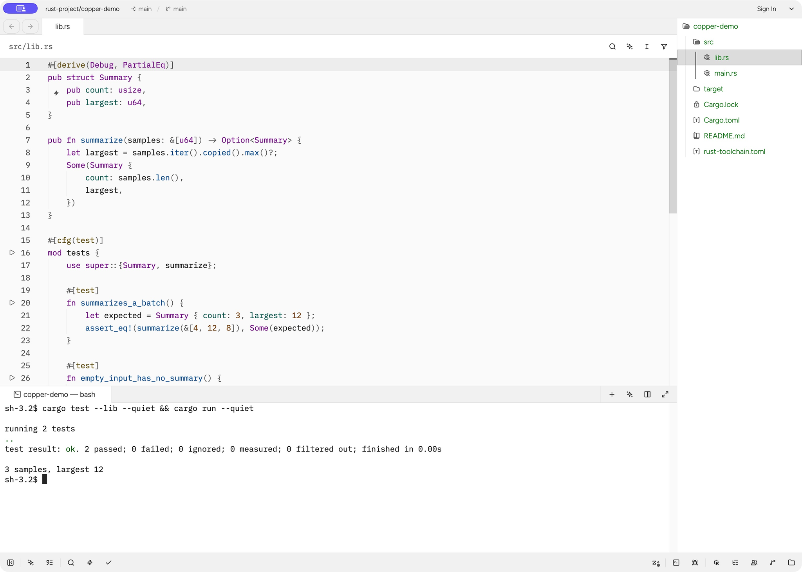

# Made

[](https://github.com/imagine-engineering/made/actions/workflows/run_tests.yml)

Made is a shared editor platform built on [Zed](https://github.com/zed-industries/zed). Copper is the Rust-focused desktop application you can build from this repository.



_Copper development build with a disposable Rust project._

## Work in Copper

You can open a project, edit and search its files, use the integrated terminal, and work with Git. Rust tooling includes `rust-analyzer` integration, a Cargo panel, and test exploration alongside the editor.

The native agent can read and search project files, edit code, and run project commands through its tool permissions. Choose a provider and model before starting a conversation. Copper includes managed llama.cpp local models and cloud-provider configuration. Managed model downloads start only when you choose Download. Memory requirements and tool-use reliability vary by model. The [local-model guide](docs/src/ai/use-a-local-model.md) explains setup and qualification limits.

For now, build Copper from source. Expanded multiplayer workflows and Sim visual workflows are opt-in features still being qualified. Groovy and Forge remain planned products, outside the enabled Copper configuration.

## Get started

Install [rustup](https://rustup.rs/) and the native build dependencies for [macOS](docs/src/development/macos.md#dependencies), [Linux](docs/src/development/linux.md#dependencies), or [Windows](docs/src/development/windows.md#dependencies). Allow space for Cargo's build output; a full build needs substantially more disk than the source checkout.

```sh
git clone https://github.com/imagine-engineering/made.git
cd made
cargo run -p zed --no-default-features --features agentic-tools,rust-tools
```

Rustup selects the repository's pinned toolchain. The internal Cargo package is still named `zed`; this command selects Copper's native-agent and Rust tools. Open a Rust project folder, select its toolchain, and use the terminal or Cargo panel to build and test it.

## Documentation and contributing

Start with the [documentation index](docs/README.md). [Product flavors](docs/src/development/product-flavors.md) covers architecture, optional builds, configuration and packaging. The [contribution guide](CONTRIBUTING.md) and [CI scope](.github/workflows/README.md) describe development checks.

For maintainers, [product releases](docs/src/development/product-releases.md) documents preparation from an existing tag, draft review and explicit publication. Production packages require platform qualification and signing; a successful development build does not establish release readiness.

## Upstream and licensing

Made retains Zed's upstream attribution and license notices. The source is primarily [GPL-3.0-or-later](LICENSE-GPL), with [Apache-2.0](LICENSE-APACHE) components where marked. Check individual components and third-party notices for their licenses.
